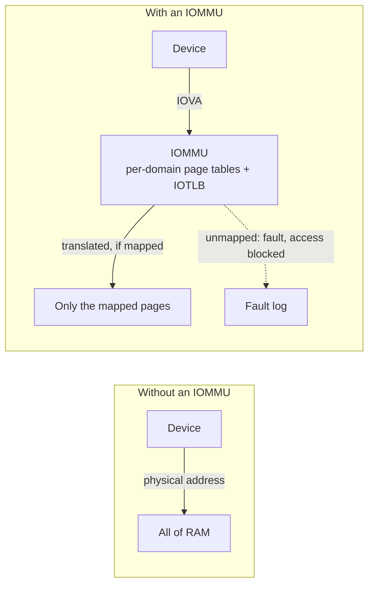
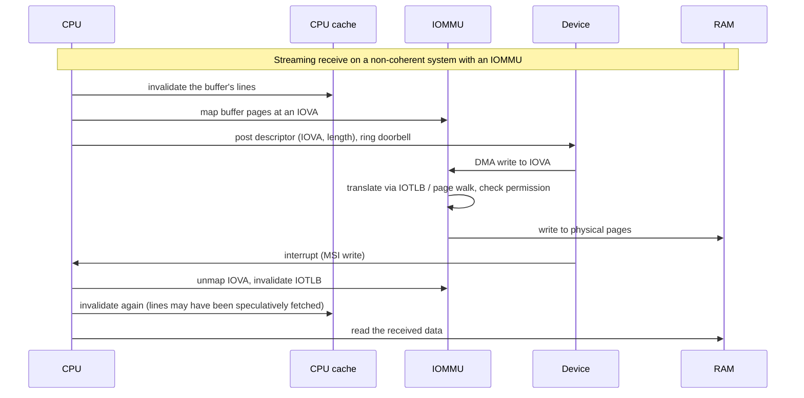

# DMA and the IOMMU

Bus-master DMA, scatter-gather, cache coherency with devices, and the IOMMU as address translation and isolation for devices.

A device that can write to memory on its own is fast and dangerous. Fast, because the CPU no longer
copies every byte. Dangerous, because the device writes wherever it is told to write, and the
address it is given is not a virtual address the CPU would recognise. It may not even be a physical
one. This page covers the hardware side of that trade:

- how bus-master DMA works;
- why CPU caches make it subtle;
- how an **IOMMU** puts a page table in front of every device, so the device sees only the memory it
  was meant to see.

## Programmed I/O versus bus-master DMA

With **programmed I/O** (PIO), the CPU moves every word itself. It reads a device register, stores
to memory, and repeats. That is fine for a keyboard and hopeless for a 100 Gb/s NIC, where the CPU
would do nothing but copy.

With **bus-master DMA**, the device performs memory reads and writes itself, on the interconnect,
with no CPU involvement per byte. The CPU's part shrinks to three jobs: tell the device where the
buffers are, tell it to start, and handle the interrupt when it finishes. (On PCIe, the device may
master the bus only once software sets the bus-master bit in its Command register; see
[PCIe in Depth](./pcie-in-depth.md).)

The usual interface is a **descriptor ring**: an array in main memory, each entry describing one
buffer (address, length, flags). The driver fills descriptors and advances a producer index by
writing a device register (a **doorbell**). The device fetches descriptors by DMA, moves the data,
writes back status, and advances a consumer index. Ring layouts are device-specific. NVMe
submission/completion queues, NIC rx/tx rings and virtio virtqueues are all variations on this idea.

## Scatter-gather

A 64 KiB buffer that is contiguous in a process's virtual address space is usually scattered across
sixteen unrelated 4 KiB physical pages. **Scatter-gather** DMA lets one transfer use a *list* of
(address, length) segments. The device walks the list, so the OS never needs to find, or copy into,
physically contiguous memory. On a fragmented system that contiguity may not exist at all.
Scatter-gather is the norm on any modern high-throughput device.

## Three kinds of address

Three address spaces are involved, and confusing them is the root of most DMA bugs:

| Address | Who uses it | Translated by |
|---|---|---|
| CPU virtual | Software running on the CPU | The CPU's MMU, through page tables |
| CPU physical | The memory controller | — (it is the real location) |
| Bus / device address (IOVA) | The device, in the DMA requests it emits | The IOMMU if present; otherwise often identical to physical |

Without an IOMMU, on most x86 systems the device address simply *is* the physical address. Two
problems follow:

- **Address-width limits.** A device that can only generate 32-bit addresses cannot reach memory
  above 4 GiB. The OS must copy through a **bounce buffer**: a low-memory buffer the device can
  reach, copied to or from the real buffer by the CPU.
- **No containment.** A device given one physical address can issue writes to any physical address.
  A buggy or malicious device, or a device behind a hot-pluggable external port, can overwrite the
  kernel.

## Caches and DMA

The CPU reads and writes through its caches. A device reads and writes RAM over the interconnect.
That gives two ways for the two views to disagree:

- **Device writes, CPU reads stale.** The device DMAs fresh data into RAM, but an old copy of those
  lines is still in the CPU cache. The CPU reads the old copy.
- **CPU writes, device reads stale.** The CPU fills a buffer, but the dirty lines are still in its
  cache and have not reached RAM. The device DMAs out the old contents.

**Cache-coherent DMA** solves this in hardware. Device accesses **snoop** the CPU caches, exactly
as another core's accesses would (see
[Cache Coherence and MESI](../memory-hierarchy/cache-coherence-and-mesi.md)). A device write
invalidates stale cached copies, and a device read is served the dirty line. On x86-64, PCIe DMA is
coherent in this way, which is why the problem is easy to forget.

**Non-coherent DMA** leaves it to software. Before a device reads a buffer, the CPU must **clean**
(write back) the buffer's cache lines. Before the CPU reads a buffer the device wrote, it must
**invalidate** those lines so the next load goes to RAM. Many arm64 SoCs (and other embedded
architectures) have peripherals that are not coherent, so these maintenance operations are real and
are required on every transfer. Forgetting one gives corruption that depends on what happened to be
cached. It reproduces intermittently and only on that hardware.

## The IOMMU: a page table for devices

An **IOMMU** sits between devices and memory and translates every device-originated address through
page tables of its own, chosen per device (or per group of devices, a **domain**). It is to devices
what the MMU is to the CPU, with its own translation cache, the **IOTLB**. Examples are Intel
**VT-d**, AMD's **AMD-Vi**, and the Arm **SMMU**.

An IOMMU does two different jobs, and systems turn it on for either:

- **Translation.** The OS maps a scattered set of physical pages to one contiguous range of
  **IOVAs** (I/O virtual addresses). The device sees one contiguous buffer and needs no
  scatter-gather. IOVAs can also be chosen below 4 GiB for a 32-bit device, so the device reaches
  memory anywhere without a bounce buffer.
- **Isolation.** A device can reach only what is currently mapped in its domain. Anything else
  faults in the IOMMU instead of reaching RAM. That is the defence against DMA attacks from hostile
  or compromised devices (for example through Thunderbolt), and it is what makes **device
  passthrough** to a virtual machine safe. The guest programs the device with guest-physical
  addresses, and the IOMMU's tables, owned by the hypervisor, confine it to that guest's memory.

*A device's path to memory with and without an IOMMU. Without one, a device address reaches any
physical page. With one, it reaches only what software mapped for that device.*

## The cost

Isolation is not free. To protect at the granularity of individual I/O buffers, the OS maps each
buffer before handing it to the device and unmaps it afterwards. That means an IOMMU page-table
update per I/O. Each unmap must also **invalidate the IOTLB**, or the device could keep using a
stale translation after the buffer has been reused. IOTLB invalidation goes through a command queue
to the IOMMU and is slow compared with a CPU TLB flush.

Systems therefore choose a point on a trade-off:

- **Strict invalidation.** Every unmap waits for its IOTLB invalidation. This gives the strongest
  isolation and the highest per-I/O cost.
- **Deferred (batched) invalidation.** Unmaps are queued and flushed together. This is much cheaper,
  but it leaves a short window in which the device can still reach a buffer that has already been
  freed and reused.
- **Passthrough (identity) mode** for trusted devices. The IOMMU is present but maps device
  addresses one-to-one, so there is no per-I/O cost and no isolation.

Mapping granularity is a further limit. IOMMU protection is per page, so a small buffer sharing a
page with unrelated data exposes that data too. Markuze, Morrison and Tsafrir showed that for
high-rate devices, copying into permanently mapped shadow buffers can be both safer and *faster*
than mapping every buffer.

*One DMA receive on a system that has both an IOMMU and non-coherent caches: every step software
must take, and where the device's write is translated and checked.*

The second invalidation in the diagram is real. A CPU may speculatively pull a line into its cache
while the device owns the buffer. Non-coherent architectures therefore invalidate after the
transfer as well as before.

## Comparison

| | No IOMMU | IOMMU, passthrough | IOMMU, translating |
|---|---|---|---|
| Device sees | Physical addresses | Physical addresses (identity map) | IOVAs mapped per domain |
| Isolation between devices and memory | None | None | Per page, per domain |
| Bounce buffers for 32-bit devices | Needed | Needed | Not needed (IOVA chosen low) |
| Per-I/O cost | None | None | Map + unmap + IOTLB invalidation |
| Safe for VM device passthrough | No | No | Yes |

## Where this goes next

- [PCIe in Depth](./pcie-in-depth.md) — bus mastering and the MSI write that ends a transfer.
- [Cache Coherence and MESI](../memory-hierarchy/cache-coherence-and-mesi.md) — the snooping that
  makes coherent DMA work.
- [TLBs and Address Translation Hardware](../memory-hierarchy/tlb-and-address-translation-hardware.md) —
  the CPU-side structures the IOMMU mirrors.
- [`../../linux/14-device-drivers-and-hardware/the-dma-api.md`](../../linux/14-device-drivers-and-hardware/the-dma-api.md) —
  how one kernel hides all of this behind a single API.

## References

- Intel, *Intel Virtualization Technology for Directed I/O — Architecture Specification* — the DMA
  remapping chapters define VT-d's translation structures, fault reporting and IOTLB invalidation.
  It is the most complete public description of a real IOMMU.
- Arm, *System Memory Management Unit Architecture Specification* (SMMUv3) — the Arm equivalent,
  including stream IDs and the command queue used for invalidation.
- Markuze, Morrison & Tsafrir,
  ["True IOMMU Protection from DMA Attacks: When Copy Is Faster Than Zero Copy"](https://dl.acm.org/doi/10.1145/2872362.2872379)
  (ASPLOS 2016) — why per-buffer mapping still leaves sub-page and deferred-invalidation windows,
  with measurements.
- Arpaci-Dusseau & Arpaci-Dusseau,
  [*Operating Systems: Three Easy Pieces*, "I/O Devices"](https://pages.cs.wisc.edu/~remzi/OSTEP/file-devices.pdf)
  — the clearest short introduction to PIO versus DMA.
