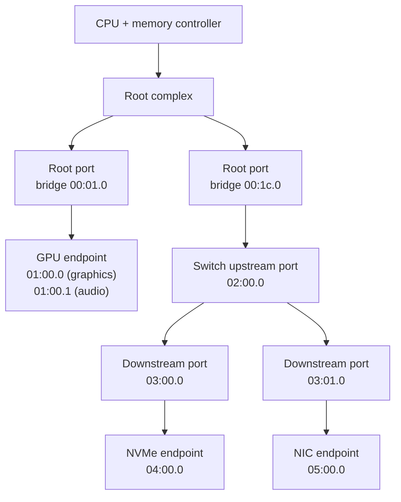

# PCIe in Depth

The PCIe link and topology, configuration space, BARs, enumeration, and MSI/MSI-X as memory writes.

To software, PCIe looks like a bus. In hardware it is a packet-switched network. The software model
is the one PCI introduced in 1992: a tree of **functions**, each carrying a small block of
**configuration space** that says what the function is and which address windows it needs. Under
that model, the parallel shared bus was replaced by serial, point-to-point, packetised links. An
operating system written for PCI enumerates a PCIe machine without knowing anything changed. This
page explains how that compatibility works, and what an OS has to do at boot before any device is
usable.

## From a shared bus to point-to-point links

Conventional PCI was a parallel bus: 32 or 64 data lines shared by every device on a segment, with
arbitration deciding who drove them. Every device waited its turn, and the bus ran at the speed of
its slowest member. PCIe replaces that bus with **links**. A link is a dedicated connection between
exactly two components, built from one or more **lanes**. Each lane is a pair of differential
signal pairs, one per direction. A link's width (x1, x4, x8, x16) is its number of lanes, and
bandwidth scales with width.

Data crosses a link as packets, in three layers:

- **Transaction layer.** Produces **TLPs** (transaction-layer packets): memory read, memory write,
  configuration read/write, completion, and message.
- **Data link layer.** Adds sequence numbers and a CRC, and retransmits on error.
- **Physical layer.** Encodes and serialises the bits.

A memory read is a request TLP out and a completion TLP back. That split-transaction behaviour is
why a PCIe read costs a round trip, while a write is **posted**: it is sent and forgotten.

Each generation roughly doubles the per-lane signalling rate:

| Generation | Per-lane rate | Encoding | ≈ usable per lane, one direction |
|---|---|---|---|
| 1.0 | 2.5 GT/s | 8b/10b | 250 MB/s |
| 2.0 | 5 GT/s | 8b/10b | 500 MB/s |
| 3.0 | 8 GT/s | 128b/130b | ~985 MB/s |
| 4.0 | 16 GT/s | 128b/130b | ~1.97 GB/s |
| 5.0 | 32 GT/s | 128b/130b | ~3.94 GB/s |
| 6.0 | 64 GT/s | PAM4, FLIT mode with FEC | ~7.6–8 GB/s (depends how FLIT overhead is counted) |
| 7.0 | 128 GT/s | PAM4, FLIT mode with FEC | ~15–16 GB/s |

The step from 2.0 to 3.0 is the one exception to doubling the raw rate. Moving from 8b/10b
encoding (20% overhead) to 128b/130b (about 1.5%) let 8 GT/s carry nearly twice the data of 5 GT/s.

## Topology: root complex, switches, endpoints

A PCIe system is a tree:

- The **root complex** connects the CPU and memory to the fabric. Its **root ports** are the
  tree's first branches.
- **Switches** fan one upstream port out into several downstream ports. Each port appears to
  software as a PCI-to-PCI **bridge**.
- **Endpoints** are the devices: NICs, NVMe drives, GPUs.

Software addresses every function by **bus/device/function** (BDF): an 8-bit bus number, a 5-bit
device number and a 3-bit function number, written `bb:dd.f`, such as `00:1f.3`. A multi-function
device (a GPU with an audio function, for example) presents several functions at one device
number. Every bridge creates a new **secondary bus** below it. That is how a physical tree of
point-to-point links becomes the logical tree of numbered buses that PCI software expects.



*A small PCIe tree as software sees it. Every root port and switch port is a bridge with its own
secondary bus, so bus numbers increase as the tree deepens.*

## Configuration space

Each function exposes a block of registers called **configuration space**. Legacy PCI defined 256
bytes per function. PCIe extends that to **4 KiB**. The first 64 bytes are a standard header, and
everything above it is a list of optional **capability** structures.

PCI reached configuration space through two I/O ports (`0xCF8`/`0xCFC` on x86). PCIe adds
**ECAM** (Enhanced Configuration Access Mechanism): the whole configuration space of every function
is mapped into one physical memory region. A function's registers then sit at a fixed offset
computed from its BDF, and an ordinary memory load reads them. The firmware tells the OS where that
region starts. On x86 it uses the ACPI `MCFG` table.

The first 16 bytes are the same for every function:

```wavedrom title="The first 16 bytes of every PCI configuration header (offsets 0x00-0x0F)" alt="Bit-field strip of the first four 32-bit words of PCI configuration space: vendor ID, device ID, command, status, revision ID, class code, cache line size, latency timer, header type, and BIST"
{ reg: [
    { bits: 16, name: "Vendor ID (0x00)", type: 2 },
    { bits: 16, name: "Device ID (0x02)", type: 2 },
    { bits: 16, name: "Command (0x04)", type: 4 },
    { bits: 16, name: "Status (0x06)", type: 4 },
    { bits: 8, name: "Revision (0x08)", type: 3 },
    { bits: 24, name: "Class code (0x09-0x0B)", type: 2 },
    { bits: 8, name: "Cache line (0x0C)", type: 5 },
    { bits: 8, name: "Latency (0x0D)", type: 5 },
    { bits: 8, name: "Header type (0x0E)", type: 3 },
    { bits: 8, name: "BIST (0x0F)", type: 5 }
  ],
  config: { hspace: 1000, bits: 128, lanes: 4 }
}
```

- **Vendor ID and device ID** identify the hardware. A vendor ID of `0xFFFF` means no function is
  present. Enumeration depends on that.
- **Class code** says what kind of device it is (mass storage → NVMe, network → Ethernet), so
  generic drivers can bind without knowing the vendor.
- **Command** turns the function on: memory-space decoding, I/O-space decoding, and **bus
  mastering**. A function with bus mastering off cannot start DMA.
- **Header type** says whether the function is an endpoint (type 0) or a bridge (type 1), and
  whether the device has more functions.

Type 0 headers then carry six **Base Address Registers** (BARs) at offset `0x10`, and a
**capabilities pointer**. The pointer starts a linked list of capability structures: power
management, MSI, MSI-X, the PCIe capability itself, and many more in the extended space above
256 bytes. Software walks the list to discover features. It never assumes a feature lives at a
fixed offset.

## BARs and resource assignment

A BAR is a device's request for an address window: "I have 16 KiB of registers, map them
somewhere." The device fixes the window's size. The address comes from whoever configures the
device. Software learns the size with a trick:

1. Save the BAR's value.
2. Write all ones to it.
3. Read it back. The device hard-wires the low address bits to zero, so the read-back value has
   zeros wherever the address must be aligned. Inverting the address bits and adding one gives the
   size. Read-back `0xFFFFC000` means 16 KiB.
4. Restore the saved value, or write the newly assigned address.

The low bits of a BAR are flags, not address:

- **Memory or I/O.** I/O BARs are a legacy x86 feature. Almost everything modern uses memory BARs.
- **32-bit or 64-bit.** A 64-bit BAR uses two consecutive BAR slots.
- **Prefetchable.** Reads have no side effects, so the window may be mapped with more relaxed
  caching.

Someone then assigns each BAR an address that does not overlap any other, inside the window its
parent bridge forwards. Firmware usually does this before the OS starts. The OS can keep that
layout or redo it, which hotplug and large BARs often require.

## Enumeration

At boot, software discovers the tree depth-first:

1. Starting at bus 0, read the vendor ID of every device number (and function 0 of each). `0xFFFF`
   means nothing is there.
2. For every function found, read its header type. An endpoint is recorded and its BARs are sized.
3. A bridge gets the next free bus number as its **secondary bus**. Software recurses into it,
   then sets the bridge's **subordinate bus** number to the highest bus found below it. From then
   on, the bridge forwards configuration requests for that range of buses downstream.
4. On the way back up, each bridge is programmed with memory and I/O windows that cover the BARs
   of everything below it.

**Hotplug** is the same walk, run later, for one slot. Address space reserved for that slot at
boot is what makes a later hot-add possible without moving everything else.

## MSI and MSI-X: interrupts as memory writes

PCI's interrupt pins (INTA#–INTD#) survive in PCIe only as emulated messages. The native mechanism
is **message-signaled interrupts**. Software programs a function with an address and a data value.
To raise an interrupt, the function performs an ordinary posted **memory write** of that value to
that address. The interrupt controller decodes the write and delivers a vector to a CPU.

- **MSI** is one capability structure with up to 32 vectors. The vectors are contiguous and share
  one address, so they cannot be targeted at different CPUs independently.
- **MSI-X** puts a table of up to 2048 entries in one of the function's BARs. Each entry has its
  own address, data value and mask bit. That per-entry control is why multi-queue devices get one
  vector per queue, each aimed at a different CPU.

Because an MSI is a memory write, it follows PCIe's write-ordering rules. It cannot overtake the
device's own earlier DMA writes, so by the time the CPU takes the interrupt, the data is in memory.
[Interrupt Controllers](./interrupt-controllers.md) owns the controller side: how the write becomes
a vector, and how APIC and GIC route it.

## Comparison

| | Conventional PCI | PCI-X | PCIe |
|---|---|---|---|
| Signalling | Parallel, shared, 33/66 MHz | Parallel, shared, up to 133 MHz (and DDR/QDR in 2.0) | Serial lanes, point-to-point |
| Topology | Shared bus segments joined by bridges | Same as PCI | Tree of links: root complex, switches, endpoints |
| Bandwidth scaling | Shared by every device on the segment | Shared, and slowest device sets the clock | Per link, scales with lane count |
| Interrupts | INTx pins, shared | INTx, optional MSI | MSI/MSI-X native; INTx emulated as messages |
| Config access | 256 B via I/O ports `0xCF8`/`0xCFC` | Same as PCI | 4 KiB via ECAM memory window (legacy ports still work for the first 256 B) |

## Where this goes next

- [Interrupt Controllers](./interrupt-controllers.md) — what happens to an MSI write once it reaches
  the controller.
- [System Interconnects](./system-interconnects.md) — where PCIe sits among the machine's other
  buses.
- [`../../linux/14-device-drivers-and-hardware/pci-and-pcie-drivers.md`](../../linux/14-device-drivers-and-hardware/pci-and-pcie-drivers.md) —
  the driver side: claiming a function, mapping its BARs, and allocating vectors.

## References

- PCI-SIG, *PCI Express Base Specification* — the authority on TLPs, configuration space and
  MSI/MSI-X. Member-only (paywalled), so the generation table above uses the per-lane rates PCI-SIG
  publishes in its public announcements, which every secondary source repeats.
- Budruk, Anderson & Shanley, *PCI Express System Architecture* (MindShare / Addison-Wesley, 2003)
  — the standard long-form explanation of the layering, enumeration and configuration. It predates
  Gen 3, so its encoding and speed chapters are dated, but the software model is unchanged.
- Linux `include/uapi/linux/pci_regs.h` — the configuration-header offsets and Command-register
  bits as one real OS defines them. It is the most compact correct table of the header available
  (the offsets on this page were checked against it).
- [Linux kernel documentation — How to write Linux PCI drivers](https://docs.kernel.org/PCI/pci.html)
  — the enumeration model seen from the consumer side. Read it after this page as a "see it used"
  pointer.
