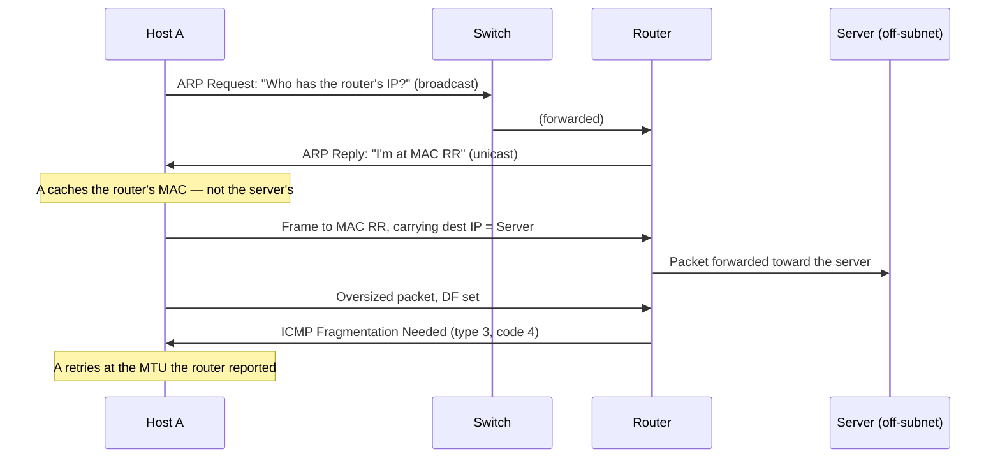

# ARP, ICMP, and Neighbour Discovery

IP routes by IP address, but an Ethernet frame is delivered by MAC address, so every hop needs a
translation from "the next router's IP" to "the next router's hardware address." And when delivery
fails somewhere along the way, IP needs a way to say so. ARP (and IPv6's Neighbour Discovery) does the
first job; ICMP does the second. Both are small, easy protocols to dismiss as plumbing, and filtering
either one breaks networks in ways that are hard to diagnose.

[Data Link Layer](./data-link-layer.md) already introduced ARP — what it resolves, the basic broadcast
request / unicast reply exchange, and the `ip neigh` cache command. This page does not re-derive that;
it covers ARP's lifecycle after that first resolution, its failure modes, and its IPv6 replacement.

## Core Concepts

| Term | Meaning |
|---|---|
| **Next hop** | The next device a packet is handed to on its way to its destination — a router, or the destination itself if it's on the local subnet. |
| **Neighbour** | A device reachable at the link layer with no router in between — the general, protocol-agnostic term ARP and NDP both resolve addresses for. |
| **ARP cache** | The table of recently resolved IP→MAC mappings a host keeps to avoid re-resolving every packet. |
| **Gratuitous ARP** | An unsolicited ARP announcement — a host telling the LAN "I own this IP" without being asked. |
| **Proxy ARP** | A router answering ARP requests on behalf of another host, making itself look like the destination to hosts that can't route. |
| **ICMP type/code** | The two-field classification of an ICMP message — type names the category (e.g., Destination Unreachable), code narrows the reason within it. |
| **TTL** | The IPv4 hop-count field that both prevents routing loops and is what `traceroute`-style tools exploit. |
| **PMTU** | Path MTU — the smallest MTU along an entire path, discovered rather than assumed. |
| **NDP** | Neighbour Discovery Protocol — IPv6's replacement for ARP, built on ICMPv6. |
| **Solicited-node multicast** | An IPv6 multicast address derived from a target address's low 24 bits, used so a neighbour solicitation reaches only hosts that might own that address, not the whole link. |
| **DAD** | Duplicate Address Detection — checking that no other node on the link already has the address before using it. |
| **SLAAC** | Stateless Address Autoconfiguration — a host deriving its own IPv6 address from a router advertisement, without DHCP. |

## Mechanism

### ARP's lifecycle

A resolved entry doesn't live forever. Once cached, an ARP entry ages and is periodically
re-validated — Linux shows this as the `REACHABLE` → `STALE` → (re-probe) cycle already introduced in
[Data Link Layer](./data-link-layer.md). Two other mechanisms shape when entries appear or change
outside of that normal aging:

- **Gratuitous ARP** — a host broadcasts an ARP announcement for its own address without being asked,
  typically an ARP request with the sender and target IP set to the same address. Other hosts on the
  segment update their cache immediately rather than waiting for a stale entry to expire. This is how
  a failover (a standby server taking over a virtual IP, e.g. under VRRP/keepalived) gets the rest of
  the LAN to redirect traffic to its new MAC within one announcement, and it doubles as duplicate
  address detection: if another host already owns that IP, it will notice the announcement and can
  flag the conflict (formalized in [RFC 5227](https://www.rfc-editor.org/rfc/rfc5227.html)).
- **Proxy ARP** — a router configured to answer ARP requests on behalf of hosts it can reach, making
  those hosts appear to be on the local segment even though they're actually elsewhere. It was a common
  workaround before subnetting and dynamic routing were universal, and still shows up in some
  virtualization and bridging setups today.

### ARP has no authentication

Nothing in the protocol verifies that a reply actually comes from the host that owns the IP address it
claims. Any device on the LAN can answer an ARP request — or send an unsolicited gratuitous ARP — for
any address it chooses, and every other host on the segment will believe it. This is what makes **ARP
spoofing** possible: a malicious host can claim to be the default gateway (or any other host) and have
traffic routed through it instead, enabling interception on the local segment. The defenses are
correspondingly local: **Dynamic ARP Inspection** on managed switches (validating ARP against a known
IP-to-MAC-to-port binding), static ARP entries for a small number of critical addresses like a default
gateway, and — the mitigation that actually matters beyond the local segment — encrypting traffic above
IP so an intercepted link doesn't hand over readable data even if the interception succeeds. None of
this is a procedure for carrying out ARP spoofing; it's the shape of the exposure and why it's taken
seriously on shared, untrusted LANs.

### ICMP: IP's error channel

ICMP carries the messages IP itself has no field for — "this couldn't be delivered," "this is taking
too long," "you should use a different next hop." The types that come up in everyday network work:

| Type | Code(s) | Meaning |
|---|---|---|
| 8 / 0 | — | Echo Request / Echo Reply — what `ping` sends and receives. |
| 3 | 0 | Destination Unreachable — Network Unreachable: no route to the destination network. |
| 3 | 1 | Destination Unreachable — Host Unreachable: the destination host itself couldn't be reached. |
| 3 | 3 | Destination Unreachable — Port Unreachable: nothing is listening on the destination UDP port. |
| 3 | 4 | Destination Unreachable — Fragmentation Needed and DF Set: the packet was too large for a link and "don't fragment" was set — the trigger for Path MTU Discovery. |
| 11 | 0 | Time Exceeded (TTL expired in transit) — what `traceroute`-style tools exploit hop by hop. |
| 5 | — | Redirect — a router telling a host a better next hop exists for a destination. |
| 2 (ICMPv6) | — | Packet Too Big — ICMPv6's equivalent of type 3/code 4, carrying the MTU that fits. |

(See [RFC 792](https://www.rfc-editor.org/rfc/rfc792.html) for the IPv4 set and
[RFC 4443](https://www.rfc-editor.org/rfc/rfc4443.html) for ICMPv6's.)

### traceroute

`traceroute` and its relatives discover a path by sending packets with a deliberately small,
increasing TTL — 1, then 2, then 3 — and recording which router's address shows up in the resulting
Time Exceeded reply at each step. The classic implementation sends UDP packets to an unlikely-to-be-open
high port, expecting a Port Unreachable once the packet finally survives to the destination; some
implementations send ICMP Echo instead; some send TCP SYNs to a specific port to get past firewalls
that only permit that kind of traffic. Because firewalls along the path often treat UDP, ICMP, and TCP
differently, **UDP-, ICMP-, and TCP-based traceroute can report different paths** for the same
destination — a difference in tool, not in the actual route. A `*` at a hop means no reply arrived
within the timeout, which is commonly a router declining or rate-limiting the ICMP response, not
evidence that the packet was lost — traffic bound further along the path routinely sails right past a
hop that never answers a probe addressed to itself.

### Path MTU discovery and the black hole

A sender using Path MTU Discovery ([RFC 1191](https://www.rfc-editor.org/rfc/rfc1191.html)) sets IP's
"don't fragment" bit and starts at the largest size it's willing to try. If a packet meets a link with a
smaller MTU somewhere along the path, the router at that link would need to fragment it, can't (DF is
set), and instead drops it and sends back Destination Unreachable / Fragmentation Needed — carrying the
MTU that would have fit — so the sender can retry smaller.

That mechanism depends entirely on the ICMP message actually arriving back at the sender. A firewall
that drops all ICMP — a common, blunt "for security" policy — breaks it silently: small packets, like
the initial TCP handshake, are well under any real-world MTU and sail through, so the connection opens
successfully. Only once the application tries to send something larger than the path's true MTU does
the packet vanish with no error, no retry hint, and no explanation — the connection simply hangs. This
"PMTU black hole" is the canonical, first-hand consequence of "block all ICMP," and it is why
[RFC 4890](https://www.rfc-editor.org/rfc/rfc4890.html) is explicit that ICMPv6 in particular must not
be blanket-filtered.

### IPv6 Neighbour Discovery

IPv6 has no ARP. Its replacement, Neighbour Discovery
([RFC 4861](https://www.rfc-editor.org/rfc/rfc4861.html)), is built entirely on ICMPv6 messages rather
than a separate protocol:

- **Neighbour Solicitation / Neighbour Advertisement** do ARP's job — resolving an IPv6 address to a
  link-layer address — but a solicitation goes to a **solicited-node multicast** group derived from the
  target address rather than an Ethernet broadcast, so only hosts that could plausibly own that address
  are interrupted, not the whole link.
- **Router Solicitation / Router Advertisement** let a host discover routers and on-link prefixes
  without any manual configuration or DHCP.
- **Duplicate Address Detection** performs the gratuitous-ARP-like conflict check before a host starts
  using an address, as a mandatory step rather than an optional courtesy.
- **SLAAC** lets a host combine a router-advertised prefix with its own interface identifier to
  self-assign a usable global address, with no DHCP server required.

Because so much of IPv6's basic operation — address resolution, router discovery, address
configuration — rides on ICMPv6, **ICMPv6 is not optional in the way IPv4's ICMP sometimes gets treated
as**: filtering it as a blanket security measure breaks fundamental connectivity, not just diagnostics.



*Resolving the next hop, not the destination — and the ICMP message that keeps a large packet from
vanishing.*

## Practical Usage

Reading the neighbour cache from a real Linux host:

```bash
$ ip neigh
```

```text
169.254.73.152 dev loopback0 lladdr 00:11:22:33:44:55 PERMANENT
192.168.100.1 dev eth2 lladdr 08:2f:e9:e4:b2:28 REACHABLE
```

`PERMANENT` entries were configured by hand or by the platform and are never aged out; `REACHABLE`
means the kernel recently confirmed the mapping.

`ping`'s reported round-trip time includes more than wire latency — it includes however long the
remote host's kernel took to notice the Echo Request and generate a reply, and routers along the way
often deliberately deprioritize ICMP they have to generate themselves (as opposed to just forwarding),
so a `ping` RTT to an intermediate hop can run higher than the actual forwarding latency it contributes:

```bash
$ ping -c 3 1.1.1.1
```

```text
PING 1.1.1.1 (1.1.1.1) 56(84) bytes of data.
64 bytes from 1.1.1.1: icmp_seq=1 ttl=59 time=4.32 ms
64 bytes from 1.1.1.1: icmp_seq=2 ttl=59 time=4.39 ms
64 bytes from 1.1.1.1: icmp_seq=3 ttl=59 time=7.03 ms

--- 1.1.1.1 ping statistics ---
3 packets transmitted, 3 received, 0% packet loss, time 2003ms
rtt min/avg/max/mdev = 4.321/5.245/7.026/1.259 ms
```

Dedicated tools like `traceroute`, `mtr`, and `tracepath` automate the TTL-stepping technique from
Mechanism above, but the same technique works by hand with nothing but `ping -t` to set a specific TTL,
which makes the Time Exceeded exchange directly visible one hop at a time:

```bash
$ ping -c 1 -t 1 1.1.1.1
$ ping -c 1 -t 2 1.1.1.1
$ ping -c 1 -t 3 1.1.1.1
```

```text
PING 1.1.1.1 (1.1.1.1) 56(84) bytes of data.
From 192.168.100.1 icmp_seq=1 Time to live exceeded

PING 1.1.1.1 (1.1.1.1) 56(84) bytes of data.
From 83.238.252.81 icmp_seq=1 Time to live exceeded

PING 1.1.1.1 (1.1.1.1) 56(84) bytes of data.
From 83.238.113.56 icmp_seq=1 Time to live exceeded
```

Each line is a different router along the path replying once its TTL budget for that probe reaches
zero — hop 1 is the local gateway, hops 2 and 3 are progressively farther upstream. `tracepath` (or
`mtr`) does exactly this automatically, incrementing the TTL and printing one line per hop, and also
reports the point where Path MTU Discovery had to reduce the packet size.

## Edge Cases & Pitfalls

- **"`ping` works, so the network is fine."** ICMP Echo can succeed while TCP traffic on the same path
  fails — PMTU black holes, port-specific firewall rules, and MTU mismatches all affect TCP without
  affecting a small ICMP Echo packet at all.
- **"High latency on an intermediate `traceroute` hop"** is usually that router treating its own
  ICMP generation as low priority, not a genuinely slow link — the hops before and after it can show
  perfectly normal latency for traffic that only transits them.
- **ARP flux on multi-homed hosts** — a host with more than one interface on overlapping or bridged
  segments can answer ARP requests inconsistently depending on which interface responds first, leading
  to intermittent, hard-to-reproduce connectivity issues.
- **Stale neighbour entries after a MAC change** — replacing a NIC, restoring a VM snapshot, or
  failover to a passive node without gratuitous ARP can leave every other host on the segment holding a
  cached mapping to a MAC address that no longer answers, until the entry ages out on its own.

## Comparisons

| Aspect | ARP (IPv4) | NDP (IPv6) |
|---|---|---|
| Transport | Its own EtherType over Ethernet broadcast | ICMPv6 messages over solicited-node multicast |
| Security | None built in | None built in for the base protocol; SEND and RA-Guard add authentication/filtering at the switch |
| Address autoconfiguration | Not part of ARP — handled separately (DHCP) | Built in via SLAAC and Router Advertisements |

## References

- IETF, [RFC 826](https://www.rfc-editor.org/rfc/rfc826.html) — *An Ethernet Address Resolution
  Protocol* (ARP).
- IETF, [RFC 792](https://www.rfc-editor.org/rfc/rfc792.html) — *Internet Control Message Protocol*.
- IETF, [RFC 4861](https://www.rfc-editor.org/rfc/rfc4861.html) — *Neighbor Discovery for IP version 6
  (IPv6)*.
- IETF, [RFC 1191](https://www.rfc-editor.org/rfc/rfc1191.html) — *Path MTU Discovery*.
- IETF, [RFC 4890](https://www.rfc-editor.org/rfc/rfc4890.html) — *Recommendations for Filtering
  ICMPv6 Messages in Firewalls* — the operational case for not blocking ICMPv6.
- IETF, [RFC 5227](https://www.rfc-editor.org/rfc/rfc5227.html) — *IPv4 Address Conflict Detection* —
  gratuitous ARP done correctly.

### Books & Videos

- W. Richard Stevens, *TCP/IP Illustrated, Volume 1* (2nd ed., Fall & Stevens) — ARP and ICMP chapters
  with packet-level traces.

## Related Pages

- [Data Link Layer](./data-link-layer.md)
- [Network Layer & Routing](./network-layer-and-routing.md)
- [NAT and Connection Tracking](./nat-and-connection-tracking.md)
- [Routing and Neighbours](../../linux/13-networking-stack/routing-and-neighbours.md) — the kernel's
  routing table and neighbour cache, and its states.
