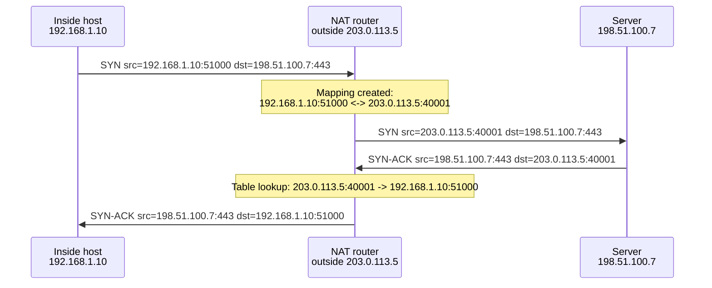

# NAT and Connection Tracking

Network address translation rewrites addresses in packets as they pass through. The moment a device
rewrites an outgoing packet's source address, it must recognise the eventual reply and rewrite it back
— which means it has to remember every flow it has touched. NAT is therefore stateful by nature, and
that state explains both its usefulness and nearly every way it breaks.

[Network Layer & Routing](./network-layer-and-routing.md) already introduces NAT's basics — that
private addresses ([RFC 1918](https://www.rfc-editor.org/rfc/rfc1918.html)) can't be routed on the
public Internet and so are rewritten to a shared public address on the way out. This page treats that
as the starting point and goes into the forms NAT takes, why the state it keeps is unavoidable, and
where it breaks.

## Core Concepts

| Term | Meaning |
|---|---|
| **SNAT** | Source NAT — rewriting a packet's source address (and usually port), the direction a host behind NAT going out to the Internet uses. |
| **DNAT** | Destination NAT — rewriting a packet's destination address, used for port forwarding and load balancing. |
| **NAPT / PAT** | NAT that translates ports as well as addresses, so many internal hosts can share one external address. |
| **Masquerading** | SNAT whose outside address isn't fixed but follows whatever address the outbound interface currently has. |
| **5-tuple** | (protocol, source address, source port, destination address, destination port) — the key that identifies one flow. |
| **Mapping** | The record of how one flow's inside tuple corresponds to its outside tuple, created on the first packet and used to rewrite every packet after. |
| **Binding timeout** | How long a mapping is kept after the flow goes idle, before it's reclaimed. |
| **Hairpinning** | An inside host reaching another inside host by way of the outside (public) address, requiring the NAT device to redirect the packet back inward. |
| **ALG** | Application-Level Gateway — logic that rewrites payload data (not just headers) for protocols that embed addresses inside their own messages. |
| **CGNAT** | Carrier-Grade NAT — an ISP performing NAT on addresses that are themselves private to the ISP, sharing one public address across many customers. |
| **Connection tracking** | The general mechanism of recording flow state to match replies to requests — what NAT is built on, and what a stateful firewall uses even without translating anything. |
| **Stateful firewall** | A firewall that permits or denies traffic based on whether it belongs to a tracked, already-permitted flow, not just static header rules. |

## Mechanism

### The translation table

Every NAT device keeps a table mapping an inside `(address, port)` to an outside `(address, port)`,
one entry per flow. The first outbound packet of a new flow creates the entry; every packet after,
in either direction, is rewritten by looking that entry up.

*One outbound connection through NAPT: the tuple rewritten on the way out, the mapping it creates, and
the reverse rewrite on the way back.*

(Addresses above are documentation ranges: `192.168.1.0/24` is
[RFC 1918](https://www.rfc-editor.org/rfc/rfc1918.html) private space; `203.0.113.0/24` and
`198.51.100.0/24` are [RFC 5737](https://www.rfc-editor.org/rfc/rfc5737.html) documentation ranges,
never assigned to a real host.)

### The forms

| Form | What it does | Typical use |
|---|---|---|
| **Static 1:1 NAT** | One inside address always maps to one fixed outside address | Publishing a single internal server at a fixed public IP |
| **NAPT (source NAT + port translation)** | Many inside addresses share one outside address, distinguished by port | What a home router does for an entire household |
| **Destination NAT / port forwarding** | An inbound connection to the router's address and port is redirected to a specific inside host and port | Exposing a game server or self-hosted service behind a home router |
| **Masquerade** | SNAT whose outside address is whatever the outbound interface currently has, not a fixed address | A router with a dynamic (DHCP-assigned) public IP |
| **Hairpin NAT** | An inside host reaching another inside host via the *outside* address gets redirected back in | A LAN device using a service's public hostname, which resolves to the router's own public IP |
| **Carrier-grade NAT** | An ISP performs NAT on addresses that are private *to the ISP*, using [RFC 6598](https://www.rfc-editor.org/rfc/rfc6598.html)'s reserved `100.64.0.0/10` shared address space between customer and ISP-level NAT | ISPs conserving IPv4 addresses across many subscribers |

### Why the state is unavoidable

A reply packet arrives addressed to the NAT device's outside address and some port; the only way to
know which inside host it belongs to is the mapping table. That means every mapping must eventually
expire — otherwise the table grows without bound — but the flow that owns a mapping may still be alive
when the timer runs. For TCP, the NAT device can infer some of the connection's state from its flags
(a SYN starts a flow, a FIN or RST signals it's ending) and time out an idle mapping more aggressively
once it sees a clean close. UDP carries no such signal: a UDP "connection" exists only as a mapping with
a timeout, since nothing in the protocol ever says "this flow is done." A mapping that expires while a
long-idle connection is still logically open — an SSH session left alone for an hour, for instance — is
exactly the "connection died for no reason" class of problem, and it's why long-idle protocols send
periodic keepalives: not because the remote peer needs them, but because the NAT state in between does.

### Mapping and filtering behaviour

[RFC 4787](https://www.rfc-editor.org/rfc/rfc4787.html) gives this behaviour precise vocabulary,
splitting it into two independent questions:

- **Mapping behaviour** — for a given inside `(address, port)`, does the NAT reuse the *same* outside
  mapping regardless of which outside destination it's talking to (**endpoint-independent**), only when
  the outside IP matches (**address-dependent**), or only when both the outside IP and port match
  (**address-and-port-dependent**)?
- **Filtering behaviour** — for a given mapping, does the NAT accept inbound packets from *any* outside
  source (**endpoint-independent filtering**), only from an outside IP the inside host has already sent
  to (**address-dependent**), or only from the exact outside IP and port already contacted
  (**address-and-port-dependent**)?

**Endpoint-independent mapping** is what makes peer-to-peer traffic *possible*: if a host's mapping is
stable no matter who it's talking to, that mapping can be discovered once (see Traversal, below) and
handed to a third party to connect to. A NAT that uses address-and-port-dependent mapping for both
mapping and filtering — commonly called **symmetric NAT** — creates a *different* mapping for every
distinct destination, so a mapping learned by talking to a rendezvous server is useless for a peer
trying to connect directly; this is precisely what prevents peer-to-peer traffic from working through
it. [RFC 5382](https://www.rfc-editor.org/rfc/rfc5382.html) states the equivalent requirements for TCP
specifically.

### Protocols that carry addresses inside

Most protocols work fine translated, because they never mention an IP address inside their own
payload — the header is the only place an address appears, and that's exactly what NAT rewrites. A few
protocols break that assumption: **FTP** in active mode sends the client's IP and a port number inside
the control-connection payload for the server to connect back to; **SIP** embeds addresses in its
signaling messages for media to be sent to; and any protocol that does likewise ends up telling the
far end an address that's only valid *inside* the NAT, not the translated one it was actually reached
through. An **Application-Level Gateway** compensates by parsing and rewriting that embedded address
to match the translation — but that requires understanding the protocol's payload format, breaks the
moment the protocol is encrypted (an ALG can't rewrite what it can't parse), and has to be kept in sync
with every protocol version. ALGs are consequently fragile, and their failure mode is usually silent:
the connection opens, then stalls exactly where the embedded address gets used.

### Traversal

Because NAT hides an inside host behind a mapping it didn't choose and doesn't know in advance, a
real-time application that needs a peer to connect back to it has to discover that mapping first:

- **STUN** (Session Traversal Utilities for NAT) — a host asks a public STUN server what address and
  port its packets appear to come from, revealing its own outside mapping.
- **TURN** (Traversal Using Relays around NAT) — when direct traversal isn't possible at all (as under
  symmetric NAT), both peers instead relay all traffic through a public relay server, trading
  efficiency for guaranteed connectivity.
- **ICE** (Interactive Connectivity Establishment,
  [RFC 8445](https://www.rfc-editor.org/rfc/rfc8445.html)) — the coordinating protocol that gathers
  every candidate address a host has (its local address, its STUN-discovered mapping, and a TURN relay
  as fallback), tries all the combinations against the peer's own candidates, and uses whichever pairing
  actually works.

### A stateful firewall is the same table

A stateful firewall that performs no translation at all still needs exactly this structure: a table of
flows the firewall has decided to permit, consulted for every packet so that "allow replies to
connections initiated from inside" is answered by a lookup rather than a static rule matching every
possible reply address and port in advance. NAT and stateful firewalling are, underneath, the same
bookkeeping problem — one happens to also rewrite the packet.

## Practical Usage

A home router's port-forwarding rule ("forward port 8080 to 192.168.1.50:80") is DNAT: it rewrites the
*destination* of an inbound packet before delivering it to the inside host, the mirror image of the
SNAT/NAPT that translates that same host's outbound traffic.

A WAN address inside `100.64.0.0/10` — [RFC 6598](https://www.rfc-editor.org/rfc/rfc6598.html)'s shared
address space — is the signature of being behind carrier-grade NAT: the "public" address a device sees
is itself private to the ISP, with a second layer of NAT between it and the real Internet. Hosting a
service reachable from the public Internet from behind CGNAT generally isn't possible without a relay
(a reverse tunnel or a TURN-style relay service) or IPv6, since there's no port-forwarding control over
a NAT layer the subscriber doesn't operate.

## Edge Cases & Pitfalls

:::warning[NAT is not a firewall]
NAT blocks unsolicited inbound traffic only as a side effect of there being no mapping for it yet — it
was never designed as an access-control mechanism. A port-forwarding rule, or a UPnP request an
application made on its own without asking a human, punches a hole through that side effect silently
and deliberately.
:::

- **Table exhaustion** — a NAT device has a bounded number of possible mappings (limited by available
  outside ports per address); many short-lived flows, or a client opening large numbers of connections,
  can exhaust it and cause new connections to fail outright.
- **Timeouts killing idle long-lived connections** — see "Why the state is unavoidable" above; the fix
  is a keepalive at whatever interval is shorter than the shortest NAT device's timeout on the path,
  which usually has to be guessed.
- **Logging and attribution under CGNAT** — because many subscribers share one public address, logging
  only the address is not enough to identify who made a given connection; the port has to be logged too,
  and the ISP's own CGNAT mapping records are needed to translate a port back to a subscriber.
- **IPv6 was designed to make NAT unnecessary** — with enough address space that every host can have a
  real, globally routable address, the original motivation for NAT (address scarcity) disappears — and
  yet NAT66 and NPTv6 (IPv6-to-IPv6 prefix translation) exist anyway, usually for renumbering
  independence or habit rather than necessity.

## Comparisons

| Approach | What it translates | State kept |
|---|---|---|
| NAT44 (traditional NAPT) | IPv4 address and port, both directions | Full per-flow mapping table |
| NAT64 ([RFC 6146](https://www.rfc-editor.org/rfc/rfc6146.html)) + DNS64 ([RFC 6147](https://www.rfc-editor.org/rfc/rfc6147.html)) | IPv6 client address/port to a synthesized IPv4 destination, with DNS64 synthesizing the AAAA record that points at it | Full per-flow mapping table, plus algorithmic address synthesis |
| NPTv6 | IPv6 prefix only (1:1, algorithmic, no ports) | None — stateless, since it's a pure prefix substitution |
| Plain IPv6 + stateful firewall | Nothing — addresses pass through unchanged | Per-flow permit table, same shape as NAT's, without translation |

## References

- IETF, [RFC 3022](https://www.rfc-editor.org/rfc/rfc3022.html) — *Traditional IP Network Address
  Translator (Traditional NAT)* — the original definition of Basic NAT and NAPT.
- IETF, [RFC 4787](https://www.rfc-editor.org/rfc/rfc4787.html) — *Network Address Translation (NAT)
  Behavioral Requirements for Unicast UDP* — the mapping/filtering vocabulary this page uses.
- IETF, [RFC 5382](https://www.rfc-editor.org/rfc/rfc5382.html) — *NAT Behavioral Requirements for
  TCP* — timeout and state handling for TCP specifically.
- IETF, [RFC 8445](https://www.rfc-editor.org/rfc/rfc8445.html) — *Interactive Connectivity
  Establishment (ICE)* — how real-time applications traverse NAT, with STUN and TURN as components.
- IETF, [RFC 6888](https://www.rfc-editor.org/rfc/rfc6888.html) — *Common Requirements for
  Carrier-Grade NATs (CGNs)* — what CGN devices must do, and the operational problems they create.

### Books & Videos

- Fall & Stevens, *TCP/IP Illustrated, Volume 1* (2nd ed.) — the NAT and firewall chapter.

## Related Pages

- [Network Layer & Routing](./network-layer-and-routing.md)
- [Transport Layer: TCP & UDP](./transport-layer-tcp-udp.md)
- [ARP, ICMP, and Neighbour Discovery](./arp-icmp-and-neighbour-discovery.md)
- [Connection Tracking and NAT](../../linux/13-networking-stack/connection-tracking-and-nat.md) — how
  Linux's conntrack implements this table.
