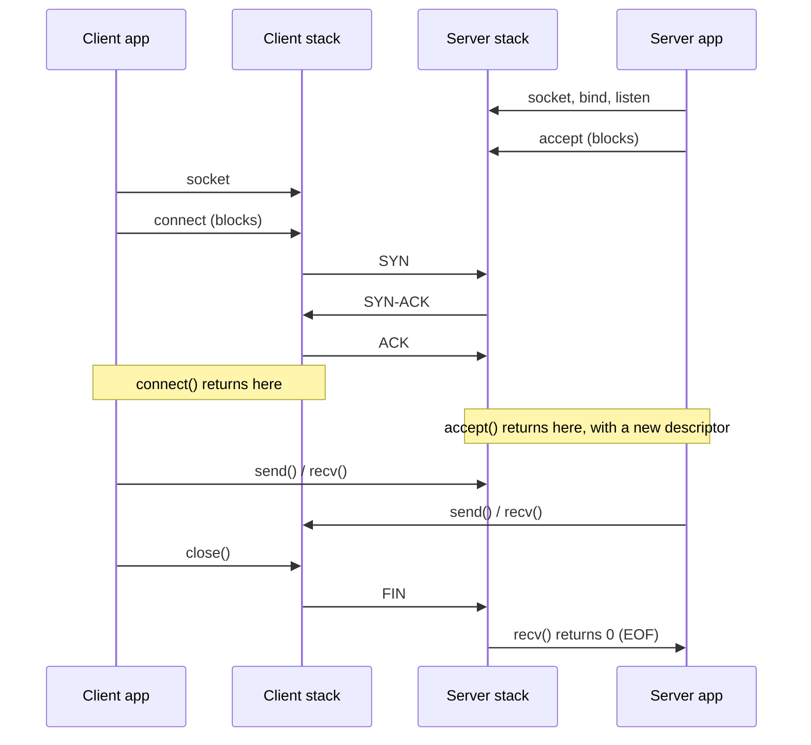

# Sockets and the Application Boundary

Every networked program, in every language, eventually makes the same handful of calls. The socket
API is the boundary between an application and a network stack it does not own — a program never
touches a frame or a segment directly; it asks the operating system to create, connect, send on, and
close an endpoint, and the kernel does the rest. The pages before this one in this section describe
what travels on the wire. This page describes what a program can *ask for* — and, just as important,
what it is never told.

## Core Concepts

| Term | Meaning |
|---|---|
| **Socket** | An endpoint for communication, represented in a program as a file descriptor. |
| **Address family** | The address namespace a socket operates in — `AF_INET` (IPv4), `AF_INET6` (IPv6), `AF_UNIX` (local), and others. |
| **Socket type** | The communication semantics a socket provides — a reliable byte stream (`SOCK_STREAM`), a datagram (`SOCK_DGRAM`), or something more specialized. |
| **Descriptor** | The small integer handle a process uses to refer to an open socket, exactly as it would an open file. |
| **Listening socket** | A socket bound to an address and marked to accept incoming connections, but not itself connected to a peer. |
| **Connected socket** | A socket with a specific remote peer, created either by `connect` (client) or returned by `accept` (server). |
| **Blocking / non-blocking** | Whether a call that cannot complete immediately (e.g., no data to read) suspends the calling thread or returns an error instead. |
| **Readiness** | The state of "this call would not block right now" — what `select`/`poll`/`epoll` report, distinct from the operation having actually happened. |
| **Backlog** | The bound on how many completed-but-unaccepted connections a listening socket will queue. |
| **Half-close** | Shutting down one direction of a full-duplex connection (usually the write side) while still able to read the other. |

## Mechanism

### A socket is a file descriptor

This is the single design decision that shapes everything else on this page. BSD 4.2 (1983) chose to
represent a socket as a file descriptor rather than inventing a separate handle type, and every
subsequent socket API — including Linux's and Windows' — inherited the consequences:

- `read`, `write`, `close`, and `dup` all work on a socket exactly as they do on an open file, though
  `send`/`recv` are preferred because they accept socket-specific flags.
- A socket is inherited across `fork`, which is why a pre-fork server model (one listening socket,
  many worker processes each blocked in `accept`) works with no extra plumbing.
- Any readiness API that watches "file descriptors that are ready" — `select`, `poll`, `epoll`,
  `kqueue` — watches sockets and ordinary files through the same interface.

The cost of that uniformity is that a socket descriptor carries none of its own semantics in the type
system: nothing about the integer `4` tells you whether it's a listening socket, a connected stream, or
a UDP endpoint. That's tracked by the kernel, not exposed to the caller except through calls like
`getsockopt(SO_TYPE)`.

### The call lifecycle

A server and a client walk a different, asymmetric sequence of calls to reach the same connected
state:

- **Server:** `socket` (create) → `bind` (claim a local address) → `listen` (start queuing incoming
  connections) → `accept` (block until one completes, returning a **new** descriptor for it — the
  listening socket itself never carries data).
- **Client:** `socket` → `connect` (initiate, blocking until the handshake completes or fails).
- **Both, once connected:** `send`/`recv` (or `write`/`read`) to exchange data, then `shutdown` and/or
  `close` to tear the connection down.



*Which socket call causes which packet, and the exact moment each blocking call returns.*

Note that `accept` hands back a *different* descriptor from the one `listen` was called on — the
listening socket keeps listening, and the new descriptor is the one actually used to talk to that one
client.

### Families and types

Not every combination of address family and socket type is meaningful, but the ones that are cover
most of networked programming:

| | `SOCK_STREAM` | `SOCK_DGRAM` | `SOCK_RAW` | `SOCK_SEQPACKET` |
|---|---|---|---|---|
| **`AF_INET` / `AF_INET6`** | TCP — HTTP, SSH, database connections | UDP — DNS, QUIC's transport, VoIP | Crafting custom IP packets (`ping` implementations, traceroute tools) | — |
| **`AF_UNIX`** | Local stream IPC (Docker's daemon socket, X11) | Local datagram IPC (systemd's `journald` socket) | — | Local connection-oriented, message-boundary-preserving IPC (D-Bus) |
| **`AF_PACKET`** | — | — | Reading/writing raw Ethernet frames, bypassing the IP stack (`tcpdump`'s capture path) | — |
| **`AF_NETLINK`** | — | Kernel/userspace control-plane messaging (`ip route`, `ip link` talk to the kernel this way) | — | — |

`AF_PACKET` and `AF_NETLINK` are **Linux-specific** address families with no portable equivalent —
code using them is not going to compile unmodified on BSD or Windows.

### The listening socket's two queues

Conceptually, a listening socket manages two queues, not one:

1. Connections whose three-way handshake is still in progress (a SYN arrived, but the final ACK
   hasn't).
2. Connections that finished the handshake and are waiting for the application to call `accept`.

The `backlog` argument to `listen` bounds the second queue (its effect on the first is more
implementation-specific and has changed across kernel versions — that detail belongs to
[Sockets in the Kernel](../../linux/13-networking-stack/sockets-in-the-kernel.md), not here). What a
client experiences when the accept queue is full is not a clean rejection: the handshake stalls, the
client's stack retransmits its SYN a few times, and the connection either eventually succeeds (once the
application catches up and calls `accept`) or times out. A slow-accepting server looks, from the
outside, like a slow or flaky network.

### Blocking, non-blocking, and readiness

By default, a socket call blocks the calling thread until it can complete: `accept` until a connection
arrives, `recv` until data is available, `connect` until the handshake resolves. A socket can be
switched to non-blocking mode, in which case a call that would otherwise block instead returns
immediately with `EAGAIN`/`EWOULDBLOCK`.

Non-blocking sockets are only useful alongside a way to ask "which of my many sockets are ready right
now?" — that's what **readiness APIs** exist for:

- `select` and `poll` are portable (POSIX) readiness APIs. Both hand the kernel a set of descriptors
  and get back which are ready, but both cost **O(n)** per call in the number of watched descriptors —
  the caller passes the whole set every time, and the kernel walks all of it every time.
- `epoll` (Linux) and `kqueue` (BSD/macOS) are OS-specific answers built for scale: the interest set is
  registered once and the kernel reports only what changed, making the common case of "10,000
  descriptors, a handful ready" cheap instead of linear.

All of these share one conceptual limitation: they report **readiness** ("you may try the operation
now without blocking"), not **completion** ("the operation is done"). That distinction is exactly the
one that `io_uring` (Linux) and IOCP (Windows) sit on the other side of — a completion-based API tells
you an operation you already submitted has finished, rather than merely permitting you to attempt one.

### Byte streams have no message boundaries

TCP (and therefore a `SOCK_STREAM` socket) delivers an ordered byte stream, not a sequence of
messages. A single `send` of 1000 bytes may arrive across three separate `recv` calls; conversely,
several small `send` calls may be coalesced and delivered in one `recv`. Nothing in the API preserves
"this many bytes were one write" across the connection — if an application needs message boundaries
(length prefixes, delimiters, fixed-size records), it has to build that framing itself. Forgetting this
— assuming one `send` maps to one `recv` — is the single most common socket-programming bug.

## Practical Usage

A minimal TCP echo server and client, both under 40 lines. They read in a loop, write back everything
read handling partial writes, and treat `EINTR` as "try again" rather than an error. Both were compiled
with `cc -Wall -Wextra` and run against each other to confirm the round trip actually works before
being put on this page.

```c
#include <arpa/inet.h>
#include <errno.h>
#include <stdio.h>
#include <sys/socket.h>
#include <unistd.h>

int main(void) {
    int lfd = socket(AF_INET, SOCK_STREAM, 0);
    setsockopt(lfd, SOL_SOCKET, SO_REUSEADDR, &(int){1}, sizeof(int));
    struct sockaddr_in addr = {
        .sin_family = AF_INET, .sin_port = htons(9000),
        .sin_addr.s_addr = htonl(INADDR_ANY),
    };
    bind(lfd, (struct sockaddr *)&addr, sizeof(addr));
    listen(lfd, 16);

    for (;;) {
        int cfd = accept(lfd, NULL, NULL);
        if (cfd < 0) {
            if (errno == EINTR) continue;
            perror("accept");
            continue;
        }
        char buf[4096];
        ssize_t n;
        while ((n = read(cfd, buf, sizeof(buf))) > 0) {
            ssize_t off = 0;
            while (off < n) {
                ssize_t w = write(cfd, buf + off, n - off);
                if (w < 0) {
                    if (errno == EINTR) continue;
                    perror("write");
                    break;
                }
                off += w;
            }
        }
        close(cfd); /* EOF on read: echoed everything, now close */
    }
}
```

```c
#include <arpa/inet.h>
#include <errno.h>
#include <stdio.h>
#include <string.h>
#include <sys/socket.h>
#include <unistd.h>

int main(int argc, char **argv) {
    if (argc < 2) {
        fprintf(stderr, "usage: %s <message>\n", argv[0]);
        return 1;
    }
    int fd = socket(AF_INET, SOCK_STREAM, 0);
    struct sockaddr_in addr = {
        .sin_family = AF_INET, .sin_port = htons(9000),
        .sin_addr.s_addr = inet_addr("127.0.0.1"),
    };
    if (connect(fd, (struct sockaddr *)&addr, sizeof(addr)) < 0) {
        perror("connect");
        return 1;
    }
    const char *msg = argv[1];
    size_t len = strlen(msg), off = 0;
    while (off < len) {
        ssize_t w = write(fd, msg + off, len - off);
        if (w < 0) {
            if (errno == EINTR) continue;
            perror("write");
            return 1;
        }
        off += (size_t)w;
    }
    shutdown(fd, SHUT_WR); /* half-close: done sending, still reading */

    char buf[4096];
    ssize_t n;
    while ((n = read(fd, buf, sizeof(buf))) > 0) fwrite(buf, 1, (size_t)n, stdout);
    close(fd);
    return 0;
}
```

Run as `./echo-server &` then `./echo-client "hello"`, which printed `hello` back — the round trip
this section describes, actually exercised. The client's `shutdown(fd, SHUT_WR)` is the half-close from
Core Concepts in action: it tells the server "no more data coming from me" without closing the
descriptor outright, so the client can still read the echoed reply after the server sees EOF on its
read side.

## Edge Cases & Pitfalls

:::danger[`send` succeeding does not mean the peer received anything]
A successful `send`/`write` only means the kernel copied the bytes into its own send buffer. It says
nothing about whether they left the machine, arrived, or were read by the application on the other
end — TCP's reliability guarantees eventual delivery or an error, not immediate delivery.
:::

- **`close` with unread data can reset the connection.** If a socket is closed while the kernel still
  has unread incoming data buffered, some stacks respond by sending `RST` instead of a clean `FIN`,
  which the peer sees as a connection reset rather than a normal close.
- **`SO_REUSEADDR` and `SO_REUSEPORT` do different things.** `SO_REUSEADDR` lets a socket bind to an
  address still lingering in `TIME_WAIT` (essential for a server that restarts quickly); `SO_REUSEPORT`
  lets *multiple* sockets bind the same address/port simultaneously, typically so the kernel can load
  balance incoming connections across them. Neither substitutes for the other.
- **`SIGPIPE` on writing to a closed peer.** Writing to a socket whose peer has already closed its end
  raises `SIGPIPE` by default, which terminates the process unless the signal is ignored or the write
  uses `MSG_NOSIGNAL`/equivalent — a frequent source of servers that mysteriously die on client
  disconnects.
- **Nagle's algorithm plus delayed ACK.** Nagle's algorithm holds small writes briefly hoping to
  coalesce them; delayed ACK holds acknowledgments briefly hoping to piggyback them on data. Combined,
  they can add 40–200 ms of latency to small, latency-sensitive request/response traffic. `TCP_NODELAY`
  disables Nagle's algorithm on a per-socket basis.
- **Whoever closes first holds `TIME_WAIT`.** The side that initiates the close keeps the connection's
  `(address, port)` tuple unusable for a timeout period, precisely so a delayed duplicate segment from
  the old connection can't be mistaken for part of a new one.

## Comparisons

| API | Portability | Per-call cost | Model |
|---|---|---|---|
| `select` | POSIX, widely portable | O(n) in watched descriptors, plus a fixed descriptor-count ceiling on many implementations | Readiness |
| `poll` | POSIX, widely portable | O(n) in watched descriptors, no fixed ceiling | Readiness |
| `epoll` | Linux only | O(1) amortized — interest set registered once, kernel reports changes | Readiness |
| `kqueue` | BSD/macOS only | O(1) amortized, same shape as `epoll` | Readiness |
| IOCP | Windows only | O(1) amortized | Completion |
| `io_uring` | Linux only (recent kernels) | O(1) amortized, batched submission/completion | Completion |

## References

- The Open Group, [`socket()` — Base Specifications, Issue 8](https://pubs.opengroup.org/onlinepubs/9799919799/functions/socket.html)
  — the portable POSIX contract for `socket()` and `<sys/socket.h>`, so you can tell standard behavior
  from an OS-specific extension.
- man7.org, [`socket(7)`](https://man7.org/linux/man-pages/man7/socket.7.html) and `tcp(7)` — Linux's
  own statement of the address families, socket options, and semantics this page describes; the bridge
  to [Sockets in the Kernel](../../linux/13-networking-stack/sockets-in-the-kernel.md).
- Dan Kegel, [*The C10K Problem*](http://www.kegel.com/c10k.html) — historical (last substantively
  updated in 2014) but still the clearest account of why readiness APIs had to move beyond `select`.

### Books & Videos

- W. Richard Stevens, Bill Fenner & Andrew M. Rudoff, *UNIX Network Programming, Volume 1* (3rd ed.) —
  the definitive, exhaustive socket-programming reference.

## Related Pages

- [Transport Layer: TCP & UDP](./transport-layer-tcp-udp.md)
- [OSI & TCP/IP Models](./osi-and-tcp-ip-models.md)
- [Inter-Process Communication](../operating-systems/interprocess-communication.md)
- [Sockets in the Kernel](../../linux/13-networking-stack/sockets-in-the-kernel.md) — how Linux
  implements every call on this page.
