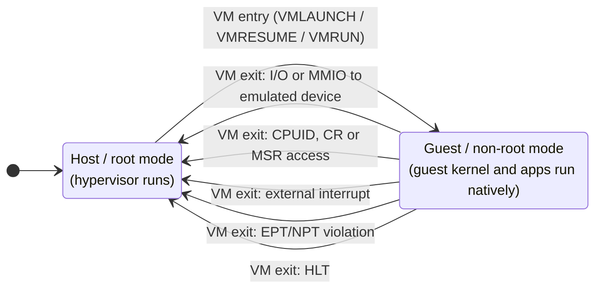

# Hardware Virtualization

A virtual machine runs a guest kernel that believes it owns privileged hardware. Running one fast
means letting it execute directly on the real CPU almost all of the time, and catching it the moment
it does something only the machine's actual owner may do. In 1974, Popek and Goldberg stated exactly
when an architecture makes that possible. x86 failed their test for thirty years. **VT-x** (Intel)
and **AMD-V** (AMD) are the hardware fix, and this page covers what they changed and what they
still cost.

## Trap-and-emulate, and the Popek–Goldberg condition

The classic way to run a guest kernel is **trap-and-emulate**. Run the guest kernel deprivileged, at
user level. Every privileged instruction it executes then traps to the real kernel, the
**hypervisor** (or VMM), which emulates the instruction's effect on the guest's *virtual* machine
state and resumes it.

Popek and Goldberg made precise when this works. Call an instruction **sensitive** if it reads or
changes machine state that the VMM must control, such as the interrupt flag or the page-table base.
Call it **privileged** if it traps when executed outside the most privileged mode. Their theorem: an
architecture can be virtualized by trap-and-emulate if **every sensitive instruction is
privileged**, because then every sensitive action the guest takes traps.

Classic x86 broke the condition. Several sensitive instructions did *not* trap in ring 3. They
silently did something different:

- **`POPF`** loads the flags register. In ring 3, the write to the interrupt-enable flag is silently
  ignored, with no trap. A deprivileged guest kernel that disables interrupts with `POPF` simply
  doesn't, and the VMM never finds out.
- **`SGDT`/`SIDT`** read the descriptor-table base registers without trapping, so a guest kernel
  sees the *host's* tables, not its own.

Before hardware support, two software workarounds made x86 virtualization practical anyway:

- **Binary translation** (VMware, 1999). The VMM scans guest kernel code before running it and
  rewrites each problematic instruction into a safe sequence, caching the translated code. Guest
  user code runs natively.
- **Paravirtualization** (Xen, 2003). Modify the guest kernel's source so it never executes
  problematic instructions. It calls the hypervisor explicitly instead, through **hypercalls**. This
  is fast and needs no hardware help, but the guest must be ported.

## A new axis: root and non-root mode

VT-x (2005) and AMD-V (2006, also called SVM) do not fix the problematic instructions one by one.
They add a new dimension of privilege that is **orthogonal to the rings**:

- **VMX root operation** (AMD: host mode) is where the hypervisor runs.
- **VMX non-root operation** (AMD: guest mode) is where the guest runs, *including its kernel in
  ring 0*.

A guest kernel in non-root ring 0 believes it is fully privileged, and for most instructions it is:
they execute natively at full speed. The difference is that the hypervisor configures which events
in non-root mode cause a **VM exit** back to root mode. Sensitive instructions are now made to exit
by configuration, so the Popek–Goldberg condition is met by construction. The ring model itself is
untouched; see [Privilege Levels and Protection](./privilege-levels-and-protection.md).

## VM entry and VM exit

The CPU keeps the state of both worlds in an in-memory control structure, one per virtual CPU:

- the **VMCS** (Virtual Machine Control Structure) on Intel;
- the **VMCB** (Virtual Machine Control Block) on AMD.

It holds the guest's register state, the host's state to return to, and the **controls**: which
events cause an exit.

- **VM entry** (`VMLAUNCH` / `VMRESUME` on Intel, `VMRUN` on AMD) saves host state, loads guest
  state, and starts executing the guest.
- **VM exit** happens when a configured event occurs. The CPU saves guest state into the VMCS,
  records the **exit reason** and its qualification, loads host state, and resumes the hypervisor
  at a fixed entry point. The hypervisor handles the cause and then enters the guest again.

What causes exits is configurable, and a typical hypervisor sets these:

| Exit cause | Typical frequency | What the hypervisor must do |
|---|---|---|
| I/O instruction (`IN`/`OUT`) or MMIO to an emulated device | High for emulated devices | Emulate the device register access |
| `CPUID` | Low; unconditional on Intel | Return a filtered, virtual CPU identity |
| Control-register or MSR access | Moderate, mostly at boot | Validate and apply to virtual state |
| External interrupt | Proportional to host interrupt rate | Let the host handle it, then re-enter |
| EPT/NPT violation | Bursty: on first touch of guest memory | Back the guest page with host memory, or emulate MMIO |
| `HLT` | Whenever a vCPU idles | Deschedule the vCPU until it has work |

## Why an exit is expensive

An exit is a full **world switch**: tens of registers and control fields saved and restored, the
pipeline drained, and execution resumed in a different context with different page tables. Intel
describes a single transition as costing "hundreds or thousands of cycles". The cost has fallen
with each CPU generation, and has risen again with mitigations for speculative-execution
vulnerabilities, which add work to every transition.

The hypervisor's handler then runs on top of that, and it can cost far more than the transition
itself. Because exits dominate virtualization overhead, most later hardware virtualization features
exist to **avoid exits**, not to make them faster:

- **EPT/NPT** removes page-table-update exits (next section).
- **APICv** (Intel) and **AVIC** (AMD) let a guest read and write its virtual interrupt controller
  without exiting.
- **Posted interrupts** deliver interrupts into a running guest without an exit.

## Memory: shadow page tables and EPT/NPT

A guest has *two* translations to get right:

- its own page tables map **guest-virtual → guest-physical** addresses;
- the hypervisor maps **guest-physical → host-physical**.

**Shadow page tables** were the software answer. The hypervisor write-protects the guest's page
tables, traps every update, and maintains a merged guest-virtual → host-physical table for the real
MMU to use. It works, but every guest page-table write becomes an exit.

**Nested paging** puts both translations in hardware: Intel **EPT** (Extended Page Tables) and AMD
**NPT** (Nested Page Tables, also called RVI). The guest edits its own page tables freely with no
exits, and the hardware walks the two levels together.

The catch is the two-dimensional walk. Every guest page-table entry the hardware must read is
located by a *guest-physical* address, so each one first needs a full walk of the host tables.
Count it for 4-level guest tables and 4-level host tables:

- The guest walk reads 4 entries. Each entry's guest-physical address needs a 4-step host walk to
  translate, then the entry itself is read: (4 + 1) references per guest level, so 4 × 5 = 20.
- The final guest-physical address of the data needs one more host walk: 4 references.
- Total: **24 memory references** for one TLB miss, against 4 natively. Equivalently, (4 + 1) ×
  (4 + 1) − 1 = 24.

This is why the TLB, and the page-walk caches that hold intermediate entries, matter even more
under virtualization than natively. See
[TLBs and Address Translation Hardware](../memory-hierarchy/tlb-and-address-translation-hardware.md),
and why large pages on the *host* side are one of the most effective VM performance settings.

## I/O: emulated, paravirtual, passthrough

Devices get the same three answers the CPU did:

- **Emulated.** The hypervisor pretends to be a real, well-known device (an e1000 NIC, an IDE disk).
  The guest needs no special driver, but every register access the guest's driver makes is an
  exit.
- **Paravirtual.** Guest and hypervisor agree on a device designed for virtualization: rings of
  buffer descriptors in shared memory, with one notification per batch rather than one exit per
  register. This is the I/O form of paravirtualization, and it needs a guest driver.
- **Passthrough.** A real device is assigned directly to the guest, which drives it with its native
  driver at full speed. This is safe only with an **IOMMU**, which confines the device's DMA to that
  guest's memory. See [DMA and the IOMMU](../buses-and-io/dma-and-iommu.md).

## arm64's model, briefly

Arm built virtualization into its privilege hierarchy from Armv7's virtualization extensions on.
Instead of a separate root/non-root axis, it has a dedicated **exception level, EL2**, for the
hypervisor, between the guest kernel at EL1 and the secure monitor at EL3. Traps from EL1 to EL2
are configured by EL2's own system registers, and **stage-2 translation** is Arm's nested paging.

Arm's split originally suited "thin" hypervisors that run entirely at EL2. A hypervisor that is
*also* a full OS kernel, which runs at EL1, had to bounce between levels. **VHE** (Virtualization
Host Extensions, Armv8.1) lets such a host kernel run directly at EL2.

*The two modes hardware virtualization adds, and the exits that move a CPU from the guest back to
the hypervisor. Everything not configured to exit runs natively.*

## Where this goes next

- [Privilege Levels and Protection](./privilege-levels-and-protection.md) — the ring model that root
  and non-root mode sit alongside.
- [TLBs and Address Translation Hardware](../memory-hierarchy/tlb-and-address-translation-hardware.md)
  — why the two-dimensional walk makes TLB reach so important.
- [Virtualization and Isolation](../operating-systems/virtualization-and-isolation.md) — VMs compared
  with containers and sandboxes as isolation designs.
- [`../../linux/15-containers-and-virtualization/kvm-and-hardware-virtualization.md`](../../linux/15-containers-and-virtualization/kvm-and-hardware-virtualization.md) —
  how one kernel turns this hardware into a hypervisor.

## References

- Popek & Goldberg,
  ["Formal Requirements for Virtualizable Third Generation Architectures"](https://dl.acm.org/doi/10.1145/361011.361073),
  *Communications of the ACM* 17(7), 1974 — the theorem, stated in two pages; everything above
  follows from it.
- Adams & Agesen,
  ["A Comparison of Software and Hardware Techniques for x86 Virtualization"](https://dl.acm.org/doi/10.1145/1168857.1168860)
  (ASPLOS 2006) — VMware's honest finding that first-generation VT-x was often *slower* than binary
  translation, because exits were so expensive.
- Bhargava, Serebrin, Spadini & Manne,
  ["Accelerating Two-Dimensional Page Walks for Virtualized Systems"](https://dl.acm.org/doi/10.1145/1346281.1346286)
  (ASPLOS 2008) — the 24-reference nested walk, and the page-walk caches that tame it.
- Intel, *Intel 64 and IA-32 Architectures Software Developer's Manual*, Vol. 3C, the VMX chapters —
  the VMCS layout, the full list of exit reasons, and EPT.
- Intel,
  ["Improving Performance of VM Workloads by Optimizing Poll Time"](https://www.intel.com/content/www/us/en/developer/articles/technical/improving-performance-vm-workloads-opt-poll-time.html)
  — the source of the "hundreds or thousands of cycles" transition cost quoted above.
