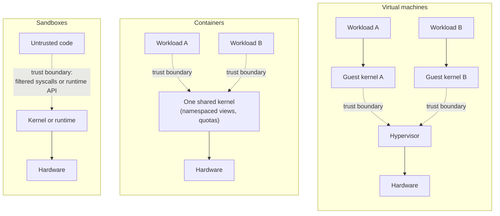

# Virtualization and Isolation

"Isolated" is not one property. A virtual machine, a container and a sandbox each draw a boundary
around untrusted code, but they draw it in different places. Three questions separate them:

- What do the two sides of the boundary still **share**?
- **Who enforces** the boundary?
- How much code sits on the trusted side of it, reachable from the untrusted side?

This page owns the theory. How Linux actually builds containers and runs VMs belongs to the Linux
section, which this page links to at the end.

## Three boundaries

**Machine-level isolation: virtual machines.** A hypervisor partitions the *hardware*. Each guest
gets its own virtual CPUs, memory and devices, and runs its **own kernel**. The guest's kernel is
untrusted from the host's point of view. The boundary is enforced by the CPU's virtualization
extensions and the IOMMU, and administered by the hypervisor (see
[Hardware Virtualization](../cpu-architecture/hardware-virtualization.md)).

**OS-level isolation: containers.** One kernel serves every workload, but gives each group of
processes a partitioned *view* of the kernel's resources: its own process-ID space, filesystem
tree, network stack and hostnames, plus quotas on CPU and memory. Nothing is virtualized in
hardware. The boundary is a set of checks inside the shared kernel.

**Process-level and language-level isolation: sandboxes.** The untrusted code runs as an ordinary
process, or inside a language runtime, but with a **restricted interface** to the kernel or to the
host. Examples:

- system-call filtering, which allows a short list of calls and refuses the rest;
- capability-based designs, where code can touch only objects it was handed a reference to;
- a WebAssembly runtime, which exposes only the host functions it imports.

The boundary is the interface, enforced by the kernel (for filters) or by the runtime (for
languages).

*Where each design draws its trust boundary (dashed). A VM's boundary sits below a whole guest
kernel; a container's and a sandbox's sit at the interface to a kernel the workload shares.*

## What is shared, and why it matters

The shared component is what an attacker attacks. Whatever sits directly on the other side of the
boundary is the attack surface.

- **Containers share the kernel.** This is the container model's defining weakness. Every kernel
  bug reachable through the system calls a container may make is a potential container escape,
  regardless of how carefully the namespaces are configured. The kernel is tens of millions of
  lines of C and exposes several hundred system calls.
- **VMs share the hypervisor and the hardware.** A guest kernel bug compromises only that guest. To
  escape, an attacker needs a bug in the hypervisor, in its device emulation, or in the CPU.
- **Everyone shares the CPU's microarchitecture.** Caches, branch predictors and other internal
  buffers are shared by whatever runs on the same core or socket. Transient-execution and cache
  side channels cross *every* boundary on this page, including the VM boundary. Mitigating them
  means flushing state on transitions or never co-scheduling mutually untrusted workloads on the
  same core.

## Attack surface as a measurable quantity

One useful, if rough, comparison is the size of the interface the untrusted side can reach:

| Design | Interface the untrusted side reaches |
|---|---|
| VM | A few dozen kinds of VM exit, a small set of hypercalls, and the emulated or paravirtual devices |
| Container | The full system-call interface of a general-purpose kernel — several hundred calls, with many sub-operations each |
| Syscall-filtered sandbox | A configured subset of those calls, and only the argument values the filter allows |

Interface size is an **argument, not a proof**. A small interface implemented badly is worse than a
large one implemented well, and much of a hypervisor's real exposure lies in device emulation code,
which is larger than its exit list suggests. The point is directional: shrinking what the untrusted
side can reach shrinks the code an attacker can aim at. Saltzer and Schroeder called the principle
behind this **economy of mechanism**.

## Resource isolation versus security isolation

Two kinds of isolation are routinely confused:

- **Performance (resource) isolation.** One workload cannot starve another of CPU, memory, I/O or
  process slots. It is achieved with quotas, weights and limits, and it is a question of fairness
  and availability.
- **Security isolation.** One workload cannot read or modify another's data, or take control of
  the host. It is a question of confidentiality and integrity.

They are independent. A resource quota gives no security isolation: a process throttled to 10% of a
CPU can still exploit a kernel bug. A partitioned view gives no resource isolation: a process that
cannot *see* another process can still exhaust the memory both depend on. A secure container needs
both, built from different mechanisms.

## The hybrid answers

Several designs move the container boundary toward the VM boundary, keeping a container's developer
experience while reducing the shared kernel's exposure:

- **MicroVMs** (Firecracker). Each workload is a real VM, but the hypervisor's device model is cut
  down to the minimum (a few paravirtual devices, no emulated legacy hardware). That keeps the
  trusted side small and lets startup take a fraction of a second. The trusted side is the host
  kernel's hypervisor support plus a small user-space monitor.
- **User-space kernels** (gVisor). The workload's system calls are intercepted and serviced by a
  second kernel written in a memory-safe language, running as an ordinary sandboxed process. Only a
  narrow, filtered set of host system calls is ever made on the workload's behalf. The trusted side
  is that small host interface plus the sandbox kernel's own correctness.
- **Kata Containers.** Container tooling on the outside, a lightweight VM per container (or per pod)
  on the inside. The trusted side is the hypervisor, as for any VM.

Each buys stronger isolation with some combination of startup time, memory overhead and system-call
performance. Which trade is right depends on how mutually untrusted the workloads are.

## Comparison

| | VM | Container | User-space kernel (gVisor-style) | MicroVM | Syscall-filter sandbox |
|---|---|---|---|---|---|
| Shared with other workloads | Hypervisor, hardware | Host kernel, hardware | Narrow host-kernel interface, hardware | Hypervisor, hardware | Host kernel (restricted), hardware |
| Boundary enforced by | CPU virtualization + IOMMU | Kernel checks (namespaces, permissions) | Sandbox kernel + host syscall filter | CPU virtualization + IOMMU | Kernel's syscall filter |
| Startup cost | Seconds (full guest boot) | Milliseconds | Tens to hundreds of ms | Around a hundred ms | Negligible |
| Density | Low | High | Medium–high | Medium–high | Highest |
| Escape requires | Hypervisor or hardware bug | Host kernel bug reachable from the container | Sandbox-kernel bug *and* a host bug through the narrow interface | Hypervisor/monitor or hardware bug | Kernel bug reachable through the allowed calls |

Startup and density are order-of-magnitude classes, not benchmarks. Real figures depend heavily on
configuration.

## Where this goes next

- [Hardware Virtualization](../cpu-architecture/hardware-virtualization.md) — the CPU support every
  VM-based design above depends on.
- [OS Structure: Monolithic, Microkernel, Hybrid](./os-structure-monolithic-microkernel-hybrid.md) —
  the same "how much code is trusted" argument, applied to a kernel's own structure.
- [`../../linux/15-containers-and-virtualization/what-a-container-actually-is.md`](../../linux/15-containers-and-virtualization/what-a-container-actually-is.md) —
  how Linux assembles a container from parts.
- [`../../linux/15-containers-and-virtualization/kvm-and-hardware-virtualization.md`](../../linux/15-containers-and-virtualization/kvm-and-hardware-virtualization.md) —
  how Linux becomes a hypervisor.

## References

- Saltzer & Schroeder,
  ["The Protection of Information in Computer Systems"](https://doi.org/10.1109/PROC.1975.9939),
  *Proceedings of the IEEE*, 1975 — least privilege, economy of mechanism, complete mediation: the
  vocabulary this page reasons with.
- Agache et al.,
  ["Firecracker: Lightweight Virtualization for Serverless Applications"](https://www.usenix.org/conference/nsdi20/presentation/agache)
  (NSDI 2020) — why AWS built a minimal VMM rather than trusting containers for multi-tenant
  isolation, and what it cost.
- [gVisor architecture guide](https://gvisor.dev/docs/architecture_guide/intro/) — the user-space
  kernel design, explicit about what is and is not trusted.
- Arpaci-Dusseau & Arpaci-Dusseau, *Operating Systems: Three Easy Pieces*, appendix "Virtual Machine
  Monitors" — the classic VMM concepts in a few pages.
