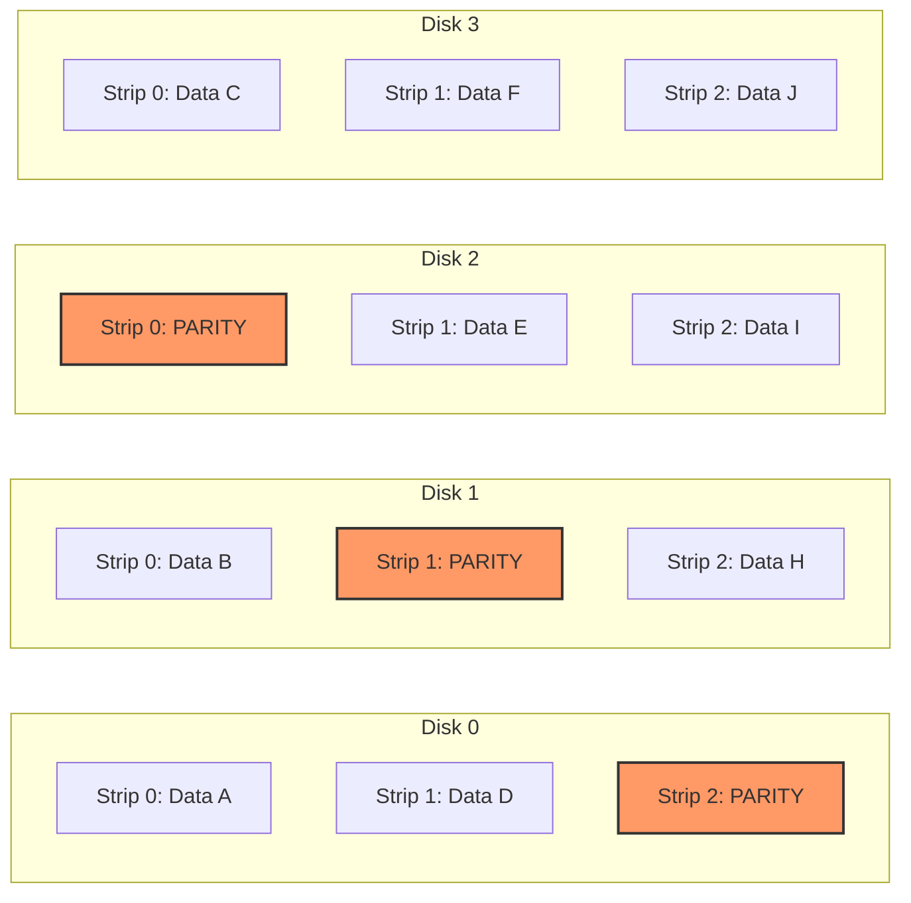

# RAID and Redundancy

Redundancy answers one question — "what happens when a disk dies?" — and RAID gives three different
answers: spread the data (striping), duplicate it (mirroring), or store enough arithmetic to
recompute it (parity). Each answer spends capacity and write performance differently. None of them
answers a different question people keep asking it: "what happens when I delete the wrong file?"

## Core Concepts

| Term | Meaning |
|---|---|
| **Stripe** | One pass of data spread across all disks in the array — the unit striping operates on. |
| **Strip (chunk)** | The contiguous piece of a stripe that lives on a single disk. |
| **Mirror** | A full, redundant copy of the data kept on a separate disk. |
| **Parity** | Redundant data computed (usually by XOR) from a set of strips, letting any one of them be reconstructed from the rest. |
| **Degraded** | The array's state after a disk failure: still serving reads/writes, but with no spare redundancy left for that stripe. |
| **Rebuild (resync)** | Reconstructing a failed disk's data onto a replacement, from the surviving disks. |
| **Hot spare** | An idle disk kept ready so a rebuild can start automatically the moment a failure is detected. |
| **URE (unrecoverable read error)** | A sector that fails to read even after the drive's own error correction gives up — a second point of failure during a rebuild. |
| **Write hole** | A window where data and its parity disagree because a crash landed between the two writes. |

## Mechanism

*Where parity lives in RAID 5: one parity block per strip, rotating across disks so no single disk
carries all of it.*

### Striping (RAID 0)

RAID 0 splits data into strips and writes them across all disks in parallel, so a large read or write
is serviced by every disk's bandwidth at once — throughput scales roughly with disk count. It carries
no redundancy at all, and the failure math runs the wrong way: with independent per-disk failure
probability, losing *any one* of *n* disks loses the entire array, so the array's failure probability
*grows* with every disk added. RAID 0 is a performance technique wearing a RAID name, not a redundancy
technique.

### Mirroring (RAID 1, RAID 10)

RAID 1 keeps a full duplicate copy of every block on a second disk. Reads can be served from either
copy (some implementations split reads across both for extra throughput), while writes must go to
both before the write is considered complete. RAID 10 stripes across a set of mirrored pairs — RAID 1
for redundancy, RAID 0 layered on top for throughput. It is not the same as RAID 01 (mirroring two
striped sets): in RAID 01, losing one disk fails an entire stripe set, so a second failure anywhere in
the *surviving* striped set takes down the array; in RAID 10, losing one disk only degrades its own
mirror pair, and the array survives any combination of failures that doesn't take out both members of
the same pair. RAID 10 tolerates more failure patterns than RAID 01 for the same disk count.

### Parity (RAID 5)

Instead of a full duplicate, parity stores just enough extra information to reconstruct any one
missing strip. The simplest version is a bitwise XOR across the corresponding strips on every other
disk. Worked through on 4 bits across three data disks:

| Disk | Bits |
|---|---|
| A (data) | `1010` |
| B (data) | `0110` |
| C (data) | `0011` |
| P (parity = A ⊕ B ⊕ C) | `1111` |

Now "lose" disk B. It reconstructs from the rest of the row: `A ⊕ C ⊕ P` = `1010 ⊕ 0011 ⊕ 1111` =
`0110` — exactly B's original bits. Parity doesn't store *what* B contains; it stores *just enough*
that B is recoverable as long as everything else in the row survives.

That recomputation has a cost on the write path, known as the **small-write penalty**: overwriting
part of a stripe can't just write the new data, because the parity strip is a function of every data
strip in the row. A single logical write becomes four physical I/Os — read the old data, read the old
parity, write the new data, write the new parity (the new parity is computed from the difference
between old and new data, XORed into the old parity, rather than re-reading every other data strip).
Parity also **rotates**: which disk holds the parity strip changes from stripe to stripe (as drawn
above), so parity writes — which happen on every write — are spread across every disk instead of
hammering one dedicated parity disk into being the array's bottleneck.

### Double parity (RAID 6)

RAID 6 keeps two independent redundancy blocks per stripe instead of one: a P block that is still the
simple XOR, and a Q block computed as a Reed–Solomon syndrome over a Galois field — a second,
algebraically independent equation over the same data, chosen so that any two missing strips (two
data strips, or one data and one parity, or both parity strips) can be solved for. The field
arithmetic behind Q is a specialized topic on its own; the fact that matters here is the trade: RAID 6
tolerates any two simultaneous disk failures, at the cost of a second parity write for every logical
write, on top of RAID 5's small-write penalty.

### The write hole

Data and its parity are two separate writes to two separate disks, and nothing about the medium makes
them atomic together. A crash (or power loss) that lands between the two leaves a strip whose parity
no longer matches its data — silently. Nothing notices until a disk actually fails and reconstruction,
trusting parity that was never corrected, produces garbage instead of the missing strip. Three
families of fix exist: a battery- or flash-backed controller cache that keeps the pending write pair
until both land; a journal or write-intent log that records which stripe is mid-update so recovery
knows to re-parity it; and copy-on-write, which sidesteps the problem entirely by never updating a
strip in place (see [Crash Consistency and Journaling](./crash-consistency-and-journaling.md) for the
general form of this problem — the write hole is one instance of it).

### Rebuild

Replacing a failed disk means reconstructing its entire contents from the survivors — for RAID 5,
that's reading *every* remaining disk, end to end, for the full capacity of the array. Three
consequences follow directly. Rebuild time scales with capacity, not with how much data actually
changed, so it has only gotten worse as drives have grown into the tens of terabytes while their
sequential throughput has not kept pace. The array runs **degraded** for the whole rebuild — no spare
redundancy, and often slower, since the rebuild itself competes for I/O. And a second failure, or even
a single unrecoverable read error (URE) hit while reading a survivor during a RAID 5 rebuild, loses
data outright, because there is no longer a second source to reconstruct from.

Whether that second failure is *likely* is an arithmetic question, not a fixed fact: a consumer HDD
datasheet commonly quotes an unrecoverable-read-error rate on the order of 1 in 10^14 bits read. Read
enough terabytes during a rebuild and that rate starts to matter — but the exact odds depend on the
array's total capacity and the specific drive's own datasheet figure, not on a single number every
array shares. Treat the URE rate as a *shape* of argument — bigger arrays make rebuild-time failure
more likely — and pull the real figure from the drives actually in use rather than quoting one
percentage as universal fact.

## Practical Usage

Choosing a level is a workload question. Random-write-heavy databases favor RAID 10: no
read-modify-write penalty, and a simple recovery path. Large, capacity-oriented arrays (bulk storage,
backups, media archives) favor RAID 6, trading a second parity write for tolerating two failures
during what is often a very long rebuild. Small, critical volumes — a boot disk, a hypervisor's system
volume — favor plain RAID 1: simplicity and a fast rebuild matter more than capacity efficiency at
that scale.

The redundancy logic itself can live in three different places: a dedicated **hardware RAID
controller** (its own processor and, ideally, battery-backed cache), **software RAID** run by the host
CPU with no special hardware, or **filesystem-integrated redundancy**, where the filesystem itself
understands multiple disks and redundancy (ZFS's RAID-Z, Btrfs's RAID profiles). The filesystem-
integrated approach has one structural advantage over the other two: because the filesystem also owns
checksumming, it can tell which copy of a mismatched pair is actually correct, instead of just
detecting that a mismatch exists.

## Edge Cases & Pitfalls

:::danger[RAID is not a backup]
RAID protects against a disk failing. It does nothing at all against deleting the wrong file,
ransomware encrypting every file, or application-level corruption — the array faithfully and
redundantly replicates all three, just as reliably as it replicates the data you meant to keep.
Redundancy and backup solve different failure modes.
:::

- Disks purchased in the same batch, from the same manufacturing run, tend to fail on similar
  schedules — a rebuild after one failure lands right in the window where a second, correlated
  failure is most likely, not a random and independent one.
- On SSD-based mirrors, both disks receive identical writes and therefore wear out on a correlated
  schedule too; mirroring flash does not buy the same independence it buys on spinning disks.
- Degraded-mode performance is often bad enough to be an outage in practice, even though the array is
  technically still serving data — a rebuild competing for I/O on an already-degraded array can push
  latency past what an application actually tolerates.
- Parity alone cannot tell a *correct* write from a *silently corrupted* one — it can reconstruct a
  strip that's missing, but if a strip was corrupted without ever being detected as missing, parity
  has no way to know which of the mismatched values is right. That needs checksums, which plain RAID
  doesn't provide.

## Comparisons

| RAID level | Usable capacity (of *n* disks) | Failures tolerated | Read performance | Write penalty | Rebuild exposure |
|---|---|---|---|---|---|
| RAID 0 | *n* | 0 | High (striped) | None | N/A — any failure loses the array |
| RAID 1 | *n*/2 | 1 (per mirrored pair) | High (either copy) | Low (write both copies) | Low — direct copy from mirror |
| RAID 5 | *n* − 1 | 1 | High | High (4 I/Os per write) | High — full-array read, one URE away from data loss |
| RAID 6 | *n* − 2 | 2 | High | Higher (5 I/Os per write) | Moderate — tolerates one more failure mid-rebuild |
| RAID 10 | *n*/2 | 1 per pair (up to *n*/2 total) | High | Low | Low — rebuilds only the failed disk's own pair |

## References

- Patterson, Gibson & Katz, ["A Case for Redundant Arrays of Inexpensive Disks (RAID)"](https://dl.acm.org/doi/10.1145/50202.50214), *SIGMOD* 1988 — the paper that named the levels; short, readable, and the source of the vocabulary.
- Leventhal, ["Triple-Parity RAID and Beyond"](https://queue.acm.org/detail.cfm?id=1670144), *ACM Queue* 7(11), 2009 — the rebuild-exposure argument made with real numbers, and why RAID 6 became the capacity default.
- SNIA, [*Common RAID Disk Data Format (DDF)*](https://www.snia.org/tech_activities/standards/curr_standards/ddf) specification — the vendor-neutral definitions of the standard levels.

### Books & Videos

- Remzi H. Arpaci-Dusseau & Andrea C. Arpaci-Dusseau, [*Operating Systems: Three Easy Pieces*](https://pages.cs.wisc.edu/~remzi/OSTEP/), ch. "Redundant Arrays of Inexpensive Disks" — free online, with the worked parity analysis this page summarises.

## Related Pages

- [Hard Disk Drives](./hard-disk-drives.md)
- [Crash Consistency and Journaling](./crash-consistency-and-journaling.md)
- [Storage: HDD, SSD & NVMe — Overview](./intro.md)
- [Software RAID](../../linux/12-block-layer-and-storage/software-raid.md) — how Linux's md driver implements these levels.
