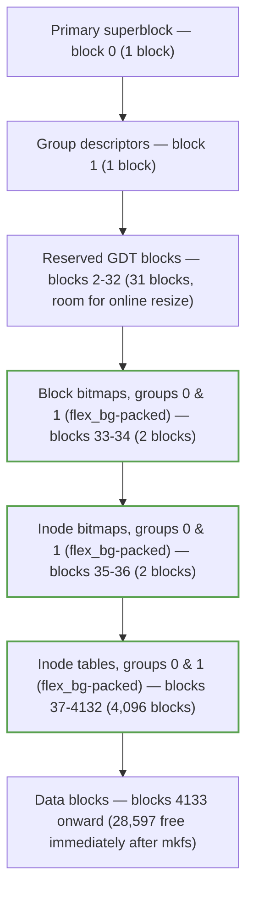

# ext4

ext4 is the conservative default: an evolution of ext2 and ext3 that kept a fixed on-disk layout and
added extents, a journal, and delayed allocation without ever breaking the ability to mount an old ext2
or ext3 filesystem as ext4. Read from the on-disk layout upward, it is also the clearest real example of
almost everything this folder has described so far — inodes, extents, htree directories, and the journal
[Journaling and Crash Consistency](./journaling-and-crash-consistency.md) already covers in full. This
page does not re-derive that journal material; it links it and moves on to what's specific to ext4 itself.

## The layout: block groups

An ext4 volume is divided into fixed-size **block groups** — 32,768 blocks each at the default 4 KiB
block size, verified against `Documentation/filesystems/ext4/blockgroup.html` at the current kernel docs
site. Each group can hold, in order: an optional backup superblock and group-descriptor table (only some
groups carry these, per the `sparse_super` feature), a block bitmap, an inode bitmap, and an inode table,
followed by the group's data blocks. **`flex_bg`** changes where those small per-group metadata pieces
physically live: instead of every group keeping its own bitmaps and inode table inside its own block
range, `flex_bg` packs the bitmaps and inode tables of several consecutive groups (a "flex group",
`flex_bg` **size 16** by default) together at the start of the first group in that batch — fewer, larger
metadata I/Os instead of many small scattered ones.

<Lab host="any-linux" title="Read ext4's on-disk structures" time="20 min">

No root needed — everything below runs against a plain file.

1. **Build a 256 MB ext4 image.**

   ```bash
   $ truncate -s 256M e.img && mkfs.ext4 -F e.img
   mke2fs 1.47.2 (1-Jan-2025)
   Creating filesystem with 65536 4k blocks and 65536 inodes
   Filesystem UUID: d8674352-5113-4ae1-a5f1-9548cfb1fd63
   Allocating group tables: done
   Writing inode tables: done
   Creating journal (4096 blocks): done
   Writing superblocks and filesystem accounting information: done
   ```

2. **`dumpe2fs -h e.img`** — the superblock's own summary of the filesystem's shape:

   ```text
   Filesystem features:      has_journal ext_attr resize_inode dir_index orphan_file filetype
                              extent 64bit flex_bg metadata_csum_seed sparse_super large_file
                              huge_file dir_nlink extra_isize metadata_csum
   Inode count:              65536
   Block count:              65536
   Block size:               4096
   Blocks per group:         32768
   Inodes per group:         32768
   Flex block group size:    16
   Journal inode:            8
   Total journal blocks:     4096
   ```

   65,536 blocks of 4 KiB is exactly 256 MiB, split into 32,768 blocks per group — **two** block groups
   total. Because `flex_bg`'s batch size (16) is larger than the number of groups that actually exist
   (2), both groups' bitmaps and inode tables end up packed into one flex group, visible in the next step.

3. **`dumpe2fs e.img | head -40`** — the first group's real, physical layout:

   ```text
   Group 0: (Blocks 0-32767) csum 0xabf3 [ITABLE_ZEROED]
     Primary superblock at 0, Group descriptors at 1-1
     Reserved GDT blocks at 2-32
     Block bitmap at 33 (+33), csum 0x08c7a5ae
     Inode bitmap at 35 (+35), csum 0xeccffbcf
     Inode table at 37-2084 (+37)
     28597 free blocks, 32756 free inodes, 2 directories, 32756 unused inodes
     Free blocks: 4171-32767
     Free inodes: 13-32768
   Group 1: (Blocks 32768-65535) csum 0xbb4e [INODE_UNINIT, ITABLE_ZEROED]
     Backup superblock at 32768, Group descriptors at 32769-32769
     Reserved GDT blocks at 32770-32800
     Block bitmap at 34 (bg #0 + 34), csum 0x035e8156
     Inode bitmap at 36 (bg #0 + 36), csum 0x00000000
     Inode table at 2085-4132 (bg #0 + 2085)
     28639 free blocks, 32768 free inodes, 0 directories, 32768 unused inodes
   ```

   This is `flex_bg` visible directly: group 1's own block bitmap sits at block **34** — inside *group
   0's* block range — labeled `(bg #0 + 34)` by `dumpe2fs` itself, and its inode bitmap and inode table
   are packed the same way, immediately after group 0's own. Without `flex_bg`, group 1's metadata would
   sit at the start of block 32768 instead. The anchor diagram below is drawn directly from these numbers.

4. **`debugfs -w e.img`, write a real file, and read its extent back:**

   ```text
   debugfs: write /etc/services services
   Allocated inode: 13
   debugfs: stat services
   Inode: 13   Type: regular    Mode:  0644   ...   Size: 12990
   EXTENTS:
   (0-3):4171-4174
   debugfs: ls -l /
        2   40755 (2)      0      0    4096 ... .
        2   40755 (2)      0      0    4096 ... ..
       11   40700 (2)      0      0   16384 ... lost+found
       13  100644 (1)      0      0   12990 ... services
   ```

   `/etc/services` (12,990 bytes, 4 blocks at 4 KiB each) landed as **one extent**: logical blocks 0–3
   map to physical blocks 4171–4174 — physical block 4171 is exactly where step 3's `Free blocks:` range
   started, confirming this was the first data allocated after the fixed metadata region. One extent
   entry describes all four blocks; the "Inodes and the extent tree" section below is this same idea at
   file-format-of-the-`i_block`-field level.

5. **Force a directory large enough to need `htree`.** `debugfs`'s own `mknod`/`link` path grows a
   directory's linear blocks as entries are added but — unlike the live kernel's `ext4_dx_add_entry` —
   does not convert it to a hashed index on the fly. `e2fsck -D` (directory optimization) does the same
   conversion offline, so after linking 5,000 entries into a fresh directory:

   ```text
   debugfs: mkdir /bigdir
   debugfs: cd /bigdir
   debugfs: mknod file00000 p
   ... (5,000 entries)
   debugfs: cd /
   debugfs: stat /bigdir
   Size: 102400   Blockcount: 200          # 25 linear blocks — dir_index feature present, but not yet indexed
   debugfs: htree /bigdir
   htree: Not a hash-indexed directory     # confirmed: debugfs's own linking never converts it

   $ e2fsck -fyD e.img                     # -D: optimize (and, here, index) directories
   Pass 3A: Optimizing directories
   e.img: ***** FILE SYSTEM WAS MODIFIED *****

   debugfs: stat /bigdir
   Inode: 14   Flags: 0x81000              # 0x1000 = EXT4_INDEX_FL — now hash-indexed
   Size: 131072   Blockcount: 256          # 1 root block + 31 leaf blocks
   debugfs: htree /bigdir
   Root node dump:
        Hash Version: 1
        Indirect levels: 0
   Number of entries (count): 31
   Number of entries (limit): 507
   Entry #0: Hash 0x00000000, block 1
   Entry #1: Hash 0x08cd6b3c, block 2
   ...
   Entry #30: Hash 0xfff4cf62, block 31
   ```

   31 root entries, each pointing at one leaf block holding a contiguous hash range — a lookup in this
   5,000-entry directory is the root block plus exactly one leaf block, not a linear scan of 25 blocks.

**If it fails:** `debugfs` and `dumpe2fs` ship in `e2fsprogs` — install it if either command is missing.
`htree` on a small or freshly-linked directory correctly prints "Not a hash-indexed directory": ext4 only
converts a directory to a hashed index once it outgrows a single linear block, and — as step 5 shows —
`debugfs`'s own offline linking doesn't trigger that conversion the way a live kernel mount does; `e2fsck
-D` is the offline equivalent.

</Lab>



*The first block group of a real 256 MB ext4 image, laid out from `dumpe2fs`. The three green boxes are
the metadata `flex_bg` relocated here from group 1's own block range — without `flex_bg`, group 1 would
carry its own copies of these three starting at block 32768 instead.*

## Inodes and the extent tree

`struct ext4_inode`'s `i_block` field (`<Src file="fs/ext4/ext4.h" symbol="ext4_inode" />`) is a fixed
60-byte area — `__le32 i_block[15]`, 15 × 4 bytes, verified at v6.18. On an extent-based inode (the
`extent` feature, set on the lab image above and on essentially every ext4 filesystem created since the
feature's introduction), those 60 bytes hold a `<Src file="fs/ext4/ext4_extents.h"
symbol="ext4_extent_header" />` (12 bytes: magic, entry count, capacity, depth, generation) followed by
up to **four** `<Src file="fs/ext4/ext4_extents.h" symbol="ext4_extent" />` entries (12 bytes each — the
4-block `services` file's single extent above is exactly one of these) when the tree's depth is 0, or up to four
`ext4_extent_idx` index entries pointing at further extent-tree blocks when it isn't. An extent is
`(logical block, length, physical block)` — a single entry can describe up to 32,768 contiguous blocks (128
MiB at a 4 KiB block size), which is the whole reason extents replaced ext2/ext3's indirect-block scheme:
a contiguous 1 GiB file needs only a handful of extent entries instead of the roughly 262,144 individual
4-byte block pointers an indirect-block inode would need to name the same blocks one at a time.

```wavedrom title="struct ext4_extent_header: the 12-byte header at the start of i_block, and every extent-tree block below it" alt="Bit-field strip of ext4_extent_header: eh_magic 16 bits (0xF30A), eh_entries 16 bits, eh_max 16 bits, eh_depth 16 bits, eh_generation 32 bits"
{ reg: [
    { bits: 16, name: "eh_magic (0xF30A)", type: 2 },
    { bits: 16, name: "eh_entries", type: 3 },
    { bits: 16, name: "eh_max", type: 3 },
    { bits: 16, name: "eh_depth", type: 4 },
    { bits: 32, name: "eh_generation", type: 1 }
  ],
  config: { hspace: 900, bits: 96, lanes: 2 }
}
```

```wavedrom title="struct ext4_extent: one 12-byte leaf entry — a single contiguous run of physical blocks" alt="Bit-field strip of ext4_extent: ee_block 32 bits (logical), ee_len 16 bits, ee_start_hi 16 bits, ee_start_lo 32 bits"
{ reg: [
    { bits: 32, name: "ee_block (logical)", type: 3 },
    { bits: 16, name: "ee_len", type: 4 },
    { bits: 16, name: "ee_start_hi", type: 5 },
    { bits: 32, name: "ee_start_lo", type: 5 }
  ],
  config: { hspace: 900, bits: 96, lanes: 2 }
}
```

*The twelve bytes that describe an extent, and the header that says how many follow.* `eh_magic` is
`EXT4_EXT_MAGIC` (`0xf30a`, `<Src file="fs/ext4/ext4_extents.h" symbol="ext4_extent_header" />` header,
verified at v6.18) — every extent-tree block, `i_block` included, starts with this same 12-byte header
regardless of depth, which is what lets `ext4_ext_map_blocks` walk a tree of unknown depth generically:
read the header, check `eh_depth`, and either read `eh_entries` leaf extents directly (depth 0) or recurse
into `eh_entries` index pointers (depth > 0).

## Directories and htree

A small ext4 directory is a plain linear array of variable-length entries in one or a few blocks — exactly
what step 4 of the lab above shows for a freshly created 2-entry directory. Once a directory outgrows a
single block (with the `dir_index` feature enabled, which the lab image has), ext4 converts it to a hashed
B-tree rooted at a `<Src file="fs/ext4/namei.c" symbol="dx_root" />` block: the filename's hash picks a
range, the range picks a leaf block, and the leaf block is a small linear array again — so a lookup in a
directory with a million entries costs the root block plus one leaf block, not a scan proportional to the
directory's size. Step 5's lab output is this exact structure on a real, if much smaller, directory: 31
root entries (hash ranges), each naming one of 31 leaf blocks holding roughly 160 of the 5,000 total
entries apiece.

## Delayed allocation

A buffered `write()` on ext4 does not choose which physical blocks a file's new data will occupy at write
time — see [`open`, `read`, `write` in the Kernel](./open-read-write-in-the-kernel.md#write) for why the
syscall returns once the data is dirty in the page cache and nothing more. ext4 defers the actual block
allocation to writeback, when `<Src file="fs/ext4/inode.c" symbol="ext4_writepages" />` runs and the
kernel can see how much contiguous data there actually is to place at once, via `<Src file="fs/ext4/inode.c"
symbol="ext4_map_blocks" />` → `<Src file="fs/ext4/extents.c" symbol="ext4_ext_map_blocks" />` →
`<Src file="fs/ext4/balloc.c" symbol="ext4_mb_new_blocks" />` for the actual allocation. Choosing
contiguous blocks for a whole batch of dirty pages at once, instead of one small allocation per `write()`
call, is what makes delayed allocation good for both contiguity (fewer, larger extents) and allocator
overhead (fewer separate allocation calls) — at the cost of exactly the crash-window behavior [Journaling
and Crash Consistency](./journaling-and-crash-consistency.md#the-replace-by-rename-recipe-on-linux)
describes: a file's blocks genuinely do not exist yet between `write()` and writeback, which is why
skipping `fsync` in the replace-by-rename recipe is unsafe rather than merely slow.

## The journal, and fast commits

jbd2, transactions, commits, and the `data=` modes are [Journaling and Crash
Consistency](./journaling-and-crash-consistency.md) in full — this page only adds **fast commits**, a
lighter-weight log ext4 layers on top of jbd2 for the common case (LWN, 2021, in the references below).
Instead of a full jbd2 transaction covering every metadata change, a fast commit records a small, specific
set of common operations — file creation, unlink, rename, and similar — in a separate, smaller log area
that replays faster than a full jbd2 transaction would. `ext4_fc_commit` (referenced from
[Journaling and Crash Consistency](./journaling-and-crash-consistency.md)'s own `fsync` path) falls back to
a full `jbd2_complete_transaction` whenever the operation being committed isn't one fast commits can
represent, so the mechanism is additive — it never removes jbd2's own guarantee, only skips its full cost
for the operations common enough to be worth a dedicated fast path.

## Features worth knowing

Feature flags read off this page's own lab image (step 2's `dumpe2fs -h`) plus the ones the brief singled
out that this particular `mkfs.ext4 -F` default did **not** turn on — each description verified against
`Documentation/filesystems/ext4/super.html` at the current kernel docs site:

| Feature | What it changes | On the lab image? |
|---|---|---|
| `metadata_csum` | Metadata (bitmaps, inode table, directory blocks, extent tree) carries checksums, catching corruption the journal alone wouldn't | Yes |
| `64bit` | Block and inode counts, and group-descriptor fields, grow to 64-bit width — needed once a filesystem's block count exceeds what 32 bits can address | Yes |
| `huge_file` | A file's size is tracked in block units rather than 512-byte sectors, extending the maximum representable file size well past what sector-granularity allowed | Yes |
| `casefold` | A directory can be marked case-insensitive, with filename comparison done on a normalized (Unicode NFD) form | No — needs `-O casefold` at `mkfs` time |
| `encrypt` | Encrypted inodes (`fscrypt`) may exist on the filesystem | No — needs `-O encrypt` |
| `verity` | Verity inodes (`fsverity`, read-only integrity verification) may exist | No — needs `-O verity` |
| `inline_data` | A very small file's data is stored directly inside the inode instead of a separate data block | No — needs `-O inline_data` |

<KernelFacts
  structure={[["struct ext4_extent_header", "fs/ext4/ext4_extents.h"], ["struct ext4_inode", "fs/ext4/ext4.h"]]}
  path="writeback → ext4_writepages() → ext4_map_blocks() → ext4_ext_map_blocks() → ext4_mb_new_blocks()"
  observe="sudo dumpe2fs -h /dev/<root-device> | grep -E 'features|Block size|Journal'  # read-only; or build the lab image above with no root at all"
  trap="Delayed allocation means a file's blocks do not exist on disk until writeback runs. du on a just-written file can report less than its final size, and a crash before writeback leaves a zero-length or truncated file — which is exactly why the replace-by-rename recipe on the journaling page includes an fsync before the rename, not after it." />

## References

- [ext4 Data Structures and Algorithms](https://docs.kernel.org/filesystems/ext4/index.html) — the kernel's
  own ext4 documentation: block groups, extents, directories, and inodes with exact byte offsets; this
  page's `blockgroup.html` and `super.html` pages were the source for the layout and feature-flag sections
  above (verified at the current docs site, restructured under `Documentation/filesystems/ext4/` from the
  older single-file `ext4.txt`).
- [`debugfs(8)`](https://man7.org/linux/man-pages/man8/debugfs.8.html) and `man 8 dumpe2fs` — the two tools
  this page's lab runs directly against a plain file, no mount or root required.
- Mathur, Cao, Bhattacharya, Dilger, Tomas, Vivier, ["The new ext4 filesystem: current status and future
  plans"](https://www.kernel.org/doc/ols/2007/ols2007v2-pages-21-34.pdf), Ottawa Linux Symposium 2007 — the
  original design rationale for extents and delayed allocation; the feature set (fast commits, `casefold`,
  `verity`) has grown considerably since, but the core design this page describes is unchanged.
- Jonathan Corbet, ["Fast commits for ext4"](https://lwn.net/Articles/842385/), LWN, 2021 — the fast-commit
  design referenced above.
