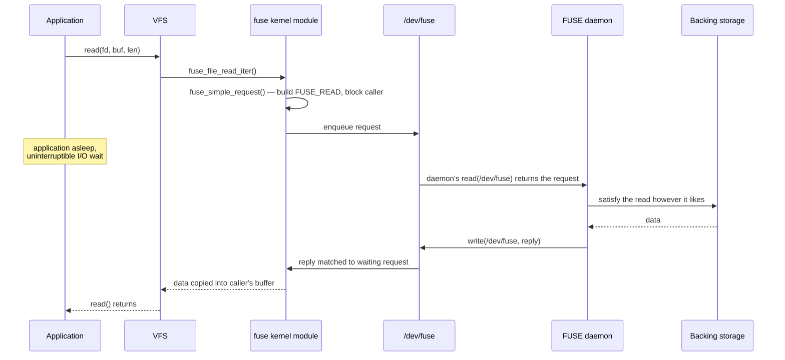

# FUSE

FUSE moves a filesystem's logic out of the kernel into an ordinary process. The kernel side is a small
VFS filesystem that turns each operation into a message on `/dev/fuse` and waits for a daemon to answer.
That buys safety and easy development — a crash kills a process, not the machine, and any language works
— and it costs boundary crossings on every operation that is not served from cache.

## The request protocol

A FUSE daemon opens `/dev/fuse` and loops: read a request, do the work (in whatever language and however
it likes), write a reply. Every VFS operation on the mount becomes one such request — `FUSE_LOOKUP` for
resolving a name, `FUSE_GETATTR` for `stat`, `FUSE_READ` and `FUSE_WRITE` for data, and dozens more
covering the rest of the VFS's operation set. On the kernel side, `fs/fuse/` is the client: it queues
outgoing requests and matches incoming replies in `<Src file="fs/fuse/fuse_i.h" symbol="fuse_conn" />`,
one instance per mounted FUSE filesystem, and blocks the calling task until the daemon answers — a process
reading a FUSE file is genuinely asleep, waiting on another process's `read()` of `/dev/fuse` and
`write()` of the reply, with the kernel in between doing nothing but relaying. Each request starts with a
fixed `<Src file="include/uapi/linux/fuse.h" symbol="fuse_in_header" />`, which carries the opcode, a
unique request ID for matching the reply, and the calling process's identity, followed by an
opcode-specific payload.

*One `read()` on a FUSE filesystem: the application waits while its request makes a round trip through a
user-space daemon.*

## What it costs

Every uncached operation pays for at least two extra boundary crossings — kernel to daemon, daemon back to
kernel — plus a context switch into the daemon process and back, on top of whatever work the daemon itself
does. None of that is present in an in-kernel filesystem, where the same operation is a function call.
Three knobs claw the difference back for the common case: the **page cache** still sits in front of a
FUSE filesystem exactly as it does for any other, so a re-read of already-cached data never reaches the
daemon at all; `entry_timeout` and `attr_timeout` let the daemon tell the kernel "trust the last lookup or
`stat` result for this many seconds" instead of reconfirming on every access; and `writeback_cache` lets
writes coalesce in the page cache and flush in larger batches instead of crossing to the daemon on every
`write()` call. What none of this fixes is **metadata-heavy** workloads — `stat`-ing thousands of small
files, walking a large directory tree, anything dominated by many small distinct operations rather than
by streaming a few large ones — because each distinct piece of metadata is its own round trip the first
time it's needed, and no amount of caching removes that first crossing.

## Making it faster

Three mechanisms narrow the gap further, present here as the state of the interface at v6.18 rather than
as something FUSE has always done:

- **Splice-based transfer** moves data between `/dev/fuse` and a file descriptor without an extra copy
  through a userspace buffer, for daemons that opt into it — cheaper per byte than the default `read`/
  `write` path, though it still crosses to the daemon.
- **FUSE passthrough**, merged in **Linux 6.9**, lets the daemon hand the kernel a backing file descriptor
  once at open time; after that, reads and writes on the FUSE file go **straight to the backing file** in
  the kernel, bypassing the daemon entirely for the data path (`<Src file="fs/fuse/passthrough.c" />`,
  gated by the `FUSE_PASSTHROUGH` capability in
  `<Src file="include/uapi/linux/fuse.h" symbol="FUSE_PASSTHROUGH" />`). The daemon still handles
  metadata and lookup; only bulk I/O skips it. The initial merge supports only privileged daemons —
  broadening that is later work, not something v6.18 already has.
- **The io_uring-based transport**, merged in **Linux 6.14** (`fs/fuse/dev_uring.c`), replaces the plain
  `read`/`write` loop on `/dev/fuse` with `io_uring` submission and completion queues, cutting per-request
  syscall overhead and letting a daemon service requests with better CPU/NUMA locality. It changes how
  requests move across the kernel/daemon boundary, not how many boundary crossings a given operation still
  needs — passthrough and caching are what reduce crossings; this is what makes each crossing cheaper.

## virtiofs

**virtiofs** runs the FUSE protocol over a `virtio` transport instead of `/dev/fuse`, to share a host
directory into a virtual machine: the daemon (`virtiofsd`) runs on the host, and the guest kernel's FUSE
client talks to it over the virtio device rather than a character device, which avoids the network
filesystem round trip (and its serialization and caching compromises) that sharing a directory over NFS
or `9p` would otherwise require. It's FUSE's request/reply model unchanged — the daemon still answers
`FUSE_LOOKUP`, `FUSE_READ`, and the rest — with a different pipe underneath. The
[VM and WSL2 lab](../01-lab-and-toolchain/a-full-system-vm-and-wsl2.md) already set up and used a
`virtiofs` share to move files between host and guest; this is the mechanism behind that share.

## Where FUSE shows up

| Filesystem | Why user space was the right place for it |
|---|---|
| `sshfs` | Speaks SSH/SFTP to a remote host — network protocol handling has no business in the kernel, and any bug is a daemon crash, not a kernel panic. |
| `rclone` (mount mode) | Bridges dozens of cloud storage backends (S3, Drive, Dropbox, …) behind one filesystem interface — each backend is a plugin in a language the kernel would never accept. |
| `gocryptfs` | Per-file encryption in user space means the crypto code, and any bug in it, stays out of kernel context entirely, and it can use ordinary crypto libraries instead of the kernel's own primitives. |
| `fuse-overlayfs` | Reimplements overlayfs's semantics for **rootless containers**, where the real kernel overlayfs's use of `trusted.*` xattrs isn't available — a user-space workaround for exactly the privilege gap the previous page's `userxattr` option also addresses, from the other direction. |
| NTFS-3G | Long the standard read-write NTFS driver before the in-kernel `ntfs3` matured — a full, actively-changing on-disk format implementation, safer to iterate on and ship as a package outside the kernel release cycle. |
| AppImage | Mounts the application bundle itself as a FUSE filesystem to run it without unpacking — using FUSE as a packaging mechanism rather than a storage one. |

## When it is worth it

Rules of thumb, not a hard boundary: **yes** for protocol clients (anything talking to a remote service
that isn't itself a block device), experimental or rapidly-iterating filesystem designs, and anything
where a crash-only failure mode (the daemon dies, the mount hangs or errors, the kernel keeps running) is
an acceptable trade for developing outside the kernel. **No** for a hot database volume or any workload
that is latency-sensitive and metadata-heavy at once — exactly the case "What it costs" above says caching
cannot fully hide.

FUSE mounts are private by default: only the mounting user (and root) can access them, even though the
mount is visible in the mount table to everyone. Seeing it in `mount` output and being able to open files
through it are different things — the **`allow_other`** mount option is what changes the second, and the
daemon has to request it explicitly; the kernel additionally refuses to honor `allow_other` from a
non-root mounter unless `user_allow_other` is set in `/etc/fuse.conf`, a system-wide opt-in a regular user
cannot grant themselves. Both checks exist because a FUSE daemon is ordinary user code, and one user's
filesystem daemon being reachable by every other user on the box is a deliberate decision, never a
default.

## Misconceptions

1. **"FUSE is slow, full stop."** Cached reads and writes are close to native speed — the cost is real but
   concentrated in uncached, metadata-heavy access, not spread evenly across everything the filesystem
   does.
2. **"Passthrough and io_uring make FUSE as fast as a kernel filesystem."** They narrow specific gaps
   (bulk data-path crossings, per-request syscall overhead) without removing the daemon from metadata and
   lookup handling, where much of the metadata-heavy cost above still lives.

<KernelFacts
  structure={[["struct fuse_conn", "fs/fuse/fuse_i.h"], ["struct fuse_in_header", "include/uapi/linux/fuse.h"]]}
  path="read() → fuse_file_read_iter() → fuse_simple_request() → daemon read(/dev/fuse) → reply → wake caller   (verify: a cached read is served from the page cache and never reaches this path)"
  observe="findmnt -t fuse,fuse.sshfs,fuse.gocryptfs   # and: ls -l /dev/fuse"
  trap="A hung FUSE daemon hangs every process that touches its mount, in uninterruptible sleep — including an innocent ls of the parent directory or a df. umount -l detaches the mount; echo 1 > /sys/fs/fuse/connections/N/abort breaks the stuck requests." />

## References

- [FUSE](https://docs.kernel.org/filesystems/fuse.html) — the kernel-side documentation: mount options,
  the connection abort interface used in the trap above, and the protocol's design notes.
- [libfuse](https://github.com/libfuse/libfuse) — the reference user-space library most FUSE filesystems
  are built on, with working examples; the fastest route to a filesystem that actually runs.
- Vangoor, Tarasov & Zadok, ["To FUSE or Not to FUSE: Performance of User-Space File Systems"](https://www.usenix.org/conference/fast17/technical-sessions/presentation/vangoor),
  USENIX FAST 2017 — the measured overhead across workload types this page's "metadata-heavy suffers most"
  claim comes from; the study predates passthrough (2024) and the io_uring transport (2025), both of which
  target exactly the costs it measured.
- [virtiofs](https://docs.kernel.org/filesystems/virtiofs.html) — FUSE over virtio for the VM-sharing case
  described above.
