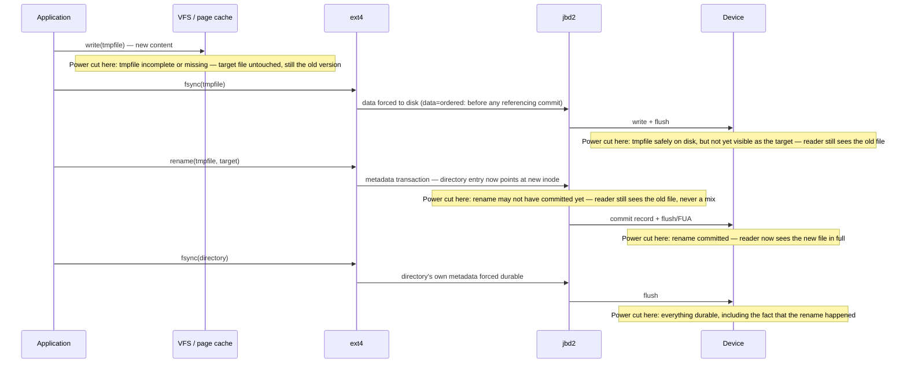

# Journaling and Crash Consistency

[Crash Consistency and Journaling](../../computer-science/storage/crash-consistency-and-journaling.md)
explains why a crash can corrupt a disk and lays out the four families of fix — scan-and-repair,
write-ahead logging, copy-on-write, and log structure. This page does not re-derive any of that. It
answers a narrower, more practical question instead: when an application on Linux calls `write`, `fsync`,
and `rename`, what does it actually get back after a power cut? The honest answer depends on the
filesystem, its mount options, the device underneath it, and how carefully the application asked — and
every one of those variables is concrete and checkable, which is the point of writing this page
separately from the theory it builds on.

## What a Linux filesystem promises

A journaling Linux filesystem promises **metadata consistency**: after a crash, the filesystem mounts,
and its own bookkeeping — which blocks are allocated, which inode owns them, what a directory contains —
agrees with itself. It does not promise **data durability** for anything the application never asked to
be made durable. Those are different guarantees, and the CS backfill page's core-concepts table draws the
line precisely: consistency is about the on-disk structures always being *recoverable* to some valid
state; durability is about whether a *specific write* survived. ext4 can recover perfectly from a crash —
mount cleanly, journal replayed, every bitmap agreeing with every inode — while still having lost the
last few seconds of an application's unflushed writes. That is not a bug in the consistency guarantee; it
is the boundary of what the guarantee ever covered.

## jbd2: the journal ext4 uses

ext4's journal is a separate, reusable kernel subsystem — **jbd2** (journaling block device layer 2,
the successor to ext3's jbd) — built around `<Src file="include/linux/jbd2.h" symbol="journal_t" />`, one
per mounted filesystem that uses it. Three vocabulary words matter for everything below:

- A **handle** is one filesystem operation's claim on the journal — `ext4_journal_start`/`ext4_journal_stop`
  bracket it — through which ext4 records every metadata block it touches.
- A **running transaction** is the set of handles currently being batched together. Many unrelated
  operations — several files being renamed, an inode being extended, a directory entry being added — can
  land in the *same* running transaction if they happen close together in time, which is exactly the
  batching that makes journaling cheap: one commit can cover dozens of otherwise-unrelated metadata
  changes.
- A **commit** closes the running transaction and writes it to the log, driven by
  `<Src file="fs/jbd2/commit.c" symbol="jbd2_journal_commit_transaction" />`. A transaction commits on a
  timer (`commit=`, 5 seconds by default — confirmed against `Documentation/admin-guide/ext4.rst` at
  v6.18), on an `fsync` that needs it, or when the journal itself fills and forces one.

The commit work happens on a dedicated kernel thread, `kjournald2`
(`<Src file="fs/jbd2/journal.c" symbol="kjournald2" />`), started per journal by
`jbd2_journal_start_thread` under the name `jbd2/<devname>`. For ext4's usual case — the journal stored as
a reserved inode inside the filesystem rather than on a separate device — `<devname>` is built from the
block device name plus that inode's number, and ext4's journal is conventionally **inode 8** (this
sandbox's own lab image confirms it: `dumpe2fs -h` on the 256 MB test filesystem built for the [ext4
page](./ext4.md) reports `Journal inode: 8`), which is exactly where the familiar `jbd2/sdX-8` thread name
in `ps` comes from — the `-8` is that inode number, not an arbitrary suffix.

## Data modes

`data=` controls what the journal actually protects, and it is the single biggest lever on what a crash
can cost. ext4 supports three modes (`Documentation/admin-guide/ext4.rst`, verified at v6.18):

| Mode | What's journaled | After a crash |
|---|---|---|
| `data=ordered` (**default**) | Metadata only, but data blocks are forced to disk *before* the metadata transaction that references them commits | Metadata always consistent; a file's data is never garbage, but unflushed writes can still be lost entirely |
| `data=writeback` | Metadata only, with no ordering guarantee against data | Metadata always consistent; a file can contain **stale old data** in blocks it never wrote, not just missing data — the recipe below exists partly because of this mode |
| `data=journal` | Everything — data and metadata both go through the log | Strongest guarantee; every byte is written twice (log, then checkpoint), so it is also the slowest |

`data=ordered`'s ordering rule is the reason ext4 can journal only metadata and still avoid the
metadata-only failure mode the CS page's partial-write table describes (an inode pointing at garbage):
the data physically cannot be referenced by a committed transaction before it is on disk. `data=writeback`
drops that rule for speed and accepts, explicitly, that a crash can expose a previous file's leftover
bytes in a file that never wrote them — a real, documented security concern the ext4 admin guide itself
calls out, not a theoretical one.

## Barriers, flush, and FUA

None of the above matters if the ordering jbd2 enforces in software can be silently undone by a device's
own volatile write cache reordering things after the fact. At each commit, ext4 issues a flush — a
`REQ_PREFLUSH` request, verified present in `<Src file="include/linux/blk_types.h" symbol="REQ_PREFLUSH" />`
at v6.18, and where the device supports it, `REQ_FUA` (`<Src file="include/linux/blk_types.h"
symbol="REQ_FUA" />`) on the commit block itself so that one write is forced past the cache directly — so
that the device cannot acknowledge the commit before its contents are actually durable.
`<Src file="block/blk-flush.c" symbol="blkdev_issue_flush" />` is the block-layer entry point that issues
one of these; [The `bio`](../12-block-layer-and-storage/the-bio.md) covers how a flush request is actually
represented and scheduled once it leaves the filesystem.

This is tunable, and the tunable has a history. ext4's `barrier=<0|1>` mount option (aliases `barrier`/
`nobarrier`, both still documented at v6.18 — **not** removed, contrary to what older folklore about
"the nobarrier option going away" might suggest) disables these flushes outright. Doing so is the classic
"fast until the power fails" configuration: with barriers off, a benchmark run entirely from a warm write
cache looks faster because the flushes it isn't paying for were the only thing keeping jbd2's commit
ordering honest against the device. The ext4 documentation's own recommendation — disable barriers only
if the storage is battery-backed (or otherwise cannot lose its write cache on power loss) — is the whole
story in one sentence: barriers cost performance to buy a guarantee that is worthless on storage that
never needs it, and silently absent on storage that does.

## fsync errors, and the 2018 lesson

[Writeback and fsync](../08-memory-management/writeback-and-fsync.md) covers `errseq_t` and the PostgreSQL
incident in full; this section states only what it means for the recipe below. Historically, a writeback
failure was recorded once against the file's `address_space` and cleared the moment *any* `fsync` call
observed it — including a caller that had no idea an error had just occurred, and including cases where
the dirty pages behind the failed write had already been dropped from the page cache, unrecoverable. A
program that got an error, retried the `fsync`, and got success back had no way to know that "success"
meant only "nothing new failed," not "your data is now on disk." PostgreSQL hit exactly this in production
in 2018 (Bacik and others' fix introduced `errseq_t`, `<Src file="include/linux/errseq.h"
symbol="errseq_t" />` — verified present at v6.18 — so that every file descriptor open at the time of a
failure sees it independently, rather than the first caller to check silently consuming it for everyone
else). What the fix does **not** do is bring the lost data back: once `fsync` has failed, the pages behind
that write may already be gone, and the only correct response is to treat the write as lost — not retried,
not assumed recovered by a later success.

## The replace-by-rename recipe on Linux

The durable, atomic way to replace a file's contents on Linux is four steps, and the CS backfill page
already establishes why each one is necessary — this page states it once more only to anchor what "actually
happens" below is measured against:

1. Write the new contents to a **temporary file** in the same directory.
2. **`fsync`** the temporary file — its data and its own metadata are now durable.
3. **`rename()`** the temporary file over the target. On a local Linux filesystem this rename is atomic:
   any reader sees the whole old file or the whole new one, never a mixture.
4. **`fsync`** the **containing directory**. The rename changed a directory entry, which is its own
   piece of metadata, dirtied independently of the file's contents — without this step, a crash can leave
   the rename durably applied to the file but not yet durable in the directory that records it.

ext4 offers a heuristic that partially rescues applications that skip step 2: **`auto_da_alloc`** (on by
default, still documented at v6.18 in `Documentation/admin-guide/ext4.rst`) detects the
`open(O_TRUNC)`/`write`/`close`/`rename` and temp-file/`write`/`close`/`rename` patterns specifically, and
forces the new file's delayed-allocation blocks to be written before the next journal commit that would
otherwise let the rename go through first — closing the classic "rename over a file that turns out to be
zero-length after a crash" failure mode without the application ever calling `fsync`. Relying on it anyway
is still wrong: it is a heuristic pattern-match against exactly the shapes the ext4 developers anticipated,
it is ext4-specific (nothing obligates another filesystem, or a future ext4, to keep matching the same
shapes), and it does nothing at all for step 4 — the directory entry's own durability is never covered by
`auto_da_alloc`. Code that depends on it is code that happens to work on today's ext4 and is not portable
even within Linux.

## What actually happens

**Run for real on this machine, checked 2026-09-14.** Same technique as
[`open`, `read`, `write` in the Kernel](./open-read-write-in-the-kernel.md#what-actually-happens): no
`root` in this sandbox, but `apt-get download strace libunwind8` plus `dpkg -x` gets a working `strace`
without installing anything system-wide. The target: what does saving a file in a real, unmodified `vim`
actually do?

```bash
$ apt-get download strace libunwind8
$ dpkg -x strace_*.deb extract/ && dpkg -x libunwind8_*.deb extract/
$ LD_LIBRARY_PATH=extract/usr/lib/x86_64-linux-gnu extract/usr/bin/strace \
    -f -e trace=openat,close,write,fsync,ftruncate,rename,renameat,renameat2,unlink \
    vim -es -c "normal Goappended by vim" -c "wq" testfile.txt
```

Elided below are `vim`'s dynamic-linker resolution, its runtime/plugin directory probing, and locale
setup — several hundred `openat` calls, none of them relevant here — leaving exactly the syscalls that
touch the target file and vim's own swap file:

```text
...                                                                    # dynamic linker / runtime / locale, elided
openat(AT_FDCWD, "testfile.txt", O_RDONLY) = 3                         # read the file into vim's buffer
close(3)                                = 0
openat(AT_FDCWD, ".testfile.txt.swp", O_RDWR|O_CREAT|O_EXCL, 0600) = 4 # swap file: crash-recovery scratch, not the recipe
write(4, "b0VIM 9.1"..., 4096)          = 4096                         # (three more 4096-byte writes to the swap file elided)
fsync(4)                                = 0                            # swap file made durable before touching the real file
openat(AT_FDCWD, "testfile.txt", O_WRONLY|O_CREAT, 0644) = 3           # *** opens the TARGET directly — no temp file, no O_TRUNC ***
ftruncate(3, 0)                         = 0                            # *** truncates the target to zero length, in place ***
write(3, "hello world, line one\nline two\na"..., 47) = 47             # new content
fsync(3)                                = 0                            # target file made durable
close(3)                                = 0
write(4, "b0VIM 9.1"..., 4096)          = 4096                         # swap file marked clean
close(4)                                = 0
unlink(".testfile.txt.swp")             = 0                            # swap file removed — save succeeded
+++ exited with 0 +++
```

This is a genuinely useful surprise, not the textbook answer. This build's `vim` reports (`:set
backupcopy? backup? writebackup?`) `backupcopy=yes`, `nobackup`, `writebackup` — and `backupcopy=yes`
means, per vim's own documentation, "make a copy of the file and overwrite the original one." **Vim does
not perform the replace-by-rename recipe here at all.** There is no temporary file for the content itself
(the `.swp` file is a separate crash-recovery mechanism, not part of this), and critically, **no `rename()`
syscall appears anywhere in this trace.** Vim opens `testfile.txt` directly, `ftruncate`s it to zero length
in place, writes the new content, and `fsync`s the same file descriptor.

Reading that against the recipe and the crash windows it exists to avoid:

- **Before `ftruncate`**: the original file is completely intact. A crash here loses nothing — the edit
  never started.
- **Between `ftruncate` and `write`/`fsync`**: this is the dangerous window the recipe's rename step is
  specifically designed to make unreachable. The file is zero bytes long on disk. A crash here — or an
  earlier `write()` failing partway before its own `fsync` — leaves `testfile.txt` **empty**, not "the old
  version," because vim truncated the live file in place instead of building the new version somewhere
  else first. Under `data=ordered`, jbd2's ordering rule protects ext4's own metadata (the inode's size
  field will never disagree with what blocks are actually allocated), but it does nothing to protect the
  *application's* choice to destroy the old content before the new content existed.
- **After `fsync(3)` returns**: the new content is durable. A crash from this point on shows the saved
  file, in full.

The swap file's own `fsync` (protecting vim's crash-recovery scratch data) happens before any of this and
is a real safety net of a different kind — if the machine dies during the dangerous window above, `vim -r`
can recover the edit from the swap file on the next start. But that is vim compensating for not using the
atomic-replace recipe, not a substitute for it: an editor's swap file is a vim-specific convenience, not a
property the filesystem or any other program reading `testfile.txt` gets to rely on.

## Misconceptions

1. **"A journaling filesystem protects my data."** It protects its own metadata. Ext4 mounting cleanly
   and passing `fsck` after a crash says nothing about whether the bytes an application wrote a moment
   before the crash survived — that is a `fsync` question, not a journaling question, and the trace above
   shows a widely-used real editor whose crash-safety for the *file content itself* depends entirely on
   its own `fsync` call landing before the power cuts, exactly like any other program.
2. **"If `fsync` fails I can retry it."** A retried `fsync` can report success without the original data
   ever having reached disk — the pages behind the failed write may already be gone from the cache. Treat
   an `fsync` failure as the write being lost, full stop.
3. **"`fsync` on the file is enough for a new file."** It durably writes the file's own data and metadata.
   It says nothing about the directory entry that makes the file findable by that name — that entry is
   its own piece of metadata, and needs its own `fsync`, on the directory, as step 4 of the recipe above
   spells out.



*A durable file replace on ext4, step by step, with what survives a crash at each point.*

<KernelFacts
  structure={[["journal_t", "include/linux/jbd2.h"], ["errseq_t", "include/linux/errseq.h"]]}
  path="fsync() → vfs_fsync_range() → ext4_sync_file() → ext4_fsync_journal() → ext4_fc_commit() → jbd2_complete_transaction() → blkdev_issue_flush()"
  observe="ps -eo comm | grep '^jbd2' && findmnt -no OPTIONS /"
  trap="fsync returning an error does not mean 'try again'. On Linux the pages that failed may already be marked clean, so the data is gone from memory as well as from disk — the only correct response is to treat the write as lost and recover from your own log." />

## References

- [ext4 Journal (jbd2)](https://docs.kernel.org/filesystems/ext4/journal.html) — the ext4 journal's
  on-disk format and the three data modes, from the kernel's own filesystem documentation (path verified
  at v6.18; the ext4 docs were restructured under `Documentation/filesystems/ext4/` since older material
  linking a single flat `ext4.txt` was written).
- Jonathan Corbet, ["PostgreSQL's fsync() surprise"](https://lwn.net/Articles/752063/), LWN, 2018 — the
  incident this page's `fsync`-error section summarizes.
- Jonathan Corbet, ["Improved block-layer error handling"](https://lwn.net/Articles/724307/), LWN, 2017 —
  the `errseq_t` mechanism that resulted.
- Pillai et al., ["All File Systems Are Not Created
  Equal"](https://www.usenix.org/conference/osdi14/technical-sessions/presentation/pillai), OSDI 2014 —
  the measured evidence that real applications on ext4 get crash consistency wrong far more often than the
  filesystem does, which this page's `vim` trace above is one small, live example of. See
  [Crash Consistency and Journaling](../../computer-science/storage/crash-consistency-and-journaling.md)
  for the full discussion.
