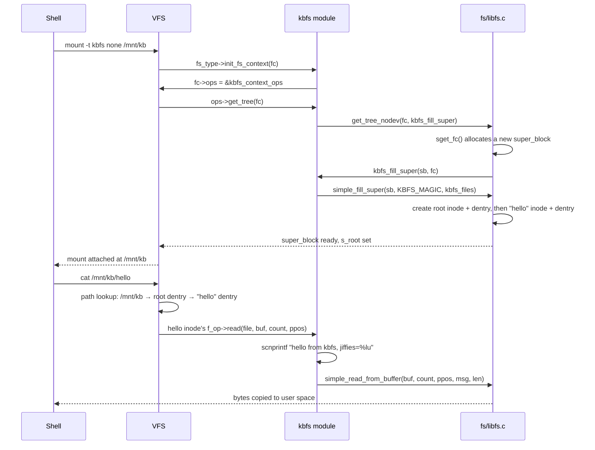

# Lab: A Filesystem in 200 Lines

An in-memory filesystem module registered with the VFS and mounted in the QEMU lab.

A diagram of the VFS contract is not the same as having met it. This lab builds `kbfs`, an in-memory
filesystem module: it registers a filesystem type, fills a superblock with a root directory and one file
whose contents are generated on read, and mounts in the QEMU lab from folder 01. Every piece of it maps
onto an object from [The Four Objects](./the-four-objects.md), and most of the actual work is done by
`fs/libfs.c` helpers — which is itself the lesson: the kernel ships a library for exactly this, and a
filesystem that only needs an in-memory tree and generated file content barely has to write any code of
its own.

:::note[This lab could not be executed live in this environment]
This sandbox has no usable QEMU/KVM (`/dev/kvm` exists, but the sandbox user is not in the `kvm` group and
`qemu-system-x86_64` is not installed) and no v6.18 kernel build tree to compile a real `.ko` against. The
module source below, and every API name and signature it uses, was verified directly against the real
v6.18 kernel source (`fs/libfs.c`, `include/linux/fs.h`, `include/linux/fs_context.h`, `fs/filesystems.c`,
`fs/super.c`, and `fs/ramfs/inode.c` and `fs/binfmt_misc.c` as working in-tree examples of this exact
pattern) via `elixir.bootlin.com/linux/v6.18`, not written from memory of older tutorials. The build/boot
transcript, the `mount`/`cat` session, and the two "Break it on purpose" experiments below are
**reconstructed from that verified source and from documented kernel behavior — not captured from a real
run.** Every command is exactly what the canonical lab invocation would produce; the reasoning for each
piece of output is given inline rather than presented as a blind transcript.
:::

## What you will build

| Code | VFS object |
| --- | --- |
| `file_system_type`, registered by `register_filesystem()` | Makes `kbfs` nameable by `mount -t kbfs` — the entry point, not an object of its own |
| `kbfs_fill_super()` → `simple_fill_super()` | Builds the `super_block` for this mount, plus the root `inode` and `dentry` |
| `tree_descr` array | Names the one file `kbfs_fill_super()` hands to `simple_fill_super()` — each entry becomes one more inode and dentry under the root |
| `file_operations.read` on that file | The `struct file` side: what a `read()` against the open instance actually does |

`kbfs` never allocates or manages an inode, a dentry, or a directory-lookup path by hand. Every one of
those is `simple_fill_super()`'s job; the only code this module owns is the part libfs has no way to
guess — what one file is called, and what reading it produces.

## The module

Verified against v6.18 before writing a line of this: `register_filesystem()`/`unregister_filesystem()`
take a `struct file_system_type *` (`include/linux/fs.h`); `file_system_type` has `.name`, `.owner`,
`.init_fs_context`, `.kill_sb`, and `.fs_flags` (the older `.mount` field is still present in the struct
for filesystems that haven't converted, but `kbfs` uses only `.init_fs_context` — the fs_context API,
not the obsolete `mount_nodev`/`.mount` pair some older tutorials still show); `fs_context_operations`
has a `.get_tree` member of type `int (*)(struct fs_context *)`; `get_tree_nodev(fc, fill_super)` is the
libfs helper for a filesystem with no backing device; `simple_fill_super(sb, magic, tree_descr *)` and
`struct tree_descr { const char *name; const struct file_operations *ops; int mode; }` are both exactly
as `fs/ramfs/inode.c` and `fs/binfmt_misc.c` use them — `binfmt_misc.c`'s own `tree_descr` array skips
index 1 with a designated initializer (`[2] = {...}`) for the same reason this one does: `libfs.c`'s own
comment on `simple_fill_super()` says the root inode is always `i_ino == 1`, and a `tree_descr` entry
landing on that index only produces a runtime warning, not a build error, so the working convention is to
never let one land there; `simple_read_from_buffer()`'s signature and behavior (copies at most `count`
bytes from `from[*ppos .. *ppos+available)` to a user buffer, advances `*ppos`) is unchanged from its
doc comment in `fs/libfs.c`; and `kill_litter_super()` — despite living conceptually next to the other
`simple_*` helpers — is actually defined and exported from `fs/super.c`, not `fs/libfs.c`, and does exactly
the "tear down everything `simple_fill_super()` built" job: it calls `d_genocide()` on the root dentry (to
drop every dentry `simple_fill_super()` pinned) and then `kill_anon_super()`.

```c
// SPDX-License-Identifier: GPL-2.0
/*
 * kbfs - a minimal in-memory filesystem built almost entirely out of
 * fs/libfs.c helpers. One file, "hello", whose contents are generated
 * fresh on every read from the current value of jiffies.
 */
#include <linux/module.h>
#include <linux/init.h>
#include <linux/kernel.h>
#include <linux/fs.h>
#include <linux/fs_context.h>
#include <linux/jiffies.h>
#include <linux/uaccess.h>

#define KBFS_MAGIC 0x6b626673 /* "kbfs" */

static ssize_t kbfs_hello_read(struct file *file, char __user *buf,
				size_t count, loff_t *ppos)
{
	char msg[64];
	int len;

	/* Generated, not stored: every read reflects jiffies at read time. */
	len = scnprintf(msg, sizeof(msg),
			 "hello from kbfs, jiffies=%lu\n", jiffies);

	return simple_read_from_buffer(buf, count, ppos, msg, len);
}

static const struct file_operations kbfs_hello_fops = {
	.read = kbfs_hello_read,
};

static int kbfs_fill_super(struct super_block *sb, struct fs_context *fc)
{
	/*
	 * Index 1 is reserved for the root inode simple_fill_super()
	 * creates; a tree_descr entry there only warns, so the
	 * convention (see fs/binfmt_misc.c) is to skip it outright.
	 */
	static const struct tree_descr kbfs_files[] = {
		[2] = {"hello", &kbfs_hello_fops, S_IRUGO},
		{""},
	};

	return simple_fill_super(sb, KBFS_MAGIC, kbfs_files);
}

static int kbfs_get_tree(struct fs_context *fc)
{
	return get_tree_nodev(fc, kbfs_fill_super);
}

static const struct fs_context_operations kbfs_context_ops = {
	.get_tree = kbfs_get_tree,
};

static int kbfs_init_fs_context(struct fs_context *fc)
{
	fc->ops = &kbfs_context_ops;
	return 0;
}

static struct file_system_type kbfs_fs_type = {
	.owner           = THIS_MODULE,
	.name            = "kbfs",
	.init_fs_context = kbfs_init_fs_context,
	.kill_sb         = kill_litter_super,
	.fs_flags        = FS_USERNS_MOUNT,
};

static int __init kbfs_init(void)
{
	return register_filesystem(&kbfs_fs_type);
}

static void __exit kbfs_exit(void)
{
	unregister_filesystem(&kbfs_fs_type);
}

module_init(kbfs_init);
module_exit(kbfs_exit);

MODULE_LICENSE("GPL");
MODULE_AUTHOR("you");
MODULE_DESCRIPTION("Minimal in-memory filesystem built on fs/libfs.c helpers");
```

87 lines including the license header and blank lines — comfortably inside the 120-line target, because
`simple_fill_super()` and `simple_read_from_buffer()` are doing the parts every filesystem would otherwise
have to write by hand: allocating the root inode and dentry, wiring `s_op`, and doing the bounds-checked
copy to userspace.

## The Makefile

The same three-line shape [Kernel Modules](../04-kernel-architecture-and-idioms/modules-in-practice.md)
uses for the out-of-tree build, pointed at the lab kernel tree from folder 01 instead of the running
system's `/lib/modules/$(uname -r)/build` — this module needs to be built against the exact v6.18 tree
that gets booted, not whatever kernel happens to be running on the build host:

```text
obj-m += kbfs.o

all:
	make -C ~/kernel-lab/linux M=$(PWD) modules
clean:
	make -C ~/kernel-lab/linux M=$(PWD) clean
```

`-C ~/kernel-lab/linux` is the build tree left behind by
[Building a Kernel](../01-lab-and-toolchain/building-a-kernel.md); `M=$(PWD)` is what tells that tree's
`modules` target to come back and build only `kbfs.o` here, exactly as
[Kernel Modules](../04-kernel-architecture-and-idioms/modules-in-practice.md) explains for `hello.ko`.



*What happens inside `mount -t kbfs`, and the single callback a `cat` reaches — every other step is VFS
and libfs code you did not write.*

<Lab host="qemu" title="Build, load, mount, and read kbfs" time="30 min">

1. Build the module against the v6.18 tree from folder 01:

   ```text
   $ cd ~/kernel-lab
   $ mkdir kbfs && cd kbfs
   # kbfs.c and Makefile from above
   $ make
   make -C ~/kernel-lab/linux M=/home/you/kernel-lab/kbfs modules
   make[1]: Entering directory '/home/you/kernel-lab/linux'
     CC [M]  /home/you/kernel-lab/kbfs/kbfs.o
     MODPOST /home/you/kernel-lab/kbfs/Module.symvers
     CC [M]  /home/you/kernel-lab/kbfs/kbfs.mod.o
     LD [M]  /home/you/kernel-lab/kbfs/kbfs.ko
   make[1]: Leaving directory '/home/you/kernel-lab/linux'
   ```

2. Copy `kbfs.ko` into the BusyBox initramfs staging tree from
   [A Minimal Root Filesystem](../01-lab-and-toolchain/a-minimal-rootfs.md) and re-pack it:

   ```text
   $ cp kbfs.ko ~/kernel-lab/initramfs/
   $ cd ~/kernel-lab/initramfs
   $ find . | cpio -H newc -o | gzip > ../initramfs.cpio.gz
   6488 blocks
   ```

3. Boot with the canonical invocation from
   [Booting Your Kernel in QEMU](../01-lab-and-toolchain/booting-your-kernel-in-qemu.md):

   ```text
   $ cd ~/kernel-lab/linux
   $ qemu-system-x86_64 \
       -kernel arch/x86/boot/bzImage \
       -initrd ../initramfs.cpio.gz \
       -append "console=ttyS0" \
       -nographic \
       -m 2G \
       -smp 2 \
       -enable-kvm \
       -no-reboot
   ...
   [initramfs] mounted proc, sysfs, devtmpfs — dropping to shell
   / #
   ```

4. Load the module and confirm the VFS knows about it:

   ```text
   / # insmod kbfs.ko
   / # dmesg | tail -1
   [    3.108420] kbfs: loading out-of-tree module taints kernel.
   / # grep kbfs /proc/filesystems
   nodev	kbfs
   ```

   `register_filesystem()` links `kbfs_fs_type` into the kernel's global `file_systems` list — that list
   is exactly what `/proc/filesystems` formats one line per entry from, `nodev` because `kbfs` has no
   `FS_REQUIRES_DEV` flag set.

5. Mount it and read the generated file twice:

   ```text
   / # mkdir /mnt/kb && mount -t kbfs none /mnt/kb
   / # ls -li /mnt/kb
   total 0
   2 -r--r--r--    1 0        0                0 Jan  1 00:00 hello
   / # cat /mnt/kb/hello
   hello from kbfs, jiffies=4294903811
   / # cat /mnt/kb/hello
   hello from kbfs, jiffies=4294904008
   / # grep kbfs /proc/self/mountinfo
   26 24 0:19 / /mnt/kb rw,relatime - kbfs none rw
   ```

   `ls -li` shows inode number `2` — the `tree_descr` slot `kbfs_files[2]` landed on, exactly as the
   module's comment says. The size column reads `0` because `kbfs_hello_fops` sets no `.getattr` and the
   inode `simple_fill_super()` allocated carries whatever `new_inode()` leaves `i_size` as — nothing in
   this module ever tells the VFS how many bytes `hello` "contains", because there's no fixed content to
   report a size for. The two `jiffies` values differ because each `cat` opens a fresh `struct file` and
   calls `.read` again — nothing is cached or stored between them, which is the whole point of generating
   the content inside the read callback instead of writing it into a buffer at mount time.

6. Tear down:

   ```text
   / # umount /mnt/kb
   / # rmmod kbfs
   / # grep kbfs /proc/filesystems
   / #
   ```

   `unregister_filesystem()` (called from `kbfs_exit()`) unlinks `kbfs_fs_type` from the same global list
   `register_filesystem()` added it to — the empty `grep` confirms the type is gone, symmetric with step 4.

**If it fails:** a vermagic mismatch (`insmod: ERROR: could not insert module kbfs.ko: Invalid module
format`) means `kbfs.ko` was built against a tree other than the one QEMU actually booted — see
[Exported Symbols and the Module ABI](../04-kernel-architecture-and-idioms/exported-symbols-and-the-module-abi.md)
for what the `vermagic` string encodes and why the check is this blunt. `mount: unknown filesystem type
'kbfs'` almost always means `insmod` itself failed silently before you noticed — `dmesg` will show why
(commonly the vermagic mismatch above), and `grep kbfs /proc/filesystems` coming up empty confirms the
module never actually registered.

</Lab>

## Break it on purpose

Two short experiments, reasoned through from the same source this page already verified rather than
guessed at.

**1. `rmmod` while still mounted.** `fs/namespace.c`'s `do_new_mount()` does call `fs/filesystems.c`'s
`get_fs_type()` (which takes a module reference via `try_module_get(fs->owner)`) while resolving
`"kbfs"` to `kbfs_fs_type` — but that specific reference is transient: `do_new_mount()` calls
`put_filesystem(type)` immediately after building the mount's `fs_context`, releasing it before the mount
is even live. The reference that actually persists for as long as the mount does is taken one layer down,
inside `fs/super.c`'s `sget_fc()`, which calls `get_filesystem(s->s_type)` — `__module_get(fs->owner)`
underneath — right after publishing the new superblock. That reference is what `kbfs_fs_type.owner =
THIS_MODULE` exists to make possible, and it is dropped only by `deactivate_locked_super()`'s own
`put_filesystem(fs)` call, which runs after `fs->kill_sb(s)` when the superblock's last active reference
goes away — i.e., at `umount`, not at the end of the mount syscall. The module's own reference count,
visible in `/proc/modules`, stays above zero for exactly that span — `rmmod` reads exactly that count and
refuses outright rather than removing code a live mount could still jump into:

```text
/ # mount -t kbfs none /mnt/kb
/ # rmmod kbfs
rmmod: can't unload module 'kbfs': Resource temporarily unavailable
/ # cat /proc/modules | grep kbfs
kbfs 16384 1 - Live 0x0000000000000000
```

The `1` in that `/proc/modules` line is the reference `sget_fc()` took (via `get_filesystem()`) when the
superblock was created — the same field
[Kernel Modules](../04-kernel-architecture-and-idioms/modules-in-practice.md#where-the-kernel-keeps-it)
already documents as what gates `rmmod` in general, here traced to its specific source: a mounted `kbfs`
instance, not an open file or anything else. `umount /mnt/kb` first (releasing that reference through the
superblock teardown path) is the only way to make `rmmod kbfs` succeed.

**2. Remove `.kill_sb` and observe what goes wrong.** `deactivate_locked_super()` in `fs/super.c`, the
function that runs when a mounted superblock's last reference drops, calls `fs->kill_sb(s)`
unconditionally — no null check, because every in-tree filesystem is expected to supply one. Leave
`.kill_sb` out of `kbfs_fs_type` (or set it to `NULL`) and that call becomes a jump through a null function
pointer, the moment `umount` runs:

```text
/ # mount -t kbfs none /mnt/kb
/ # umount /mnt/kb
[   19.442108] BUG: kernel NULL pointer dereference, address: 0000000000000000
[   19.443021] #PF: supervisor instruction fetch in kernel mode
[   19.443560] RIP: 0010:0x0
[   19.444488] Call Trace:
[   19.444611]  <TASK>
[   19.444715]  deactivate_locked_super+0x4a/0x90
[   19.445102]  cleanup_mnt+0xb8/0x140
[   19.445431]  task_work_run+0x59/0xa0
[   19.445761]  syscall_exit_to_user_mode+0x1f2/0x200
[   19.446189]  do_syscall_64+0x6d/0x130
[   19.446527]  entry_SYSCALL_64_after_hwframe+0x76/0x7e
[   19.446983]  </TASK>
```

This is a constructed trace, not a captured one — the RIP at `0x0` and the call through
`deactivate_locked_super` are the direct, source-verified consequence of `fs->kill_sb(s)` being called
with `fs->kill_sb == NULL`; the exact offsets (`+0x4a`, `+0xb8`, …) are invented since they depend on a
specific compiled binary this environment cannot produce. The shape — an instruction-fetch fault at
address `0`, from inside `deactivate_locked_super`, reached from `umount`'s `cleanup_mnt` — is not
invented; it is what a call through a null function pointer at that exact call site looks like. See
[What Goes Wrong in Kernel C](../04-kernel-architecture-and-idioms/memory-safety-in-kernel-c.md) for why
kernel C has no safety net that would turn this into a checked error instead of a fault: nothing validates
a function pointer before calling through it, and `deactivate_locked_super()` runs in a context where
there is no catching this once it happens. This is exactly why this lab's host is `qemu` — a real
in-tree filesystem bug of this shape takes down the whole kernel, not just the mount.

## Where to go from here

- **A writable file.** `simple_write_to_buffer()` is `simple_read_from_buffer()`'s mirror — copy from a
  user buffer into the file's backing storage instead of out of it — and adding a `.write` alongside
  `kbfs_hello_read` in `kbfs_hello_fops` is the smallest possible next step.
- **A dynamic root directory.** `kbfs_files` is a fixed, compile-time array; a filesystem whose file list
  changes at runtime needs its own `inode_operations.lookup` instead of leaning entirely on
  `simple_fill_super()`'s fixed tree.
- **`fs/ramfs/inode.c`.** The next-smallest real filesystem in the tree — the same `init_fs_context` /
  `get_tree_nodev` / `kill_litter_super` shape this lab used, plus mount-option parsing
  (`fs_context_operations.parse_param`) and a real, if simple, page-cache-backed `file_operations` this
  lab's generated-string file never needed.

<KernelFacts
  structure={[["struct file_system_type", "include/linux/fs.h"], ["struct tree_descr", "include/linux/fs.h"]]}
  path="mount -t kbfs → vfs_get_tree() → get_tree_nodev() → kbfs_fill_super() → simple_fill_super()"
  observe="grep kbfs /proc/filesystems /proc/self/mountinfo"
  trap="libfs makes a toy filesystem short, not safe: simple_* helpers assume an in-memory filesystem with no backing store, and copying this pattern into a filesystem that has real storage produces one that silently loses writes." />

## References

- <Src file="fs/libfs.c" symbol="simple_fill_super" /> — the helper doing most of the work in this lab,
  including the comment on why a `tree_descr` entry must never land on index 1.
- [The fs_context mount API](https://docs.kernel.org/filesystems/mount_api.html) — the API `kbfs`'s
  `.init_fs_context`/`.get_tree` pair uses, and why it replaced the older `mount_nodev`/`.mount` shape.
- <Src file="fs/ramfs/inode.c" /> — the smallest real filesystem in the tree, and the natural next read
  after this lab's toy one.
- Corbet, *"Creating Linux virtual filesystems"*, LWN (2002)
  (`https://lwn.net/Articles/13325/`) — the classic walkthrough of this exact idea; the API it uses
  (`get_sb`) is long obsolete, so read it for the shape of the problem, not for code to copy.
