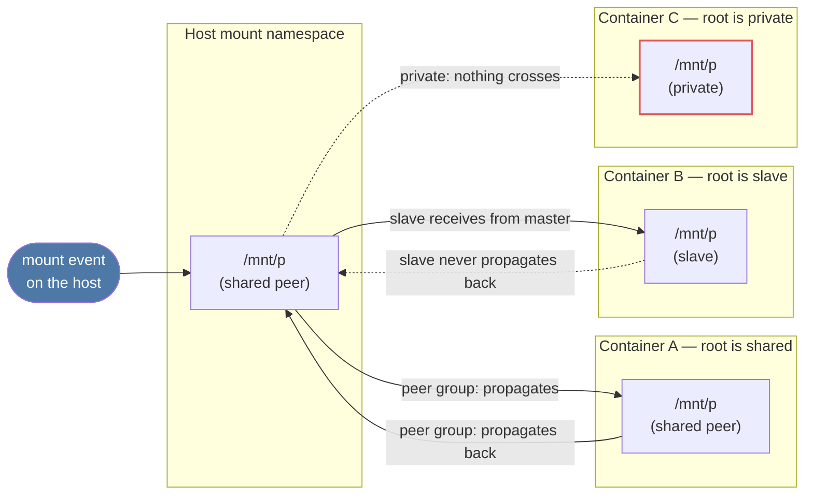

# Mounts and Mount Namespaces

The directory tree you see with `ls /` is not the tree on any one disk. It is a composition: many
filesystem trees — an ext4 root, a tmpfs `/tmp`, a FUSE mount, a bind-mounted directory — grafted onto
each other at mount points, and the graft points themselves are recorded in a separate **mount tree**
that the kernel consults during path lookup, not in the directory tree of any single filesystem. Once
that separation is clear — the mount tree is metadata *about* the directory tree, not part of it — bind
mounts, mount namespaces, and why a container sees a different `/` all turn out to be the same idea
applied at different scopes.

## The mount tree

Every mount in the system is a `<Src file="fs/mount.h" symbol="mount" />` — a kernel-internal structure
that embeds the public `<Src file="include/linux/mount.h" symbol="vfsmount" />`. Between the two they
record everything one graft point needs: which superblock this mount instance reads and writes (`mnt`
inside `vfsmount`, pointing at `struct super_block`), which dentry is the *root* of this mount — the
directory that appears at the mount point, not necessarily the filesystem's own root — and where this
mount is attached: a parent mount (`mnt_parent`) plus the mountpoint dentry within that parent
(`mnt_mountpoint`). Nothing here says "this is the only mount of this superblock." One superblock —
one ext4 filesystem, one tmpfs instance — can back many mounts simultaneously, each a separate `struct
mount` with its own parent, its own mountpoint, and potentially its own flags. That fact is the entire
mechanism behind the next section.

## Bind mounts

A **bind mount** is a second mount of an existing subtree: `mount --bind /existing/dir /another/place`
creates a new `struct mount` whose root dentry is `/existing/dir`'s dentry and whose superblock is the
same superblock `/existing/dir` was already using. No new filesystem is created or formatted — the bind
mount is a second door into a place that already has one.

This is easy to mistake for a symlink, and the two behave nothing alike. A symlink is a name that holds
a path string, resolved fresh on every lookup by `path_lookup` following the string wherever it currently
points; it stops working the moment that string stops resolving, and a process that `chroot`s into a
subtree loses any symlink whose target lies outside it. A bind mount has no path string at all — it is a
direct pointer to the target's dentry and superblock, resolved once at mount time, and it survives
`chroot` intact because it isn't re-resolving anything on each lookup. The two are also independently
configurable: a bind mount can carry different mount flags than the thing it points at, most usefully
`ro` — bind-mounting a writable filesystem read-only somewhere else, while the original writable mount
keeps working exactly as before, since they are two separate `struct mount`s sharing one superblock.
That combination — same data, different flags, through two different doors — is exactly what the Lab
below demonstrates and what a symlink cannot do at all.

## Mount propagation

Bind mounts alone don't explain what happens next: if a process is in its own mount namespace (a private
copy of the mount tree — see below) and the host mounts a USB drive, should that mount appear inside the
namespace? Sometimes yes — a system container that should see newly attached hardware. Sometimes no — a
sandboxed build that must not see anything mounted after it started. **Mount propagation** is the
kernel's answer, and it is a property of the mount, not of the namespace: every mount belongs to a
**peer group**, and the group's type decides which other mounts see events at this one.

- **shared** — a member of a peer group. A mount or unmount at any member propagates to every other
  member.
- **slave** — receives propagation from a shared master but does not propagate back to it. A namespace
  whose root is slaved to the host's shared root keeps seeing new host mounts, but nothing mounted inside
  it leaks back out.
- **private** — propagates nowhere and receives nothing. A mount event here is invisible everywhere else,
  and mounts elsewhere never appear here.
- **unbindable** — private, plus it refuses to be the source of a bind mount at all. Used to stop a
  subtree from being duplicated anywhere else in the tree, not just to stop propagation.

`mount --make-rshared /` makes `/` and, recursively (the `r`), everything currently mounted under it into
one shared peer group. This is the operation that turns an ordinary mount tree into one where cloning it
(next section) produces a peer rather than an isolated copy.



*The same mount event under shared, slave, and private propagation — which copies of the tree see it and
which do not.*

## Mount namespaces

`CLONE_NEWNS` — the oldest Linux namespace, predating the generic namespaces infrastructure, which is why
its flag says `NS` and not `MNT` — gives a process its own copy of the mount tree. "Copy" is the operative
word: the new namespace starts as a snapshot of every mount the caller could see, each one re-created as
its own `struct mount` in the new namespace. What happens *after* the clone — whether a mount added on one
side later shows up on the other — is entirely decided by the propagation settings on the mounts that got
copied, per the peer-group rules above. A new mount namespace is not automatically isolated; it is a
structural copy whose future connectedness was decided before the clone happened.

This is why `systemd` makes `/` (and everything under it) `rshared` by default on a modern host: the init
system, service managers, and udev all want mounts made anywhere in the tree — a fresh USB drive, a
newly-provisioned NFS share — to become visible everywhere they should be, without every consumer having
to re-mount or poll for it. Container runtimes then deliberately re-mount their new root `rslave` (see
host mounts, don't leak back) or fully `rprivate` (see nothing, leak nothing) precisely because they do
*not* want a container inheriting the host's habit of universal visibility — a compromised or merely noisy
container mounting something should not be a host-visible event, and a namespace that never overrode
`shared` would make it one. The same propagation machinery that makes a desktop's automount "just work"
is what a container runtime has to explicitly turn off to get isolation. This propagation control is also
the exact primitive the containers material — coming later in this series — builds container filesystem
isolation on top of; the mechanism is the whole of it, not a container-specific concept underneath.

## The new mount API

The classic `mount(2)` syscall packs "identify a filesystem type," "configure it," and "attach it to the
tree" into one call with an overloaded, filesystem-specific `data` blob — workable for simple cases,
awkward for anything that needs multi-step configuration, privilege separation (configure as one process,
attach as another), or attaching before naming a final location. Six syscalls, all landing in the same
Linux 5.2 cycle (verified against `man7.org`), split those phases apart: `fsopen(2)` creates an
**in-kernel filesystem context** for a named filesystem type; `fsconfig(2)` feeds it options one at a time
against that context, rather than one packed blob; `fsmount(2)` turns a configured context into a detached
mount — one that exists but is not yet attached anywhere in any tree; `move_mount(2)` attaches (or moves)
a mount, detached or not, to a location; and `open_tree(2)` opens a reference to an *existing* mount or
subtree, optionally cloning it, without needing a path lookup that also has to double as the attach point.
A seventh, `mount_setattr(2)` (Linux 5.12), changes properties of an existing mount tree — most notably
**idmapped mounts**, which remap the UID/GID a filesystem sees without changing the identities visible
to the mounting process. Idmapped-mount support landed filesystem-by-filesystem afterward: xfs, ext4,
and FAT at 5.12 itself, btrfs and ntfs3 at 5.15, f2fs at 5.18, erofs at 5.19 (verified against
`man7.org`'s `mount_setattr(2)` page). None of this replaces `mount(2)` — the `mount` command and most
software still use it — but it is what `util-linux`'s newer mount handling, container runtimes doing
idmapped bind mounts, and anything building filesystem contexts programmatically now use instead.

## What actually happens

This sandbox has no spare block device to run a literal `mount /dev/sdb1 /mnt` against, so the field-by-
field walkthrough below uses a real mount performed live in the Lab further down — `mount -t tmpfs
demo-shared-tmpfs /tmp/mnt-lab/shared/root/p` — which exercises exactly the same kernel path a block
device mount does, minus opening a block device: `path_mount()` (the internal entry point both the
`mount(2)` syscall and, ultimately, `do_new_mount()` reach) resolves the target path to a mountpoint
dentry, `do_new_mount()` looks up the filesystem type and drives context creation, `vfs_get_tree()` calls
the filesystem's `get_tree` to build (or, for something already mounted elsewhere, reuse) a `struct
super_block`, and `do_add_mount()` creates the new `struct mount`, links it as a child of the target's
mount, and hangs it off the mountpoint dentry — after which `propagate_mnt()` walks the mountpoint's peer
group and slaves, creating the copies propagation says should exist elsewhere. `/mnt`'s (or here,
`/tmp/mnt-lab/shared/root/p`'s) previous contents are not touched on disk or deleted — the new mount's
root dentry simply becomes what path lookup finds first at that point; the old contents are hidden, not
gone, and reappear the moment the mount is removed with `umount`.

The real `/proc/self/mountinfo` line this produced, captured live:

```text
661 572 0:92 / /tmp/mnt-lab/shared/root/p rw,relatime shared:347 - tmpfs demo-shared-tmpfs rw,uid=1000,gid=1000
```

Field by field (per `proc_pid_mountinfo(5)`):

| Field | Value | Meaning |
|---|---|---|
| mount ID | `661` | unique ID of this mount in this namespace |
| parent ID | `572` | mount ID of `/tmp/mnt-lab/shared/root`, the mount this one is attached under |
| major:minor | `0:92` | the backing device's `st_dev`; `0:N` is normal for virtual filesystems like tmpfs |
| root | `/` | the directory *within the mounted filesystem* that appears here — `/` because the whole tmpfs instance is exposed, not a subdirectory of it |
| mount point | `/tmp/mnt-lab/shared/root/p` | where this mount is attached, relative to the process's root |
| mount options | `rw,relatime` | per-mount flags |
| optional fields | `shared:347` | this mount's peer group ID — present because [Mount propagation](#mount-propagation) made an ancestor shared |
| separator | `-` | marks the end of the variable-length optional-fields block |
| filesystem type | `tmpfs` | what `get_tree` built |
| mount source | `demo-shared-tmpfs` | the string passed as the mount source (a real block device would show `/dev/sdb1` here) |
| super options | `rw,uid=1000,gid=1000` | filesystem-specific options, distinct from the per-mount options field |

<Lab host="root-required" title="See propagation happen" time="15 min">

**Environment note.** This sandbox has no real root and no interactive `sudo`, but unprivileged user +
mount namespaces (`unshare --user --mount --map-root-user`) work here and grant real `CAP_SYS_ADMIN`
*inside* the new namespace — enough to mount tmpfs and exercise every propagation rule below for real.
Three persistent namespaces stand in for the brief's "two terminals": NS-A is the always-mounting side —
one process, held with a backgrounded `sleep`, entered repeatedly with `nsenter --preserve-credentials`
to run each step, exactly as a second terminal attached to the same namespace would be. NS-B and NS-C are
each a second terminal in turn: NS-B is cloned from NS-A to observe the *shared* case (step 3), and NS-C
is a separate clone, made after NS-A's shared subtree was reused for the *private* case, so that NS-B's
already-established shared peering couldn't leak a false negative into the private test (step 4). Two
"second terminals," not one, because the two propagation cases needed to be checked against clones taken
under different conditions, not the same clone reused.

1. Start the first namespace and check `/`'s propagation. Passing `unchanged` matters — see "If it
   fails" below.

   ```text
   $ unshare --user --mount --map-root-user --propagation unchanged sleep 600 &
   $ nsenter --target $NSA_PID --mount --user --preserve-credentials findmnt -o TARGET,PROPAGATION /
   TARGET PROPAGATION
   /      private
   ```

   `/` came back `private`, not the `shared` a typical systemd host would show — this sandbox is WSL2,
   whose init does not make `/` shared the way `systemd` does on bare metal. Recorded honestly; it does
   not change how propagation itself behaves, only what the starting condition already was.

2. Turn a subtree shared, then clone a second namespace from inside the first — this is the moment a real
   container runtime's `CLONE_NEWNS` happens, and the new namespace inherits the shared peer group because
   it existed at clone time:

   ```text
   $ mount --bind /tmp/mnt-lab/shared/root /tmp/mnt-lab/shared/root
   $ mount --make-shared /tmp/mnt-lab/shared/root
   $ findmnt -o TARGET,PROPAGATION /tmp/mnt-lab/shared/root
   TARGET                   PROPAGATION
   /tmp/mnt-lab/shared/root shared

   $ nsenter --target $NSA_PID --mount --user --preserve-credentials \
       unshare --mount --propagation unchanged sleep 600 &     # NS-B
   $ nsenter --target $NSB_PID --mount --user --preserve-credentials \
       findmnt -o TARGET,PROPAGATION /tmp/mnt-lab/shared/root
   TARGET                   PROPAGATION
   /tmp/mnt-lab/shared/root shared
   ```

3. Mount a tmpfs in NS-A's copy of the shared subtree and check NS-B live — no new clone, this is
   propagation happening between two already-running namespaces:

   ```text
   $ nsenter --target $NSA_PID --mount --user --preserve-credentials bash -c '
       mkdir -p /tmp/mnt-lab/shared/root/p
       mount -t tmpfs demo-shared-tmpfs /tmp/mnt-lab/shared/root/p
       findmnt -o TARGET,SOURCE,FSTYPE,PROPAGATION /tmp/mnt-lab/shared/root/p'
   TARGET                     SOURCE            FSTYPE PROPAGATION
   /tmp/mnt-lab/shared/root/p demo-shared-tmpfs tmpfs  shared

   $ nsenter --target $NSB_PID --mount --user --preserve-credentials \
       findmnt -o TARGET,SOURCE,FSTYPE,PROPAGATION /tmp/mnt-lab/shared/root/p
   TARGET                     SOURCE            FSTYPE PROPAGATION
   /tmp/mnt-lab/shared/root/p demo-shared-tmpfs tmpfs  shared
   ```

   It appeared in NS-B without anyone touching NS-B — exactly the propagation the peer group promises.

4. Repeat with `--make-private` instead of `--make-shared`, on a fresh subtree, cloning a third namespace
   (NS-C) the same way:

   ```text
   $ nsenter --target $NSA_PID --mount --user --preserve-credentials bash -c '
       mount --bind /tmp/mnt-lab/private/root /tmp/mnt-lab/private/root
       mount --make-private /tmp/mnt-lab/private/root'
   $ nsenter --target $NSA_PID --mount --user --preserve-credentials bash -c '
       mkdir -p /tmp/mnt-lab/private/root/p
       mount -t tmpfs demo-private-tmpfs /tmp/mnt-lab/private/root/p
       findmnt -o TARGET,SOURCE,FSTYPE,PROPAGATION /tmp/mnt-lab/private/root/p'
   TARGET                      SOURCE             FSTYPE PROPAGATION
   /tmp/mnt-lab/private/root/p demo-private-tmpfs tmpfs  private

   $ nsenter --target $NSC_PID --mount --user --preserve-credentials bash -c '
       findmnt -o TARGET,SOURCE,FSTYPE,PROPAGATION /tmp/mnt-lab/private/root/p || echo "NOT VISIBLE: findmnt found nothing at that path"
       ls /tmp/mnt-lab/private/root/p'
   NOT VISIBLE: findmnt found nothing at that path
   ```

   `findmnt` exits non-zero (nothing mounted at that path, so the `||` branch's `echo` ran) and `ls`
   printed nothing — the directory is genuinely empty in NS-C. A private mount event does not cross, even
   though NS-C was cloned from the very same namespace that has the mount.

5. Bind-mount a directory read-only and confirm writes fail through the bind but succeed through the
   original — same superblock, different flags per mount, exactly the [Bind mounts](#bind-mounts) claim:

   ```text
   $ echo "hello from original" > /tmp/mnt-lab/bind/src/file.txt   # seeded before this step, on the host
   $ nsenter --target $NSA_PID --mount --user --preserve-credentials bash -c '
       mount --bind /tmp/mnt-lab/bind/src /tmp/mnt-lab/bind/dst
       mount -o remount,bind,ro /tmp/mnt-lab/bind/dst
       findmnt -o TARGET,SOURCE,OPTIONS /tmp/mnt-lab/bind/dst
       echo "via bind" >> /tmp/mnt-lab/bind/dst/file.txt 2>&1 || echo "WRITE FAILED: $?"
       echo "via original" >> /tmp/mnt-lab/bind/src/file.txt
       cat /tmp/mnt-lab/bind/dst/file.txt'
   TARGET                SOURCE                   OPTIONS
   /tmp/mnt-lab/bind/dst tmpfs[/mnt-lab/bind/src] ro,nosuid,nodev,nr_inodes=1048576
   bash: line 7: /tmp/mnt-lab/bind/dst/file.txt: Read-only file system
   WRITE FAILED: 1
   hello from original
   via original
   ```

   The write through `dst` (the read-only bind) fails with `EROFS`; the write through `src` (the original,
   still writable) succeeds — and it is immediately visible through `dst` too, because both mounts are the
   same tmpfs superblock. Read-only-ness is a property of the mount, not of the data.

**Cleanup:** killing the three backgrounded `sleep` holders (`kill $NSA_PID $NSB_PID $NSC_PID`) destroys
their mount namespaces, which unmounts everything created inside them automatically — no host-visible
mount was left behind by this lab.

**If it fails:** `unshare` without an explicit `--propagation` flag defaults to `private`, silently
severing any peer group the new namespace's mounts belonged to at clone time — step 1 above hit exactly
this once, on the second (unshared) namespace, before `--propagation unchanged` was added to that
invocation too; the symptom was a `findmnt` that reported `private` on a subtree that had just been
verified `shared` moments earlier one level up. Also confirm `/mnt/p` (or here, `.../root/p`) exists as a
directory *before* the `mount` call — `mount` does not create its target.

</Lab>

## Misconceptions

1. **"A bind mount is a kind of symlink."** It is a second mount of the same subtree, pointing directly
   at the target's dentry and superblock with no path string involved. It survives `chroot`, which a
   symlink to something outside the new root does not, and it can carry mount flags — `ro` in particular
   — independently of the mount it was bound from, which a symlink cannot do at all.
2. **"Mounting over a directory deletes what was there."** It hides it. The old contents are still on
   disk, unreachable through that path only because the new mount's root dentry now answers lookups there
   instead; `umount` makes them reappear exactly as they were.
3. **"A new mount namespace is isolated from the host's mounts."** Only if propagation says so.
   `CLONE_NEWNS` copies the mount tree at that instant, but a namespace cloned while `/` was shared keeps
   receiving every mount the host makes afterward — isolation is a propagation setting a container
   runtime applies deliberately (`rslave` or `rprivate`), not a side effect of having a separate
   namespace. Step 4 above shows the same fact from the other side: a *private* subtree stops receiving
   updates even though the namespace holding it was cloned from a namespace that does.

<KernelFacts
  structure={[["struct mount", "fs/mount.h"], ["struct vfsmount", "include/linux/mount.h"]]}
  path="mount() → path_mount() → do_new_mount() → vfs_get_tree() → do_add_mount() → propagate_mnt()"
  observe="findmnt -o TARGET,SOURCE,FSTYPE,PROPAGATION   # or: cat /proc/self/mountinfo"
  trap="unshare --mount does not stop mounts from leaking in if / was shared when the namespace was cloned — propagation, not the namespace itself, decides isolation. Container runtimes set it explicitly (rslave or rprivate) for exactly this reason." />

## References

- [Shared subtrees](https://docs.kernel.org/filesystems/sharedsubtree.html) — the in-tree design
  document; the propagation semantics worked through directly, including the peer-group and slave
  definitions used above.
- [`mount_namespaces(7)`](https://man7.org/linux/man-pages/man7/mount_namespaces.7.html) — the
  authoritative user-visible description of namespaces and propagation together.
- LWN, [Mount namespaces and shared subtrees](https://lwn.net/Articles/689856/) — Kerrisk's 2016 article;
  the propagation semantics it describes are unchanged, and it predates the new mount API above.
- [`proc_pid_mountinfo(5)`](https://man7.org/linux/man-pages/man5/proc_pid_mountinfo.5.html) — every
  `mountinfo` field defined; the page name verified current at v6.18-era man-pages (older releases folded
  this into `proc(5)`).
