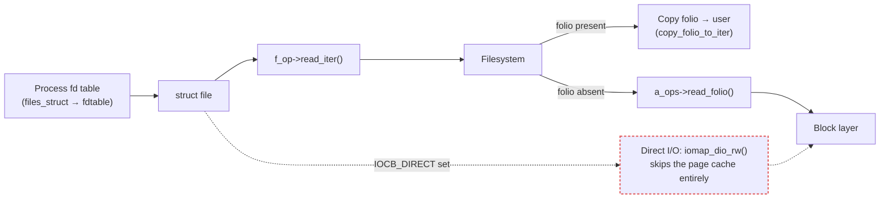

# `open`, `read`, `write` in the Kernel

A file descriptor is not a handle to a file. It's a small integer, an index into a per-process table of
pointers to `struct file` — and that one level of indirection is the whole explanation for a handful of
things that otherwise look like special cases: why `dup()` gives you a second descriptor that shares an
offset with the first, why a child inherits its parent's open files across `fork()`, and why `O_CLOEXEC`
is a per-descriptor bit rather than a per-file one. This page follows the three most common file
syscalls — `open`, `read`, `write` — from that integer down to the filesystem and the page cache, and
marks the exact point where `O_DIRECT` leaves the path this page otherwise describes.

## What an fd is

Every process's open files live behind `current->files`, a `<Src file="include/linux/fdtable.h"
symbol="files_struct" />`. Verified at v6.18, its live table is `fdt`, a pointer to a `<Src
file="include/linux/fdtable.h" symbol="fdtable" />` holding `fd`, the actual array of `struct file
__rcu *`; `open_fds`, a bitmap of which slots are in use; and `close_on_exec`, a separate bitmap — one
bit per descriptor — of which of those open files should be closed across `execve()`. That bitmap is
exactly why `O_CLOEXEC` is a property of *this descriptor*, not of the underlying `struct file`: two
descriptors pointing at the same open file can disagree about whether `exec` closes them.

Opening a file allocates the **lowest-numbered free slot** in this table (`get_unused_fd_flags`, called
before the filesystem is even touched) and, once the open succeeds, `<Src file="fs/file.c"
symbol="fd_install" />` publishes the new `struct file` pointer into that slot. This is also the
mechanism behind a classic piece of shell plumbing: `dup2(fd, 1)` doesn't create a new open file or copy
any data — it makes fd table slot 1 point at the *same* `struct file` `fd` already points at (after
closing whatever slot 1 pointed at before). Redirecting stdout is nothing more than overwriting one
pointer in this table.

## `open()`

`open()`/`openat()` reach `<Src file="fs/open.c" symbol="do_sys_openat2" />`, which — verified at
v6.18 — does the following in order: `build_open_flags()` turns the raw `O_*` flags and mode into an
internal `struct open_flags`, and is where `O_CREAT`, `O_TRUNC`, and `O_EXCL` are interpreted (`O_CREAT`
says create it if missing, `O_EXCL` combined with `O_CREAT` says fail with `EEXIST` if it already
exists — the building block of atomic lockfile creation — and `O_TRUNC` says truncate it to zero length
if it already exists and is a regular file); `getname()` then copies the path string in from userspace;
`get_unused_fd_flags()` reserves the lowest free descriptor number; `do_filp_open()` does the
actual work — path lookup (all of [Path Lookup and the Dentry Cache](./path-lookup-and-the-dcache.md)),
permission checks, and calling the filesystem's `f_op->open` to build the `struct file`; and finally
`fd_install()` publishes the result. If `do_filp_open()` fails, the reserved descriptor is released
instead of installed — the caller never observes a half-open fd.

## `read()`

`read(fd, buf, count)` reaches `<Src file="fs/read_write.c" symbol="ksys_read" />`, which resolves `fd`
to a `struct file` and calls `<Src file="fs/read_write.c" symbol="vfs_read" />`. `vfs_read` in turn calls
`f_op->read_iter`, handing it a `struct kiocb` (the file, position, and flags for this one I/O — see
"Where `O_DIRECT` leaves" below for what one of those flags does) and a `struct iov_iter` (an iterator
over where the bytes should land, abstracting a single buffer, a scatter/gather `readv`, or a
userspace-vs-kernel destination behind one interface). For a regular file on a page-cache-backed
filesystem, that `read_iter` reaches `<Src file="mm/filemap.c" symbol="filemap_read" />`, which finds or
fills the needed folios and copies from them via `copy_folio_to_iter` — the same page cache [The Page
Cache](../08-memory-management/the-page-cache.md) already covers in full, including readahead, which
this page does not re-explain.

## `write()`

The write path is symmetric in shape and different in what it guarantees. `<Src file="fs/read_write.c"
symbol="vfs_write" />` calls `f_op->write_iter`, which for a buffered write on a regular file reaches
`<Src file="mm/filemap.c" symbol="generic_perform_write" />`. Verified at v6.18, that function loops over
the folios the write touches, calling `a_ops->write_begin` to get a folio ready (allocating and locking
it if necessary), `copy_folio_from_iter_atomic` to copy the caller's bytes in, and `a_ops->write_end` to
finish and mark the folio dirty. The syscall returns as soon as that loop finishes — the bytes are in the
page cache, dirty, and *not yet on disk*. Getting them there is a separate, later job belonging to
writeback (see [Writeback and fsync](../08-memory-management/writeback-and-fsync.md) for how and when
that happens).

## File position, sharing, and `O_APPEND`

A descriptor's read/write position, `f_pos`, belongs to the `struct file`, not to the descriptor number
— which is exactly why descriptors produced by `fork()` or `dup()` (pointing at the same `struct file`)
share one position, while two independent `open()` calls on the same path get two separate `struct
file`s and two independent positions, as [The Four Objects](./the-four-objects.md#the-file-one-open-instance)
already established. When a `struct file` *is* shared this way, concurrent reads/writes through different
descriptors need to serialize their read-modify-write of `f_pos`, and that's what `f_pos_lock` (a mutex
on `struct file`, verified at v6.18) is for — taken via `<Src file="include/linux/file.h"
symbol="fdget_pos" />`, which only actually locks when the file is detectably shared (an elevated
reference count from `fork()` or `dup()`), so the common unshared case pays nothing for it.

`O_APPEND` changes where a write lands: for each write, the position is reset to end-of-file under the
inode's own lock before the write happens, which is what makes concurrent appends from *separate
processes* to the same file land whole rather than interleaved or overwriting each other, on local
filesystems, for writes that complete in a single call. That guarantee does not extend to NFS, where the
append-to-end-of-file step and the write are not atomic across the network in the same way. `pread`/
`pwrite` sidestep all of this by taking an explicit offset and never touching `f_pos` at all — the right
tool whenever multiple threads share one descriptor and need independent positions.

## Where `O_DIRECT` leaves

Everything above assumes a buffered I/O path through the page cache. `O_DIRECT` is the escape hatch: the
kernel sets `IOCB_DIRECT` (bit 17 of the `kiocb` flags word, `1 << 17`, verified at v6.18 in
`include/linux/fs.h`) on the `kiocb`, and `read_iter`/`write_iter` branch on it to a filesystem's
direct-I/O path instead — commonly `<Src file="fs/iomap/direct-io.c" symbol="iomap_dio_rw" />` on filesystems
built on the `iomap` infrastructure. That path skips the page cache entirely and builds block I/O
directly from the caller's own buffer, which means the alignment and size the hardware and filesystem
require become the caller's problem instead of something the page cache smooths over invisibly. [Buffered,
Direct, and Alignment](../12-block-layer-and-storage/buffered-direct-and-alignment.md) covers exactly
what those constraints are and what happens when they're violated.

## What actually happens

**Run for real on this machine, checked 2026-09-14.** `strace` isn't installed in this sandbox and
there's no `root` to install it the normal way — but `apt-get download strace libunwind8` fetches the
`.deb`s without root, `dpkg -x` extracts their contents into a plain directory without installing
anything system-wide, and the extracted binary runs fine against its own `LD_LIBRARY_PATH` tracing a
process it spawns itself (which needs no special privilege — only `PTRACE_ATTACH` on an *unrelated*
process would). The trace below is genuine `strace` output, not a reconstruction, captured with:

```bash
$ apt-get download strace libunwind8
$ dpkg -x strace_*.deb extract/ && dpkg -x libunwind8_*.deb extract/
$ LD_LIBRARY_PATH=extract/usr/lib/x86_64-linux-gnu extract/usr/bin/strace \
    -f -e trace=openat,dup2,write,close bash -c 'echo hello > out.txt'
```

The full trace includes several dozen `openat` calls from bash's own dynamic linker resolving `libc`,
`libtinfo`, and the `C.utf8` locale — none of them relevant here, elided below as `...`. What's left is
exactly the four syscalls this page has been building toward:

```text
...                                                                  # dynamic linker / locale, elided
openat(AT_FDCWD, "out.txt", O_WRONLY|O_CREAT|O_TRUNC, 0666) = 3
dup2(3, 1)                              = 1
close(3)                                = 0
write(1, "hello\n", 6)                  = 6
dup2(10, 1)                             = 1
close(10)                               = 0
+++ exited with 0 +++
```

Read against the sections above: the shell opens `out.txt` with exactly the `O_WRONLY|O_CREAT|O_TRUNC`
combination "`open()`" described — write-only, create it if missing, truncate it if it already has
content — getting back fd 3. Because `echo` is a shell builtin, not an external program, there's no
`fork`/`exec` here at all; bash instead saves its own stdout by `dup2`-ing it to a spare descriptor
(implicitly, before this trace excerpt) and `dup2(3, 1)`s the new file onto fd 1 in its place, then
`close(3)`s the now-redundant original descriptor — exactly the "fd table slot pointed at a different
`struct file`" mechanism "What an fd is" described for `dup2(fd, 1)`. `echo`'s own `write(1, "hello\n",
6)` writes to fd 1 knowing nothing about where it currently points — it is not aware it is writing to a
regular file rather than a terminal. The trailing `dup2(10, 1)` / `close(10)` is bash restoring its own
stdout once this one redirected command finishes. And per "`write()`" above: when this trace's
`+++ exited with 0 +++` appears, `hello`'s six bytes are in the page cache, not necessarily on disk yet —
`write()` returning success is a statement about the page cache, not about the platter or flash
underneath it.

## Misconceptions

1. **"A file descriptor is a pointer to the file."** It's an index into a per-process table of pointers
   to `struct file`, and two different indexes — in the same process or different ones — can point at
   the very same `struct file`, sharing its offset and flags.
2. **"`write()` returning means the data is on disk."** It means the data is in the page cache and marked
   dirty. Getting it onto stable storage is writeback's job, on its own schedule, unless the caller
   explicitly asks for `fsync()`/`O_SYNC`/`O_DIRECT` to wait for or bypass that.
3. **"`O_APPEND` makes all appends atomic everywhere."** It does, for a single write that completes in
   one call, on local filesystems. It does not on NFS, and it does not help a write the caller itself
   split into multiple calls — each call gets its own atomic seek-to-end, not the whole sequence.



*The full buffered read path from a file descriptor to the block layer, and the direct-I/O branch that
bypasses the cache.*

Bit positions for the `open()` flags below were read from `include/uapi/asm-generic/fcntl.h` at v6.18 —
the header defines them in **octal**, which converts to the bit positions drawn here as: `O_WRONLY` =
`00000001` = bit 0, `O_RDWR` = `00000002` = bit 1, `O_CREAT` = `00000100` = bit 6, `O_EXCL` =
`00000200` = bit 7, `O_NOCTTY` = `00000400` = bit 8, `O_TRUNC` = `00001000` = bit 9, `O_APPEND` =
`00002000` = bit 10, `O_NONBLOCK` = `00004000` = bit 11, `O_DSYNC` = `00010000` = bit 12, `O_DIRECT` =
`00040000` = bit 14, `O_LARGEFILE` = `00100000` = bit 15, `O_DIRECTORY` = `00200000` = bit 16,
`O_NOFOLLOW` = `00400000` = bit 17, and `O_CLOEXEC` = `02000000` = bit 19. Bits 2–5 are unused; bit 13
(`FASYNC`) and bit 18 (`O_NOATIME`) are real, assigned bits but outside this page's scope, shown below as
`(other)` rather than left blank so the strip stays bit-accurate. This exact numbering is x86-64 (and
most architectures using the generic header) — `O_ACCMODE`'s two low bits are universal, but several
architectures (notably SPARC and some historical ports) assign different values to the higher flags, so
this strip is not portable to read off for another architecture's flags word.

```wavedrom title="Where each open() flag sits in the flags word on x86-64" alt="Bit-field strip of the open() flags word on x86-64, from O_WRONLY at bit 0 through O_CLOEXEC at bit 19, with unused and out-of-scope bits marked"
{ reg: [
    { bits: 1, name: "WRONLY", type: 2 },
    { bits: 1, name: "RDWR", type: 2 },
    { bits: 4, name: "unused", type: 1 },
    { bits: 1, name: "CREAT", type: 3 },
    { bits: 1, name: "EXCL", type: 3 },
    { bits: 1, name: "NOCTTY", type: 3 },
    { bits: 1, name: "TRUNC", type: 3 },
    { bits: 1, name: "APPEND", type: 6 },
    { bits: 1, name: "NONBLOCK", type: 5 },
    { bits: 1, name: "DSYNC", type: 5 },
    { bits: 1, name: "(other)", type: 1 },
    { bits: 1, name: "DIRECT", type: 4 },
    { bits: 1, name: "LARGEFILE", type: 4 },
    { bits: 1, name: "DIRECTORY", type: 4 },
    { bits: 1, name: "NOFOLLOW", type: 4 },
    { bits: 1, name: "(other)", type: 1 },
    { bits: 1, name: "CLOEXEC", type: 5 }
  ],
  config: { hspace: 900, bits: 20, lanes: 2 }
}
```

<KernelFacts
  structure={[["struct files_struct", "include/linux/fdtable.h"], ["struct kiocb", "include/linux/fs.h"]]}
  path="read() → ksys_read() → vfs_read() → f_op->read_iter() → filemap_read() → copy_folio_to_iter()"
  observe="apt-get download strace libunwind8 && dpkg -x strace_*.deb extract/ && dpkg -x libunwind8_*.deb extract/ && LD_LIBRARY_PATH=extract/usr/lib/x86_64-linux-gnu extract/usr/bin/strace -f -e trace=openat,dup2,write bash -c 'echo hello > out.txt'"
  trap="Two descriptors can share one file offset without either program knowing — a parent and a child writing to an inherited log descriptor advance the same f_pos. Unexpected interleaving in a shared log is usually this, not a filesystem bug." />

## References

- <Src file="fs/read_write.c" symbol="vfs_read" /> — the dispatch point from syscall to `f_op->read_iter`,
  short enough to read in full.
- <Src file="mm/filemap.c" symbol="filemap_read" /> — where a buffered read meets the page cache and
  folios get copied to the caller.
- [`open(2)`](https://man7.org/linux/man-pages/man2/open.2.html) — every flag's contract in one place,
  including the `O_APPEND`-on-NFS caveat and the `O_DIRECT` alignment notes this page only summarizes.
- LWN, [The `iov_iter` interface](https://lwn.net/Articles/625077/) — why `read`/`write` take an
  iterator rather than a raw pointer; 2014, and the interface has grown since, but the motivating idea
  (one interface for a user buffer, a kernel buffer, or a scatter/gather list) is unchanged.
