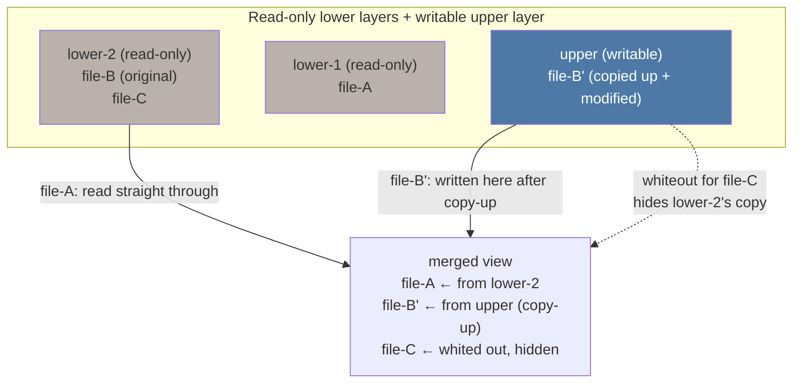

# overlayfs

overlayfs presents one directory tree made from several: read-only **lower** layers stacked under a
writable **upper** layer. Reads fall through to whichever layer has the file; writes always land in the
upper layer, copying a file up from below on its first modification. Nothing in a lower layer ever
changes, which is exactly the property a container image needs — many containers share one set of
read-only layers, each with its own thin writable layer on top.

## Lower, upper, work, merged

A mount needs four directories:

- **`lowerdir`** — one or more read-only source trees, colon-separated when there is more than one
  (`lowerdir=/a:/b:/c`), ordered from topmost to bottommost. Nothing overlayfs does ever writes into a
  lower directory.
- **`upperdir`** — the single writable layer. Every write, new file, and deletion is recorded here.
- **`workdir`** — scratch space overlayfs uses internally, never exposed through the merged view.
  Copy-up stages a file here before renaming it into `upperdir`, and whiteout creation is staged the
  same way, so that a crash mid-operation leaves either the old state or the new one, never a
  half-written file visible through the mount. **`workdir` must be on the same filesystem as
  `upperdir`** — the staging step ends with a `rename(2)`, which is only atomic within one filesystem,
  so a cross-filesystem `workdir` would turn "atomic copy-up" back into "copy, then hope nothing
  interrupts the next step."
- **`merged`** — the mountpoint itself: the single directory tree a process actually sees, assembled
  from the three above.

## Lookup through layers

A lookup for a name in the merged view walks the layers from upper to lowest lower, in order, and the
first layer that has that name answers — `<Src file="fs/overlayfs/namei.c" symbol="ovl_lookup" />` is
where this happens. A **directory** present in several layers is merged: overlayfs builds one combined
listing out of every layer's entries for that directory, so `ls` on a merged directory can show files
that physically live in different layers at once. A **regular file** present in more than one layer is
not merged — the topmost occurrence wins outright, and every lower occurrence of the same name is
invisible, exactly as if it had been deleted from every layer below the one that answered.

## Copy-up

The first time a lower file is opened for write, or has its metadata changed (owner, mode, timestamps),
overlayfs copies the **whole file** into the upper layer before letting the operation proceed —
`<Src file="fs/overlayfs/file.c" symbol="ovl_maybe_copy_up" />` decides whether a copy-up is needed, and
`<Src file="fs/overlayfs/copy_up.c" symbol="ovl_copy_up_flags" />` performs it. This has consequences
that are easy to get wrong: a one-byte change to a 2&nbsp;GB file copies the entire 2&nbsp;GB into the
upper layer, so the first write to a large, previously-untouched file is far slower than every write
after it. And because copy-up creates a new inode in the upper layer, a file descriptor opened **before**
the copy-up — read-only, against the lower file — keeps reading the lower file's original contents even
after another process's write triggers a copy-up and modifies the upper copy; the two descriptors
diverge.

`metacopy=on` narrows this for the metadata-only case: changing a file's owner or permissions, with no
content change, copies up a small metadata-only stub in the upper layer instead of the whole file
content, and the content itself is still fetched from the lower layer on demand. It is a mount option,
not the default, precisely because it changes copy-up's failure and consistency properties in ways a
plain overlay mount does not have to reason about.

## Deletion: whiteouts and opaque directories

Removing a file that exists in a lower layer cannot actually delete it — overlayfs has no write access
to the lower layers at all. Instead, `rm` on a merged file creates a **whiteout** in the upper layer: a
character device node with device number `0,0`, at the same name, which lookup treats as "this name is
deleted here" rather than as an actual device file. The lower file is untouched; the whiteout simply
outranks it during the layer walk described above. Replacing a whole directory works the same way at
directory granularity: the new upper directory is marked **opaque** with an extended attribute
(`trusted.overlay.opaque`, or under the `user.overlay.*` namespace when the mount uses the unprivileged
`userxattr` option — see below), which tells lookup to stop walking into lower layers for that directory
entirely, rather than merging its now-absent old contents back in.

This is why deleting a file inside a container layer never frees space in the image: the delete adds a
small whiteout to the container's own thin upper layer, while the actual data stays exactly where it
was, in a shared read-only lower layer that this container's delete was never able to touch.

## Where you meet it

**Container image layers** are the dominant use (named here in prose only — the containers material
covers the image-layer mechanics in full). Each image layer is a lower directory; the container's
writable state is the upper layer; many containers can share the same set of lower layers as long as
none of them writes into it, because none of them can. **Live-CD and immutable-root systems** use the
same trick the other way around: a read-only root filesystem shipped on the medium as the lower layer,
with a tmpfs or disk-backed upper layer absorbing every runtime change, so the shipped image is never
modified and a reboot can discard the upper layer to return to a known-clean state.

**Unprivileged overlay mounts inside a user namespace** work on modern kernels: `trusted.*` extended
attributes require real `CAP_SYS_ADMIN` outside any namespace, which an unprivileged user namespace does
not grant, so overlayfs falls back to the `user.overlay.*` xattr namespace instead when the mount is
given the `userxattr` option. Support for mounting overlayfs at all inside an unprivileged user+mount
namespace landed in Linux 5.11; the Lab below exercises it directly.

<Lab host="root-required" title="Build an overlay and watch copy-up" time="15 min">

**Environment note.** This sandbox has no real root and no interactive `sudo`, but — as in the
[Mounts](./mounts-and-mount-namespaces.md) Lab — `unshare --user --mount --map-root-user` grants real
`CAP_SYS_ADMIN` inside a new namespace, and the mount below adds the `userxattr` option so overlayfs uses
`user.overlay.*` instead of `trusted.overlay.*` for its whiteout/opaque metadata, per the previous
section. Every step below is a real mount, real copy-up, and real whiteout, run and captured live.

1. Set up the four directories and seed the lower layer:

   ```text
   $ mkdir -p lower upper work merged
   $ head -c 50M /dev/urandom > lower/big.bin
   $ echo "hello from lower" > lower/a.txt
   ```

2. Mount the overlay, inside the unprivileged namespace:

   ```text
   $ unshare --user --mount --map-root-user sleep 600 &
   $ nsenter --target $NSA_PID --mount --user --preserve-credentials bash -c '
       mount -t overlay overlay -o lowerdir=lower,upperdir=upper,workdir=work,userxattr merged
       findmnt -t overlay -o TARGET,OPTIONS merged
       ls -la upper'
   TARGET   OPTIONS
   .../merged rw,relatime,lowerdir=lower,upperdir=upper,workdir=work,redirect_dir=nofollow,userxattr
   total 0
   drwxr-xr-x+2 root root  40 ... .
   drwxr-xr-x 6 root root 140 ... ..
   ```

   `upper` starts empty — nothing has been written through the merged view yet, and `merged/big.bin`
   already shows the full 50&nbsp;MB, served straight from `lower`.

3. Trigger copy-up with a one-byte append, and time it:

   ```text
   $ nsenter --target $NSA_PID --mount --user --preserve-credentials bash -c '
       time sh -c "echo x >> merged/big.bin"
       ls -l upper'
   real    0m0.016s
   -rw-r--r--+1 root root 52428802 ...  big.bin
   ```

   `upper/big.bin` is now the **whole** 50&nbsp;MB file (plus the two appended bytes), not a diff. The
   16&nbsp;ms timing is fast because this sandbox's scratch directory is itself tmpfs-backed (in-memory) —
   on a real block device the same whole-file copy is the dominant cost, and scales with the file's size,
   not the size of the change, which is the point the timing is meant to demonstrate regardless of the
   underlying medium's raw speed.

4. Delete a lower file through the merged view and inspect the whiteout:

   ```text
   $ nsenter --target $NSA_PID --mount --user --preserve-credentials bash -c '
       rm merged/a.txt
       ls -l upper'
   total 51204
   c--------- 2 root root 0, 0 ... a.txt
   -rw-r--r--+1 root root 52428802 ... big.bin
   ```

   `a.txt` is now a character device with major/minor `0, 0` in `upper` — the whiteout — and no
   permission bits at all (`c---------`). It is not a real device; the merged lookup path recognizes this
   exact shape and treats it as "deleted here."

5. Unmount and confirm the lower layer never changed:

   ```text
   $ nsenter --target $NSA_PID --mount --user --preserve-credentials umount merged
   $ ls -l lower
   -rw-r--r-- 1 root root       17 ... a.txt
   -rw-r--r-- 1 root root 52428800 ... big.bin
   ```

   `lower/a.txt` still exists at its original 17 bytes, and `lower/big.bin` is still exactly 52428800
   bytes — the original size, with none of the two appended bytes from step 3. Every write in this lab
   landed in `upper`; `lower` was read from and never written to.

**If it fails:** a `workdir` on a different filesystem from `upperdir` is rejected at mount time with
`EXDEV` — the atomicity argument in [Lower, upper, work, merged](#lower-upper-work-merged) is exactly why.
Some filesystems cannot serve as the upper layer at all: older tmpfs builds without extended-attribute
support, and NFS, both lack what overlayfs needs to store whiteout and opacity metadata.

</Lab>

## Misconceptions

1. **"Changing a file in a container copies only the changed blocks."** Copy-up copies the whole file,
   every time, regardless of how small the change is. `metacopy=on` softens this only for pure metadata
   changes, not content changes.
2. **"Deleting a file in a layer frees space."** It adds a whiteout — a few bytes — to the upper layer.
   The lower layer's data is untouched and still occupies exactly the space it always did.
3. **"overlayfs is a container technology."** It is a general-purpose filesystem that container
   runtimes happen to be the most common user of. Live-CDs, immutable-root distributions, and
   read-only-root embedded systems use the identical mechanism for reasons that have nothing to do with
   containers.



*How one merged directory is assembled from three layers: a file read through, a file copied up and
modified, and a file hidden by a whiteout.*

<KernelFacts
  structure={[["struct ovl_entry", "fs/overlayfs/ovl_entry.h"], ["struct ovl_fs", "fs/overlayfs/ovl_entry.h"]]}
  path="open(O_WRONLY) on merged → ovl_open() → ovl_maybe_copy_up() → ovl_copy_up_flags() → write lands in upper"
  observe="findmnt -t overlay -o TARGET,OPTIONS   # on a host running containers, shows every layer stack"
  trap="A read-only file descriptor opened before copy-up keeps pointing at the lower file. After another process modifies the file through the merged view, the two descriptors see different contents — a real source of confusing log-tailing and config-reload bugs." />

## References

- [Overlay Filesystem](https://docs.kernel.org/filesystems/overlayfs.html) — the full semantics:
  copy-up, whiteouts, `metacopy`, `redirect_dir`, and the non-standard behaviours the kernel
  documentation lists explicitly (this page covers only the mechanism, not every option).
- <Src file="fs/overlayfs/copy_up.c" /> — the copy-up implementation referenced throughout this page.
- ["Debating overlayfs"](https://lwn.net/Articles/447650/), LWN, 2011 — coverage of an earlier union/overlay
  filesystem proposal and the design objections it ran into, from before overlayfs's eventual 2014
  mainline merge; useful context for why union filesystems took as long as they did to land cleanly.
- The OCI Image Format specification, ["Layer"](https://github.com/opencontainers/image-spec/blob/main/layer.md)
  — how a whiteout is represented inside an image tarball (a file named `.wh.<name>`), distinct from the
  on-disk character-device form this page describes; a container runtime translates between the two when
  unpacking a layer onto overlayfs.
