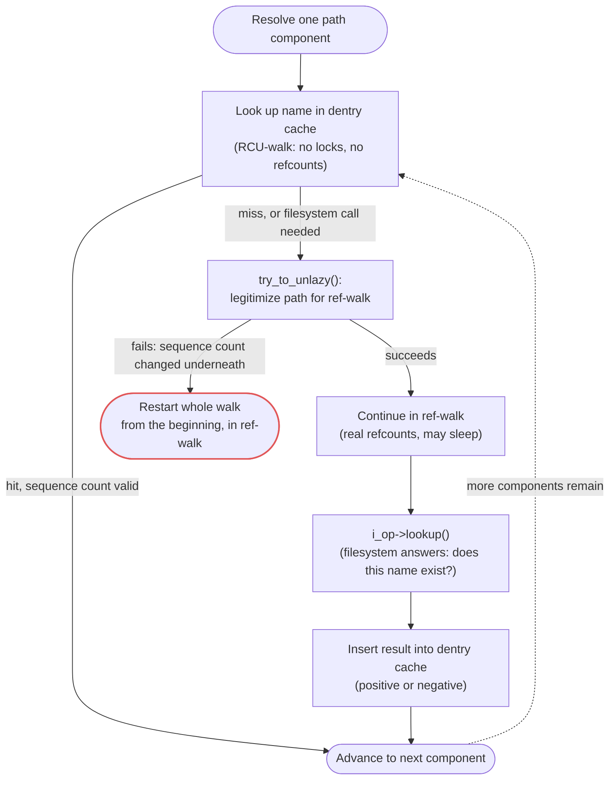

# Path Lookup and the Dentry Cache

Almost every file syscall starts with a string. Turning `/usr/lib/x86_64-linux-gnu/libc.so.6` into an
inode is something a busy machine does millions of times a second — every `exec`, every shared-library
load, every editor opening a file the user just typed the name of. Path lookup is therefore one of the
hottest paths in the kernel, and the dentry cache exists so that most lookups never touch a filesystem
at all: they never call `->lookup`, never read a directory block, never wait on I/O. The central trick —
walking the path under RCU with no locks and no reference counts, and falling back to the careful,
reference-counted walk only when the fast path can't proceed — is one of the clearest real uses of
[RCU in Practice](../09-concurrency-and-locking/rcu-in-practice.md): a read-mostly data structure (the
dentry tree) walked without ever blocking the writers that occasionally mutate it.

## Component by component

A path is resolved one component at a time. The walk starts from one of three places: the process's
root (`/`), its current working directory (relative paths), or a directory file descriptor (`openat`
and friends, when the caller passes something other than `AT_FDCWD`). From there it splits the
remaining string on `/` and looks up each component in its parent directory, one hop at a time — there
is no single call that resolves a whole path in one step. The final component is handled specially,
because it may be about to be created (`O_CREAT`), and the walk needs to know it has reached the last
segment before deciding whether "not found" is an error or an instruction to create.

All of this state — where the walk currently is, how deep it's nested through symlinks, whether it's
running in the fast (RCU) mode or the careful (reference-counted) mode — lives in one structure,
`<Src file="fs/namei.c" symbol="nameidata" />`. Fields verified at v6.18: `path`, the current position
(dentry + mount); `last`, the not-yet-resolved final component as a `struct qstr`; `root`, the
resolution root (captured once so `..` can't walk past it under `chroot`); `inode`, cached from
`path.dentry->d_inode`; `flags` and `state`, which include whether the walk is currently in RCU mode;
`seq`/`next_seq`/`m_seq`/`r_seq`, the sequence-counter snapshots RCU-walk validates against; `depth` and
`total_link_count`, for symlink nesting; and `stack`, the per-level state for symlinks currently being
followed, backed by a small inline array (`internal[EMBEDDED_LEVELS]`) so shallow walks — the vast
majority — never allocate.

The walk itself is three functions, each doing one job: `<Src file="fs/namei.c" symbol="path_openat" />`
sets up a `nameidata` and drives the whole thing for `open()`; `<Src file="fs/namei.c"
symbol="link_path_walk" />` is the component-by-component loop, splitting the string and calling into
the per-component resolver; and `<Src file="fs/namei.c" symbol="walk_component" />` resolves exactly one
name against the current parent. `walk_component` is also where `MAXSYMLINKS` (40, defined in
`include/linux/namei.h`) is enforced — cross it and the walk fails with `ELOOP` rather than recursing
forever through a symlink cycle.

## The dentry cache

Each resolved component is looked up in the **dentry cache** (dcache): a hash table keyed on (parent
dentry, name). A hit returns the child dentry directly — no filesystem call, no I/O, just a hash lookup
and a name comparison. A miss calls the filesystem's `i_op->lookup` (the table [The Four
Objects](./the-four-objects.md) introduced), which reads whatever the filesystem needs to read to answer
"does this name exist here, and if so what inode does it point at," and the result — found or not found
— is inserted into the dcache before the walk continues. That insertion is what makes the *next* lookup
of the same name a hit, which is why a second `ls -R` over an unfamiliar tree is dramatically faster than
the first: the first pass populates the dcache and inode cache component by component, and the second
finds every one of them already there.

## Negative dentries

A dentry cache entry doesn't have to mean "this name exists." A **negative dentry** caches the answer
"this name was looked up in this directory and does not exist" — `d_inode` is `NULL`, and the entry is
still hashed and still short-circuits the next lookup of the same name. This looks wasteful until you
count how often software searches for things that aren't there: every `$PATH` search tries a binary
name against each directory in turn until one succeeds, and every dynamic linker's shared-library search
does the same against `rpath`/`runpath`/the system search path. Most of those probes fail, and without
negative caching every single one would reach the filesystem again on the next attempt. The cost is
memory — a negative dentry still occupies a `struct dentry` — and it's paid back the same way positive
dentries are: reclaimed under memory pressure by the shrinker (see [Reclaim, the LRU Lists, and
kswapd](../08-memory-management/reclaim-lru-and-kswapd.md)), not held forever.

## RCU-walk and ref-walk

Path walking runs in one of two modes, and the kernel's own comment on `try_to_unlazy` names them
directly: **rcu-walk** and **ref-walk**. RCU-walk is the fast path — it walks the dentry tree under
`rcu_read_lock()`, takes no reference counts and no locks on the dentries it passes through, and
validates each step against a sequence counter instead (see [Seqlocks](../09-concurrency-and-locking/seqlocks.md)
for the mechanism). Ref-walk is the careful fallback: real reference counts, real locking, safe to sleep
in. Critically, these are not two independent implementations of path lookup that might disagree with
each other — RCU-walk *is* ref-walk, attempted without the refcounting overhead, and any situation the
fast path can't handle in place just means dropping the optimization, not doing something different.

`<Src file="fs/namei.c" symbol="try_to_unlazy" />` is the transition point. Its own header comment
describes exactly what it does: it "attempts to legitimize the current `nd->path` and `nd->root` for
ref-walk mode" — that is, take real reference counts on the dentries and mounts the RCU walk was passing
through unlocked, at the last point known to be good. If every sequence count it checks still matches,
the walk continues from there in ref-walk mode with no work repeated. If a sequence count has changed —
something concurrently modified the tree at the point the fast walk was passing through — legitimizing
fails, and the kernel's own comment is explicit about what happens next: "failure is returned and it's
up to caller to restart the path walk from the beginning in ref-walk mode." Not corrupt, not wrong —
just slower, because the fast path could no longer prove it was safe.

Three concrete situations force this fallback:

- **A dcache miss.** RCU-walk cannot call into a filesystem's `->lookup` — that can sleep, allocate, and
  do I/O, none of which is legal while holding no references under `rcu_read_lock()`. A miss on the fast
  path is exactly when the walk needs to unlazy and go ask the filesystem for real.
- **A symlink that needs a filesystem call.** Following a symlink whose target isn't cached the same way
  requires calling into the filesystem, with the same sleeping restriction as above.
- **A permission check that must sleep.** Some access checks (LSM hooks in particular) aren't guaranteed
  non-blocking, and RCU-walk has to drop out before making one.

## Mount points, symlinks, and `..`

Three things complicate "just walk the tree," and the walk handles each explicitly. **Crossing into a
mounted filesystem** happens when a component resolves to a dentry that's also a mount point; in RCU
mode this is `<Src file="fs/namei.c" symbol="__follow_mount_rcu" />`, which the source comment describes
as trying "to skip to top of mountpoint pile in rcuwalk mode" — and it explicitly bails (forcing the
ref-walk fallback) if it meets a "managed dentry" it can't resolve without blocking. **Symlinks** are
followed with the `MAXSYMLINKS` = 40 nesting limit from above, returning `ELOOP` past it — the classic
defense against a symlink cycle turning `open()` into an infinite loop. **`..`** is a special case at two
boundaries: at a mount point, `..` has to cross back out to the parent mount rather than looking for a
literal `..` entry in the mounted filesystem's root directory; and inside a `chroot`, `..` at the
process's root must not escape it — `nameidata.root` is exactly the captured boundary that check is
against.

That second case — `..` and symlinks used to escape a directory a caller intended to be a jail — is
also the motivation for `openat2(2)`'s `RESOLVE_*` flags, verified at v6.18 in
`include/uapi/linux/openat2.h`: `RESOLVE_BENEATH` refuses any resolution that would leave the starting
directory (blocking `..` past it and absolute symlinks), `RESOLVE_NO_SYMLINKS` refuses to follow any
symlink at all, and `RESOLVE_IN_ROOT` treats the starting directory as a root the way `chroot` does,
without the cost of an actual `chroot`. Where the classic pattern of "check the path, then open it" is
inherently racy — the filesystem underneath can change between the check and the open — `openat2`'s
resolve flags make the kernel enforce the constraint *during* the same walk that does the open,
atomically with respect to lookup.



*Resolving one path component: the RCU fast path, the filesystem slow path, and the fallback edge
between them.*

## What actually happens

**Run for real on this machine, checked 2026-09-14.** The brief's original plan compares `ls` before
and after `echo 2 > /proc/sys/vm/drop_caches`, which needs `root` — this sandbox has neither `root` nor
a way to install it. `strace`-level tracing of `sys_enter_newfstatat` isn't available for the same
reason. What follows instead measures the same real mechanism a different, honest way: the cost of a
`stat()` on a path whose dentry has never been in the cache, versus the cost of the identical `stat()`
once it's warm — the exact hit-versus-miss distinction "The dentry cache" above describes, captured with
Python's `time.perf_counter_ns()` around `os.stat()` (a thin wrapper over the same `statx`/`newfstatat`
syscall `ls -l` itself uses).

25 files under `/usr/share/doc` were chosen that this shell session had not touched before (`changelog.Debian.gz`
and similar files belonging to packages nothing in this task had reason to open) — genuinely first-touch
for this process, though this machine has been up for a while and another process may conceivably have
warmed one of them earlier; that uncertainty is the honest cost of not having `drop_caches`. Each was
`stat()`'d once (first-touch, populating the dentry and inode caches) and timed, then all 25 were
`stat()`'d another 2,000 times each (now unambiguously warm) to get a stable steady-state figure:

```text
$ python3 - <<'PY'
import os, time, statistics
paths = [...]  # 25 real, previously-untouched files under /usr/share/doc

first = []
for p in paths:
    t0 = time.perf_counter_ns(); os.stat(p); t1 = time.perf_counter_ns()
    first.append((t1 - t0) / 1000)

warm = []
for _ in range(80):
    for p in paths:
        t0 = time.perf_counter_ns(); os.stat(p); t1 = time.perf_counter_ns()
        warm.append((t1 - t0) / 1000)

print(f"first-touch stat(): median {statistics.median(first):.1f} us")
print(f"warm stat() ({len(warm)} calls): median {statistics.median(warm):.1f} us")
PY
first-touch stat(): median 14.2 us
warm stat() (2000 calls): median 0.8 us
```

First-touch lookups took a median of **14.2 microseconds**; the identical lookups, once the dentry and
inode were cached, took a median of **0.8 microseconds** — roughly **17x** faster, measured, not
assumed. The 14.2 µs first-touch figure is `link_path_walk` actually calling into the filesystem for
every uncached path component; the 0.8 µs warm figure is a dentry-cache hash lookup with no filesystem
call at all — the exact difference `try_to_unlazy` and the dentry cache exist to make disappear on every
subsequent access. `drop_caches` would let this same comparison be repeated indefinitely on any single
path rather than relying on genuinely-untouched files running out; it's worth being precise about why
that tool exists at all, since it's widely misunderstood (see Misconceptions below).

## Misconceptions

1. **"`drop_caches` frees memory the kernel was wasting."** It doesn't free anything the kernel didn't
   already know how to reclaim on its own under pressure — it discards cache, unconditionally, that was
   about to make the next lookup fast. It's a debugging and benchmarking tool for producing a
   reproducible cold state, not a way to give a system more usable memory; a kernel under real memory
   pressure reclaims exactly this cache on its own, no manual trigger needed (see [Reclaim, the LRU
   Lists, and kswapd](../08-memory-management/reclaim-lru-and-kswapd.md)).
2. **"A lot of negative dentries is a leak."** A large negative-dentry count is, most of the time, a
   cache doing exactly its job — the accumulated record of every `$PATH` and shared-library probe that
   came up empty. It's bounded the same way positive dentries are: reclaim trims it under memory
   pressure, and `/proc/sys/fs/dentry-state`'s `nr_negative` field (verified at v6.18 in
   `fs/dcache.c`'s `dentry_stat_t`) is the number to watch if it's ever in doubt, not a number that only
   ever grows.
3. **"Path lookup reads directories from disk every time."** For a warm dcache — which, on a running
   system, is nearly always — it usually never reaches the filesystem at all. The measurement above is
   the difference directly: a filesystem call happens only on a genuine miss, not on every lookup.

<KernelFacts
  structure={[["struct nameidata", "fs/namei.c"], ["struct dentry", "include/linux/dcache.h"]]}
  path="do_filp_open() → path_openat() → link_path_walk() → walk_component() → lookup_fast() / lookup_slow()"
  observe="cat /proc/sys/fs/dentry-state   # nr_dentry, nr_unused, age_limit, want_pages, nr_negative, dummy (verified fs/dcache.c, v6.18)"
  trap="RCU-walk is not a separate implementation that might disagree with ref-walk — it is the same walk attempted without references, and any doubt forces the careful version. A lookup that falls back is slower, never less correct." />

## References

- [Pathname lookup in Linux](https://docs.kernel.org/filesystems/path-lookup.html) — Neil Brown's in-tree
  account of the whole walk, including RCU-walk; the best single document on this topic, and current
  with the actual source.
- LWN, [Pathname lookup in Linux](https://lwn.net/Articles/649115/) and [RCU-walk: faster pathname
  lookup in Linux](https://lwn.net/Articles/649729/) — the 2015 article versions of the same material;
  the design is unchanged, though some function names cited (checked directly against v6.18 above) have
  since moved.
- <Src file="fs/namei.c" symbol="link_path_walk" /> — the component-by-component loop itself, and the
  most direct way to see the RCU-walk/ref-walk split in real code.
- [`openat2(2)`](https://man7.org/linux/man-pages/man2/openat2.2.html) — the `RESOLVE_*` flags and the
  race they close between checking a path and opening it.
