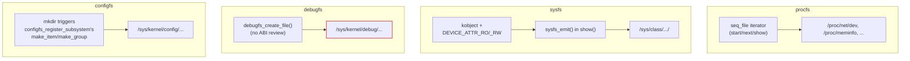

# procfs, sysfs, debugfs, configfs

Four pseudo-filesystems, four different promises. `/proc` began as the process interface and
accumulated everything else the kernel wanted to expose along the way; `/sys` is generated from the
device model under a strict one-value-per-file rule; `/sys/kernel/debug` makes no stability promise at
all, to anyone, ever; and `/sys/kernel/config` inverts the usual direction entirely — user space
*creates* kernel objects by calling `mkdir`. None of these are interchangeable, and knowing which
contract a given file lives under is what tells you whether a script reading it will still work after
the next kernel upgrade.

## procfs

Most of `/proc` is per-process: `/proc/<pid>/status`, `/proc/<pid>/maps`, `/proc/<pid>/fd/`, and the rest
of the directory [Proc as the Process Interface](../06-processes-and-threads/proc-as-the-process-interface.md)
already covers in depth — this page doesn't re-teach that half. What's left is system-wide: legacy files
like `/proc/meminfo`, `/proc/interrupts`, and `/proc/mounts` that predate `/sys` and were never migrated,
plus `/proc/sys`, which is not legacy at all — it's the live sysctl tree, the same tunables `sysctl(8)`
and `sysctl.d` configuration files read and write.

Almost all of this is produced by `<Src file="include/linux/seq_file.h" symbol="seq_operations" />`: a
small iterator interface (`start`/`next`/`stop`/`show`) that lets a file with unpredictable or very large
content — every process, every interface, every interrupt line — be generated a record at a time instead
of formatted into one buffer up front. This has a consequence worth knowing: reading a large `/proc` file
in small chunks (a `read()` loop with a small buffer, rather than one large read) can observe a table that
changed between chunks — a process that exited, an interface that was added — because each `show()` call
reflects live state at the moment it runs, not a snapshot taken once at `open()`. The file is internally
consistent record-by-record, not globally atomic across the whole read.

## sysfs

sysfs is built on **kernfs** (`<Src file="include/linux/kernfs.h" symbol="kernfs_node" />`), a generic
in-memory filesystem framework that sysfs was the first user of, and it is generated directly from the
kobject hierarchy — see [Kobjects, sysfs, and the Object
Model](../04-kernel-architecture-and-idioms/kobjects-sysfs-and-the-object-model.md) for how a `struct
kobject` becomes a directory in the first place. The rule sysfs enforces that `/proc` never did is
**one value per file**: an attribute is defined with `DEVICE_ATTR_RO`/`DEVICE_ATTR_RW` (and friends) and
formatted for output with `<Src file="include/linux/sysfs.h" symbol="sysfs_emit" />`, which exists
specifically to stop a `show()` callback from writing past `PAGE_SIZE` — the one guarantee every sysfs
file gets. Because the format is disciplined, the ABI can be too: every stable sysfs attribute has (or is
supposed to have) an entry in `Documentation/ABI/`, in the tier appropriate to its stability, which the
next section covers.

## debugfs

debugfs has no rule at all, and that's the point: it exists specifically for state a developer wants to
expose without committing to an interface. It carries no ABI promise, is frequently root-only, and — on a
kernel built with lockdown enabled — can be restricted or disabled outright regardless of who's asking.
The operational rule that follows: a production tool that depends on a debugfs path is depending on an
accident of the current kernel's implementation, not a contract, no matter how long that path has existed
or how stable it has seemed.

## configfs

configfs runs sysfs's direction in reverse. Where sysfs is read-mostly and generated *from* kernel
objects that already exist, configfs lets user space `mkdir` a directory under a registered subsystem and
have that `mkdir` *create* a kernel object — writes to the new directory's attributes then configure it,
and `rmdir` tears it down. Real, non-toy users of this: USB gadget configuration (composing a USB device
out of functions at runtime), the LIO iSCSI/SCSI target, and `nvmet`, the in-kernel NVMe-over-Fabrics
target — all cases where user space needs to construct a kernel object with a nontrivial number of
parameters, which a single `mkdir`-triggered object with attribute files handles far more naturally than
an ioctl with a packed struct would.

## The ABI contract

| | Stability promise | Documented in | Who creates entries | Right use when writing a driver |
|---|---|---|---|---|
| procfs (`/proc`) | mixed — process files and `/proc/sys` are stable; legacy system files vary by file | scattered; `/proc/sys` entries typically self-documenting via `sysctl` docs | the kernel; layout is largely historical, not newly extended | avoid for new drivers — `/proc` is not the growth path |
| sysfs (`/sys`) | stable, if listed | `Documentation/ABI/stable` | driver authors, via kobject/attribute registration | the default choice for exposing device state and simple controls |
| debugfs (`/sys/kernel/debug`) | none | nowhere — that's the point | any driver author, with no review gate on the "interface" | debugging aids and internals never meant for scripts to depend on |
| configfs (`/sys/kernel/config`) | stable, if listed | `Documentation/ABI/stable` (per subsystem) | driver/subsystem authors registering a configfs subsystem | multi-parameter object creation that `mkdir`+attributes models better than sysfs's flat per-device layout |

`Documentation/ABI/` itself has four tiers beyond "stable": `testing` (in place, may still change),
`obsolete` (scheduled for removal, still present), and `removed` (kept as a historical record of what used
to exist). A file's presence in `/sys` says nothing about which tier it's in — only `Documentation/ABI`
does, and the "What actually happens" section below finds a real, long-lived sysfs file that is still
filed under `testing`, not `stable`. Deciding which of these four filesystems a new driver should expose
its interface through — sysfs attribute, debugfs dump, or configfs object — is exactly the kind of call
[Talking to User Space](../14-device-drivers-and-hardware/talking-to-user-space.md) works through in full; the ABI contract above is the frame that
decision happens inside.



*Four ways kernel state becomes a file, and the stability promise attached to each.*

## What actually happens

**Run for real on this machine, checked 2026-09-14.** Two ways to read one piece of network-interface
state, traced with `strace` (fetched via `apt-get download strace` + `dpkg -x`, the same fallback used
elsewhere in this section when a package isn't already installed):

```text
$ strace -e trace=openat,read,close python3 -c "
import os
fd = os.open('/sys/class/net/lo/mtu', os.O_RDONLY)
os.read(fd, 65536)
os.close(fd)"
openat(AT_FDCWD, "/sys/class/net/lo/mtu", O_RDONLY|O_CLOEXEC) = 3
read(3, "65536\n", 65536)               = 6
close(3)                                = 0
```

```text
$ strace -e trace=openat,read,close python3 -c "
import os
fd = os.open('/proc/net/dev', os.O_RDONLY)
os.read(fd, 65536)
os.close(fd)"
openat(AT_FDCWD, "/proc/net/dev", O_RDONLY|O_CLOEXEC) = 3
read(3, "Inter-|   Receive               "..., 65536) = 821
close(3)                                = 0
```

Both traces show a single `read()` here, because a 65536-byte buffer is larger than either file ever
produces in one call — the interesting difference isn't the call count, it's what each `read()` returns
and how it got assembled. The sysfs read returns exactly 6 bytes: one number and a newline, the entire
output of one `show()` callback (`dev_attr_show()` calling the network core's MTU show function, which
calls `sysfs_emit()` and nothing else) reached via `kernfs_fop_read_iter() → sysfs_kf_seq_show()`. The
procfs read returns 821 bytes: a header line plus one line per interface (`lo`, `eth0`, `eth1`, `eth2`,
and this machine's WSL `loopback0`), assembled by a `seq_file` iterator that walks every registered
network device and calls `show()` once per interface, concatenating the results — the same
`seq_operations` mechanism the [procfs](#procfs) section above described for large system-wide files.
One callback emitting one bounded value versus an iterator building a variable-length table: that's the
one-value-per-file sysfs rule against the "whatever the table needs" model procfs uses, made visible in
two `read()` return sizes on the same machine.

The `Documentation/ABI` entry for the sysfs side, verified at v6.18 in
`Documentation/ABI/testing/sysfs-class-net`:

```text
What:           /sys/class/net/<iface>/mtu
Date:           April 2005
KernelVersion:  2.6.12
Contact:        netdev@vger.kernel.org
Description:
                Indicates the interface currently configured MTU value, in
                bytes, and in decimal format. [...]
```

Worth noting precisely because it's easy to assume otherwise: this file has existed since kernel 2.6.12 in
2005, over two decades, and it is *still* filed under `Documentation/ABI/testing`, not `stable` — a
concrete example of "The ABI contract" table above: longevity is not what determines a file's tier, its
listing is.

## Misconceptions

1. **"Everything under `/proc` and `/sys` is a stable API."** Only what `Documentation/ABI/stable` lists
   carries that promise — and as the `mtu` example above shows, a file can be old, widely depended on, and
   still formally `testing`. debugfs promises nothing at all, regardless of age.
2. **"Writing to `/proc/sys` is permanent."** A `sysctl -w` or a direct write to `/proc/sys/...` changes
   live kernel state immediately, but only until reboot — it is not persisted anywhere by the write itself.
   Making a change survive a reboot means putting it in a `sysctl.d` config file, which is reapplied at
   boot; the live write and the persistent config are two different actions that happen to use the same
   underlying tunable.
3. **"sysfs files are regular files with a size."** `stat` reports 4096 bytes (`PAGE_SIZE`) for essentially
   every sysfs attribute file, regardless of what it actually contains — the content is generated fresh on
   each `read()`, not stored. This is why `cp` (which may size a buffer or seek based on reported size) and
   `tail -f` (which waits for the file to grow past its old size) both misbehave on sysfs files in ways
   they don't on a real file.

<KernelFacts
  structure={[["struct seq_operations", "include/linux/seq_file.h"], ["struct kernfs_node", "include/linux/kernfs.h"]]}
  path="read(/sys/...) → kernfs_fop_read_iter() → sysfs_kf_seq_show() → dev_attr_show() → driver show() → sysfs_emit()"
  observe="ls /sys/kernel/debug 2>&1 | head -3   # and, in a kernel source tree: ls Documentation/ABI/stable | head"
  trap="A debugfs file that has existed for ten years is still not an interface. Tools that parse it break without notice, and on a lockdown-enabled kernel they can fail outright." />

## References

- [sysfs](https://docs.kernel.org/filesystems/sysfs.html) — the sysfs rules in the kernel's own words,
  including the one-value-per-file convention this page leans on throughout.
- [The `/proc` filesystem](https://docs.kernel.org/filesystems/proc.html) — the long, authoritative
  `/proc` reference, covering both the per-process files and the system-wide ones this page focuses on.
- [The Linux kernel driver interface (ABI)](https://docs.kernel.org/admin-guide/abi.html) — the rendered
  `Documentation/ABI` tree, and how to read stable/testing/obsolete/removed.
- [configfs — Userspace-driven kernel object configuration](https://docs.kernel.org/filesystems/configfs.html)
  — configfs's model in detail, with a worked subsystem example.
- [seq_file HOWTO](https://docs.kernel.org/filesystems/seq_file.html) — the iterator interface behind
  most of `/proc` and the `show()` side of sysfs reads alike.
