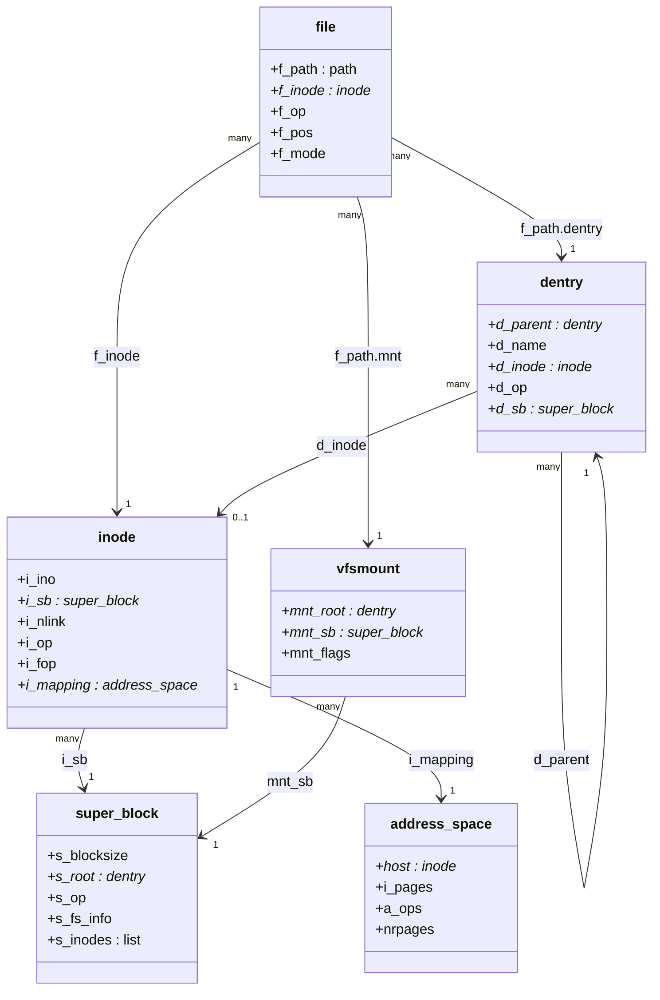

# Superblock, Inode, Dentry, File

Four objects, four questions. The **superblock** answers "which mounted filesystem instance is this?" The
**inode** answers "what file is this, independent of anything it's called?" The **dentry** answers "what
name, in what directory, currently points at that file?" And the **file** answers "what open instance of
that name-and-file pair is this process holding, at what position, with what flags?" Every one of those
questions has a different answer even for what looks, from a shell prompt, like "one file" — and keeping the
four apart is what explains three things that otherwise look like special cases: why a hard link isn't a
copy, why deleting a file someone still has open doesn't make their reads fail, and why renaming the file a
process is mid-write to never disturbs that write. This page draws the relationship between the four once,
and the rest of this folder — path lookup, mounts, every concrete filesystem — refers back to it rather than
re-explaining it.

## The superblock: a mounted filesystem

A `<Src file="include/linux/fs.h" symbol="super_block" />` exists **one per mounted instance**, not one per
device and not one per mount point. Mount the same ext4 partition twice at two different paths and there are
two superblocks reading the same device; bind-mount an existing mount point elsewhere and there is still
only one superblock, because a bind mount adds a second `vfsmount` pointing at the same tree without mounting
anything new — the distinction folder 11's own
[Mounts and Mount Namespaces](./mounts-and-mount-namespaces.md) covers in full. Fields that matter here,
verified at v6.18: `s_blocksize`, the filesystem's block size; `s_root`, the dentry at the top of this
instance's tree; `s_op`, its `super_operations` table; `s_fs_info`, an opaque pointer to whatever
filesystem-private state ext4, NFS, or tmpfs needs (reached, like every filesystem-private extension in this
folder, through the `container_of` pattern from
[`container_of` and Embedded Structs](../04-kernel-architecture-and-idioms/container-of-and-embedded-structs.md));
and `s_inodes`, the list of every inode currently belonging to this instance.

## The inode: a file without a name

A `<Src file="include/linux/fs.h" symbol="inode" />` is a file's identity and metadata, and — this is the
fact the rest of this page keeps coming back to — **it has no name**. Verified at v6.18: `i_ino` and `i_sb`
identify it (a number, plus which superblock it belongs to); `i_mode`, `i_uid`, `i_gid`, and the timestamp
fields carry ownership and permissions; `i_op` and `i_fop` are its operations tables (`i_fop` is handed
straight to `struct file.f_op` on open — the header comment calls it "former `->i_op->default_file_ops`");
and `i_mapping` points at the `<Src file="include/linux/fs.h" symbol="address_space" />` already covered in
[The Page Cache](../08-memory-management/the-page-cache.md) — this page does not redefine it, only places
it in the object graph. The field that carries the "no name" fact directly is `i_nlink`: the kernel's own
comment on it is explicit that filesystems may only *read* it — modification goes through
`set_nlink()`/`inc_nlink()`/`drop_nlink()` — and what it counts is exactly the number of names (dentries,
across possibly different directories) currently pointing at this one inode. Zero names is a perfectly
valid state for a live inode, which is exactly what [Hard links and deleted-but-open
files](#hard-links-and-deleted-but-open-files-explained) below depends on.

## The dentry: a name, cached

A `<Src file="include/linux/dcache.h" symbol="dentry" />` is one name-to-inode link in a path — not the file,
a *link* to the file, entirely separate from it. Verified at v6.18: `d_parent` (the containing directory's
dentry), `d_name`, `d_inode` (the inode this name currently resolves to — and the header comment is explicit
that `NULL` here means **negative**: this exact name has been looked up and confirmed *not* to exist, cached
so the next lookup of the same missing name doesn't have to ask the filesystem again), `d_op` for filesystems
that need custom name comparison or revalidation, and `d_sb`. Dentries form the in-memory tree that path
lookup walks component by component; they exist purely for speed — the dentry cache (dcache) — not for
persistence, and the kernel is free to evict an unused one and rebuild it from the filesystem on the next
lookup. [Path Lookup and the Dentry Cache](./path-lookup-and-the-dcache.md) is the whole mechanism; this page
only fixes what the object holds.

## The file: one open instance

A `<Src file="include/linux/fs.h" symbol="file" />` is one open instance — the thing a file descriptor
actually refers to. Verified at v6.18: `f_path`, a `struct path` pairing a dentry with the `vfsmount` it was
reached through (so the same dentry, reached via two different mounts, is still tracked correctly); `f_inode`,
a direct pointer to the inode, cached so hot paths don't have to chase `f_path.dentry->d_inode`; `f_op`,
`f_pos`, `f_flags`, and `f_mode`; and a reference count — `f_ref`, read through the `file_count()` helper
rather than a plain field, verified at v6.18.

That reference count is exactly what distinguishes two everyday cases that look similar from the shell but
are not: **two separate `open()` calls on one path** each allocate a new `struct file`, so the two file
descriptors have independent `f_pos` values — seeking one never moves the other, even though both point at
the same inode. **A `fork()` or `dup()`**, by contrast, does not allocate a new `struct file` — the child
descriptor (or the `dup`'d one) points at the *same* `struct file`, its reference count incremented, and
therefore shares one `f_pos`: one process advancing the read position moves it for the other too.

## Operations tables

Five tables, each hanging off one of the objects above, each verified at v6.18:

| Table | Owned by | Covers | Two representative members |
| --- | --- | --- | --- |
| `super_operations` | superblock (`s_op`) | Inode lifecycle and filesystem-wide operations | `alloc_inode`, `write_inode` |
| `inode_operations` | inode (`i_op`) | Namespace operations — turning a name into a child, or changing one | `lookup`, `create` |
| `file_operations` | file (`f_op`) | Open-instance I/O — read, write, seek, mmap, ioctl | `read_iter`, `open` |
| `dentry_operations` | dentry (`d_op`) | Name comparison, hashing, and cache revalidation | `d_revalidate`, `d_compare` |
| `address_space_operations` | the inode's `address_space` (`a_ops`) | Page-cache I/O for this file's content | `read_folio`, `writepages` |

`dentry_operations` and `address_space_operations` are the two [Why the VFS Exists](./why-vfs-exists.md)
called optional — a filesystem with ordinary name semantics and no page-cache participation can leave both
unset and inherit generic behaviour.

## Lifetimes and what pins what

The four objects form a pin chain, each link holding the next one alive: **an open file pins its dentry**
(`f_path.dentry`), **a dentry pins its inode** (`d_inode`, for as long as the dentry is hashed or held), and
**an inode pins its superblock** (`i_sb`) for as long as the inode exists. That chain, followed to its
consequence, explains two facts that otherwise look like bugs:

- **An unlinked file a process still has open keeps consuming disk space.** `unlink()` removes the *name*
  (the dentry stops pointing at anything reachable by path, and `i_nlink` drops), but the open `struct file`
  still pins the inode directly through `f_inode`, and the inode still owns its blocks. `du` on the
  directory tree won't find it — there's no name left to find — but the space is not free.
- **`umount` can report `EBUSY`.** A superblock cannot go away while anything still pins an inode that
  belongs to it — an open file, a process's current working directory, a dentry still cached — because
  freeing the superblock out from under a live inode would leave that inode's `i_sb` pointing at freed
  memory.

## Hard links and deleted-but-open files, explained

A hard link is two dentries, in the same or different directories, both pointing `d_inode` at the same
inode — not two files, one file with two names. `link()` creates the second dentry and increments `i_nlink`;
`unlink()` on either name removes that one dentry and decrements `i_nlink`, and the underlying data is freed
only when **both** counts — the link count and the open-file count — have reached zero. That "both" is the
whole explanation for a fact every long-running Linux service eventually runs into: a log file, deleted with
`rm` while a process still holds it open for writing, does not free its disk space at that moment.
`i_nlink` went to zero; the inode did not, because the open `struct file` still pins it. The process keeps
writing into blocks `du` can no longer find a path to, until it closes the descriptor or exits.

The kernel marks exactly this state in `/proc/<pid>/fd`. Reproduced directly on the machine this page was
written on:

```text
$ bash -c 'exec 3>/tmp/x; rm /tmp/x; ls -l /proc/$$/fd'
total 0
lr-x------ 1 dev dev 64 Sep 14 17:23 0 -> /dev/null
l-wx------ 1 dev dev 64 Sep 14 17:23 1 -> /tmp/.../bfk4ryoba.output
l-wx------ 1 dev dev 64 Sep 14 17:23 2 -> /tmp/.../bfk4ryoba.output
l-wx------ 1 dev dev 64 Sep 14 17:23 3 -> /tmp/x (deleted)
```

fd 0–2 are this sandbox's own stdin/stdout/stderr, present in every process and not part of the
demonstration (path abbreviated above; the real one is this agent's own scratch output file). fd 3 is the
one this section is about: opened with `exec 3>/tmp/x`, then `/tmp/x` was `rm`'d while fd 3 stayed open —
and `ls -l` shows exactly the `(deleted)` marker the kernel adds to a descriptor's `/proc` symlink target
when its dentry no longer has a live name. `lsof +L1` is the standard tool for finding every such
descriptor on a running system — every deleted-but-open file, system-wide, with the space it's still
holding.



*The four VFS objects and the pointers that connect them — the diagram the rest of this folder refers back
to.*

The deleted-but-open lifecycle from above, as a sequence:

```mermaid
sequenceDiagram
    participant App
    participant VFS
    participant Dentry as dentry
    participant Inode as inode

    App->>VFS: open("/tmp/x")
    VFS->>Dentry: resolve name → dentry, d_inode set
    Note over App,Inode: fd held; dentry and inode both pinned

    App->>VFS: unlink("/tmp/x")
    VFS->>Dentry: dentry unhashed (name gone)
    VFS->>Inode: i_nlink-- (→ 0)
    Note over Inode: inode stays alive — the open file still pins it

    App->>VFS: read(fd, buf, N)
    VFS->>Inode: reads succeed exactly as before
    Note over App: no error — the caller never notices the name is gone

    App->>VFS: close(fd)
    VFS->>Inode: last reference drops
    Note over Inode: inode evicted, blocks freed
```

*Deleting a file removes a name; the inode, and the space it owns, survive until the last open reference
closes.*

<KernelFacts
  structure={[["struct inode", "include/linux/fs.h"], ["struct dentry", "include/linux/dcache.h"]]}
  path="fd → struct file → f_path.dentry → d_inode → i_sb (super_block)"
  observe="ls -l /proc/$$/fd && stat -c '%i %h %n' /etc/hostname"
  trap="Deleting a file removes a name, not the data. A log file deleted while a process still holds it open keeps consuming disk space, invisibly to du, until that process closes it or exits — lsof +L1 finds them." />

## References

- [The Linux Virtual Filesystem](https://docs.kernel.org/filesystems/vfs.html) — the sections on `struct
  super_operations`, `struct inode_operations`, and `struct file_operations`, member by member; the same
  source [Why the VFS Exists](./why-vfs-exists.md) cites for the tables themselves.
- <Src file="include/linux/dcache.h" symbol="dentry" /> — the dentry structure with its own field comments,
  including the "`NULL` is negative" comment on `d_inode` this page quotes.
- Bovet & Cesati, *Understanding the Linux Kernel* (3rd ed.), ch. 12 — the most detailed long-form treatment
  of this object model available; old (2.6-era) — read it for the relationships between the four objects,
  not for exact field names, several of which (the rbtree-free dentry cache, the maple-tree VMA index
  elsewhere in this section) have since changed.
- [`unlink(2)`](https://man7.org/linux/man-pages/man2/unlink.2.html) — the user-visible contract this page's
  hard-link and deleted-but-open sections are built on: removing a name, and what happens to the file behind
  it while a descriptor keeps it open.
