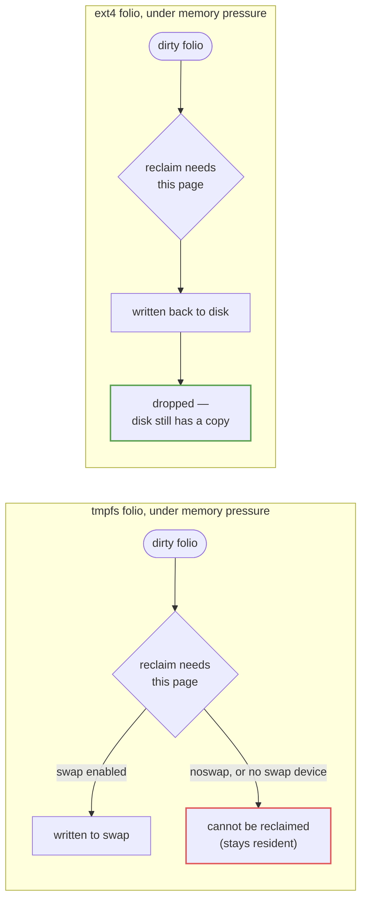

# tmpfs and Memory-Backed Filesystems

tmpfs is what you get when a filesystem has a page cache and nothing underneath it. File data lives in
folios that belong to the page cache exactly the way an ext4 file's folios do — same data structures,
same reclaim machinery — except that for tmpfs the cache *is* the only copy; there is no disk to write
those folios back to. That single fact explains everything distinctive about tmpfs: it's fast, because
reads and writes touch memory and nothing else; its contents vanish on reboot, because memory does; and —
the part people miss, covered in Misconceptions below — it can still be swapped out, because "no backing
store on disk" is not the same claim as "never leaves RAM."

## Page cache with no backing store

A tmpfs inode is a real inode with a real `address_space`, and writing to a tmpfs file dirties folios in
that `address_space` the same way writing to any other file does. The difference shows up under memory
pressure: for a disk-backed filesystem, a dirty folio is written back to its device and then can be
dropped, because the device still holds a copy. A dirty tmpfs folio has nowhere to write back to — the
"device" is the folio itself — so reclaim's only option, if it needs the physical page back, is to move
the data to *swap* rather than discard it (see [Swap and zswap](../08-memory-management/swap-and-zswap.md)
for what happens next). Everything here is implemented in `mm/shmem.c`, and that file's name is not an
accident: tmpfs, POSIX shared memory (`shm_open`), `memfd_create`, and SysV shared memory are one
subsystem under the hood, differing mainly in how a user-space name gets attached to a shmem inode.

## Size limits and accounting

A tmpfs mount takes `size=` (default: half of physical RAM) and `nr_inodes=` limits, enforced at write and
create time respectively — cross `size=` and a write gets `ENOSPC`, the same error a full disk gives,
even though nothing about a disk is involved. Because the backing store is memory, tmpfs usage is memory
accounting: it shows up in `/proc/meminfo` as `Shmem` (verified live on this machine: `Shmem: 40640 kB`,
alongside `ShmemHugePages` when THP applies — see below), and it is charged to the memory cgroup of
whichever process wrote the data, exactly like any other page a cgroup is holding. A tmpfs mount reporting
"full" via `df` is memory pressure wearing a filesystem's clothing, not a disk that ran out of space —
the fix is freeing memory or raising `size=`, not adding storage.

## Where it is used

| Location | Who creates it | What it's for |
|---|---|---|
| `/tmp` | the distribution's fstab or systemd, on distributions that opt in | scratch files that shouldn't survive reboot and shouldn't touch disk for speed |
| `/dev/shm` | the kernel/init, always present on a modern system | POSIX shared memory (`shm_open(3)`) — named memory regions shared between unrelated processes |
| `/run` | systemd (or the init system) very early in boot | runtime state — PID files, sockets — that is inherently invalid after a reboot |
| a `memfd_create(2)` file | any process, on demand, with no mount point at all | an anonymous tmpfs file with no name in any directory, used for sealed or shareable memory (e.g., passing a buffer to another process by fd) |
| SysV shared memory (`shmget(2)`) | any process | the older shared-memory API; backed by the same `mm/shmem.c` machinery as everything else in this table |

## ramfs: the version with no limits

`ramfs` is tmpfs with the safety rails removed: no `size=` limit and no swap — a ramfs folio simply *is*
memory, full stop, with reclaim unable to do anything about it because there's no swap fallback and no
disk to write back to. A process that keeps writing to a ramfs mount past what the machine can spare does
not get `ENOSPC`; it drives the system toward OOM, because from the allocator's point of view that memory
is simply in use, the same as any other unreclaimable allocation. This makes ramfs unsuitable as a general
`/tmp`-style filesystem, but it survives as the minimal example of a page-cache-only filesystem — worth
knowing conceptually even where it's rarely mounted directly — and historically as what `rootfs`, the
filesystem the kernel mounts before any real filesystem exists, is built from; see [initramfs and
early userspace](../03-boot-and-init/initramfs-and-early-userspace.md) for where that matters during boot.

## Options worth knowing

- **`huge=`** — controls Transparent Huge Page use on this tmpfs mount (`never`, `always`, `within_size`,
  `advise`); see [Hugepages and THP](../08-memory-management/hugepages-and-thp.md) for what a huge folio
  costs and buys. `ShmemHugePages` in `/proc/meminfo` is what to watch.
- **`noswap`** — disables swap for this tmpfs mount entirely, trading the memory-pressure safety valve
  for a guarantee that this mount's data never touches a swap device; the merged commit (`shmem: add
  support to ignore swap`) and LWN's coverage of the patch series date it to Linux 6.4.
- **quota support (`quota`, `usrquota`, `grpquota`)** — per-user/group accounting and enforcement on a
  tmpfs instance, added in Linux 6.6; cannot be changed on remount once set. Useful for the exact
  scenario "a big `size=` is free" (Misconceptions below) gets wrong: bounding one tenant's tmpfs use
  without bounding everyone sharing the mount.
- **`mode=`, `uid=`, `gid=`** — ownership and permissions of the tmpfs root directory at mount time,
  same semantics as any filesystem's mount-time ownership options.

## Four filesystems, four different deals

| | tmpfs | ramfs | disk-backed (e.g. ext4) | `/dev/shm` |
|---|---|---|---|---|
| Backing store | page cache only | page cache only | page cache **and** a device | tmpfs (same code, different mount) |
| Size limit | `size=` (default: half of RAM) | none | device capacity | `size=` set at mount, usually by init |
| Swappable | yes, unless `noswap` | no — never | n/a (clean pages just get dropped) | yes, unless `noswap` |
| Counted as | `Shmem` in `/proc/meminfo` | ordinary unreclaimable memory | `Cached`/`Buffers` (clean), `Dirty` (unwritten) | `Shmem`, same as any tmpfs |
| Survives reboot | no | no | yes | no |

*Why a tmpfs page and an ext4 page behave differently under memory pressure: one has a disk to return to,
the other only has swap.*

## Misconceptions

1. **"tmpfs is always in RAM."** Only while there's enough RAM to hold it. Under memory pressure, tmpfs
   folios move to swap exactly like anonymous memory does — an idle tmpfs file can genuinely be sitting on
   the swap device, not in physical memory at all, until something reads it back.
2. **"tmpfs uses memory only for what you store, so a big `size=` is free."** `size=` is a ceiling, not a
   reservation — setting it costs nothing by itself. But every byte actually written *is* memory the
   kernel cannot simply drop the way it drops clean page-cache from a disk-backed file; the only way to
   reclaim it is to swap it out, and on a swapless machine it cannot be reclaimed at all.
3. **"`free` shows tmpfs usage as used memory."** It shows up under `shared` (and folded into
   `buff/cache`), not under the plain "used" column — which is exactly why a system can show large,
   stubborn `buff/cache` that reclaim never seems to shrink: unlike ordinary page cache, tmpfs pages in
   that number are real data, not a clean cache of something recoverable from disk, so kswapd's cheapest
   option (just drop it) isn't available for them.

<KernelFacts
  structure={[["struct shmem_inode_info", "include/linux/shmem_fs.h"]]}
  path="write() → shmem_file_write_iter() → generic_perform_write() → shmem_write_begin() → shmem_get_folio()"
  observe="df -h -t tmpfs && grep -E '^(Shmem|ShmemHugePages):' /proc/meminfo"
  trap="Filling /dev/shm or a tmpfs /tmp does not fill a disk — it consumes memory that reclaim cannot free except by swapping, and on a machine without swap it drives the system toward the OOM killer." />

## References

- [tmpfs](https://docs.kernel.org/filesystems/tmpfs.html) — every mount option, including `size=`,
  `huge=`, `noswap`, and the quota options, with the in-tree documentation this page's version notes are
  checked against.
- <Src file="mm/shmem.c" /> — the implementation shared by tmpfs, `memfd_create`, and SysV shared memory;
  one file backing every row of the "Where it is used" table above.
- [`memfd_create(2)`](https://man7.org/linux/man-pages/man2/memfd_create.2.html) — anonymous tmpfs files
  and the sealing API (`F_SEAL_*`) built on top of them.
- [ramfs, rootfs and initramfs](https://docs.kernel.org/filesystems/ramfs-rootfs-initramfs.html) — why
  ramfs exists, and why the kernel's very first mounted filesystem is built from it.
