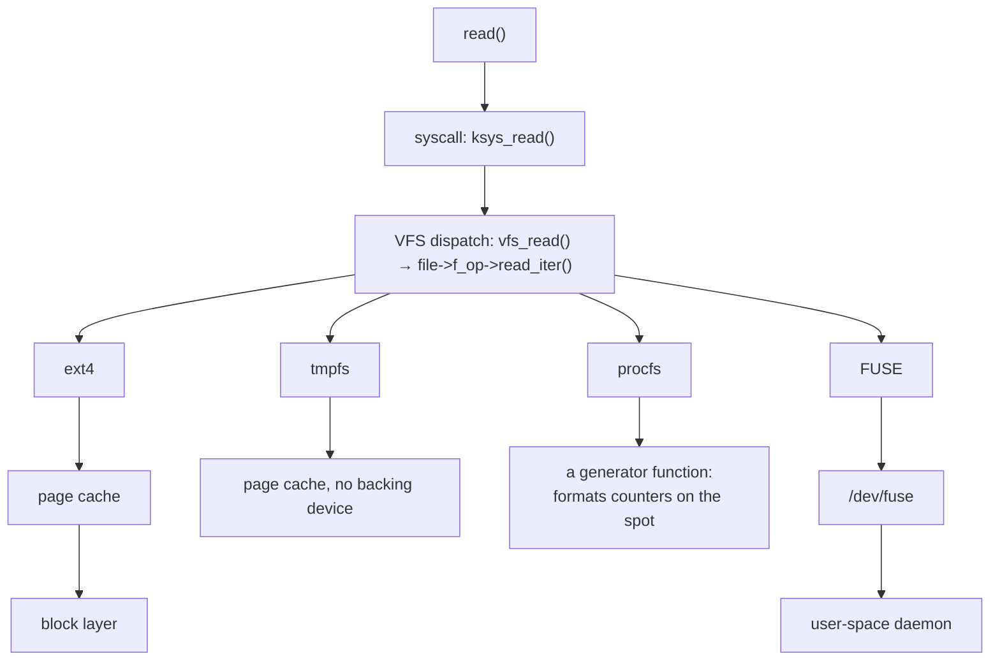

# Why the VFS Exists

A single `read()` call has to work whether the file lives on ext4, on a network server three hops away, in
RAM with no backing device at all, or nowhere at all — `/proc/cpuinfo` has no bytes sitting anywhere; it is
generated fresh on every read. The same three system calls, `open()`, `read()`, `close()`, have to produce
correct behaviour in every one of those cases, without the caller ever writing filesystem-specific code and
without the kernel ever writing one giant function that branches on "which filesystem is this." The
component that makes that possible is the **VFS**, the virtual filesystem switch: an indirection layer that
defines, once, what a filesystem must supply, and dispatches every operation through tables of function
pointers that the concrete filesystem filled in. It is object-oriented programming, done in plain C with no
compiler support for it — and once that pattern is visible in one place, the rest of this folder reads as
variations on it rather than as thirteen unrelated subjects.

## The problem: one interface, many implementations

Five things Linux presents as "a filesystem" store their data in five completely different places:

| Filesystem | Where the data actually lives |
| --- | --- |
| ext4 | Blocks on a physical or virtual block device, addressed by block number |
| NFS | A remote server, reached over the network, whose own filesystem does the real storing |
| tmpfs | RAM only — page-cache folios with no backing device to write back to |
| procfs | Nowhere. `/proc/meminfo`'s bytes do not exist until a `read()` asks for them |
| A FUSE filesystem | Wherever a user-space daemon decides — a database row, an encrypted blob, another network call |

Every one of these five answers the same four operations — `open`, `read`, `stat`, `readdir` — with wildly
different code underneath each. A caller running `cat` doesn't know, and shouldn't need to know, which of
the five it's talking to.

## Object-oriented C

The mechanism is a struct of function pointers, filled in once per filesystem and dispatched through by a
caller that never knows which implementation it holds. `<Src file="include/linux/fs.h"
symbol="file_operations" />` is the table every open file carries; a representative slice of it, verified at
v6.18:

```c
struct file_operations {
	struct module *owner;
	loff_t (*llseek) (struct file *, loff_t, int);
	ssize_t (*read_iter) (struct kiocb *, struct iov_iter *);
	ssize_t (*write_iter) (struct kiocb *, struct iov_iter *);
	int (*open) (struct inode *, struct file *);
	int (*release) (struct inode *, struct file *);
	int (*mmap) (struct file *, struct vm_area_struct *);
	int (*fsync) (struct file *, loff_t, loff_t, int datasync);
	/* … */
};
```

A generic `struct file` carries a pointer to one of these tables (`f_op`), filled in by whichever filesystem
opened it. Code that calls `file->f_op->read_iter(...)` never mentions ext4, NFS, or procfs by name — it
calls through the pointer, and the pointer's target is what makes the behaviour filesystem-specific. Getting
from that generic `struct file` (or `struct inode`) back to a filesystem's own, larger struct — the one with
the private fields ext4 or NFS actually needs — is exactly the `container_of` idiom worked out in
[`container_of` and Embedded Structs](../04-kernel-architecture-and-idioms/container-of-and-embedded-structs.md);
every object this folder describes uses it to reach its filesystem-private part.

## What a filesystem must supply

Registering a filesystem with the VFS is a short, fixed checklist — name it, and the rest of this folder is
the long version of each item:

- A `<Src file="include/linux/fs.h" symbol="file_system_type" />`, registered once per filesystem driver,
  naming it and providing the callback that builds a superblock at mount time.
- A filled-in **superblock** for each mounted instance — block size, root dentry, the filesystem's own
  private data. [Superblock, Inode, Dentry, File](./the-four-objects.md) is the whole object model this
  builds on, and [Mounts and Mount Namespaces](./mounts-and-mount-namespaces.md) covers what "at mount time"
  actually triggers.
- An **inode operations** table (`i_op`) — `lookup`, `create`, `mkdir`, and friends — for turning a name
  into a child inode.
- A **file operations** table (`f_op`), shown above — the open-file-instance behaviour.
- Optionally, a **dentry operations** table (`d_op`), for filesystems with unusual name-comparison or
  caching needs (case-insensitive lookups, network filesystems that must revalidate a cached name). See
  [Path Lookup and the Dentry Cache](./path-lookup-and-the-dcache.md).
- Optionally, an **address space operations** table (`a_ops`), for any filesystem whose files participate
  in the page cache — `read_folio`, `writepages`, and the rest of the table
  [The Page Cache](../08-memory-management/the-page-cache.md) already documents in full; this page does not
  redefine `address_space`.

A filesystem that skips the optional two still works — it inherits generic behaviour — but every filesystem
supplies the first four.

## What actually happens

`cat /proc/meminfo` and `cat /etc/hostname` are, from `cat`'s point of view, identical: open a path, read
until EOF, write to stdout. Both go through the exact same dispatch path up to one point —
`SYSCALL_DEFINE3(read, ...)` → `<Src file="fs/read_write.c" symbol="ksys_read" />` → `<Src
file="fs/read_write.c" symbol="vfs_read" />` — verified at v6.18: `vfs_read()` calls `file->f_op->read`
directly if the filesystem supplied one, and otherwise falls back to `new_sync_read()`, which calls
`file->f_op->read_iter()`. For an ordinary file and for a procfs file alike, that's the same generic code
running up to the moment it dereferences `f_op`.

:::note
`strace` is not installed in the environment this page was written in, and there is no passwordless `sudo`
to add it (`apt-get install -y strace` fails on the dpkg lock; `sudo -n true` fails with "interactive
authentication is required" — both confirmed by direct attempt, not assumed). The two transcripts below are
reconstructed, not captured: the syscall shape (one `openat`, one `read` returning the file's exact size in
a single call) is `cat`'s well-documented, deterministic behaviour for a small file read through a 128 KiB
buffer, and the byte counts are the real sizes of these two files on the machine this page was written on
(`wc -c /etc/hostname` → 16, `wc -c /proc/meminfo` → 1503). Treat them as illustrative, not as a recorded
trace.
:::

```text
$ strace -e trace=openat,read cat /etc/hostname
openat(AT_FDCWD, "/etc/hostname", O_RDONLY) = 3
read(3, "DESKTOP-SHIELDX\n", 131072)    = 16

$ strace -e trace=openat,read cat /proc/meminfo
openat(AT_FDCWD, "/proc/meminfo", O_RDONLY) = 3
read(3, "MemTotal:       ...", 131072) = 1503
```

The two calls look identical from user space. They diverge at exactly one point: what `f_op->read_iter`
names. For `/etc/hostname` on ext4, it resolves into the ordinary page-cache read path —
`filemap_read()` finding or filling a folio, as [The Page Cache](../08-memory-management/the-page-cache.md)
covers in full. For `/proc/meminfo`, the file's operations table instead points at procfs's own
`read_iter` — verified at v6.18, `<Src file="fs/proc/inode.c" symbol="proc_reg_read_iter" />` — which for a
`seq_file`-backed entry like `meminfo` reaches `<Src file="fs/seq_file.c" symbol="seq_read_iter" />` and, from
there, a function that walks live kernel counters and formats them into the buffer on the spot. No folio is
read from a block device; no folio is even allocated in a filesystem's `address_space`, because
`/proc/meminfo` has none.

## "Everything is a file", stated precisely

The precise version of the slogan is: everything is a **file descriptor**, not everything is a file on a
filesystem. A socket, a pipe, an `eventfd`, a `timerfd`, a `pidfd` — none of these have a path, a directory
entry, or an inode number a filesystem allocated. What they do have is a `struct file` with a `f_op` table,
which is all `read()`, `write()`, `close()`, `poll()`, and `select()` actually require. The mechanism that
makes that possible is `<Src file="fs/anon_inodes.c" symbol="anon_inode_getfile" />` — verified to exist at
v6.18 — which hands back a fully-formed `struct file` backed by a single, shared anonymous inode instead of
one obtained by looking up a name in a directory. A socket answering `read()` is not a filesystem trick; it
is the same generic `struct file` mechanism this whole page has been describing, pointed at an operations
table that was never registered with any `file_system_type` a `mount` command could name.

## Misconceptions

1. **"The VFS is a filesystem."** It stores nothing and defines no on-disk format. It is a dispatch layer —
   a set of generic objects and operations tables — that every real filesystem plugs into.
2. **"Everything in Linux is a file."** Everything is a *descriptor*. A socket has no path, cannot be
   `open()`ed by name, and does not appear in any directory listing; it only shares the file-descriptor
   interface, via `anon_inode_getfile()` above.
3. **"`/proc` files take up space."** They have no storage at all. `ls -l /proc/meminfo` reports a size
   because `stat()` has to return something, but nothing is allocated on any device or in the page cache —
   the content is produced fresh, in `proc_reg_read_iter()`, on each read.



*One `read()` and four destinations: the VFS dispatches, and each filesystem decides where the bytes come
from.*

<KernelFacts
  structure={[["struct file_operations", "include/linux/fs.h"], ["struct file_system_type", "include/linux/fs.h"]]}
  path="read() → ksys_read() → vfs_read() → file->f_op->read_iter() (via new_sync_read(), when only read_iter is implemented) → filesystem"
  observe="strace -e trace=openat,read cat /proc/meminfo /etc/hostname"
  trap="The VFS does not store anything or know any on-disk format. It is a dispatch layer, and a bug report that says 'the VFS lost my data' is almost always about a filesystem, the page cache, or the device underneath." />

## References

- [The Linux Virtual Filesystem](https://docs.kernel.org/filesystems/vfs.html) — the kernel's own VFS
  overview, listing every operations table and what each member must do; the primary source for this page.
- <Src file="include/linux/fs.h" /> — the object and operations-table definitions, read directly rather than
  taken on faith; every struct and field named above was verified against this header at v6.18.
- Kerrisk, *The Linux Programming Interface*, ch. 14 "File Systems" — the user-visible side of this same
  design, including why `/proc` behaves the way it does; a purchase, not a free link.
- Love, *Linux Kernel Development* (3rd ed.), ch. 13 "The Virtual Filesystem" — the clearest conceptual
  introduction to this material available; note that it predates v6.18 by well over a decade and some
  structures described here (`struct address_space`'s exact field list, the maple-tree-based VMA lookups
  elsewhere in this section) have since changed.
