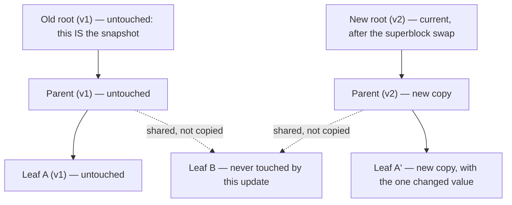

# XFS and Btrfs

XFS and Btrfs are two different bets on what matters. XFS bet on parallelism and scale: split the
filesystem into independent allocation groups, index everything with B+ trees, and let many threads
allocate at once without contending on one shared structure. Btrfs bet on never overwriting data:
copy-on-write B-trees give snapshots, checksums, and cheap clones as structural consequences of the
on-disk format rather than bolted-on features. Neither is "better than ext4" in general — each is right
for different workloads, and this page states which without advocacy.

## XFS: allocation groups and B+ trees

An XFS filesystem is divided into **allocation groups (AGs)** — independently lockable regions, each
represented in memory by `<Src file="fs/xfs/libxfs/xfs_ag.h" symbol="xfs_perag" />` (verified at v6.18).
Splitting the filesystem this way is what lets XFS scale: an allocation in one AG takes a lock scoped to
*that* AG, so many threads writing to different files can allocate space concurrently without contending
on one filesystem-wide lock the way a simpler design would. `xfs_perag` itself carries, among other
fields, `pagf_bno_level` and `pagf_cnt_level` — the heights of **two separate B+ trees** per AG, one
indexed by starting block (`bnobt`, for finding free space near a given location) and one by extent size
(`cntbt`, for finding a free extent big enough for a given request) — free space in each AG is tracked
both ways simultaneously so the allocator can satisfy either kind of query without scanning. Inodes are
allocated dynamically out of each AG's own space rather than pre-reserved at `mkfs` time, and metadata
updates go through **delayed logging**: in-memory log items are merged and only the final, coalesced
result is written to the log, rather than every individual metadata change being logged separately — see
the references for the full design. XFS also supports **reflink** (`FICLONE`/`FICLONERANGE`), a
copy-on-write clone of an extent shared between two files until either side writes to it — the same
underlying idea Btrfs's whole design is built around, offered on XFS as one feature among many rather than
as the foundation.

## Btrfs: copy-on-write B-trees

Btrfs never modifies a tree node in place. Changing one piece of data means writing a new leaf node
holding the change, which means writing a new parent node to point at that new leaf (the old parent still
points at the old leaf), which cascades all the way up to a new root — and the **only** in-place write in
the whole operation is the final step: swapping the superblock's root pointer from the old root to the
new one, one atomic write. `<Src file="fs/btrfs/ctree.c" symbol="btrfs_cow_block" />` is the function that
performs one node's copy-on-write step, and `<Src file="fs/btrfs/transaction.c"
symbol="btrfs_commit_transaction" />` is what performs the final root-pointer swap, both verified at
v6.18; `<Src file="fs/btrfs/ctree.h" symbol="btrfs_root" />` is the structure a Btrfs subvolume's own root
pointer lives in.

Nearly everything distinctive about Btrfs falls directly out of this one design choice, rather than being
a separate feature bolted on:

- **Snapshots and subvolumes** are just another root pointer into the *same* tree structure at the moment
  the snapshot was taken. Nothing is copied at snapshot time — the new root and the old root share every
  node neither side has changed since, and only future writes to either side cause new nodes to diverge.
- **Checksums** on both data and metadata are a natural fit: since a block is never overwritten in place,
  there is no "verify, then overwrite" race to worry about — a block is written once, checksummed once,
  and never silently modified underneath its own checksum afterward.
- **Reflink copies** (`cp --reflink`) and **send/receive** (incremental, block-level diffs between two
  snapshots) both follow from the same shared-node structure: a reflinked file is two inodes pointing at
  overlapping extents, and a send/receive diff is exactly the set of nodes that differ between two root
  pointers — which Btrfs already has to identify internally to know what to copy-on-write next.

## Btrfs's multi-device modes, honestly

**Checked 2026-09-14** against the Btrfs project's own current status page
(`https://btrfs.readthedocs.io/en/latest/Status.html`, "Block group profiles" table, based on kernel 7.2
at the time of checking) rather than repeating community folklore in either direction. Single, DUP, RAID0,
RAID1, RAID1C3, RAID1C4, and RAID10 are all listed **`OK`** for stability (RAID1/RAID1C3/RAID1C4/RAID10
are listed `mostly OK` for *performance* specifically — "reading from mirrors in parallel can be optimized
further," not a correctness caveat). **RAID5 and RAID6 are listed `unstable`, performance `n/a`.** The
project's own linked detail page (`btrfs-man5.html#raid56-status-and-recommended-practices`) is
unambiguous, quoted directly: *"There are some implementation and design deficiencies that make it
unreliable for some corner cases and the feature should not be used in production, only for evaluation or
testing. The power failure safety for metadata with RAID56 is not 100%."* The same page recommends using
`raid1`/`raid1c3` instead of `raid5`/`raid6` specifically **for metadata**, and documents the **write
hole** — an unclean shutdown can leave part of a stripe holding old data and old parity while the rest
holds new data, with no way to tell which is which — as still present: "Write journal is not implemented."
This has been the status for years, not a new finding; the point of checking the live page rather than
citing a fixed date from memory is that this is exactly the kind of claim that changes with a future
kernel release, and the project's own status table is the only source that stays current.

## Costs

Neither filesystem is free of trade-offs the "Choosing" section below has to weigh:

- **Btrfs**: fragmentation under random in-place overwrites — a database's own file, or a VM disk image,
  rewrites small regions constantly, and copy-on-write means "rewrite four bytes" always allocates a new
  node rather than updating in place, fragmenting the file over time. The `nodatacow` mount/file attribute
  turns COW off for such files to avoid this, at the direct cost of losing per-block checksums for exactly
  those files (COW and checksumming are the same mechanism underneath — turning one off necessarily turns
  off the other). Metadata space exhaustion is also a **distinct** failure mode from running out of data
  space — a filesystem can report free space overall while failing writes with `ENOSPC` because its
  metadata chunk specifically is full (see the trap below) — and periodic **balance** (rewriting data
  through the allocator again to consolidate it) is genuine ongoing maintenance, not a one-time setup
  step.
- **XFS**: cannot be shrunk online (growing is supported; shrinking an XFS filesystem in place is not — the
  only path is backup, recreate, restore), and repairing (`xfs_repair`) a very large filesystem needs
  memory roughly proportional to the metadata being checked, which can be a real operational constraint on
  multi-terabyte volumes with a lot of small files.

## Choosing

<Tabs>
<TabItem value="ext4" label="ext4" default>

The general-purpose default and the simplest recovery story of the three: decades of production use,
`fsck` behavior every sysadmin already understands, and no exotic maintenance operation (no balance, no
online-shrink asterisk). Right for a root filesystem, a general-purpose server, or any workload that
doesn't specifically need what XFS or Btrfs add. [The ext4 page](./ext4.md) covers it in full.

</TabItem>
<TabItem value="xfs" label="XFS">

Right for large files and many concurrent writers — media storage, databases on dedicated volumes, and
anything where parallel allocation-group throughput matters more than the ability to shrink the
filesystem later. The RHEL default since RHEL 7, which reflects exactly this workload profile in Red
Hat's own target market (large-scale server storage).

</TabItem>
<TabItem value="btrfs" label="Btrfs">

Right when snapshots, checksums, and `send`/`receive` are worth their maintenance cost — a desktop that
wants trivial pre-upgrade snapshots, a backup target using `send`/`receive` for efficient incremental
transfers, or any workload that benefits from cheap reflink copies. The Fedora Workstation default since
Fedora 33 and openSUSE's default for years before that. Avoid RAID5/RAID6 for the reasons stated above
regardless of which distribution or workload.

</TabItem>
</Tabs>

**ZFS**, for completeness: the same copy-on-write bet as Btrfs, considerably more mature on other
platforms, and deliberately **not covered further here** because it ships out-of-tree on Linux — its
license (CDDL) is treated by the kernel project as incompatible with the GPL for the purpose of a
statically or dynamically linked kernel module, so it is distributed as a separate `zfs.ko` (via
`ZFSOnLinux`/OpenZFS) rather than living in the kernel tree this documentation otherwise describes.

*Changing one block in a copy-on-write tree: new nodes all the way up to a new root, while the old root
still describes the complete old tree unchanged — which is all a snapshot is.*

| | ext4 | XFS | Btrfs |
|---|---|---|---|
| On-disk model | Fixed block groups, in-place update | Allocation groups, in-place update | Copy-on-write B-trees |
| Data checksums | No | No | Yes |
| Snapshots | No (LVM can, below the filesystem) | No (LVM can, below the filesystem) | Yes, native |
| Online shrink | No (offline only, via `resize2fs`) | No | Yes |
| Reflink | No | Yes | Yes |
| Max-scale design point | General purpose | Large files, many parallel writers | Snapshots, checksums, send/receive |
| Multi-device support | No (use LVM/`md`) | No (use LVM/`md`) | Yes, native (see RAID5/6 caveat above) |
| Default distribution | Most general-purpose distros | RHEL (since RHEL 7) | Fedora Workstation, openSUSE |

*ext4 and XFS rely on a separate layer (LVM or `md`) for snapshots and multi-device redundancy; Btrfs
builds both into the filesystem itself, which is precisely the trade-off "Choosing" above weighs.*

<KernelFacts
  structure={[["struct xfs_perag", "fs/xfs/libxfs/xfs_ag.h"], ["struct btrfs_root", "fs/btrfs/ctree.h"]]}
  path="Btrfs write → btrfs_cow_block() → new node written → btrfs_commit_transaction() → superblock root pointer updated"
  observe="sudo xfs_info /mountpoint  # or: sudo btrfs filesystem usage /mountpoint — whichever filesystem is present"
  trap="Btrfs 'free space' is two separate pools — data and metadata — and a filesystem can report gigabytes free while failing writes with ENOSPC because metadata specifically is exhausted. btrfs filesystem usage shows both pools; plain df does not." />

## References

- [XFS Delayed Logging Design](https://docs.kernel.org/filesystems/xfs/xfs-delayed-logging-design.html) —
  the in-tree design document for XFS's delayed-logging mechanism (path verified at the current kernel
  docs site, linked from `filesystems/xfs/index.html`).
- [Btrfs Status](https://btrfs.readthedocs.io/en/latest/Status.html) — the Btrfs project's own
  feature-stability table, the source for every stability claim on this page, checked 2026-09-14.
- Rodeh, Bacik & Mason, ["BTRFS: The Linux B-Tree Filesystem"](https://doi.org/10.1145/2501620.2501623),
  *ACM Transactions on Storage* 9(3), 2013 — the design paper behind the copy-on-write model this page
  describes.
- Dave Chinner, ["XFS: the filesystem of the future?"](https://lwn.net/Articles/476263/), LWN, 2012 — a
  write-up of Chinner's talk on XFS's scalability work; old, but the allocation-group architecture it
  describes is unchanged at v6.18.
