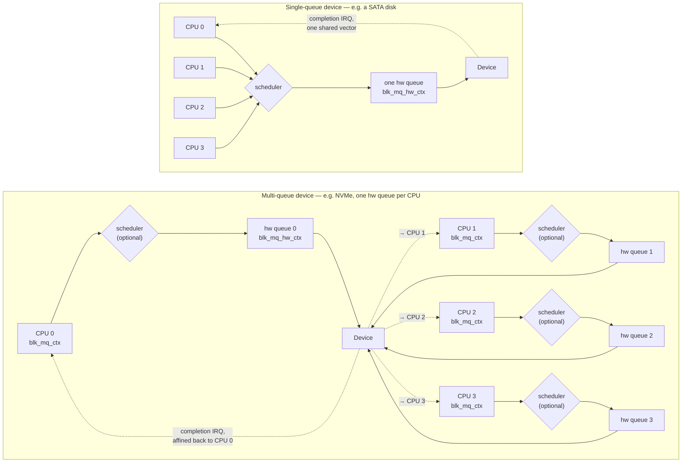

# blk-mq: Multi-Queue Block I/O

For decades Linux had one request queue per disk, protected by one lock, and every CPU submitting I/O
contended for it. That was fine for a disk doing 200 operations a second and fatal for an SSD doing
500,000 across 64 cores — the lock itself, and the cache line it lives on bouncing between cores every
time it's taken, becomes the bottleneck long before the device does. blk-mq (multi-queue block I/O)
replaced the single queue with per-CPU software queues feeding per-device hardware queues. Its design is
a direct application of [Per-CPU Data](../09-concurrency-and-locking/per-cpu-data.md): remove the sharing
instead of making the lock faster.

## Why one queue collapsed

The pre-blk-mq block layer gave every `request_queue` exactly one lock (`queue_lock`) guarding one
sorted list of pending requests. Every CPU that wanted to submit or complete I/O took that lock first.
On a disk slow enough that a request took milliseconds to service, the lock was idle almost all the
time — contention was never the bottleneck, the platter was. On flash, where a single device can accept
hundreds of thousands of commands a second across dozens of parallel channels, that same lock is now
the only thing running, and every core touching it evicts the cache line from every other core's cache
before it can proceed. The paper that motivated blk-mq (Bjørling, Axboe, Nellans & Bonnet, SYSTOR 2013 —
see References) measured the old single-queue layer topping out far below what the SSD hardware of the
day could sustain, with the queue lock as the dominant cost once request rates climbed. The fix wasn't a
faster lock — spinlocks were already about as fast as a lock gets — it was arranging the data so most
CPUs never needed to look at what another CPU was doing at all.

That old single-queue path is not a legacy option kept around for old hardware; it is gone. The last
kernel to carry it was 5.0 — verified directly: `block/cfq-iosched.c`, `block/deadline-iosched.c`, and
`block/noop-iosched.c`, the schedulers that only ran atop the old `request_fn`-based single queue, are
present in the v4.20 source tree and absent from v5.0 onward. Every block driver in the tree today,
without exception, submits through blk-mq.

## Software queues and hardware queues

blk-mq splits the old single queue into two levels. `<Src file="block/blk-mq.h" symbol="blk_mq_ctx" />`
is the **software queue** — one per CPU, holding requests a CPU has submitted but not yet handed to
hardware. It's deliberately a private structure, declared in the block layer's own internal
`block/blk-mq.h` rather than the public `include/linux/blk-mq.h`, because nothing outside the block core
ever touches it directly. `<Src file="include/linux/blk-mq.h" symbol="blk_mq_hw_ctx" />` is the
**hardware queue** — one per queue the *device* actually exposes, and the structure a driver's own code
interacts with. Because it crosses that driver boundary, `blk_mq_hw_ctx` lives in the public header.

The mapping between the two — which software queues feed which hardware queue — is
`<Src file="include/linux/blk-mq.h" symbol="blk_mq_queue_map" />`. An NVMe device that exposes one I/O
queue per CPU gets a 1:1 map: CPU *N*'s software queue feeds hardware queue *N*, and nothing else ever
touches that hardware queue. A single-queue SATA disk, which only ever exposes one hardware queue no
matter how many CPUs the machine has, maps every CPU's software queue onto that same one hardware queue
— the fan-in still has to happen somewhere, because the hardware only accepts commands through one
channel. What blk-mq removes is contention *between* software queues that don't have to share anything;
it cannot invent parallelism the device doesn't have.

## Tags

Every in-flight request holds a **tag** — an index into a per-hardware-queue bitmap, handed out by
`<Src file="block/blk-mq-tag.c" symbol="blk_mq_get_tag" />`. The tag does two jobs at once: it's what
lets `blk_mq_get_tag` refuse a new request once the bitmap is full (bounding how much work can be
outstanding on one hardware queue at a time), and it's the handle a driver hands to the device and gets
back on completion to find the matching request again — no linked-list walk, no search, just an array
index. Because of that second job, the number of bits in the tag bitmap *is* the queue depth: how many
commands can be outstanding on that hardware queue simultaneously. `nr_requests`
(`/sys/block/<dev>/queue/nr_requests`, seen already in
[Block Devices and `gendisk`](./block-devices-and-gendisk.md)) is the tunable face of that same number.

## The submission path

`<Src file="block/blk-mq.c" symbol="blk_mq_submit_bio" />` is where a `bio` — built and handed down the
way [The `bio`](./the-bio.md) describes — enters blk-mq. From there: a plugging window gives adjacent
`bio`s a chance to merge into one `request` before anything is allocated;
`<Src file="block/blk-mq.c" symbol="blk_mq_get_new_requests" />` allocates a `request` and, via
`blk_mq_get_tag`, a tag for it; if a scheduler is attached to this hardware queue, the request is handed
to it for possible reordering rather than dispatched immediately (the next page,
[I/O Schedulers](./io-schedulers.md), covers what happens there); and
`<Src file="block/blk-mq.c" symbol="blk_mq_run_hw_queue" />` finally dispatches it to the driver's own
`->queue_rq()` callback. `<Src file="include/linux/blk-mq.h" symbol="blk_mq_ops" />` (the callbacks a
driver implements — `queue_rq`, `complete`, `init_hctx`, and the rest) and
`<Src file="include/linux/blk-mq.h" symbol="blk_mq_tag_set" />` (the driver's queue count, queue depth,
and the `blk_mq_ops` table together) are the entire interface a block driver implements to plug into
blk-mq — everything above this page — plugging, tagging, scheduling, dispatch — is common code the
driver never has to reimplement.

## The completion path

The device finishes the command and raises an interrupt on the hardware queue's own vector. The driver's
interrupt handler finds the original `request` by the tag the completion carries, then calls
`<Src file="block/blk-mq.c" symbol="blk_mq_complete_request" />`, which arranges for
`<Src file="block/blk-mq.c" symbol="blk_mq_end_request" />` to run and finish the request — freeing the
tag, and calling `bio_endio()` on every `bio` that made up the request, which is what actually wakes
whatever was waiting on it (see [The `bio`](./the-bio.md#completion) for what `bio_endio()` does from
there). `<Src file="include/linux/blkdev.h" symbol="io_comp_batch" />` lets a driver that reaps several
completions in one interrupt hand them to the block layer together instead of one call at a time — a
small but real saving when an interrupt on a busy queue often finds more than one command already done.

## What actually happens

:::note[No root in this sandbox — the read itself could not be run]
This page was written in a sandbox with no root and no working `sudo` (`sudo -n true` fails with
"interactive authentication is required", and every block device node here is mode `660` owned outside
this user's groups — `dd: failed to open '/dev/sda': Permission denied` on every device tried, `sda`
through `sdd`, `loop0`, and `ram0` alike). The `dd ... iflag=direct` read the brief for this page asks
for could not actually be executed. What follows is **not** a captured trace of a live read.

What *is* real, and gathered without needing root at all: this sandbox's `/sys/block/*/mq/` hierarchy,
queried directly below, and `/proc/interrupts`. Both are used as the concrete substrate for the
walkthrough instead of inventing numbers for a device this sandbox doesn't have.
:::

This WSL2 sandbox (`uname -r`: `6.18.33.2-microsoft-standard-WSL2`, 10 CPUs) exposes its Hyper-V-backed
virtual disks as multi-queue blk-mq devices — genuinely, not simulated — with **one hardware queue per
CPU**, a real 1:1 map:

```text
$ nproc
10
$ ls /sys/block/sda/mq/
0  1  2  3  4  5  6  7  8  9
$ for q in /sys/block/sda/mq/*/; do echo "hw queue $(basename $q): cpu_list=$(cat $q/cpu_list)"; done
hw queue 0: cpu_list=0
hw queue 1: cpu_list=1
hw queue 2: cpu_list=2
hw queue 3: cpu_list=3
hw queue 4: cpu_list=4
hw queue 5: cpu_list=5
hw queue 6: cpu_list=6
hw queue 7: cpu_list=7
hw queue 8: cpu_list=8
hw queue 9: cpu_list=9
```

That is exactly the multi-queue shape the opening section above describes for an NVMe-like device — CPU
*N* maps to hardware queue *N* and nothing else does. But `/proc/interrupts` on this same machine shows
something worth being honest about instead of glossing over:

```text
$ grep -i virtio1 /proc/interrupts
 26:    0   0   0   0   1   0   0   0   0   0  HV-PCI-MSIX-3867:00:00.0  0-edge  virtio1-config
 27:    0   0   0   0   0   1   0   0   0   0  HV-PCI-MSIX-3867:00:00.0  1-edge  virtio1-hiprio
 28:    0   0   0   0   0   0   0   0   0  10  HV-PCI-MSIX-3867:00:00.0  2-edge  virtio1-requests.0
```

Ten real hardware queues, but **one** shared `virtio1-requests.0` completion vector, not ten — and that
one vector's interrupts have all landed on CPU9 so far, not on whichever CPU issued the request. This is
the virtio-scsi transport this sandbox's virtual disks actually use, and it is genuinely not NVMe: a real
NVMe controller gives each I/O queue its own MSI-X vector, normally affined to the CPU that owns the
queue (see [Interrupt Affinity](../10-interrupts-time-and-deferred-work/interrupt-affinity-and-balancing.md)
for that mechanism in general, and [NVMe in the Kernel](./nvme-in-the-kernel.md#completing-a-command) for
the NVMe-specific case). virtio-scsi's single shared vector here is a real, disclosed limitation of what
this sandbox's virtual hardware can demonstrate, not an error in the description above.

With that disclosed, here is what a read-only direct read to hardware queue 3 does, reasoned from the
verified code path above and grounded in this sandbox's own real 1:1 queue map — the CPU numbers are
illustrative of the mechanism, not measured from a live trace:

1. A task on CPU 3 issues a read syscall with `O_DIRECT`.
2. The read builds a `bio` describing the destination user page directly — no page-cache copy, per
   [Buffered, Direct, and Alignment](./buffered-direct-and-alignment.md).
3. `blk_mq_submit_bio()` runs on CPU 3, so the `bio` lands in *CPU 3's own* software queue
   (`blk_mq_ctx`) — no other CPU's submission path is touched.
4. That software queue maps, per this device's `blk_mq_queue_map`, onto hardware queue 3; a tag is
   pulled from hardware queue 3's own tag bitmap.
5. The driver's `->queue_rq()` writes the command into that hardware queue's submission ring and rings
   its doorbell — for NVMe specifically, this step is [Submitting a command](./nvme-in-the-kernel.md#submitting-a-command).
6. The device DMAs the requested block directly into the page the `bio` described and writes a
   completion entry.
7. An interrupt tied to hardware queue 3 arrives — on a real NVMe device, normally on CPU 3, by the
   affinity mechanism just linked; this sandbox's own virtio-scsi controller does not demonstrate that
   per-queue affinity for real, as shown above.
8. The driver's interrupt handler reads the completion entry, recovers the original `request` by its
   tag, and calls `blk_mq_complete_request()` / `blk_mq_end_request()`.
9. `bio_endio()` runs, and the task blocked on CPU 3's read wakes up.

At no point in that walk does CPU 3's I/O take a lock any other CPU's I/O is also trying to take — that
is the entire point of the split into per-CPU software queues in the first place.

## Where the scheduler sits

A scheduler is optional and attaches per hardware queue, sitting between the software queues feeding it
and that one hardware queue's dispatch — present in the submission path above as the "scheduler insert"
step before `blk_mq_run_hw_queue()`. What it actually does with the requests passing through it is
[I/O Schedulers](./io-schedulers.md).



*blk-mq on a multi-queue NVMe device and on a single-queue disk: the same code path, with the fan-in
drawn where the hardware forces it.*

<KernelFacts
  structure={[["struct blk_mq_hw_ctx", "include/linux/blk-mq.h"], ["struct blk_mq_tag_set", "include/linux/blk-mq.h"]]}
  path="blk_mq_submit_bio() → blk_mq_get_new_requests() → blk_mq_run_hw_queue() → ->queue_rq() … irq → blk_mq_complete_request() → bio_endio()"
  observe="ls /sys/block/nvme0n1/mq/ && cat /sys/block/nvme0n1/mq/0/cpu_list (substitute any multi-queue device)"
  trap="More hardware queues do not make a single-threaded workload faster. blk-mq removes contention between CPUs; one thread submitting I/O uses one software queue and one hardware queue no matter how many the device offers." />

## References

- [Kernel documentation — Multi-Queue Block IO Queueing Mechanism](https://docs.kernel.org/block/blk-mq.html)
  — the in-tree design document: software queues, hardware queues, and tags, in the kernel's own words.
- Matias Bjørling, Jens Axboe, David Nellans & Philippe Bonnet, *"Linux Block IO: Introducing Multi-queue
  SSD Access on Multi-core Systems"*, SYSTOR 2013 — the paper that motivated and measured the design
  described above.
- LWN, [*"The multiqueue block layer"*](https://lwn.net/Articles/552904/) — the 2013 announcement;
  historical now, and the reason the single-queue path described in "Why one queue collapsed" is gone.
- <Src file="block/blk-mq.c" symbol="blk_mq_submit_bio" /> — the submission path's entry point,
  verified at v6.18.
