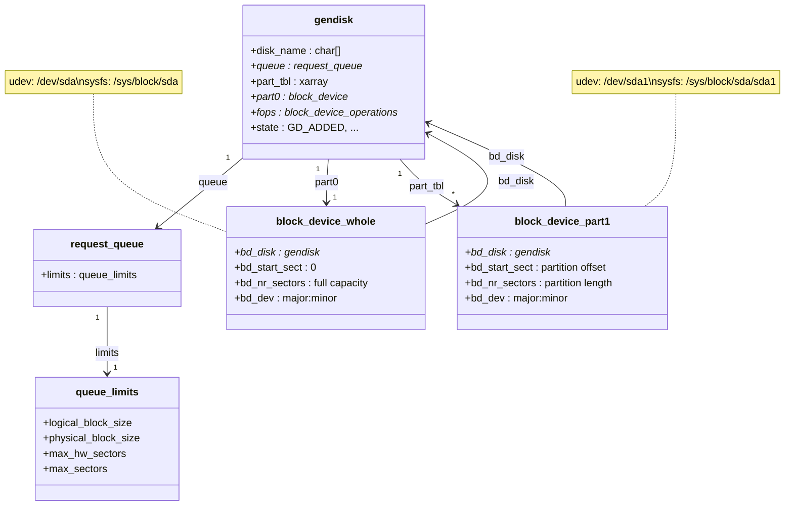

# Block Devices and `gendisk`

A block device is a device the kernel can address as an array of fixed-size sectors, in any order. That
one property is why filesystems, the page cache, partitions, and the I/O scheduler can all exist on top
of it: random access means a filesystem can place data anywhere and find it again, and a fixed sector
size means every layer above can agree on what "one unit of the device" means. The kernel describes each
such disk with a `gendisk`, and almost everything you can see about a disk in `/dev` and `/sys/block` is
generated from that one structure.

## What makes a device a block device

Four properties, together: random access by sector rather than a forced sequential order; a fixed
logical block size that every read or write is a multiple of; buffering through the page cache, so a
filesystem on top of it gets caching and writeback for free; and I/O submitted as `bio`s — described in
full in [The `bio`](./the-bio.md) — rather than as a byte stream. Contrast a character device, which
offers none of these: it is read or written as an unstructured stream (a serial port, `/dev/null`), with
no notion of seeking to an arbitrary offset and no block size to align to.

## `gendisk` and `block_device`

Two structures, one disk. `<Src file="include/linux/blkdev.h" symbol="gendisk" />` is the disk itself
— verified at v6.18, it carries `disk_name` (what shows up as `sda`, `nvme0n1`, and so on), `queue`
(the `request_queue` every `bio` submitted to this disk passes through), `part_tbl` (an `xarray` of the
disk's partitions), `part0` (the `block_device` representing the whole disk, partition-less), `fops`
(the `block_device_operations` the driver implements — `open`, `release`, `ioctl`, and friends), and
`state`, a bitmask including `GD_ADDED` — whether `add_disk()` has actually published this disk yet.

`<Src file="include/linux/blk_types.h" symbol="block_device" />` is the openable device node — *the
whole disk, or one partition of it*. Both cases are the same structure: `bd_disk` always points back at
the owning `gendisk`; `bd_start_sect` and `bd_nr_sectors` are zero and the full capacity for the whole
disk (`part0`), and the partition's own offset and length for a partition. This is why `/dev/sda` and
`/dev/sda1` are two different `block_device`s sharing one `gendisk`, one `request_queue`, and one set of
`queue_limits` — a partition does not get its own queue.

A driver creates all of this in three steps, verified at v6.18. First, allocate a disk together with its
request queue and a `struct queue_limits` describing what the hardware can do — `blk_mq_alloc_disk(set,
lim, queuedata)`, a macro wrapping `<Src file="include/linux/blk-mq.h" symbol="__blk_mq_alloc_disk" />`,
`struct gendisk *__blk_mq_alloc_disk(struct blk_mq_tag_set *set, struct queue_limits *lim, void
*queuedata, struct lock_class_key *lkclass)`. Taking `queue_limits` directly at allocation time — rather
than filling them in afterward through a series of setter calls — is a v6.18-era API shape: the limits a
device can support (`max_hw_sectors`, `logical_block_size`, `physical_block_size`, and the rest) are
known and fixed before the queue exists, so the constructor takes them as an argument instead of leaving
a window where the queue exists with limits not yet set. Second, `<Src file="include/linux/blkdev.h"
symbol="set_capacity" />` records the disk's size in sectors. Third, `<Src file="include/linux/blkdev.h"
symbol="add_disk" />` publishes it — verified at v6.18, `add_disk(disk)` is a thin `static inline`
wrapper: `return device_add_disk(NULL, disk, NULL);`, and `<Src file="block/genhd.c"
symbol="device_add_disk" />` itself forwards to `add_disk_fwnode()`, which does the actual sysfs/`kobject`
registration and, at the end, fires the uevent that makes the disk visible outside the kernel. Before
`add_disk()` returns, the disk exists in memory but nothing in `/dev` or `/sys/block` knows about it yet.

## Partitions

A disk's partition table (MBR, GPT, and the others) is parsed by code under `block/partitions/` the
first time the disk is scanned — on `add_disk()`, or after a re-scan. Each partition found becomes its
own `block_device`, sharing the parent `gendisk`'s queue and driver but carrying its own `bd_start_sect`
and `bd_nr_sectors`. Re-reading a table after it changes — after `fdisk` or `parted` modifies it — goes
through the `BLKPG` ioctl, most commonly invoked for you by `partprobe` rather than called directly.

## Device numbers and `/dev`

Every block device is identified by a major:minor pair (`dev_t`), and modern drivers almost always ask
the kernel to allocate both dynamically rather than claiming a fixed number the way old drivers once did
— `gendisk.major`/`first_minor`/`minors` exist on the structure, but "should not be set by any new
driver," per the kernel's own comment on the field; the block core allocates them. Once `add_disk()`
fires the disk's uevent, it is userspace's `udev` — not the kernel — that turns that event into an actual
`/dev/sda` node and the `/dev/disk/by-*` symlinks (`by-id`, `by-uuid`, `by-path`, `by-label`). The kernel
only ever promises a major:minor pair and a name; everything else in `/dev` is udev's interpretation of
the uevent. This is exactly why `/dev/sda` names are not stable across boots or hotplug events — they
are assigned in probe order, which depends on bus enumeration timing — while `by-uuid` and `by-id` are
stable, because they are derived from data that doesn't change: the filesystem's own UUID, or the
device's model and serial number. The uevent machinery itself — how `udev` listens for and processes
these events — belongs to a later folder in this section, not yet written.

## `/sys/block`, the attributes worth knowing

Every attribute below lives at `/sys/block/<dev>/queue/<name>` except `stat`, which is
`/sys/block/<dev>/stat` directly.

| Attribute | What it controls or reports | Writable? |
|---|---|---|
| `scheduler` | Which I/O scheduler is active for this queue, and which others are available (shown in brackets/list form) | Yes |
| `rotational` | Whether the device is spinning media (`1`) or not (`0`) — informational, used by some schedulers and userspace tools to pick behavior | Yes (can be overridden, e.g. for a misreporting virtual disk) |
| `nr_requests` | How many `request`s the block layer will queue for this device before making callers wait | Yes |
| `logical_block_size` | The smallest unit the device can be addressed in; every I/O must be a multiple of this | No |
| `physical_block_size` | The device's actual native block size — may exceed `logical_block_size` (512e/4Kn drives) | No |
| `max_sectors_kb` | The largest single I/O the block layer will send to the device, in KiB | Yes, up to a hardware maximum |
| `read_ahead_kb` | How far ahead the page cache reads speculatively for this device | Yes |
| `write_cache` | Whether the device reports a volatile write cache (`write back`) or none (`write through`) — governs whether the block layer needs to issue flush/FUA requests at all | No (device-reported) |
| `stat` | Cumulative per-device I/O counters: reads/writes/discards completed, merged, sectors, and time spent, in that fixed field order | No |

## Opening a block device

The v6.18 in-kernel API for opening a device returns a `struct file`, not the block-specific handle
older code used. `<Src file="include/linux/blkdev.h" symbol="bdev_file_open_by_path" />` — verified at
v6.18, `struct file *bdev_file_open_by_path(const char *path, blk_mode_t mode, void *holder, const
struct blk_holder_ops *hops)` — replaces the older `blkdev_get_by_path()`, unifying block-device opens
with the same `struct file` every other kernel subsystem already deals in. The `holder` and
`blk_holder_ops` arguments are what make **exclusive opens** work: a caller opens with `BLK_OPEN_EXCL`
and a holder pointer identifying itself, and a second exclusive open with a *different* holder is
refused. This is the mechanism behind the `EBUSY` a `mkfs` on an already-mounted partition gets back —
the mounted filesystem holds the device open exclusively specifically so a second `mkfs` or `mount`
cannot silently race it and corrupt data both believe they own alone.

## Real values from this sandbox

**Captured 2026-09-15, `grep -H . /sys/block/*/queue/{scheduler,rotational,logical_block_size,...}` on
the machine this page was written on** — a WSL2 environment (`uname -r` reports
`6.18.33.2-microsoft-standard-WSL2`), not folder 01's full-system VM and not a bare-metal "real machine"
in the literal sense the design brief assumes. Its block devices are Hyper-V-backed virtual disks
exposed through a synthetic SCSI controller as `sd*` names (`lsblk` shows `sda`, `sdb`, `sdc` as a 357M,
159M, and 10G disk respectively, and `sdd` as a 1T disk mounted at `/` and `/mnt/wslg/distro`), plus a
set of `loop*` and `ram*` devices. These are the real values this environment reports — nothing below is
invented for a device that wasn't actually queried:

```text
/sys/block/sda/queue/scheduler:[none] mq-deadline kyber
/sys/block/sda/queue/rotational:1
/sys/block/sda/queue/logical_block_size:512
/sys/block/sda/queue/physical_block_size:512
/sys/block/sda/queue/nr_requests:950
/sys/block/sda/queue/max_sectors_kb:4096
/sys/block/sda/queue/read_ahead_kb:8192
/sys/block/sda/queue/write_cache:write through

/sys/block/sdd/queue/scheduler:[none] mq-deadline kyber
/sys/block/sdd/queue/rotational:1
/sys/block/sdd/queue/logical_block_size:512
/sys/block/sdd/queue/physical_block_size:4096
/sys/block/sdd/queue/nr_requests:950
/sys/block/sdd/queue/max_sectors_kb:4096
/sys/block/sdd/queue/read_ahead_kb:8192
/sys/block/sdd/queue/write_cache:write back
```

Two things worth noting rather than glossing over: every `sd*` device here reports `rotational:1`,
which is almost certainly Hyper-V's synthetic SCSI controller not bothering to report the correct value
for what is, underneath, host-side SSD or NVMe storage — `rotational` is only as honest as the device
(or, here, the virtualization layer) reporting it, exactly as the table above says. And `sdd`, the disk
WSL2's root filesystem actually lives on, is the one device here with `write_cache: write back` and a
4Kn physical block size distinct from its 512-byte logical size (512e) — the two attributes a database
or filesystem author would actually check before assuming FUA/flush requests are free or that unaligned
writes don't cost a read-modify-write cycle. The `loop*` and `ram*` devices (not shown above) all report
`rotational:0`, `write_cache: write through`, and a uniform 512-byte logical block size, as expected for
purely in-memory or file-backed block devices.



*One disk as the kernel sees it: the `gendisk`, a `block_device` per partition, and the files `udev` and
sysfs generate from them.*

<KernelFacts
  structure={[["struct gendisk", "include/linux/blkdev.h"], ["struct block_device", "include/linux/blk_types.h"]]}
  path="driver probe → blk_mq_alloc_disk() → set_capacity() → add_disk() → uevent → udev creates /dev node"
  observe="grep -H . /sys/block/*/queue/{scheduler,rotational,logical_block_size} 2>/dev/null"
  trap="`/dev/sda` is an enumeration order, not an identity — add a disk or change probe timing and the names shift. Anything written to `/etc/fstab` or a script should use `/dev/disk/by-uuid` or `by-id`." />

## References

- <Src file="block/genhd.c" symbol="device_add_disk" /> — where a disk becomes visible; verified at
  v6.18 that `add_disk()` is a thin wrapper calling `device_add_disk(NULL, disk, NULL)` directly.
- [Kernel documentation — registered devices](https://docs.kernel.org/admin-guide/devices.html) — the
  registered major/minor number list.
- [Kernel documentation — block queue sysfs
  attributes](https://docs.kernel.org/block/queue-sysfs.html) — every `/sys/block/<dev>/queue` attribute,
  defined.
- [`lsblk(8)`](https://man7.org/linux/man-pages/man8/lsblk.8.html) — the tool that renders all of this as
  a tree.
