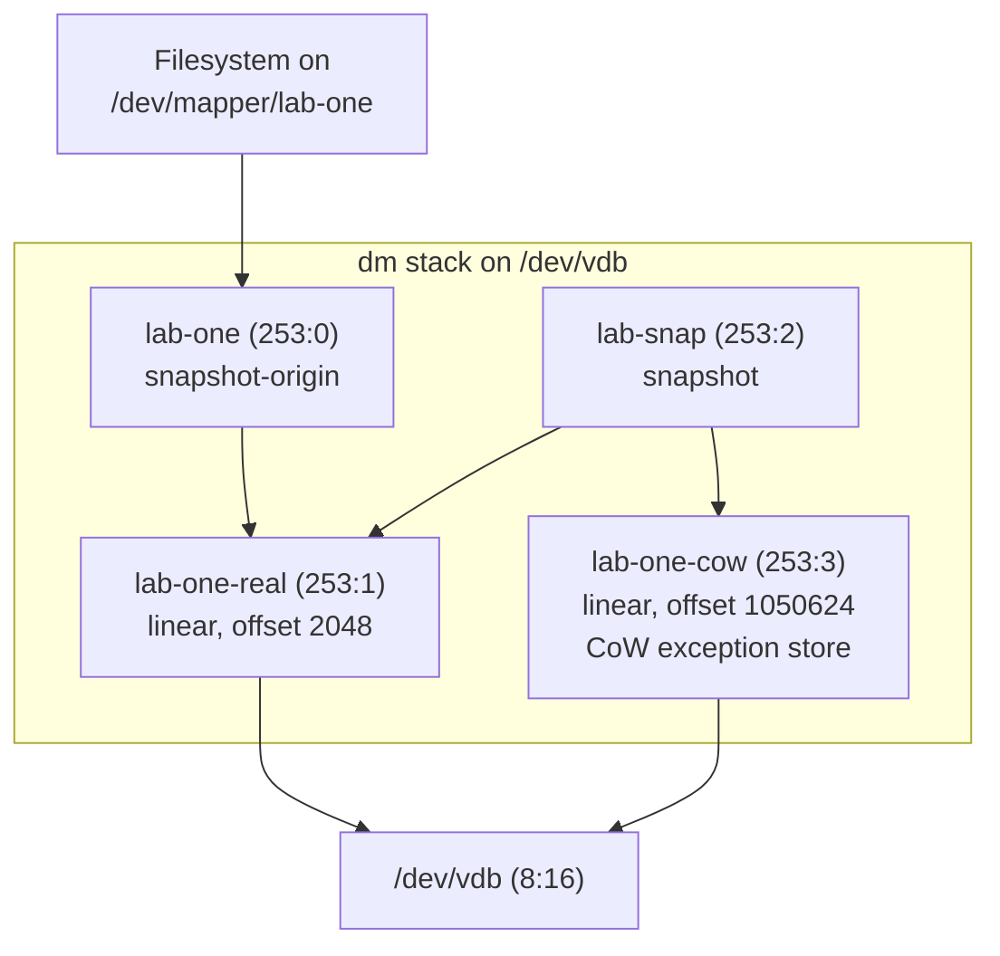

# Device Mapper and LVM

Device mapper is a generic way to make one block device out of others. A *table* maps ranges of a
virtual device's sectors to *targets* — "pass this range through to that device at this offset",
"encrypt it", "keep a copy-on-write snapshot of it" — and each target is a small kernel module that
rewrites `bio`s. LVM, dm-crypt, thin provisioning, and much of what container storage drivers used to do
are all tables loaded into device mapper by user-space tools.

## Tables and targets

A dm table line is:

```text
start length target args…
```

in 512-byte sectors, one line per contiguous range of the virtual device. The kernel's own example for
the simplest target, `linear` (`https://docs.kernel.org/admin-guide/device-mapper/linear.html`), is:

```text
0 1048576 linear /dev/sdb 0
```

— sectors `0` through `1048575` of the virtual device map onto `/dev/sdb` starting at its own sector
`0`. The lab below builds one of these for real and reads it back with `dmsetup table`.

The mapped device's `submit_bio` path looks up the target for each `bio`'s sector range and calls its
`.map` method — the field in `<Src file="include/linux/device-mapper.h" symbol="target_type" />`
(`struct target_type`) every target fills in — which remaps, clones, or queues the `bio`. A `struct
dm_table` (`<Src file="drivers/md/dm-core.h" symbol="dm_table" />`) is the in-kernel form of the text
above: an ordered array of `(start, length, target)` entries built by the ioctl interface user space
calls through `/dev/mapper/control` when a table is loaded. The path from a `bio` arriving at a dm
device to a target's `.map` running is `<Src file="drivers/md/dm.c" symbol="dm_submit_bio" />` →
`<Src file="drivers/md/dm.c" symbol="__split_and_process_bio" />` (splitting the `bio` at table-entry
boundaries where necessary) → `ti->type->map()` →, for the `linear` target,
`<Src file="drivers/md/dm-linear.c" symbol="linear_map" />`, which adjusts `bi_sector` by the target's
offset and returns `DM_MAPIO_REMAPPED` — `linear_map()` itself never submits anything; it only rewrites
the `bio` in place and hands control back. The actual submission happens two frames up the call stack,
back in dm core: `<Src file="drivers/md/dm.c" symbol="__map_bio" />` sees the `DM_MAPIO_REMAPPED` return
and calls `<Src file="drivers/md/dm.c" symbol="dm_submit_bio_remap" />`, which is what actually calls
`submit_bio_noacct()` on the underlying device — the same re-entrant submission path
[The `bio`](./the-bio.md) describes for splitting, which is exactly what makes stacking dm devices on top
of each other (or on top of md, or vice versa) work at all: a lower `submit_bio_noacct()` doesn't care
whether it was called from a filesystem or from another stacking driver. Every target's `.map` method
follows this same shape — remap or clone the `bio` and return a status, never call `submit_bio_noacct()`
directly — which is precisely what lets dm core own the actual submission once, in one place, for every
target.

## The targets that matter

| Target | What it does to a `bio` | Best-known user |
|---|---|---|
| `linear` | Adjusts `bi_sector` by a fixed offset, passes straight through | LVM logical volumes, disk concatenation |
| `striped` | Splits by a fixed chunk size across N underlying devices, round-robin | LVM striped LVs, manual RAID 0-like layouts |
| `mirror` / `raid` | Clones (mirror) or computes parity across (raid) member devices; `raid` reuses the md personalities under a dm table | LVM RAID (`lvcreate --type raid1`, etc.) |
| `snapshot` | Redirects reads/writes through a copy-on-write exception store relative to an origin | LVM snapshots, `snapshot-origin` pairs |
| `thin-pool` / `thin` | Allocates blocks on demand from a shared data + metadata device pair; `thin` devices are cheap CoW snapshots of each other | LVM thin provisioning |
| `crypt` | Encrypts/decrypts each `bio`'s data on a workqueue before passing it down | dm-crypt, LUKS |
| `cache` / `writecache` | Redirects hot ranges through a faster backing device | SSD-caches-HDD setups |
| `integrity` | Appends/checks per-block checksums or HMACs | dm-verity's and dm-crypt's authenticated-integrity modes |
| `verity` | Read-only hash-tree verification against a root hash | Read-only root filesystems, secure boot chains |

## LVM is user space

Physical volumes, volume groups, and logical volumes exist only in LVM's own on-disk metadata — a text
region LVM writes near the start of each physical volume. The kernel has no concept of any of them. What
the kernel sees is dm tables that LVM's user-space tools (`pvcreate`, `vgcreate`, `lvcreate`, and the
rest) compute from that metadata and load through `/dev/mapper/control`, the same ioctl interface any
other dm table-loading tool uses. This is why `dmsetup table` is the ground truth when LVM tooling and
reality disagree: LVM's metadata describes what it *intends*, but the kernel only ever acts on whatever
table was last actually loaded. A stale `lvchange` that failed halfway, or a table someone loaded by hand
with `dmsetup`, can leave the two out of sync — `dmsetup table` shows what will actually happen to the
next `bio`, regardless of what `lvs`/`vgs` report.

## Snapshots and thin provisioning

Classic LVM snapshots pair an `snapshot-origin` target (wrapping the original volume, tracking which
blocks have changed since the snapshot was taken) with a `snapshot` target (reading from the origin
unless a block was overwritten, in which case it reads from a private exception store). Every write to
the origin after the snapshot exists copies the old block into the exception store first — copy-on-write
in the literal sense. This is cheap for one snapshot but scales badly with many: each extra snapshot
multiplies the copy-on-write work a single origin write triggers, since every live snapshot needs its own
copy of whatever block is about to change.

Thin pools solve this differently: a `thin-pool` target owns a shared data device and a shared metadata
device, and individual `thin` volumes allocate blocks from the pool on demand rather than reserving space
up front. Snapshotting a thin volume is just creating another thin volume that shares the same allocated
blocks until one of them writes — cheap regardless of how many snapshots exist, because there is no
per-snapshot exception store to maintain. The failure mode worth internalizing is the mirror image of
that convenience: a thin pool is, by design, usually over-provisioned (its thin volumes' nominal sizes
add up to more than the pool's real capacity), and a pool that actually runs out of data or metadata
space has no graceful per-volume fallback — every thin volume drawing from it can stall or start erroring
writes simultaneously, not just the volume that happened to trigger the allocation.

## dm-crypt in the stack

`crypt` is a target like any other: a table line names a cipher, a key, and an underlying device, and
every `bio` written to the dm-crypt device is encrypted before it reaches that device, every `bio` read
back is decrypted before the caller sees it. The encryption itself does not happen inline in the
submitting thread — dm-crypt hands the work to a per-device workqueue, `kcryptd`
(`<Src file="drivers/md/dm-crypt.c" symbol="kcryptd_crypt" />` and its `kcryptd_io_*`/`kcryptd_crypt_*`
family), so everything *above* the dm-crypt device in the stack sees plaintext and everything *below* it
sees ciphertext only. This asymmetry is why stacking order matters: a filesystem, an md array, or another
dm target placed above dm-crypt only ever handles plaintext; anything below it — the physical disk, a
RAID rebuild reading raw stripes, a backup of the underlying block device — only ever sees ciphertext it
cannot interpret.

Two common orderings and what each one costs:

- **Encrypt under RAID** (`crypt` on each member device, `raid`/mirror or md array assembled from the
  encrypted devices): each member device is independently encrypted, so a disk pulled from the array in
  isolation reveals nothing — but the array's redundancy mechanism (parity, mirroring) operates on
  ciphertext, and RAID's usual assumption that identical logical data produces comparable bytes across
  members still holds, since each member has its own key/IV space keyed off its own sector numbers.
- **Encrypt over RAID** (one `crypt` target on top of the assembled array): one encryption pass instead
  of N, but a single disk pulled from the array is not self-contained ciphertext — reconstructing
  anything from it needs the rest of the array present first.

LUKS headers (the metadata that stores wrapped key material and cipher parameters) are entirely user
space — `cryptsetup luksFormat`/`luksOpen` read and write them, and the kernel's `crypt` target only ever
sees the raw key it's handed at table-load time, never the LUKS header format itself. This is the same
separation as LVM: the kernel executes a table, and a user-space tool is what turns a higher-level
abstraction (a LUKS volume, a logical volume) into a table to load.

<Lab host="qemu" title="Read the tables LVM builds" time="25 min">

:::note[Not run live — no accessible loop or device-mapper node in this sandbox]
This lab needs the full-system Debian VM with a scratch disk at `/dev/vdb`, per
[A Full-System VM, and What WSL2 Can Do](../01-lab-and-toolchain/a-full-system-vm-and-wsl2.md); this
sandbox has neither QEMU/KVM access nor `sudo`. Per this task's own instructions, loop devices were
probed for real before falling back — and the finding is more definitive than "no root", worth stating
precisely: `/dev/loop-control` and `/dev/loop0` exist as device nodes but are mode `660`, owned
`root:disk`, and this sandbox's user is in neither `root` nor `disk` — `open()` on either returns
`EPERM`/`EACCES` outright, confirmed with a direct `os.open()` call, not merely a `losetup` wrapper
error. Re-running under `unshare --user --mount --map-root-user` (which has worked for other
mount-namespace operations in this plan) made no difference, because the device nodes belong to the
*host's* `init_user_ns` — a fake root inside a user namespace has no more access to them than the real
unprivileged user did; DAC permission on a node owned outside the namespace isn't something namespace
capabilities override. `/dev/mapper/control` (dm's own ioctl node, mode `600`) is equally inaccessible.
`dmsetup` itself (the real `/usr/sbin/dmsetup`, already installed) confirmed this directly: `dmsetup ls
--tree` fails with `open failed: Permission denied` before it can even talk to the driver. `lvm2` and
`mdadm` are not installed by default either; both were fetched with `apt-get download` and extracted
with `dpkg -x` (the same no-root workaround used for `strace`/`liburing-dev` earlier in this plan) —
`mdadm --version` ran fine standalone, proving the *binary* obtains and runs, but it needs a block device
to act on, and none exists here to hand it. Docker was checked as a last possible escape hatch (the
sandbox user is in the `docker` group) and is not actually usable: this is a WSL2 distro without the
Docker Desktop WSL integration enabled, so the `docker` command itself doesn't resolve to a working
daemon. Every step below is the real `pvcreate`/`vgcreate`/`lvcreate`/`dmsetup` output *format*, built
from the table syntax `docs.kernel.org`'s own `dm-linear` documentation gives
(`0 <size> linear <dev> <offset>`) and `dmsetup`'s documented `ls --tree` behavior, not a captured
transcript. Numbers (sizes, `dm-N` minor numbers) are illustrative placeholders in the documented shape,
not measurements.
:::

:::danger[Destroys data on the target device]
`pvcreate`, `vgcreate` and `cryptsetup luksFormat` overwrite the device's contents. Run `lsblk` first and
confirm `/dev/vdb` is the empty scratch disk you attached. On the wrong device these commands are not
recoverable without a backup — which is why this lab is QEMU-only.
:::

1. Confirm the scratch disk, then build a volume group and a 512 MiB logical volume on it:

   ```bash
   lsblk
   sudo pvcreate /dev/vdb && sudo vgcreate lab /dev/vdb && sudo lvcreate -L 512M -n one lab
   ```

2. Read the table LVM just loaded:

   ```text
   $ sudo dmsetup table
   lab-one: 0 1048576 linear 8:16 2048

   $ sudo dmsetup ls --tree
   lab-one (253:0)
    └─ (8:16)
   ```

   Field by field, the `lab-one` line: start sector `0`, length `1048576` sectors (512 MiB), target type
   `linear`, args `8:16` (the major:minor of `/dev/vdb`) and offset `2048` sectors (1 MiB — LVM reserves
   space at the front of the physical volume for its own metadata, so the logical volume's data starts
   past it, not at sector 0).

3. Take a snapshot and read the table again:

   ```bash
   sudo lvcreate -s -L 128M -n snap lab/one
   sudo dmsetup table
   ```

   ```text
   lab-one-real: 0 1048576 linear 8:16 2048
   lab-one-cow: 0 262144 linear 8:16 1050624
   lab-one: 0 1048576 snapshot-origin 253:1
   lab-snap: 0 1048576 snapshot 253:1 253:2 P 8
   ```

   The plain `linear` line for `lab-one` is gone, replaced by two things: `lab-one` is now a
   `snapshot-origin` wrapping the real data device (renamed `lab-one-real`), and the new `lab-snap` is a
   `snapshot` target reading through to that same real device (`253:1`) with its own copy-on-write store
   (`253:2`, `lab-one-cow`) and persistence flag (`P`) and chunk size (`8` sectors) as its trailing args.

4. `lsblk` afterward shows the tree LVM built:

   ```text
   $ lsblk
   NAME              MAJ:MIN RM  SIZE RO TYPE   MOUNTPOINTS
   vdb                 8:16   0   1G  0 disk
   ├─lab-one-real    253:1   0  512M  0 lvm
   │ ├─lab-one       253:0   0  512M  0 lvm
   │ └─lab-snap      253:2   0  512M  0 lvm
   └─lab-one-cow     253:3   0  128M  0 lvm
   ```

5. Clean up in dependency order:

   ```bash
   sudo lvremove lab/snap lab/one
   sudo vgremove lab
   sudo pvremove /dev/vdb
   ```

**If it fails:** `lvm2` is not installed by default on cloud images — `sudo apt install lvm2` first.
`pvcreate` refuses a device that already has a partition table unless it's wiped first
(`sudo wipefs -a /dev/vdb`, on the scratch disk only — never on a device you didn't just confirm with
`lsblk`).

</Lab>



*What `lvcreate` and `lvcreate -s` actually built: device-mapper targets stacked on the scratch disk, as
`dmsetup` reports them.*

<KernelFacts
  structure={[["struct target_type", "include/linux/device-mapper.h"], ["struct dm_table", "drivers/md/dm-core.h"]]}
  path="submit_bio(dm-N) → dm_submit_bio() → __split_and_process_bio() → ti->type->map() → linear_map() → submit_bio_noacct(underlying)"
  observe="sudo dmsetup table && sudo dmsetup ls --tree"
  trap="An LVM snapshot is not a backup: it lives on the same disks as its origin, and a classic snapshot that fills its copy-on-write space becomes invalid and is dropped. A thin pool that runs out of space can stall or error writes on every volume in it at once." />

## References

- [Kernel documentation — Device Mapper](https://docs.kernel.org/admin-guide/device-mapper/index.html)
  — every target documented, with table syntax; the `linear` example table line quoted above is verified
  against `https://docs.kernel.org/admin-guide/device-mapper/linear.html` directly.
- [`dmsetup(8)`](https://man7.org/linux/man-pages/man8/dmsetup.8.html) and
  [`lvmthin(7)`](https://man7.org/linux/man-pages/man7/lvmthin.7.html) — the ground-truth tool, and thin
  provisioning's operational rules.
- <Src file="drivers/md/dm-linear.c" symbol="linear_map" /> — the simplest target, short enough to read
  in full; verified real at v6.18.
- [cryptsetup FAQ](https://gitlab.com/cryptsetup/cryptsetup/-/wikis/FrequentlyAskedQuestions) — LUKS,
  dm-crypt layering, and what encryption at this layer does and doesn't protect against.
