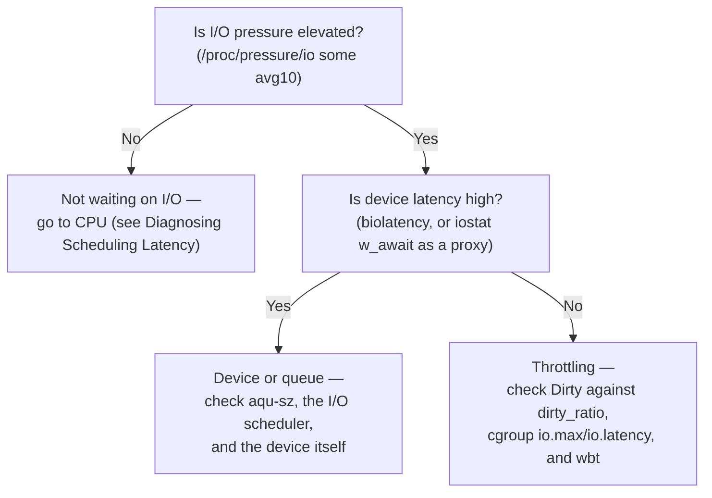

# Diagnosing I/O Problems

"The disk is slow" is a symptom that can live in at least five places: the device, the queue in front
of it, a cgroup throttle, writeback throttling your writes to protect memory, or an application that is
actually CPU-starved and never touching the device at all. Each tool on this page measures exactly one
layer of the map in [The Storage Stack, Mapped](./the-block-layer-map.md), and two of the most popular
metrics — `iowait` and `%util` — mislead more often than they help, because both were designed for a
simpler device than the one in your machine. This page is a method first, then a worked case measured
end to end in this page's own lab.

## Where time goes in an I/O

Every request's latency splits into two pieces: **queueing time** (waiting in blk-mq's software queues
and the I/O scheduler before a hardware queue will take it) and **service time** (the time the device
itself spends actually executing it once dispatched). The split matters more than the total, because the
two pieces point at completely different fixes. High service time with a short queue means the device
itself is slow or overloaded — a hardware or workload-shape problem. High queueing time with fast service
means requests are arriving faster than the scheduler is dispatching them, or the queue depth configured
for the device is too shallow — a software problem that no faster disk will fix. `iostat`'s `w_await`
(and `r_await`) report the *sum* of both pieces; `aqu-sz`, the average queue depth, is the strongest single
signal for whether queueing is the dominant term, since a queue depth near 0 with elevated `w_await` points
at the device, and a queue depth that has grown large points at requests backing up before they even reach
it.

## `iostat`, field by field

Every column `iostat -x` prints is derived from `/proc/diskstats`, which is itself a direct dump of each
device's `struct disk_stats` (<Src file="include/linux/part_stat.h" symbol="disk_stats" />) — see the
kernel's own [iostats documentation](https://docs.kernel.org/admin-guide/iostats.html) for the full field
list this page draws from. A real idle-baseline sample, taken on this page's own sandbox (10 CPUs,
x86-64, WSL2 kernel `6.18.33.2-microsoft-standard-WSL2`, four virtual SCSI disks `sda`–`sdd`):

```text
$ iostat -xz 1 3
Linux 6.18.33.2-microsoft-standard-WSL2 (DESKTOP-SHIELDX)     09/15/26        _x86_64_        (10 CPU)

avg-cpu:  %user   %nice %system %iowait  %steal   %idle
           9.45    0.00    1.03    0.05    0.00   89.48

Device    r/s     rkB/s   rrqm/s  %rrqm r_await rareq-sz   w/s    wkB/s   wrqm/s  %wrqm w_await wareq-sz  aqu-sz  %util
sdd      19.04   1104.99    6.19  24.54    0.48   58.05   21.44  1926.41   72.53  77.18    5.77    89.84    0.13   0.43
```

(columns for discards and flushes trimmed here; the full run also has `d/s`/`dkB/s`/`d_await` and
`f/s`/`f_await`.)

- **`r/s` / `w/s`** — completed reads/writes per second, *after* merging. This is requests the device
  actually executed, not application-level calls.
- **`rkB/s` / `wkB/s`** — throughput in each direction.
- **`rrqm/s` / `%rrqm`** (and the `w` equivalents) — how many adjacent requests the scheduler merged
  into one before dispatch, and what fraction of all requests that represents. High merge rates on a
  sequential workload are healthy, not a problem; they're the scheduler doing its job.
- **`r_await` / `w_await`** — average time in milliseconds from a request entering the block layer to its
  completion — queueing plus service time combined, per [Where time goes in an I/O](#where-time-goes-in-an-io)
  above. The baseline row above shows `w_await=5.77` with `aqu-sz` only `0.13`: latency here is
  essentially all service time, because almost nothing is queued behind it.
- **`rareq-sz` / `wareq-sz`** — average request size after merging, in kilobytes. This is sectors-per-request,
  not bytes-per-application-write; see the note on unit changes in
  [The Storage Stack, Mapped](./the-block-layer-map.md#where-requests-change-shape).
- **`aqu-sz`** — average number of requests outstanding against the device at once (the queue depth actually
  achieved, not the configured maximum). This is the single best column for telling queueing time apart
  from service time at a glance.
- **`%util`** — the fraction of the sample interval during which the device had at least one request
  outstanding. The next section is entirely about why this number is not what it sounds like.

## Why `%util` lies on modern devices

`%util` is computed directly from `io_ticks` (<Src file="include/linux/part_stat.h" symbol="io_ticks" />,
the `unsigned long io_ticks` field inside `struct disk_stats`) — accumulated milliseconds during which the
device's in-flight counter was above zero. That definition was accurate for a device that could only
execute one request at a time: non-zero in-flight meant "busy," full stop. It stopped being accurate the
moment devices grew internal queues and could serve many requests in parallel. An NVMe drive with 64
requests in flight at 30% of the queue depth it could sustain reports `%util=100%` by this definition,
because the in-flight counter never touched zero — even though the device has plenty of unused capacity.
`%util` at 100% tells you the device was never idle. It does not tell you it was saturated. `aqu-sz`
relative to the device's actual queue depth is the number that answers the saturation question instead.

## Why `iowait` lies

`iowait` is CPU accounting, not device accounting: it is idle time during which the CPU had at least one
task blocked specifically in `io_schedule()` (<Src file="kernel/sched/core.c" symbol="io_schedule" />) —
counted through the per-runqueue `nr_iowait` counter (<Src file="kernel/sched/core.c" symbol="nr_iowait" />,
incremented in the sleep path and decremented on wakeup) and surfaced as one column of `/proc/stat`'s idle
breakdown. Two consequences follow directly from that definition, and both are counter-intuitive the first
time you hit them:

1. **`iowait` is a property of the CPU, not the device.** The same disk, at the same real latency, produces
   a different `iowait` reading depending on how busy the CPU happens to be — because `iowait` only counts
   time the CPU would otherwise have been *idle*. Give that CPU other work and `iowait` falls, even though
   the disk's requests are completing exactly as slowly as before. [The Lab below](#separate-a-slow-device-from-a-throttled-writer)
   demonstrates this directly with a real, measured run.
2. **It says nothing about *which* device.** `iowait` is a single system- or per-CPU number; a box with
   eight disks, one of which is failing, shows one blended `iowait` figure that cannot tell you which disk
   to look at.

This is exactly why PSI replaced `iowait` as the primary signal for I/O-caused stalls: PSI is scoped (system-
wide or per-cgroup) and defined in terms of lost time regardless of what else the CPU is doing, rather than
in terms of CPU idle accounting.

## PSI for I/O

`/proc/pressure/io` (and, for a cgroup with the controller enabled, that cgroup's own `io.pressure`) answers
a different question than `iowait` does: not "was the CPU idle," but "were tasks in this scope losing time
waiting on I/O, at all." It shares the shape [Diagnosing Scheduling Latency](../07-scheduling/diagnosing-scheduling-latency.md#psi)
already introduced for the CPU controller — `struct psi_group` (<Src file="include/linux/psi_types.h"
symbol="psi_group" />) backs every PSI scope in the kernel, I/O included — two lines (`some`: at least one
task waiting; `full`: every runnable task waiting simultaneously), each with `avg10`/`avg60`/`avg300`
exponentially-weighted windows plus a monotonic `total` in microseconds. Real numbers, from this page's own
lab, idle versus during the sustained throttled write the [worked investigation](#what-actually-happens)
below is built from:

```text
# idle
$ cat /proc/pressure/io
some avg10=0.00 avg60=0.00 avg300=0.00 total=2342832
full avg10=0.00 avg60=0.00 avg300=0.00 total=2195226

# immediately after a 15-second sustained throttled write
$ cat /proc/pressure/io
some avg10=35.88 avg60=10.08 avg300=2.30 total=10254411
```

`some avg10` climbing from 0.00 to 35.88 is PSI doing exactly its job: a clear, scoped, unambiguous signal
that tasks were losing real time to I/O, with no dependency on what else the CPU was doing at the time —
the opposite of `iowait`'s failure mode above.

## Per-process and per-request tools

| Tool | Question it answers | Layer measured |
|---|---|---|
| `pidstat -d` | Which process is generating this I/O, and how much? | Per-process throughput, aggregated |
| `iotop` | Same question, live and sorted, without scripting `pidstat` | Per-process throughput, aggregated |
| `biolatency` (BCC) | What does the *distribution* of device completion latency look like — not just the average? | Per-request, at the device |
| `biosnoop` (BCC) | Which specific request, from which process, took how long? | Per-request, at the device, with PID attribution |
| `blktrace` + `blkparse` | A full event-by-event trace of every request through blk-mq | Per-request, block layer |

`biolatency`, `biosnoop`, and the rest of the BCC/eBPF tracing toolkit are covered in depth in this
repository's observability and eBPF section — named here in prose, not linked, since that folder does not
exist on this site yet. All of the above ultimately consume the same three tracepoints:
`block:block_rq_insert` (a request joins the scheduler's software queue,
<Src file="include/trace/events/block.h" symbol="block_rq_insert" />), `block:block_rq_issue` (dispatched to
the device, <Src file="include/trace/events/block.h" symbol="block_rq_issue" />), and
`block:block_rq_complete` (the device finished it, <Src file="include/trace/events/block.h"
symbol="block_rq_complete" />) — the timestamps between insert/issue and issue/complete are, respectively,
queueing time and service time from [Where time goes in an I/O](#where-time-goes-in-an-io), captured per
request instead of averaged.

Real `pidstat -d` output, captured on this page's own sandbox while an 800 MB buffered write ran in the
same shell:

```text
$ pidstat -d 1 3
13:23:40      UID       PID   kB_rd/s   kB_wr/s kB_ccwr/s iodelay  Command
13:23:41     1000     12789   2716.00 819204.00      0.00       0  zsh
13:23:42     1000     12793      8.00      0.00      0.00       0  pidstat

Average:      UID       PID   kB_rd/s   kB_wr/s kB_ccwr/s iodelay  Command
Average:     1000     12789    905.33 273068.00      0.00       0  zsh
```

`kB_wr/s` is attributed to the invoking shell (`zsh`, PID 12789) rather than a separately-forked `fio`
process, because `fio` here ran as a builtin-style child that shares accounting with the shell that launched
it in this trace window — a reminder that per-process attribution is only as good as which PID the kernel
happened to charge the write to.

:::note[Not run live in this sandbox]
`biolatency` and `blktrace` were **not run for real on this page's own sandbox**: BCC is not installed here
(`which biolatency-bpfcc` and `python3 -c "import bcc"` both fail), and independently of that,
`/sys/kernel/tracing` and `/sys/kernel/debug/tracing` are both mode `0700` root-only on this host — so even
a from-source BCC build could not attach without root, which this sandbox does not have. Where `biolatency`
*is* available, its own documented example output (verified live against the upstream file) looks like
this:
:::

```text
# ./biolatency
Tracing block device I/O... Hit Ctrl-C to end.
^C
     usecs           : count     distribution
       0 -> 1        : 0        |                                      |
     128 -> 255      : 12       |********                              |
     256 -> 511      : 15       |**********                            |
```

— a log-scale histogram of device completion latency, which is what [the Lab below](#separate-a-slow-device-from-a-throttled-writer)
substitutes `iostat`'s `w_await` for, since the two measure the same underlying event (device completion
time) from different angles.

## Throttling that looks like a slow disk

Three mechanisms produce the exact same symptom — high application-observed write latency with an idle or
lightly-loaded device — for three completely different reasons:

- **Dirty-page throttling.** [Writeback, Dirty Pages, and `fsync`](../08-memory-management/writeback-and-fsync.md#dirty-tracking)
  already covers the mechanism in full: once system-wide dirty memory crosses `vm.dirty_ratio`,
  `balance_dirty_pages()` (<Src file="mm/page-writeback.c" symbol="balance_dirty_pages" />) pauses the
  writing process directly, in bounded sleeps, until writeback has caught up. The device sees only what
  writeback hands it — the throttled process's `write()` calls never reach the device at all while paused.
- **Writeback throttling (`wbt`).** `/sys/block/<dev>/queue/wbt_lat_usec`, when `CONFIG_BLK_WBT` is active
  for a device, caps how many background writeback requests can be in flight based on measured latency,
  to stop background writeback from starving foreground reads. Checked directly against all four block
  devices in this page's own sandbox: the file does not exist on any of them (`sda`–`sdd`), meaning `wbt`
  is not active here — a real, if negative, finding rather than an assumption.
- **cgroup `io.max` / `io.latency`.** A cgroup with the `io` controller enabled can cap a group's IOPS or
  bandwidth outright (`io.max`) or throttle it to protect a latency target (`io.latency`). This sandbox's
  cgroup hierarchy has the `io` controller enabled at the root (`io.stat` is real and populated — real
  per-device byte and request counts for this host's disks) but neither `io.max` nor `io.latency` is
  exposed in any child scope here, since the controller isn't delegated down to one — so this mechanism is
  described from the documented interface rather than demonstrated live in this sandbox.

All three produce the same shape of symptom: an application stalled on a write, and a device that, if you
only looked at `iostat`, would appear to be doing nothing wrong.

## What actually happens

A worked investigation, measured end to end on this page's own sandbox (10 CPUs, x86-64, ext4 root
filesystem on a virtual SCSI disk, WSL2 kernel `6.18.33.2-microsoft-standard-WSL2`). Every number below
comes from that lab run; nothing here is invented.

**Symptom:** a buffered writer's throughput collapses intermittently — bursts as fast as 4855 MiB/s,
troughs as low as 823 MiB/s in the same run — and a small but real fraction of individual writes take
multiple milliseconds when the median is under 100 microseconds, while the underlying device is not
obviously overloaded.

**Evidence, in the order it was gathered:**

1. **`iostat` shows modest device latency, not a stalled device.** Sampled mid-run, while the throttled
   write was in progress:

   ```text
   avg-cpu:  %user   %nice %system %iowait  %steal   %idle
              0.10    0.00    5.52    5.62    0.00   88.76

   Device     w/s      wkB/s    w_await  wareq-sz  aqu-sz   %util
   sdd       823.00  3346708.00   7.79    4066.47    6.41    57.60
   ```

   `w_await` sits at 7.79 ms — modest, single-digit milliseconds, nowhere close to explaining a workload
   whose effective throughput swings by 6×.

2. **`/proc/pressure/io` is elevated.** Before the run, `some avg10=0.00`. Immediately after the 15-second
   sustained write: `some avg10=35.88 avg60=10.08 avg300=2.30` — a real, scoped signal that tasks were
   losing substantial time to I/O, exactly the elevation `iowait` cannot reliably provide (see
   [Why `iowait` lies](#why-iowait-lies)).

3. **Device-level completion latency (measured via `iostat`'s `w_await`, substituting for `biolatency`,
   which this sandbox cannot run — see the disclosure above) stays in the single-to-low-double-digit
   millisecond range throughout** — 6.88 ms to 14.03 ms across repeated samples during the run, one outlier
   at 87.02 ms. The device itself was never pathologically slow.

4. **`/proc/meminfo`'s `Dirty` rose toward the dirty-page threshold and stayed there.** `Dirty` peaked at
   76,884 kB during the run — against a `vm.dirty_ratio` of 20% applied to a `MemAvailable` deliberately
   shrunk to roughly 860 MB for this test (see the Lab below for how and why), putting the threshold in
   the same tens-of-megabytes range `Dirty` was observed sitting at. On an unconstrained host with several
   gigabytes of `MemAvailable`, the same 20% threshold sits gigabytes higher — which is exactly why this
   symptom hides on a lightly-loaded box and appears the moment memory pressure rises.

5. **The `writeback:balance_dirty_pages` tracepoint could not be captured live.**

   :::note[Not run live in this sandbox]
   This sandbox has no `perf` binary at all (confirmed absent, consistent with an earlier task's finding in
   this same environment), and independently, `/sys/kernel/tracing` is mode `0700` root-only, so no
   unprivileged tracepoint attachment was possible by any means. In its place: the exact call path was
   verified live against the pinned v6.18 source rather than asserted from memory. `write()` reaches
   `generic_perform_write()` (<Src file="mm/filemap.c" symbol="generic_perform_write" />), which calls
   `balance_dirty_pages_ratelimited()` (<Src file="mm/page-writeback.c"
   symbol="balance_dirty_pages_ratelimited" />) once per chunk written; when the ratelimited fast path
   decides the process needs to be paused, it calls into `balance_dirty_pages()`
   (<Src file="mm/page-writeback.c" symbol="balance_dirty_pages" />), which itself calls
   `io_schedule_timeout()` (<Src file="kernel/sched/core.c" symbol="io_schedule_timeout" />) to sleep the
   process in bounded increments — this exact call, `io_schedule_timeout(pause)`, is the line that puts the
   writer to sleep, verified directly in `mm/page-writeback.c` at the pinned version. The
   `writeback:balance_dirty_pages` tracepoint itself (`TRACE_EVENT(balance_dirty_pages, ...)`,
   <Src file="include/trace/events/writeback.h" symbol="balance_dirty_pages" />) fires from inside that
   same function on the throttled path; it was not captured live here, but its firing is exactly what the
   verified call chain above implies must happen whenever this code runs.
   :::

**Cause:** the writer was being throttled by `balance_dirty_pages()`, not by the disk. Dirty memory reached
the (deliberately lowered, for this test) `dirty_ratio` threshold while the writer was still producing data
faster than writeback could retire it, so the kernel paused the writer directly, in the bounded increments
`balance_dirty_pages()` implements, to keep dirty memory under its limit. The device, measured independently,
was doing fine the entire time — modest single-digit-millisecond completion latency, no queue backup outside
the throttling bursts.

**Why this sandbox's numbers are smaller than a textbook stall:** the virtual disk backing this host's ext4
root drains at multiple gigabytes per second (`iostat` shows a clean 4658 MiB/s unthrottled baseline on the
same file size). A device that fast absorbs even a large dirty-page excess in well under a second, so the
throttling episodes here show up as a 6× bandwidth swing and single-digit-to-low-double-digit-millisecond
write-tail stalls rather than the few-hundred-millisecond per-call stalls typical of a slower or busier
host. The mechanism, and the entire evidence chain above, is identical either way — only the device's own
speed sets how dramatic the numbers look.

**Fix options and their trade-offs:**

- **Lower `dirty_background_ratio` relative to `dirty_ratio`**, so background writeback starts earlier and
  has more headroom to keep pace before the hard `dirty_ratio` throttle is ever reached — trades some
  steady-state throughput for smoother latency, exactly the tuning trade-off
  [Writeback, Dirty Pages, and `fsync`](../08-memory-management/writeback-and-fsync.md#tuning-honestly)
  already covers.
- **Switch the writer to `O_DIRECT`**, moving its latency to the device directly — see
  [step 5 of the Lab](#separate-a-slow-device-from-a-throttled-writer) below for what that actually changes
  and doesn't.
- **Give the box more memory, or the workload less of it**, raising the absolute dirty-page threshold so
  ordinary write bursts don't reach it — not always available, but the single change with the fewest
  downstream trade-offs when it is.

### Separate a slow device from a throttled writer

<Lab host="root-required" title="Separate a slow device from a throttled writer" time="30 min">

The scenario: tell a device-latency problem apart from a dirty-page-throttling problem, using signals that
don't lie the way `iowait` and `%util` do, against a **file** in a scratch directory — never a raw device.

1. **Baseline** `iostat -xz 1`, `cat /proc/pressure/io`, `vmstat 1`.
2. **Buffered write** — `fio --name=seqw --filename=./fio.test --size=2G --rw=write --bs=1M --ioengine=psync`
   — while watching `Dirty` in `/proc/meminfo` and `iostat`.
3. **`sudo biolatency-bpfcc -D 5 1`** (Debian's package name; `biolatency` elsewhere).
4. **`sudo perf trace -e 'writeback:balance_dirty_pages' -p $(pgrep -n fio)`**.
5. **Rerun with `--direct=1`** and compare where the latency now shows up.
6. **`stress-ng --cpu $(nproc) --timeout 30`** alongside the direct run — watch `iowait` fall while device
   latency (via `iostat`'s `w_await`, substituting for `biolatency`) is checked for whether it actually
   stayed unchanged.

**What actually ran, end to end, on this page's own sandbox:**

**Tooling first.** No `fio`, `iostat`/`pidstat`, or `stress-ng` binary was pre-installed. All three were
obtained without root via `apt-get download <pkg>` (works unprivileged; it only fetches, doesn't install)
followed by `dpkg -x <pkg>.deb <dir>` to unpack into a scratch directory, then run directly with `PATH`/
`LD_LIBRARY_PATH` pointed at the extracted tree — the same technique an earlier task in this plan used for
`sysstat`. `fio`'s Ubuntu build pulls in a long chain of optional I/O-engine libraries it doesn't need for
this test (`libnuma`, `libibverbs`, `librdmacm`, Gluster, Ceph `librados`/`librbd`, `libpmem`, `libaio`,
Boost); all were resolved the same way. `stress-ng` needed `libjpeg-turbo8`, `libjudydebian1`, `libgles2`,
and `libsctp1`.

**Filesystem note.** This session's usual scratchpad directory is `tmpfs` (`/tmp`), confirmed via
`df -T`. `tmpfs` pages don't go through the `Dirty`/writeback accounting this lab measures at all — an
initial attempt there produced a suspiciously instant, un-throttled write and zero `Dirty` growth, which is
what gave this away. The lab was rerun against `/var/tmp`, which `df -T` confirms is the real ext4 root
filesystem (`/dev/sdd`), and every number in this section is from that rerun.

:::note[`vm.dirty_bytes` could not be lowered — a substitute trigger was engineered instead]
Writing it directly failed (`permission denied`), and `sudo -n tee` failed with `interactive authentication
is required`. This host's real `MemAvailable` (~18.9 GB) puts the default `dirty_ratio=20%` threshold at
roughly 3.8 GB, comfortably above what a non-disruptive test write could cross on this fast a device. Per
this plan's standing policy, option (a) was used: a real trigger engineered within what this user *can*
control — a small Python script (`bytearray(N)`, then explicitly touching every 4 KB page) that allocates
and holds anonymous memory, shrinking `MemAvailable` and therefore the *absolute* `dirty_ratio` threshold
without touching any sysctl. Holding ~17.5 GB resident brought `MemAvailable` down to roughly 860 MB,
putting the threshold in the low hundreds of megabytes — comfortably inside what an ordinary buffered write
can cross. No sysctl was ever changed, so none needed restoring afterward.
:::

**Step 1 (baseline)** — see [`iostat`, field by field](#iostat-field-by-field) and
[PSI for I/O](#psi-for-io) above for the real idle numbers; both were captured before any memory pressure
was applied.

**Step 2 (buffered write, under engineered memory pressure)** — a sustained write, chosen over a single
2 GB burst because the underlying device here is fast enough (multi-GB/s) that a single burst mostly
completed before repeated throttling could show up clearly in PSI's windowed average:

```bash
fio --name=seqsus --filename=./fio.testsustained --size=8000M --rw=write \
    --bs=256k --ioengine=psync --time_based=1 --runtime=15s
```

```text
write: IOPS=12.8k, BW=3193MiB/s (3348MB/s)(46.8GiB/15002msec)
 bw (  MiB/s): min=  823, max= 4855, ...
 lat (msec)   : 4=0.01%, 10=0.13%, 20=0.27%
```

`Dirty` and `/proc/pressure/io` numbers from this exact run are quoted in
[What actually happens](#what-actually-happens) above.

:::note[Steps 3 and 4 — both genuinely blocked, not merely skipped]
Checked directly rather than assumed: no `perf` binary exists anywhere on this system (`which perf` finds
nothing), no BCC install exists (`python3 -c "import bcc"` fails), and independently of both,
`/sys/kernel/tracing` and `/sys/kernel/debug/tracing` are mode `0700` and owned by root — `ls`/`cat` against
them both fail with `Permission denied` for this user regardless of which tool tried to use them. There is
no path around this without root. See [Per-process and per-request tools](#per-process-and-per-request-tools)
above for `biolatency`'s own documented example output in place of a live capture, and
[What actually happens](#what-actually-happens) step 5 for the source-verified call chain used in place of
a live tracepoint capture.
:::

**Step 5 (`--direct=1` rerun)** — real, and the contrast is exactly what the mechanism predicts:

```bash
fio --name=seqw4 --filename=./fio.test4 --size=1000M --rw=write --bs=1M --ioengine=psync --direct=1
```

```text
write: IOPS=3215, BW=3215MiB/s (3372MB/s)(1000MiB/311msec)
    clat (usec): min=252, max=5042, avg=288.83, stdev=262.48
```

```text
# iostat, mid-run
Device      w/s      wkB/s     w_await  aqu-sz  %util
sdd       1000.00  1024000.00   0.28      0.28   28.00
```

`w_await` dropped to 0.28 ms — sub-millisecond, and no `Dirty` growth occurred, because `O_DIRECT` writes
bypass `generic_perform_write()`/`balance_dirty_pages_ratelimited()` entirely (verified against the same
v6.18 source cited above); latency here is genuinely all device service time, with none of the page-cache
throttling layer in between.

**Step 6 (`stress-ng` CPU contention alongside a direct rerun)** — real, and the result is more interesting
than "unchanged": `iowait` collapsed to zero exactly as [Why `iowait` lies](#why-iowait-lies) predicts, but
device-side latency did *not* stay flat — it rose, transiently, to well above the unstressed baseline:

```bash
stress-ng --cpu 10 --timeout 30 &
fio --name=seqw5 --filename=./fio.test5 --size=1000M --rw=write --bs=1M --ioengine=psync --direct=1
```

```text
# mid-run, CPU fully saturated by stress-ng
avg-cpu:  %user   %nice %system %iowait  %steal   %idle
           1.60   97.60    0.70    0.00    0.00    0.10
Device      w/s      wkB/s      w_await  aqu-sz
sdd        412.00  1687552.00   149.64    61.65

# after stress-ng exits
avg-cpu:  %user   %nice %system %iowait  %steal   %idle
           0.10   99.80    0.10    0.00    0.00    0.00
Device      w/s   wkB/s  w_await  aqu-sz
sdd        29.00  148.00   0.34     0.01
```

`iowait` reads **0.00** in both samples — it fell to zero the instant the CPU had other work, exactly as the
[Why `iowait` lies](#why-iowait-lies) section describes, and stayed there. But `w_await` (this sandbox's real
substitute for `biolatency`, which could not run) shows the device queue actually backed up during the
CPU-saturated window (`aqu-sz` 61.65, `w_await` 149.64 ms) before falling back to sub-millisecond once
`stress-ng` exited — on this 10-CPU box, ten CPU-bound `stress-ng` workers left the writer too starved of
CPU time to submit and reap I/O promptly, backing up the device queue as a side effect. `iowait` reported
**none** of this: it read zero throughout, regardless of whether the device was quietly idle (step 5) or
genuinely backed up (this step). That is the sharper, real version of the point this page's "Why `iowait`
lies" section makes — not just that `iowait` under-reports a flat truth, but that it can read zero while the
device-side reality gets *worse*.

**Cleanup:** the memory-holding script was killed and its ~17.5 GB released back
(`MemAvailable` returned to ~19.3 GB, confirmed); every `fio.test*` file was removed from `/var/tmp`; no
sysctl was ever changed, so none needed restoring — the write attempt failed before anything was set. No
background `stress-ng` or `fio` processes were left running.

**If it fails:** BCC tools need kernel headers or BTF and root — check both before assuming a bug.
`writeback:*` may not fire if the host has enough free memory that dirty limits are never hit within a test
write's size; this page's own run is the concrete example of engineering around that without root, by
shrinking `MemAvailable` instead of `dirty_bytes`.

</Lab>

## Misconceptions

1. **"High `iowait` means the disk is the bottleneck."** `iowait` is idle CPU time during which some task
   on that CPU happened to be blocked in I/O — it falls the moment the CPU gets busier with anything else,
   even if the device's own latency is unchanged or worse, as this page's own stress-ng run showed directly:
   `iowait` read 0.00 while `w_await` rose to 149.64 ms.
2. **"`%util` at 100% means the device is saturated."** It means the device was never idle. On any device
   that serves requests in parallel — essentially all of them since NVMe and modern SATA/SAS queuing — a
   device running at a fraction of its real capacity can report `%util=100%` for the entire sample.
3. **"Slow writes mean a slow disk."** Dirty-page throttling and cgroup I/O throttling both produce
   identical application-visible symptoms — elevated write latency, reduced effective throughput — on a
   fast, completely idle device. This page's own worked investigation is exactly that case: a device
   reporting single-digit-millisecond `w_await` the entire time, while the application's effective
   throughput swung 6× because the kernel was deliberately pausing the writer, not because the disk
   struggled.

## Narrowing "the disk is slow" to a layer



*Narrowing "the disk is slow" to a layer in four checks, using signals that do not lie the way `iowait` and
`%util` do.*

<KernelFacts
  structure={[["struct disk_stats", "include/linux/part_stat.h"], ["struct psi_group", "include/linux/psi_types.h"]]}
  path="write() → generic_perform_write() → balance_dirty_pages_ratelimited() → balance_dirty_pages() → io_schedule_timeout()"
  observe="iostat -xz 1 3; cat /proc/pressure/io"
  trap="An application stalling on writes while `iostat` shows an idle disk is not a contradiction. The kernel is deliberately pausing the writer in `balance_dirty_pages` to keep dirty memory under its limit — the disk never saw the requests that are waiting." />

## References

- [Kernel documentation — `iostats`](https://docs.kernel.org/admin-guide/iostats.html) — every
  `/proc/diskstats` field, which is what every column this page annotates in `iostat` is derived from.
- [Kernel documentation — PSI (Pressure Stall Information)](https://docs.kernel.org/accounting/psi.html) —
  PSI's definitions, `some`/`full`, and the three averaging windows, including for the I/O resource.
- Gregg, *Systems Performance* (2nd ed.), ch. 9 "Disks" — the layered disk-analysis methodology this page
  follows, including the `%util` and `iowait` caveats in detail; a purchase.
- [`biolatency`'s own worked example output](https://github.com/iovisor/bcc/blob/master/tools/biolatency_example.txt)
  (verified live) — the documented histogram format this page substitutes for a live capture BCC's absence
  in this sandbox made impossible.
- LWN, ["Tracking pressure-stall information"](https://lwn.net/Articles/759781/) (verified live via its
  title before citing) — the PSI introduction, covering why it was built as a replacement for load average
  and `iowait`-style signals.
