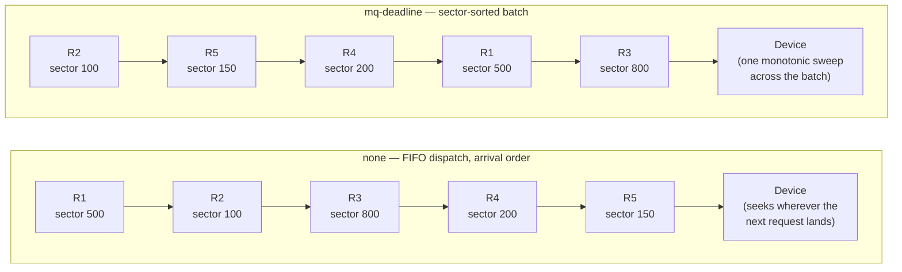

# I/O Schedulers

An I/O scheduler decides the order in which queued requests reach the device. On a spinning disk, order
is everything: a seek costs milliseconds, so sorting and batching requests is worth real CPU time. On an
NVMe drive with thousands of commands in flight and no seek penalty at all, reordering mostly adds
latency without buying anything back. That asymmetry is the whole reason Linux ships four choices,
including one that does nothing.

## What a scheduler can do

Everything an I/O scheduler offers falls under a short list: reorder requests to reduce seek distance,
merge adjacent ones into fewer larger commands, batch requests of one kind together, give reads priority
over writes (or the reverse), enforce fairness between competing processes or cgroups, and bound
worst-case latency for a request that's been waiting too long. Every one of those costs CPU time and adds
a hop between "the request exists" and "the request reached the device" — which is exactly why "the
fastest scheduler" is not a fixed answer, and why `none` is a real, first-class choice rather than a
degraded fallback.

## The four

| Scheduler | What it optimises | CPU cost | Suits | Tunables (`/sys/block/<dev>/queue/iosched/`) |
|---|---|---|---|---|
| `none` | Nothing — FIFO dispatch, whatever order requests arrived in | Lowest | Fast NVMe/SSDs with deep hardware queues, where the device itself reorders internally and seek cost is zero | none — no `iosched/` directory exists while `none` is active |
| `mq-deadline` | Sorts pending requests by sector, batches them, and guarantees each request a bounded worst-case wait via a per-request deadline | Low | A single spinning disk, or any device where reducing seek distance and bounding tail latency both matter | `read_expire`, `write_expire`, `fifo_batch`, `writes_starved`, `front_merges` |
| `bfq` | Proportional-share fairness between processes/cgroups, plus low-latency heuristics for interactive and time-sensitive I/O | High | Desktops and shared multi-tenant systems where one greedy writer must not starve everything else | `low_latency`, `slice_idle`, `timeout_sync`, `strict_guarantees`, `weight` (per-cgroup: `io.bfq.weight`) |
| `kyber` | Throttles dispatch to hit target latencies for reads and synchronous writes | Moderate | Fast SSDs/NVMe that still want some latency shaping without BFQ's fairness bookkeeping | `read_lat_nsec`, `write_lat_nsec` — the only two tunables it has |

BFQ's own documentation is candid about the cost row above: it measures BFQ's per-request processing
time at roughly 2.7× `mq-deadline`'s on the same CPU (1.9 µs versus 0.7 µs in their own benchmark) —
the price of the fairness bookkeeping `mq-deadline` doesn't do at all.

## Defaults, and who sets them

The kernel does not hardcode "NVMe gets none" anywhere — verified directly in
`<Src file="block/elevator.c" symbol="elevator_set_default" />`, called during queue registration from
`block/blk-sysfs.c`. Its logic is narrower and more mechanical than the folklore version:

```c
if (q->tag_set->flags & BLK_MQ_F_NO_SCHED_BY_DEFAULT)
    return;
/*
 * For single queue devices, default to using mq-deadline. If we
 * have multiple queues or mq-deadline is not available, default
 * to "none".
 */
if (q->nr_hw_queues == 1 || blk_mq_is_shared_tags(q->tag_set->flags))
    /* ... switch to mq-deadline ... */
```

Two separate mechanisms, both verified at v6.18: a driver can opt all the way out by setting
`BLK_MQ_F_NO_SCHED_BY_DEFAULT` on its tag set — only `drivers/block/loop.c` and
`drivers/block/null_blk/main.c` do, in this source tree, not the NVMe driver. Everything else falls
through to the actual selection rule: a device gets `mq-deadline` by default only if it exposes exactly
one hardware queue, *or* its multiple hardware queues share one underlying tag set
(`blk_mq_is_shared_tags`) — a configuration some SCSI and virtio-backed devices use, where multiple
queues exist but draw from one pool of tags rather than each having their own. Anything else — which in
practice means a real multi-queue NVMe device, with one hardware queue and one private tag pool per CPU
— matches neither condition, so `elevator_change()` is never called and the queue is simply left at
whatever blk-mq initialised it to, which is `none`. "NVMe gets none" is true as an *outcome*, but not
because anything in the kernel special-cases NVMe by name; it's true because NVMe's typical hardware
shape is exactly the shape this rule doesn't upgrade.

Past that kernel-level default, distributions and `udev` commonly override it — a rule that checks
`queue/rotational` and picks `bfq` for spinning media or `none`/`mq-deadline` for flash is a standard
pattern in several distributions' shipped udev rules, layered on top of (and able to override) whatever
the kernel chose at registration time.

## Switching at runtime

```bash
echo mq-deadline > /sys/block/sda/queue/scheduler
```

`cat`-ing the same file lists every scheduler currently usable for that device, with the active one in
brackets — `[mq-deadline] kyber bfq none`, for instance. `none`, `mq-deadline`, `bfq`, and `kyber` can
each be built in or as separate loadable modules; a scheduler missing from the list is very often just
`modprobe`d in, not unsupported (see the trap below). To make a choice survive a reboot rather than
reapplying it by hand, a `udev` rule does it instead:

```text
ACTION=="add|change", KERNEL=="sd*|nvme*", ATTR{queue/rotational}=="0", ATTR{queue/scheduler}="none"
ACTION=="add|change", KERNEL=="sd*|nvme*", ATTR{queue/rotational}=="1", ATTR{queue/scheduler}="bfq"
```

## cgroups and the scheduler

Only `bfq` implements a cgroup-aware weight of its own — `io.bfq.weight`, proportional-share bandwidth
between cgroups the same way its plain per-process weighting works between processes. `io.max` (hard
per-cgroup I/O limits) and `io.latency` (per-cgroup latency targets) are not scheduler features at all;
they're enforced by separate rq-qos policies that sit in the request path independently of whichever
scheduler is attached, so they work the same way under `none` as under `bfq`. Full cgroup I/O control —
including how `io.max` and `io.latency` are actually configured — belongs to this section's containers
folder, not yet written.

<Lab host="qemu" title="Switch schedulers and measure the difference" time="25 min">

:::note[Not run live in this sandbox — no QEMU/KVM access]
This lab needs a full-system VM with a dedicated scratch block device (`/dev/vdb`), per
[A Full-System VM, and What WSL2 Can Do](../01-lab-and-toolchain/a-full-system-vm-and-wsl2.md). This
sandbox has no `kvm` group membership and no `qemu-system-x86_64` binary at all — confirmed infeasible
in an earlier capability probe, not merely untried. **Nothing below is a captured transcript.** The
steps and expected `fio` output are reconstructed from `fio`'s own documented output format
(`https://fio.readthedocs.io/en/latest/fio_doc.html`) and from each scheduler's *documented* design —
`mq-deadline` sorts by sector and enforces read/write deadlines, `bfq` trades CPU for fairness, `none`
reorders nothing — not from a live run. Where illustrative numbers appear below, they are explicitly
labelled as illustrative, typical-shape figures reasoned from that documented behaviour, not
measurements from this sandbox or any specific device.
:::

1. Check what the scratch disk starts with:

   ```bash
   cat /sys/block/vdb/queue/scheduler
   ```

2. Install `fio` (`sudo apt install fio` on the Debian VM from folder 01).

3. For each of `none`, `mq-deadline`, and `bfq`, select the scheduler and then run the same read-only
   random-read job against it:

   ```bash
   echo none > /sys/block/vdb/queue/scheduler   # then mq-deadline, then bfq
   sudo fio --name=rr --filename=/dev/vdb --readonly --rw=randread --bs=4k \
       --direct=1 --iodepth=32 --ioengine=io_uring --runtime=20 --time_based \
       --group_reporting
   ```

4. Record IOPS and the `clat` p99 for each scheduler in a table.

**Expected output shape**, illustrating what a terse-mode `fio` report actually looks like (field names
and structure verified against `fio`'s own documentation — the specific numbers here are fabricated
placeholders for the shape, not a measurement):

```text
rr: (g=0): rw=randread, bs=(R) 4096B-4096B, (W) 4096B-4096B, (T) 4096B-4096B, ioengine=io_uring, iodepth=32
fio-3.36
Starting 1 process
rr: (groupid=0, jobs=1): err= 0: pid=12345: <timestamp>
  read: IOPS=<N>, BW=<N>MiB/s (<N>MB/s)(<N>GiB/20001msec)
    slat (usec): min=<N>, max=<N>, avg=<N>, stdev=<N>
    clat (usec): min=<N>, max=<N>, avg=<N>, stdev=<N>
     lat (usec): min=<N>, max=<N>, avg=<N>, stdev=<N>
    clat percentiles (usec):
     |  1.00th=[<N>],  5.00th=[<N>], 10.00th=[<N>], 20.00th=[<N>],
     | 50.00th=[<N>], 90.00th=[<N>], 95.00th=[<N>], 99.00th=[<N>],
     | 99.90th=[<N>], 99.99th=[<N>]
  cpu          : usr=<N>%, sys=<N>%, ctx=<N>, majf=0, minf=<N>
  IO depths    : 1=0.1%, 2=0.1%, 4=0.1%, 8=0.1%, 16=0.2%, 32=99.4%, >=64=0.0%
```

| Scheduler | Expected IOPS (illustrative, relative shape) | Expected `clat` p99 | Why |
|---|---|---|---|
| `none` | Highest | Lowest | Nothing reorders or waits; each command goes straight to the device's own (large, internally-parallel) queue. |
| `mq-deadline` | Close to `none` | Slightly higher, more even | Sector sorting and batching cost a little CPU per request and can hold a request briefly for its batch. |
| `bfq` | Measurably lower | Highest and most variable | Per-process idling and fairness accounting add real CPU and can intentionally delay a request to protect another process's share — the cost BFQ's own documentation puts at roughly 2.7× `mq-deadline`'s per-request overhead. |

State plainly: a VM's numbers reflect the *host's* underlying device and its caching, not some property
of the guest kernel — the lesson here is the mechanism and the *relative* CPU cost between schedulers,
never an absolute IOPS number to remember.

**If it fails:** `bfq` may need `modprobe bfq` if it isn't already loaded as a module. `--readonly` is
what keeps `fio` from writing to or trimming the device — never drop it when pointing `fio` at a real
block device rather than a throwaway file.

</Lab>

## Misconceptions

1. **"`none` means no queueing."** Requests still queue — in the software and hardware queues blk-mq
   itself maintains. `none` only means the scheduler layer between them does no reordering; it dispatches
   in arrival order and nothing more.
2. **"BFQ is the best scheduler because it is the most sophisticated."** Sophistication here is a cost,
   not a benefit by default — BFQ's fairness accounting is real CPU work a fast device notices, and on
   hardware that doesn't need per-process fairness, that work buys nothing back.
3. **"Changing the scheduler fixes a slow disk."** A scheduler reorders the queue in front of the
   device; it has no way to make the device itself faster. If the device is the bottleneck, every
   scheduler eventually hits the same ceiling.



*Five requests, two orders: FIFO dispatch under `none` versus sector-sorted dispatch under
`mq-deadline`.*

<KernelFacts
  structure={[["struct elevator_mq_ops", "block/elevator.h"], ["struct elevator_type", "block/elevator.h"]]}
  path="blk_mq_submit_bio() → e->type->ops.insert_requests() → blk_mq_run_hw_queue() → ops.dispatch_request() → ->queue_rq()"
  observe="cat /sys/block/*/queue/scheduler"
  trap="The brackets in /sys/block/*/queue/scheduler mark the active scheduler, and the list shows only those currently loaded. A scheduler missing from the list may simply be an unloaded module, not unsupported." />

## References

- [Kernel documentation — Switching Scheduler](https://docs.kernel.org/block/switching-sched.html) —
  listing and switching schedulers at runtime, verified against this page's own output above.
- [Kernel documentation — BFQ (Budget Fair Queueing)](https://docs.kernel.org/block/bfq-iosched.html) —
  BFQ's design, its own per-request overhead measurement, and its tunables, verified.
- [Kernel documentation — Deadline I/O scheduler tunables](https://docs.kernel.org/block/deadline-iosched.html)
  and [Kyber I/O scheduler tunables](https://docs.kernel.org/block/kyber-iosched.html) — both paths
  verified live; `read_expire`/`write_expire`/`fifo_batch`/`writes_starved` and
  `read_lat_nsec`/`write_lat_nsec` respectively are each scheduler's complete tunable set.
- [`fio` documentation](https://fio.readthedocs.io/en/latest/fio_doc.html) — the options this page's lab
  uses, especially `--readonly` and the latency-percentile output format shown above.
