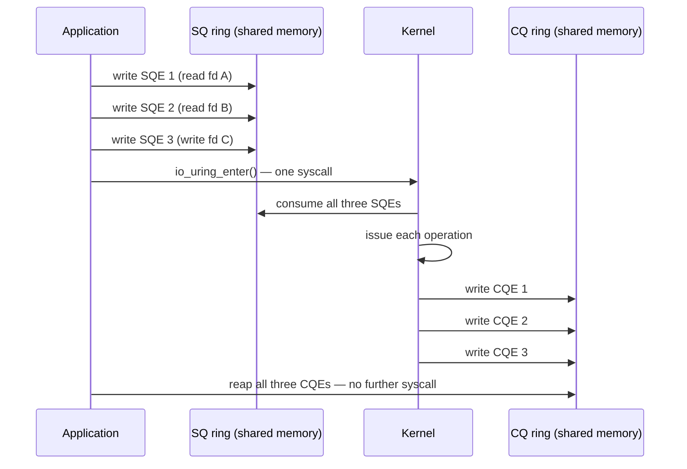

# `io_uring`

Every classic I/O syscall pays the crossing cost described in
[What a System Call Actually Is](../05-syscalls-and-the-boundary/what-a-system-call-actually-is.md) once per
operation — one user/kernel transition to start a `read()`, another for the next one, and another after
that. `io_uring` changes the unit of work instead of trying to make the crossing cheaper: the application
and the kernel share two ring buffers in memory, the application writes many requests into one ring and
reaps many results from the other, and a single `io_uring_enter()` call — or none at all, in polling mode —
moves all of them at once. It is the most significant new I/O interface Linux has had in a decade, and one
of the most security-contentious, for reasons this page does not shy away from.

## Two rings, shared memory

An `io_uring` instance is, at its core, two ring buffers `mmap()`ed from the ring's file descriptor into
both the application's and the kernel's address space, so that neither side ever copies a request or a
result across the syscall boundary — both sides are reading and writing the same memory.

- The **submission queue (SQ)** holds submission queue entries (**SQEs**), written by the application and
  consumed by the kernel. Only the application ever writes an SQE; only the kernel ever advances the queue's
  consumer index after reading one.
- The **completion queue (CQ)** holds completion queue entries (**CQEs**), written by the kernel and read by
  the application. Only the kernel ever writes a CQE; only the application ever advances the queue's
  consumer index after reading one.

Each ring is a classic single-producer/single-consumer structure — exactly one writer per ring — which is
what lets both sides touch the same memory with no lock between them: the head and tail indices, each
written by only one side and read by the other, are the entire synchronization protocol.



*Three I/O operations with one system call: requests and results cross in shared rings rather than through
the syscall boundary.*

## The three syscalls

Underneath the rings, exactly three syscalls exist, and nearly nobody calls them directly (see
[`liburing`](#liburing) below):

- **`io_uring_setup(2)`** creates a new `io_uring` instance — allocates the rings, returns a file descriptor
  for it, and fills in a `struct io_uring_params` the caller uses to `mmap()` the rings.
- **`io_uring_enter(2)`** is the workhorse: submit some number of prepared SQEs, optionally wait for some
  number of completions, in one call.
- **`io_uring_register(2)`** pre-registers long-lived resources with the ring — buffers, file descriptors,
  eventfds — so that hot-path operations don't have to look them up or pin them fresh each time (see
  [Going faster](#going-faster)).

An SQE's fields that matter for almost every operation, verified against `struct io_uring_sqe` in
`<Src file="include/uapi/linux/io_uring.h" symbol="io_uring_sqe" />` at v6.18: `opcode` (which operation —
read, write, accept, and many more), `fd`, `off` (file offset), `addr` (buffer or iovec pointer), `len`, and
`user_data` — an opaque 64-bit value the application sets and gets back unchanged on the matching CQE, the
mechanism that lets it correlate a completion with the request that caused it. The matching
`struct io_uring_cqe`, same file, carries `user_data` back, `res` (the operation's result — what a
traditional syscall's return value would have been), and `flags`.

## Completion, not readiness

`epoll` tells an application an fd *may* be ready — a subsequent `read()` can still block, or return
`EAGAIN`, or return less than requested. `io_uring` tells the application an operation is **already done**:
the CQE only appears once the read, write, or whatever else has actually completed, buffer and all. That
distinction is why `io_uring` works for regular files, which `epoll` cannot usefully report readiness for at
all — a file on disk is "always readable" from `epoll`'s point of view, since the notion of blocking on disk
I/O readiness isn't one `epoll`'s readiness model was built to express.

Making completion-based semantics work for operations that would ordinarily block is what
`<Src file="io_uring/io-wq.c" />` — the `io-wq` worker pool — exists for. An operation is issued inline,
from the context of `io_uring_enter()` itself, whenever the kernel can complete it without blocking; when it
can't (a read that would sleep on disk I/O, for instance), the request is handed to an `io-wq` worker thread
instead, which does the blocking work and posts the CQE when it's done. The application never sees this
distinction — an SQE completes the same way, on the same CQ ring, regardless of which path served it.

## Going faster

Three mechanisms trade setup cost or a dedicated CPU for fewer or cheaper syscalls on the hot path:

- **Registered (fixed) files and buffers**, via `io_uring_register(2)`. An unregistered `fd` or buffer has
  to be looked up and, for a buffer, pinned into memory on every single operation; registering it once up
  front lets subsequent SQEs reference it by a small index instead, skipping that per-operation work. The
  cost is that a registered buffer must stay valid and pinned for as long as it's registered, whether or not
  it's actively in use.
- **`IORING_SETUP_SQPOLL`**, an `io_uring_setup()` flag that spins up a dedicated kernel thread to poll the
  submission ring itself, so a steady stream of I/O needs *zero* `io_uring_enter()` calls in steady state —
  the application just writes SQEs and the kernel thread notices and issues them. The cost is exactly what
  it sounds like: that kernel thread is burning a CPU core polling, whether or not there's anything to do,
  unless it's allowed to idle out (`sq_thread_idle`) between bursts.
- **`IORING_SETUP_IOPOLL`**, for polled block I/O against a device that supports it — no completion
  interrupt at all; the application has to actively ask "is this done yet?" via `io_uring_enter()` with the
  `IORING_ENTER_GETEVENTS` flag. [NVMe in the Kernel](./nvme-in-the-kernel.md#polled-io) covers the driver
  side of exactly this mode: dedicated poll queues, and the same CPU-spent-for-latency-saved trade.

Both flags are confirmed present in the pinned kernel's own uAPI header,
`<Src file="include/uapi/linux/io_uring.h" symbol="IORING_SETUP_SQPOLL" />` and
`<Src file="include/uapi/linux/io_uring.h" symbol="IORING_SETUP_IOPOLL" />`, verified at v6.18.

## liburing

Almost nobody builds raw SQEs and rings by hand; [`liburing`](https://github.com/axboe/liburing) is the
user-space library nearly every real `io_uring` user links against instead, wrapping ring setup and giving
one helper function per operation type. This example opens `testfile.txt`, reads it through the ring, and
prints what came back:

```c
#include <fcntl.h>
#include <liburing.h>
#include <stdio.h>
#include <string.h>
#include <unistd.h>

int main(void) {
    struct io_uring ring;
    io_uring_queue_init(8, &ring, 0);

    int fd = open("testfile.txt", O_RDONLY);
    char buf[128] = {0};

    struct io_uring_sqe *sqe = io_uring_get_sqe(&ring);
    io_uring_prep_read(sqe, fd, buf, sizeof(buf) - 1, 0);
    io_uring_submit(&ring);

    struct io_uring_cqe *cqe;
    io_uring_wait_cqe(&ring, &cqe);
    if (cqe->res < 0) {
        fprintf(stderr, "read failed: %s\n", strerror(-cqe->res));
    } else {
        printf("read %d bytes: %s\n", cqe->res, buf);
    }
    io_uring_cqe_seen(&ring, cqe);

    io_uring_queue_exit(&ring);
    close(fd);
    return 0;
}
```

Compiled with `cc -o uring-read uring-read.c -luring` (liburing 2.14, obtained for this sandbox from the
Ubuntu `liburing-dev` package — see the References below for how) and actually run against a real
`testfile.txt` in this environment: `read 60 bytes: hello io_uring, this is a real file being read via the
ring`. Every call in it — `io_uring_get_sqe()`, `io_uring_prep_read()`, `io_uring_submit()`,
`io_uring_wait_cqe()`, `io_uring_cqe_seen()` — is the same shape context7 returned for current liburing and
the same shape declared in the installed `liburing.h`, checked 2026-09-15 (see References).

## Compared

<Tabs>
<TabItem value="epoll" label="epoll + non-blocking I/O" default>

**Model:** readiness. `epoll_wait()` reports an fd *may* be ready; the application still calls `read()` or
`write()` itself, which can return `EAGAIN` if the readiness turned out to be stale.

**Can do:** sockets, pipes, and other fds with a real notion of "readable"/"writable" state.

**Cannot do:** regular files — a disk-backed file is always "ready" from `epoll`'s point of view, so it
gives no useful signal for file I/O at all.

**Syscalls per operation:** one `epoll_wait()` (potentially amortized over many fds) plus one `read()`/
`write()` per operation that turns out ready.

</TabItem>
<TabItem value="aio" label="POSIX AIO">

**Model:** nominally asynchronous, but glibc's POSIX AIO (`aio_read`/`aio_write`) is implemented with a
pool of worker threads under the hood, not a kernel async path — it's synchronous I/O made to look
asynchronous from the caller's side. The kernel's own `aio` interface (`io_submit(2)` and friends) is
genuinely kernel-async but effectively limited to `O_DIRECT` file I/O to get real asynchronous behavior;
buffered `aio` reads/writes routinely block anyway.

**Can do:** `O_DIRECT` disk I/O reasonably well; everything else only by way of glibc's thread emulation.

**Cannot do:** offer one consistent, genuinely async model across file types and operation kinds — the
mechanism differs depending on what's being done.

**Syscalls per operation:** roughly one `io_submit()` plus one `io_getevents()` per batch with the kernel
interface; glibc's emulation adds thread-pool scheduling overhead on top.

</TabItem>
<TabItem value="io_uring" label="io_uring">

**Model:** completion. A CQE means the operation is done, buffer and result included — not "try it now."

**Can do:** essentially anything with an opcode — storage I/O, `accept`, `connect`, timeouts, `openat`,
`close`, and more; opcodes have grown substantially since the interface's introduction.

**Cannot do:** nothing structural stands out the way "regular files" does for `epoll` — the tradeoffs
`io_uring` has are operational (see [Going faster](#going-faster) and
[The security story](#the-security-story)), not missing capability.

**Syscalls per operation:** one `io_uring_enter()` per *batch* of any size — potentially zero in steady
state under `IORING_SETUP_SQPOLL`.

</TabItem>
</Tabs>

## The security story

`io_uring` is a large, fast-moving attack surface, and several major deployments have restricted or
disabled it in direct response to a run of serious vulnerabilities discovered against it. This is stated
plainly here because it's a real, sourced engineering conclusion reached by people running `io_uring` in
production at scale — not a reason to avoid learning the interface.

Google's Security Blog, writing about their kCTF vulnerability-reward program in June 2023, reported that
**60% of the exploit submissions in the prior year targeted `io_uring`**, that they had paid out **around
$1 million USD for `io_uring` submissions alone**, and that `io_uring` vulnerabilities had been used in
*every* submission that bypassed their sandbox mitigations entirely. Their stated response was to restrict
`io_uring` to trusted components rather than exposing it broadly — disabling it for untrusted contexts on
ChromeOS and most Android app processes, reachable only by a select set of system processes.

The kernel gives administrators two knobs for the same decision, both under `kernel.*` and both confirmed
present since **Linux 6.6** (verified against the sysctl registration table in
`<Src file="io_uring/io_uring.c" symbol="sysctl_io_uring_disabled" />` — absent at v6.5, present at v6.6 —
and against `Documentation/admin-guide/sysctl/kernel.rst`):

- **`kernel.io_uring_disabled`** — `0` (default) allows any process to create an `io_uring` instance; `1`
  fails `io_uring_setup()` with `EPERM` for unprivileged processes not in the group named by
  `io_uring_group` (existing instances keep working); `2` fails it for everyone, no exceptions.
- **`kernel.io_uring_group`** — when `io_uring_disabled=1`, a process needs either `CAP_SYS_ADMIN` or
  membership in this group to create an instance. The default, `-1`, means only `CAP_SYS_ADMIN` qualifies —
  no group is exempted.

No exploit technique is described here deliberately — the point of this section is the operational decision
(restrict, gate, or accept the surface), not how any specific bug worked.

## Misconceptions

1. **"`io_uring` makes every workload faster."** It removes syscall crossings. A workload that already does
   few, large I/O operations has few crossings to remove, and gains little; the win is concentrated in
   workloads issuing many small operations.
2. **"`io_uring` is only for storage."** Storage was the original motivating case, but networking
   (`accept`, `connect`, `send`/`recv`), timeouts, and a growing list of other opcodes are all just as much
   `io_uring` operations as a file read is — see [Compared](#compared).
3. **"`SQPOLL` is free performance."** It trades syscalls for a dedicated kernel thread spinning on a CPU
   core, polling for work whether or not any exists (bounded by `sq_thread_idle` before it sleeps). That
   CPU is not available for anything else while it's polling — free of syscalls, not free of cost.

<KernelFacts
  structure={[["struct io_uring_sqe", "include/uapi/linux/io_uring.h"], ["struct io_ring_ctx", "include/linux/io_uring_types.h"]]}
  path="io_uring_enter() → io_submit_sqes() → io_issue_sqe() → opcode handler (e.g. io_read()) → io_req_complete_post() → CQE written"
  observe="cat /proc/sys/kernel/io_uring_disabled; grep -i uring /proc/kallsyms | head -3"
  trap="io_uring being present in the kernel does not mean it is usable: kernel.io_uring_disabled and container seccomp profiles commonly block it. Production code needs a fallback path, and an EPERM from io_uring_setup() is a policy decision, not a bug." />

## References

- Axboe, [*"Efficient IO with io_uring"*](https://kernel.dk/io_uring.pdf) — the original design document by
  its author, 2019; the opcode list has grown substantially since, but the ring-buffer design argument is
  unchanged.
- [`io_uring(7)`](https://man7.org/linux/man-pages/man7/io_uring.7.html) — the interface overview from
  liburing's own man pages.
- [`liburing`](https://github.com/axboe/liburing) — the library and its examples. **Verified via context7
  (library id `/axboe/liburing`) on 2026-09-15**: `io_uring_queue_init()`, `io_uring_get_sqe()`,
  `io_uring_prep_read()`, `io_uring_submit()`, `io_uring_wait_cqe()`/`io_uring_cqe_seen()`,
  `IORING_SETUP_SQPOLL`, and `io_uring_register_buffers()` all matched the shape returned by context7's
  liburing documentation; cross-checked against the raw kernel uAPI struct definitions in
  `<Src file="include/uapi/linux/io_uring.h" />` at v6.18 as the tiebreaker (kernel source, not liburing's
  wrapper naming, is authoritative for the SQE/CQE field names used above) — both agreed on every symbol
  checked, so no discrepancy needed resolving.
- LWN, [*"Ringing in a new asynchronous I/O API"*](https://lwn.net/Articles/776703/) — the 2019
  introduction, useful for the design argument against the older kernel `aio` interface.
- Google Security Blog, [*"Learnings from kCTF VRP's 42 Linux kernel exploits
  submissions"*](https://security.googleblog.com/2023/06/learnings-from-kctf-vrps-42-linux.html) (14 June
  2023) — source for the 60%-of-submissions and ~$1M figures above and Google's resulting restriction of
  `io_uring` to trusted components; figures and URL verified directly against the published post.
