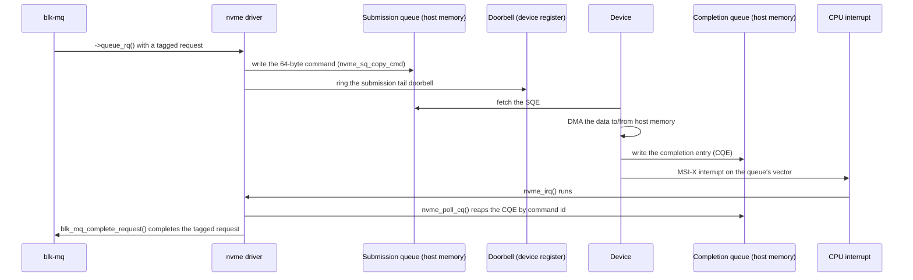

# NVMe in the Kernel

NVMe was designed after multi-core CPUs and flash, and it shows. Instead of one command queue in front
of a slow device, it gives each CPU its own pair of submission and completion rings in host memory, with
a doorbell register to say "look." That maps almost one-to-one onto blk-mq's hardware queues, which is
why the Linux NVMe driver is small for what it does. This page covers that mapping — the protocol
itself, queue depths, and why NVMe beats AHCI at all, is owned by
[NVMe & Storage Interfaces](../../computer-science/storage/nvme-and-storage-interfaces.md); read that
first if the words "submission queue" and "doorbell" are new.

## Queue pairs mapped to blk-mq

An NVMe controller exposes one admin queue pair (controller management: create/delete queues, identify
commands, and the like — never I/O) plus a number of I/O queue pairs, typically one per CPU up to
whatever limit the device and driver negotiate. Each I/O queue pair *is* a `blk_mq_hw_ctx` from
[blk-mq](./blk-mq.md) — the mapping is closer to a restatement than a translation, since blk-mq's
hardware-queue abstraction was shaped by exactly this hardware in mind. The request tag blk-mq hands out
for an in-flight request becomes the NVMe **command identifier** — the same number that lets the driver
find the request again when the completion queue mentions it.

## Submitting a command

`<Src file="drivers/nvme/host/pci.c" symbol="nvme_queue_rq" />` is the driver's `blk_mq_ops::queue_rq`
callback — the point at which a tagged blk-mq request becomes an NVMe command, verified at v6.18. It
calls `<Src file="drivers/nvme/host/core.c" symbol="nvme_setup_cmd" />` first — transport-independent
code, shared with the fabrics transports, that fills in opcode, namespace ID, and the command-specific
fields from the block request — then maps the request's data for DMA (the DMA API that makes that
possible belongs to a later folder, named here only in prose). With the 64-byte command fully built,
`<Src file="drivers/nvme/host/pci.c" symbol="nvme_sq_copy_cmd" />` copies it into the submission queue's
ring in host memory, and the driver writes the **tail doorbell** — a device register telling the
controller a new command (or commands) is waiting. That doorbell write is genuinely batched, not just in
spirit: `<Src file="drivers/nvme/host/pci.c" symbol="nvme_write_sq_db" />`'s own comment says it plainly
— "write sq tail if we are asked to, or if the next command would wrap" — so a driver submitting several
commands from one blk-mq batch skips the register write for every command except the last one in the
batch (and any command that happens to wrap the ring early), turning what could be one doorbell write per
command into one write per batch.

## Completing a command

The device DMAs the requested data, writes a **completion queue entry** into the queue's completion ring,
and raises that queue's own MSI-X interrupt vector.
`<Src file="drivers/nvme/host/pci.c" symbol="nvme_irq" />` is the handler; it calls
`<Src file="drivers/nvme/host/pci.c" symbol="nvme_poll_cq" />`, which walks every pending entry in the
completion ring, looks up the original `request` by the command identifier each entry carries (the same
number that started life as a blk-mq tag), and hands it off for completion — ultimately the same
`blk_mq_complete_request()` path [blk-mq](./blk-mq.md#the-completion-path) already describes. Why that
interrupt vector is affined to the CPU that owns the queue in the first place — so completion, like
submission, stays on one CPU — is
[Interrupt Affinity](../10-interrupts-time-and-deferred-work/interrupt-affinity-and-balancing.md)'s own
subject, not repeated here.

## Polled I/O

For the lowest possible latency, skip the interrupt entirely: dedicated **poll queues**, sized by the
`nvme.poll_queues` module parameter, and requests marked `<Src file="include/linux/blk_types.h" symbol="REQ_POLLED" />`
are never completed by an interrupt at all — something has to actively ask "is this done yet?" instead.
The caller that drives that is `io_uring`'s `IORING_SETUP_IOPOLL` mode, covered in
[`io_uring`](./io-uring.md). What it costs in exchange for the latency it saves is exactly what it sounds
like: a CPU spinning and asking, rather than sleeping until told — cheaper in wall-clock latency, never
cheaper in CPU time.

## Namespaces, multipath, and fabrics

A **namespace** is what shows up as a block device — `/dev/nvme0n1` is namespace 1 on controller 0 — and
it is a distinct concept from the **controller** itself, which owns the queue pairs, the admin queue, and
the PCIe (or fabric) connection namespaces are reached through. Most consumer NVMe drives expose exactly
one namespace per controller, but the split matters once a drive exposes several, or once one namespace
is reachable through more than one controller at all — which is exactly what native NVMe multipath is
for: `<Src file="drivers/nvme/host/nvme.h" symbol="nvme_ns_head" />`, verified at v6.18, is the
per-namespace structure a `gendisk` actually attaches to, with a list of the individual per-controller
`nvme_ns` paths chained onto it and a `shared` flag marking a namespace reachable through more than one
controller — the layer that lets the block layer see one disk where the hardware offers several paths to
it. NVMe-oF (**NVMe over Fabrics**) extends the same command set and queue-pair model over TCP, RDMA, or
Fibre Channel instead of PCIe — different transport code beneath the same driver core and the same
`nvme_setup_cmd`/completion machinery described above, not a different protocol.

## Timeouts and resets

A command that does not complete within `nvme_core.io_timeout` seconds (the module parameter backing
`nvme_io_timeout`, 30 seconds by default, verified at v6.18) triggers
`<Src file="drivers/nvme/host/pci.c" symbol="nvme_timeout" />`: first an attempt to abort just that
command, and — if the command was already aborted once before, or it's the admin queue, or the
controller doesn't respond to the abort either — a full controller reset. The real message text,
verified directly in `nvme_timeout`, is specific about which case fired: a first-time timeout on an I/O
queue logs `dev_warn(dev->ctrl.device, "I/O tag %d (%04x) opcode %#x (%s) QID %d timeout, aborting
req_op:%s(%u) size:%u\n", ...)` — a `dmesg` line like
`nvme nvme0: I/O tag 12 (100c) opcode 0x2 (READ) QID 3 timeout, aborting req_op:READ(0) size:4096`
— while a repeat timeout on the same command, or any timeout on the admin queue, instead logs `"...
timeout, reset controller\n"` and goes straight to a reset. A single flaky NVMe drive shows up as
*whole-system* I/O stalls rather than one slow disk precisely because of this
timeout window: every other command already queued on that controller's queues, from every other
process, waits behind the same stuck command until the timeout fires and recovery kicks it loose — the
tag-based completion model that makes normal operation lock-free gives no way to skip past one command
that simply never completes.



*One NVMe read on its per-CPU queue pair: two rings in host memory, one doorbell write, one interrupt.*

The first eight bytes of that 64-byte command — verified against `struct nvme_common_command` in
`<Src file="include/linux/nvme.h" symbol="nvme_common_command" />` at v6.18, and against the NVMe Base
Specification's own Submission Queue Entry (SQE) figure for the Command Dword 0 / Namespace Identifier
layout — carry the opcode, the flags byte (packing the two-bit FUSE field and the two-bit PSDT field the
kernel's own comment above `nvme_common_command` documents exactly), the command identifier, and the
namespace ID:

```wavedrom title="The first eight bytes of an NVMe command: opcode, flags (FUSE + PSDT), command identifier, and namespace ID" alt="Bit-field strip of the first 64 bits of struct nvme_common_command showing the 8-bit opcode, a split flags byte (2-bit FUSE, 4 reserved bits, 2-bit PSDT), the 16-bit command identifier, and the 32-bit namespace ID"
{ reg: [
    { bits: 8, name: "opcode", type: 2 },
    { bits: 2, name: "FUSE", type: 4 },
    { bits: 4, name: "reserved", type: 6 },
    { bits: 2, name: "PSDT", type: 3 },
    { bits: 16, name: "command identifier (CID)", type: 2 },
    { bits: 32, name: "namespace ID (NSID)", type: 5 }
  ],
  config: { hspace: 1000, bits: 64, lanes: 4 }
}
```

*The start of every NVMe command: the opcode, the flags, and the identifier that is also the blk-mq
tag.*

<KernelFacts
  structure={[["struct nvme_queue", "drivers/nvme/host/pci.c"], ["struct nvme_command", "include/linux/nvme.h"]]}
  path="blk-mq ->queue_rq() → nvme_queue_rq() → nvme_setup_cmd() → nvme_sq_copy_cmd() → doorbell … nvme_irq() → nvme_poll_cq() → blk_mq_complete_request()"
  observe="grep nvme /proc/interrupts | head -5 && cat /sys/block/nvme0n1/queue/nr_requests"
  trap="An NVMe device's queue count is negotiated with the driver, not fixed. On a VM or with nvme.io_queue_depth/poll_queues set, fewer queues than CPUs is normal — and /proc/interrupts then shows several CPUs sharing a vector." />

## References

- NVM Express, Inc., [*NVM Express Base Specification*](https://nvmexpress.org/specifications/) — the
  authority on queue pairs, doorbells, and the Submission Queue Entry layout the WaveDrom strip above is
  built from.
- <Src file="drivers/nvme/host/pci.c" symbol="nvme_queue_rq" /> — the submission path in the PCIe
  transport, verified at v6.18.
- <Src file="drivers/nvme/host/core.c" /> — the transport-independent core: `nvme_setup_cmd`,
  namespaces, timeouts, and the multipath hooks `nvme_ns_head` above builds on.
- [`io_uring_setup(2)`](https://man7.org/linux/man-pages/man2/io_uring_setup.2.html) — `IORING_SETUP_IOPOLL`,
  the userspace side of the polled-I/O path described above (LWN's [*"Block-layer I/O
  polling"*](https://lwn.net/Articles/663879/), 2015, covers the kernel-side mechanism's origin, before
  `io_uring` existed to drive it).
