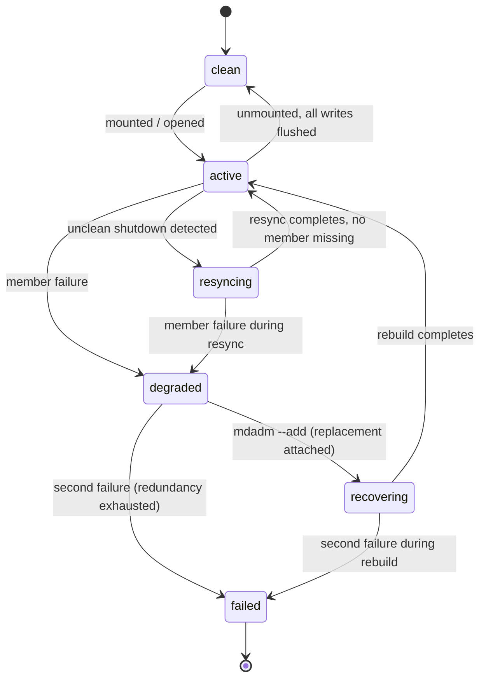

# Software RAID (md)

The RAID levels and their trade-offs are theory, owned by
[RAID and Redundancy](../../computer-science/storage/raid-and-redundancy.md) — striping, mirroring,
parity arithmetic, and the mechanics of the write hole all live there, and this page does not re-derive
any of it. This page is the Linux implementation: the `md` driver, which turns several block devices into
one using a *personality* per level, and the operational reality of running it — resync after an unclean
shutdown, rebuild after a failure, and the mechanisms Linux offers against the write hole.

## md and its personalities

`<Src file="drivers/md/md.h" symbol="mddev" />` (`struct mddev`) is the array itself: its member devices,
its level, its current state, and a pointer to the personality driving it. `<Src file="drivers/md/md.h"
symbol="md_personality" />` (`struct md_personality`) is the per-level vtable — `raid0`, `raid1`,
`raid10`, and `raid456` (RAID 4/5/6 share one personality, differing mainly in parity count and layout)
each register one, implementing the operations that matter: `make_request` (handle a `bio`), `sync_request`
(drive resync/recovery), and the personality's own state machine hooks. `<Src file="drivers/md/md.c"
symbol="md_submit_bio" />` is where a `bio` arriving at `/dev/md0` enters the driver; it hands off to
`<Src file="drivers/md/md.h" symbol="md_handle_request" />`, which does array-wide bookkeeping (is the
array suspended, does this `bio` need to wait on a barrier) before calling `mddev->pers->make_request()`
— the personality clones and redirects the `bio` to whichever member device(s) the level requires.

Arrays don't appear from nothing: `mdadm --create` writes a superblock to each member device (recording
the array's UUID, level, layout, and each member's role) and `mdadm --assemble` (or the kernel's own
auto-detection at boot) reads those superblocks back to reconstruct an array from its members, in
whatever order they happen to be discovered. This is the same user-space/kernel split as device mapper:
the superblock format and assembly logic are entirely `mdadm`'s; the kernel only ever runs whatever
`mddev` state `mdadm` hands it. dm-raid, covered on the
[device mapper](./device-mapper-and-lvm.md) page, reuses these same md personalities but drives them
through a dm table instead of an `mddev` assembled from on-disk superblocks — same RAID engine, different
front door.

## A write, in RAID 1 and in RAID 5

**RAID 1:** the personality clones the incoming `bio` once per mirror member and submits all the clones;
the write completes back to the caller once every member has acknowledged its copy. There is no shared
state between members to serialize — each mirror's copy is independent, so the only real coordination
cost is waiting for the slowest member.

**RAID 5:** a write can't be forwarded as-is, because a parity block covering several data blocks has to
be recomputed, and the personality wants to batch several converging writes into one parity update rather
than doing one recompute per `bio`. That batching happens through the *stripe cache* —
`<Src file="drivers/md/raid5.h" symbol="stripe_head" />` (`struct stripe_head`), one entry per stripe,
tracking which of its blocks are dirty, which are cached, and what state the stripe's parity computation
is in. A write chooses between two strategies per stripe: **read-modify-write** (read the old data block
and old parity, XOR out the old contribution and XOR in the new one — cheap when only a few blocks in a
wide stripe are changing) and **reconstruct-write** (read every other data block in the stripe and
recompute parity from scratch — cheaper when most or all of the stripe is already being written, since
there's no old data worth preserving). `<Src file="drivers/md/raid5.c" symbol="raid5_make_request" />`
is the entry point that turns an incoming `bio` into stripe-cache work, and
`<Src file="drivers/md/raid5.c" symbol="raid5d" />` is the per-array kernel thread that drains the stripe
cache — issuing the reads and writes each stripe's current state calls for, and running the actual parity
XOR. The parity arithmetic itself, and why either strategy produces a correct result, is the theory
page's "Parity (RAID 5)" section, not re-derived here.

## Resync, recovery, and the bitmap

An unclean shutdown — power loss, a crash — leaves md unable to prove that every stripe's parity is
actually consistent with its data: a write in flight at the moment of the crash might have updated some
blocks of a stripe but not others. md's only safe response is a full **resync**: read every stripe,
recompute parity (or compare mirror copies), and fix any mismatch found. Done naively this means reading
the entire array before it's fully trusted again, which for a large array is slow and, worse, is pure
overhead in the overwhelmingly common case where only a small fraction of stripes were actually being
written when the crash happened.

A **write-intent bitmap** narrows this: before a write proceeds, md marks the region it touches "dirty"
in a small on-disk (or, less durably, in-memory) bitmap; the mark is cleared once the write is stable.
After an unclean shutdown, only regions the bitmap still shows dirty need resyncing — everything else is
known to have been fully idle, hence consistent. The bitmap trades a small amount of write overhead
(updating bitmap bits) for a resync that scales with recent write activity instead of array size.

**Recovery** is the different case of rebuilding onto a *replacement* disk after a member actually
failed: unlike resync, there's no ambiguity about what's wrong — the personality reads the surviving
members (or the mirror copies) and reconstructs the missing member's data onto the replacement, stripe by
stripe, start to finish.

Both resync and recovery compete with production I/O for the same disks, so md rate-limits itself via
`/proc/sys/dev/raid/speed_limit_min` and `speed_limit_max` (KB/s per device): the actual rate floats
between the two depending on how much other I/O is queued, never dropping below the min (so recovery
still finishes in bounded time even under load) and never exceeding the max (so recovery doesn't starve
production I/O even when the array is otherwise idle).

## Closing the write hole

The theory page explains why an interrupted RAID 5/6 stripe write — data written, parity not, or the
reverse — leaves parity silently wrong until the next full resync notices: that's the write hole. md
offers two real mechanisms against it, both of which work by making the data+parity update itself
recoverable after a crash instead of merely detectable later:

- **`raid5-cache`** (`<Src file="drivers/md/raid5-cache.c" symbol="r5l_init_log" />`) — a dedicated
  journal device (ideally fast, persistent storage, such as an NVMe drive or an NVDIMM) that logs a
  stripe's data and parity before they're written to the array proper; after a crash, the log replays
  any incomplete stripe writes instead of guessing. Cost: a full journal device, and every write pays an
  extra journal write before the real one.
- **`raid5-ppl`** (partial parity log, `<Src file="drivers/md/raid5-ppl.c" symbol="ppl_init_log" />`) —
  cheaper: instead of a dedicated device, it logs a small *partial parity* value (enough to reconstruct
  what parity should become) alongside each write, in space reserved on the member devices themselves. No
  extra device required, at the cost of somewhat more per-write metadata overhead than a full journal
  and, per its own documentation, applying only to RAID 5 (not RAID 6).

Stated honestly: **without one of these enabled, the write hole the theory page describes is real on md.**
A default `mdadm --create` for RAID 5/6 does not turn either mechanism on; an administrator has to choose
one explicitly (`--consistency-policy=ppl` at create time, or `raid5-cache` via
`--journal-mode`/`--journal-dev` when a journal device is combined into the array).

## Monitoring a degraded array

`/proc/mdstat` is the fastest way to see every array's state at a glance:

```text
Personalities : [raid1] [raid6] [raid5] [raid4]
md0 : active raid5 sdc1[3] sdb1[1] sda1[0]
      41910272 blocks super 1.2 level 5, 512k chunk, algorithm 2 [3/3] [UUU]

unused devices: <none>
```

- `Personalities` — which RAID personalities are currently loaded (built in, or `modprobe`d).
- `md0 : active raid5 sdc1[3] sdb1[1] sda1[0]` — array name, state (`active`), level, and member devices,
  each tagged `[N]` with its role number within the array (not necessarily assembly order).
- `41910272 blocks` — the array's usable capacity in 1 KiB blocks.
- `super 1.2` — metadata format version.
- `level 5, 512k chunk, algorithm 2` — RAID level, stripe chunk size, and the specific
  data/parity rotation algorithm (relevant only in that changing it requires a full rebuild — the value
  itself is `mdadm`'s business, not something this page's mechanism section depends on).
- `[3/3] [UUU]` — three devices expected, three up; one `U` (up) or `_` (down/missing) per member, in
  member order.

The same array with `sdb1` failed and not yet replaced:

```text
Personalities : [raid1] [raid6] [raid5] [raid4]
md0 : active raid5 sdc1[3] sda1[0]
      41910272 blocks super 1.2 level 5, 512k chunk, algorithm 2 [3/2] [U_U]

unused devices: <none>
```

`sdb1` is simply gone from the member list, `[3/2]` shows two of three devices up, and `[U_U]` marks the
missing middle member with `_`. `mdadm --detail /dev/md0` gives the same information with more context
(per-device event counts, array UUID, exact failure timestamps) and is the tool to script against rather
than parsing `/proc/mdstat` text. `mdadm --monitor` (often run as a daemon, `mdmonitor` on most
distributions) watches for exactly this transition and can run a mail alert or an arbitrary program hook
on it — the mechanism this page's trap below depends on existing and being configured.

Beyond failure, `/sys/block/mdN/md/sync_action` both reports and controls background scrubbing: writing
`check` reads every stripe and counts inconsistencies without fixing them (the count lands in the sibling
file `mismatch_cnt`); writing `repair` does the same but corrects what it finds. Scheduling a periodic
`check` (most distributions ship a monthly cron/systemd timer for this) is how a mismatch is ever
noticed on an array with light or read-heavy traffic, where a real inconsistency might otherwise sit
undetected for a long time.

## md versus the alternatives

| | Metadata owner | Where scrub runs | Data checksums |
|---|---|---|---|
| **md** | `mdadm` superblock on each member | `sync_action` (`check`/`repair`) per array | No — only parity consistency, not per-block checksums |
| **dm-raid / LVM RAID** | LVM metadata (wraps the same md personalities under a dm table) | Same md `sync_action` mechanism, exposed via `lvchange --syncaction` | No — same underlying engine as md |
| **Btrfs multi-device** | Btrfs's own on-disk metadata (see [XFS and Btrfs](../11-vfs-and-filesystems/xfs-and-btrfs.md)) | `btrfs scrub` | Yes — every block is checksummed, so scrub can tell which copy is corrupt, not just that parity disagrees |
| **Hardware RAID** | The controller's own firmware/NVRAM, invisible to Linux | Controller-specific (often a BIOS/firmware utility, not a Linux tool) | Controller-dependent, usually no |

The checksum column is the practically important difference from md: on a parity mismatch, md and
dm-raid can tell you *that* a stripe disagrees but not *which* member is wrong (parity arithmetic alone
can't distinguish "data is right, parity is stale" from "parity is right, data is corrupt" without a
third source of truth), where Btrfs's per-block checksums make that call directly.

## Misconceptions

1. **"RAID is a backup."** It replicates deletions and corruption instantly and everywhere the
   redundancy lives — a file removed from a mirrored or parity array is removed from every copy at once,
   just as fast as on a single disk. RAID protects against a *device* failing, not against a *decision*
   or a *bit flip* propagating.
2. **"A resync after a crash means a disk failed."** It doesn't — it means md cannot prove the array's
   parity (or mirror copies) are consistent after an unclean shutdown, and is checking, not that any
   hardware is at fault. A clean shutdown never triggers a resync; a crash always risks one.
3. **`"mismatch_cnt > 0` means corruption."** On RAID 1 and RAID 10 specifically, a nonzero count can be
   entirely harmless — swap space on the array, for instance, is never read back consistently across
   mirrors in a way that guarantees identical bytes, since swap doesn't promise the two copies were ever
   both fully written before either was read. It's meaningful only in context: on RAID 5/6, where parity
   should always be deterministically derivable from data, a nonzero count is a much stronger signal than
   the same count on a mirrored level.



*The states an md array moves through, and the events — a crash, a failed disk, a replacement — that
move it.*

<Lab host="qemu" title="Build a degraded RAID 5 and capture /proc/mdstat" time="20 min">

:::note[Reconstructed — no accessible block device in this sandbox]
This lab needs three scratch block devices (loop devices are the normal stand-in, and this task's own
instructions specifically called for probing whether loop devices work here before falling back). They
don't: `/dev/loop-control` and every `/dev/loopN` node are mode `660`, owned `root:disk`, and this
sandbox's user is in neither group — confirmed with a direct `os.open()` call returning `EACCES`, not
merely a `losetup` error message. Re-running under `unshare --user --mount --map-root-user` made no
difference, for the same reason given on the [device mapper](./device-mapper-and-lvm.md) page's lab: the
device nodes belong to the host's `init_user_ns`, and a namespace's fake root has no more access to
resources it doesn't own than the real unprivileged user did. `mdadm` itself was fetched with
`apt-get download mdadm` and extracted with `dpkg -x` (it isn't installed by default here) and confirmed
to run — `mdadm --version` reports `mdadm - v4.5` — but a working binary with no block device to point it
at can't create anything. `sudo` needs interactive authentication this sandbox cannot supply, and Docker
(despite the sandbox user being in the `docker` group) resolves to a non-functional stub — this is a
WSL2 distro without the Docker Desktop WSL integration active, so it isn't a real escape hatch either.
**Nothing below is a captured transcript.** The `/proc/mdstat` output is the same real format shown and
field-annotated above — built from the kernel's own `md` driver output shape (`md_seq_show` in
`drivers/md/md.c`, verified to exist at v6.18), not fabricated numbers dressed up as a live capture.
:::

1. Create three loopback-backed devices from equally-sized files and build a RAID 5 array:

   ```bash
   for i in 0 1 2; do
       fallocate -l 200M /root/disk$i.img
       sudo losetup -f --show /root/disk$i.img
   done
   sudo mdadm --create /dev/md0 --level=5 --raid-devices=3 /dev/loop0 /dev/loop1 /dev/loop2
   ```

2. Once the initial resync finishes, read the healthy state (the annotated healthy example above is this
   output):

   ```bash
   cat /proc/mdstat
   ```

3. Fail one member on purpose and re-read (the annotated degraded example above is this output):

   ```bash
   sudo mdadm --fail /dev/md0 /dev/loop1
   cat /proc/mdstat
   sudo mdadm --detail /dev/md0
   ```

4. Clean up:

   ```bash
   sudo mdadm --stop /dev/md0
   for i in 0 1 2; do sudo losetup -d /dev/loop$i; rm /root/disk$i.img; done
   ```

**If it fails:** `mdadm` is not installed by default on minimal cloud images — `sudo apt install mdadm`
first, and decline its interactive prompt about scanning for arrays at boot if this is a throwaway VM.
`mdadm --create` on devices that previously held any filesystem or RAID signature will refuse or warn
until wiped with `wipefs -a`, same caution as the device-mapper lab: scratch loop devices only.

</Lab>

<KernelFacts
  structure={[["struct mddev", "drivers/md/md.h"], ["struct stripe_head", "drivers/md/raid5.h"]]}
  path="submit_bio(md0) → md_submit_bio() → md_handle_request() → mddev->pers->make_request() → raid5_make_request() → stripe cache → raid5d"
  observe="cat /proc/mdstat && cat /sys/block/md0/md/sync_action 2>/dev/null"
  trap="A degraded RAID 5 array is fully readable and looks healthy to every application — which is exactly why it goes unnoticed until a second disk fails. Without mdadm --monitor or equivalent alerting, md's redundancy quietly becomes RAID 0." />

## References

- [Kernel documentation — MD (Multiple Devices) driver](https://docs.kernel.org/admin-guide/md.html) —
  the sysfs interface, `sync_action`, bitmaps, and `mismatch_cnt`, verified.
- [`mdadm(8)`](https://man7.org/linux/man-pages/man8/mdadm.8.html) — creation, assembly, monitoring, and
  replacement; verified live.
- [Kernel documentation — raid5-ppl](https://docs.kernel.org/driver-api/md/raid5-ppl.html) and
  [raid5-cache](https://docs.kernel.org/driver-api/md/raid5-cache.html) — the two write-hole mechanisms,
  both paths verified live; source verified at <Src file="drivers/md/raid5-ppl.c" symbol="ppl_init_log" />
  and <Src file="drivers/md/raid5-cache.c" symbol="r5l_init_log" />.
- [Linux RAID wiki](https://archive.kernel.org/oldwiki/raid.wiki.kernel.org/) — community operational
  guidance, but check the date before trusting specifics: the wiki itself now opens with "OBSOLETE
  CONTENT — this wiki has been archived," and it now only lives on `archive.kernel.org`. Useful for
  terminology and history; not current guidance for a v6.18 system.
