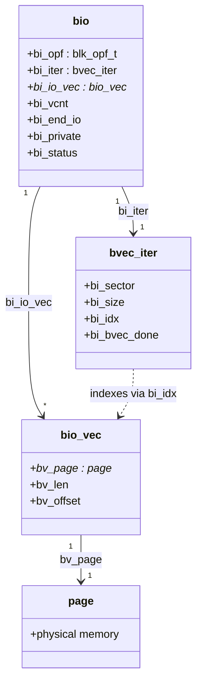

# The `bio`

The `bio` is the block layer's unit of work: a direction, a starting sector, a list of memory segments
holding the data, and a function to call when it is done. Everything above the block layer produces
`bio`s — a filesystem's writeback path, a direct-I/O read, device mapper rewriting one `bio` into
another — and everything below the block layer consumes them. Understanding its shape, especially that
it describes memory as a list of pages rather than one flat buffer, explains why splitting and merging
`bio`s is cheap, and why a stacking driver can rewrite the I/O it receives without ever copying the data
it describes.

## The fields that matter

`<Src file="include/linux/blk_types.h" symbol="bio" />`, verified at v6.18, carries eight fields worth
knowing:

- **`bi_opf`** — a `blk_opf_t` packing both *what operation* this is and *how* to do it. The low bits are
  the operation: `REQ_OP_READ`, `REQ_OP_WRITE`, `REQ_OP_FLUSH`, `REQ_OP_DISCARD`, and others. The high
  bits are flags layered on top of whichever operation is set: `REQ_SYNC` (the submitter is waiting
  synchronously — schedulers can use this to avoid reordering it behind async work), `REQ_META`
  (filesystem metadata, not file data — some schedulers prioritize it), `REQ_PREFLUSH`, and `REQ_FUA`
  (both covered below).
- **`bi_iter`** — a `struct bvec_iter`: the *current* position within this `bio`'s data — starting
  sector (`bi_sector`), how much is left (`bi_size`), and an index into the vector (`bi_idx`). This is
  what moves as the `bio` is processed or partially completed; it is not the data itself.
- **`bi_io_vec`** — the array of `struct bio_vec` segments (see below) that actually describes the
  memory. Fixed once the `bio` is built; `bi_iter` walks it without modifying it.
- **`bi_end_io`** — the completion callback, called once this `bio` (and everything chained to it) has
  finished.
- **`bi_private`** — an opaque pointer the submitter stashes here and gets back, unexamined, in
  `bi_end_io` — the usual way a callback recovers the context it needs (which write request this `bio`
  belonged to, for instance) without a global lookup.
- **`bi_status`** — a `blk_status_t`: success or a specific failure reason, set before `bi_end_io` runs.

## Segments, not buffers

`<Src file="include/linux/bvec.h" symbol="bio_vec" />` is three fields: `bv_page` (a `struct page`),
`bv_len`, and `bv_offset` — a contiguous range of bytes within one page (or, via `bvec_set_folio`, within
a folio). A `bio`'s `bi_io_vec` is an *array* of these, which is what lets one `bio` describe memory that
is scattered across many physically unrelated pages without ever copying it into one contiguous buffer —
exactly what a page cache built from individually-allocated folios needs, since the folios backing one
write are almost never adjacent in physical memory.

The iterator (`bi_iter`) is kept separate from the vector (`bi_io_vec`) deliberately — the kernel
documentation calls this the "immutable biovecs" design. Because the vector itself is never edited once
a `bio` is built, a `bio` can be split into two, or partially completed, purely by handing out a new
iterator over the *same* underlying vector — no segment is copied, moved, or rewritten to do it. Splitting
a `bio` is cheap specifically because of this separation; if the vector were mutable, splitting it would
mean either copying segments or leaving both halves unsafely aliased over the same mutable array.

## Building and submitting one

A filesystem essentially never does this directly for a data write — see the next section for where real
`bio`s come from. But the shape is small enough to read in full, and reading a single block synchronously
is illustrative of every field above at once:

```c
struct bio *bio = bio_alloc(bdev, /* nr_vecs */ 1, REQ_OP_READ, GFP_KERNEL);
bio->bi_iter.bi_sector = target_sector;

bio_add_folio(bio, folio, PAGE_SIZE, /* offset */ 0);

/* submit_bio_wait() sets bi_end_io internally and blocks the caller
 * until completion — no explicit bi_private or callback needed here. */
int ret = submit_bio_wait(bio);
if (ret)
    /* handle bio->bi_status via the returned error */;

bio_put(bio);
```

`bio_alloc` reserves the `bio` and its vector; `bio_add_folio` (the folio-native successor to the older
`bio_add_page`) appends one segment; setting `bi_iter.bi_sector` says where on the device this `bio`
starts; and `submit_bio_wait` is a convenience wrapper around `submit_bio()` that blocks the caller until
completion, which is why this sketch needs no explicit `bi_end_io` of its own. This is illustrative, not
how filesystems usually do it — real writeback paths build `bio`s asynchronously, across many folios at
once, and never block the submitting context on completion.

## Where writeback's bios come from

Filesystems build their `bio`s from dirty folios in their `writepages` address-space operation, not by
hand for each write. Many modern filesystems share the `iomap` infrastructure's `<Src
file="include/linux/iomap.h" symbol="iomap_writepages" />` for this, which walks the dirty folios of an
`address_space`, maps each range to its on-disk location, and builds and submits `bio`s from them.
Filesystems that predate `iomap`, or that need bespoke behavior, implement writeback themselves — ext4's
`fs/ext4/page-io.c` is the concrete example, building its own `bio`s from dirty folios rather than
going through `iomap_writepages`. Either way, the folios these `bio`s describe got dirty through the
mechanism [Writeback, Dirty Pages, and `fsync`](../08-memory-management/writeback-and-fsync.md) already
covers in full; this page starts from "a folio is dirty" and picks up from there.


*A `bio` from birth to completion: dirty page-cache folios described as segments, submitted, possibly
split, and completed back onto the folios they came from.*

## Splitting, chaining, and merging

A `bio` larger than what the target device can accept in one command — over `max_sectors` from its
`queue_limits`, or crossing a boundary the device can't span in one request — is split with `<Src
file="block/blk-core.c" symbol="submit_bio" />`'s own machinery calling `bio_split()`. `bio_split()`
carves off a front piece as a new `bio` and, via `bio_chain()`, links it to the original so that the
original's completion is deferred until every chained piece has completed — the submitter sees one
logical `bio` complete once, not several partial completions to reconcile itself. This splitting is
cheap precisely because of the immutable-biovecs design above: the child `bio` gets its own iterator over
a *shared* view of the same segments, not a copy of them.

Merging works in the opposite direction and at a different layer: `blk_start_plug()`/`blk_finish_plug()`
bracket a run of submissions with a "plug" — a batching window in which adjacent `bio`s destined for
requests can be merged into one larger `request` instead of dispatched as separate ones. This is why
sequential writes, submitted as many small `bio`s from the page cache's point of view, typically become
a much smaller number of large device commands: the plug holds them just long enough for adjacency to be
noticed and exploited before they're released to the device.

## Flushes and FUA

Two `bi_opf` bits represent what the storage literature calls a *barrier*, and the block layer's
representation of it is exactly these two flags rather than a separate mechanism. `REQ_OP_FLUSH` asks the
device to empty its own volatile write cache — everything the device has acknowledged but not yet
committed to stable media. `REQ_PREFLUSH` attaches that same flush request *to a write*, so the flush
happens immediately before the write is issued rather than as a separate operation. `REQ_FUA`
(force-unit-access) is different in kind: it asks that *this one write* be durable the moment it
completes, without needing a separate flush afterward. This is exactly the representation
[Writeback, Dirty Pages, and `fsync`](../08-memory-management/writeback-and-fsync.md)'s "Barriers and
FUA" section and
[Journaling and Crash Consistency](../11-vfs-and-filesystems/journaling-and-crash-consistency.md)'s
ordering guarantees both depend on: a filesystem's journal commit record is written with exactly these
flags to guarantee it lands only after the transaction it commits does. The block layer is not naive
about cost, either — for a device whose `write_cache` attribute (see
[Block Devices and `gendisk`](./block-devices-and-gendisk.md)) reports no volatile cache at all, these
flags are dropped before reaching the driver, since flushing a cache that doesn't exist has no effect to
guarantee.

## Completion

The driver completes the `request` a `bio` became part of, and the block layer calls `<Src
file="include/linux/bio.h" symbol="bio_endio" />`, which runs `bi_end_io` for every `bio` (parent and
chained children alike) whose data this completion covers. This callback frequently runs in interrupt or
softirq context — the driver's own completion handling, triggered by the device's completion interrupt,
is what calls down into `bio_endio()`, not a process context the submitter controls. See
[Hardirq Context](../10-interrupts-time-and-deferred-work/hardirq-context.md) for exactly what that
context does and does not allow. Practically: a `bi_end_io` callback cannot sleep, cannot allocate with
`GFP_KERNEL`, and cannot take a mutex — any of those either deadlock outright or corrupt kernel state
that assumes interrupt context never blocks. Code that needs to do blocking work on completion defers it
— typically by scheduling a workqueue item from inside `bi_end_io` rather than doing the blocking work
there directly.



*`struct bio`'s shape: a fixed vector of `bio_vec` segments pointing at pages, and a separate iterator
that walks the vector without modifying it — the split enabling cheap splitting and partial completion.*

:::note
`perf` is not installed in the sandbox this page was written in, and `perf_event_paranoid` is `2` — even
if it were installed, tracing `block:*` tracepoints with `perf trace` typically needs elevated privileges
this sandbox does not grant. The tracepoint name itself was verified for real, though:
`include/trace/events/block.h` at v6.18 defines `TRACE_EVENT`/`DEFINE_EVENT(block_bio, block_bio_queue,
...)`, so `block:block_bio_queue` is a real, current tracepoint, not a guess. What follows is the
documented expected output *format* for the command below, not a captured transcript — do not read it as
a live trace.
:::

```text
$ sudo perf trace -e 'block:block_bio_queue' -- dd if=/dev/zero of=/tmp/b bs=1M count=8 oflag=direct
     0.000 dd/12345 block:block_bio_queue(dev: 8:0, sector: 1048576, nr_sector: 8, rwbs: "WS", comm: "dd")
     0.412 dd/12345 block:block_bio_queue(dev: 8:0, sector: 1050624, nr_sector: 8, rwbs: "WS", comm: "dd")
     ...
8+0 records in
8+0 records out
```

Each line is one `bio` reaching `submit_bio()`: `dev` is the target's major:minor, `sector` the starting
LBA `bi_iter.bi_sector` held at submission, `nr_sector` the size in 512-byte sectors, and `rwbs` a
compact encoding of `bi_opf` (`W` for write, `S` for the `REQ_SYNC` flag `O_DIRECT` implies here). With
`bs=1M` and `oflag=direct`, each `dd` block becomes exactly one `bio` of 2048 sectors (1 MiB ÷ 512
bytes) in the well-behaved case shown — a real trace could show fewer, larger `bio`s if adjacent writes
were plugged and merged before `submit_bio()`, or more, smaller ones if a `queue_limits` maximum forced a
split first.

<KernelFacts
  structure={[["struct bio", "include/linux/blk_types.h"], ["struct bio_vec", "include/linux/bvec.h"]]}
  path="writepages → bio_alloc() → bio_add_folio() → submit_bio() → submit_bio_noacct() → blk_mq_submit_bio()"
  observe="sudo perf trace -e 'block:block_bio_queue' -- dd if=/dev/zero of=/tmp/b bs=1M count=8 oflag=direct"
  trap="A `bio`'s completion callback usually runs in interrupt or softirq context, not in the task that submitted it. Code that sleeps, allocates with `GFP_KERNEL`, or takes a mutex in `bi_end_io` works in testing and deadlocks under load." />

## References

- [Kernel documentation — the immutable biovec
  design](https://docs.kernel.org/block/biovecs.html) — why the iterator is kept separate from the
  vector, in the kernel's own words.
- <Src file="include/linux/blk_types.h" symbol="bio" /> — the structure and every `REQ_*` flag, verified
  at v6.18.
- LWN, ["A block layer introduction part 1: the bio
  layer"](https://lwn.net/Articles/736534/) — the clearest prose account of `bio` handling available;
  2017, still an accurate model of the shape even where individual names have moved on.
- <Src file="block/blk-core.c" symbol="submit_bio" /> — the entry point, alongside the
  stacking-safe `submit_bio_noacct()` it and every recursive `bio` submission (from device mapper or md)
  actually calls.
