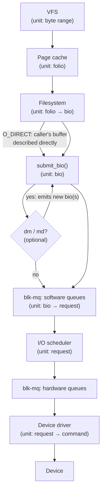

# The Storage Stack, Mapped

Between an application's `write()` and a flash die there are about a dozen layers, and most "the disk
is slow" conversations go wrong by blaming the wrong one. This page is the map: every layer in one
picture, what each one does to a request as it passes through, and which page in this folder owns it.
Every later page in folder 12 refers back here instead of re-explaining where it sits.

## The layers, top to bottom

| Layer | Receives | Emits | Owned by |
|---|---|---|---|
| VFS | a syscall (`read`/`write`/`fsync`) and a file descriptor | a call into the filesystem's `f_op` | [`open`, `read`, `write` in the Kernel](../11-vfs-and-filesystems/open-read-write-in-the-kernel.md) |
| Page cache | a byte range against an `address_space` | folios, some clean, some dirty | [Writeback, Dirty Pages, and `fsync`](../08-memory-management/writeback-and-fsync.md) |
| Filesystem | dirty folios (writeback) or a direct-I/O request | one or more `bio`s describing sectors | [The Four Objects](../11-vfs-and-filesystems/the-four-objects.md) |
| Block layer entry (`submit_bio`) | a `bio` from a filesystem or stacking driver | a `bio` handed to `blk_mq_submit_bio()`, split if it exceeds device limits | [The `bio`](./the-bio.md) |
| Stacking drivers (device mapper, md) | a `bio` targeting a virtual device | one or more new `bio`s targeting real devices | [Device Mapper and LVM](./device-mapper-and-lvm.md), [Software RAID (md)](./software-raid.md) |
| blk-mq | a `bio` | one or more `request`s, queued per-CPU then per-hardware-queue | [blk-mq: Multi-Queue Block I/O](./blk-mq.md) |
| I/O scheduler | `request`s waiting on a software queue | an order to dispatch them to the hardware queue in | [I/O Schedulers](./io-schedulers.md) |
| Device driver (NVMe, virtio-blk, SCSI) | a `request` | a device-specific command on a hardware queue | [NVMe in the Kernel](./nvme-in-the-kernel.md) |
| Transport | a device command | bytes on a bus (PCIe, SATA, ...) | `computer-science/storage/` |
| Device firmware (FTL) | a device command | a physical operation against NAND or a platter | `computer-science/storage/` |
| Media | a physical operation | data, durably stored or retrieved | `computer-science/storage/` |

The first two rows are folders 11 and 08's job, already written — this folder picks up exactly where
they leave off, at `submit_bio()`.

## Where requests change shape

A byte range becomes folios, folios become a `bio` of sectors, `bio`s become `request`s, and `request`s
become device commands. The unit of work changes at every one of those boundaries: the page cache
thinks in folios, the block layer thinks in sectors and `bio`s, blk-mq and the scheduler think in
`request`s, and the device thinks in commands with their own queue depth and completion semantics.
Confusion about which unit a metric counts explains most misread `iostat` output — `iostat`'s `avgrq-sz`
is sectors per merged `request`, not bytes per application write, and the two can differ by an order of
magnitude once merging has done its work.

## Three paths through the stack

**Buffered** I/O goes through the page cache: `write()` returns once the folio is dirty in memory, and a
separate writeback pass — on its own schedule, or forced by `fsync()` — is what eventually calls
`submit_bio()`. Completion is decoupled from the application; the application does not wait for the
device.

**Direct** I/O (`O_DIRECT`) skips the page cache. The application's own buffer is described directly by a
`bio`, and the application waits for the device to complete it — no writeback machinery is involved, and
the alignment and size constraints the page cache normally smooths over become the caller's problem.

**Memory-mapped** I/O turns page faults into the trigger: a read fault pulls a folio in through the same
page-cache path buffered I/O uses, and a write fault dirties a mapped folio exactly as a buffered
`write()` would, to be written back later by the same writeback machinery.

See [Buffered I/O, `O_DIRECT`, and Alignment](./buffered-direct-and-alignment.md) for what each path
actually requires and where they diverge in practice.

## Stacking

Device mapper and md sit *between* the filesystem and the real device. Neither one is the filesystem's
`f_op`, and neither one is a driver talking to hardware — each receives `bio`s targeting a virtual block
device it presents and emits new `bio`s of its own, targeting the real device(s) underneath. That is why
`lsblk` shows a tree rather than a flat list, and why one application write can turn into several device
writes (a RAID 1 mirror duplicates it) or, for a moment, none at all (a thin-provisioned snapshot may
only update metadata until the first real write to a block forces an allocation). Chapter [Device Mapper
and LVM](./device-mapper-and-lvm.md) and [Software RAID (md)](./software-raid.md) cover each stacking
driver on its own terms; this page only establishes that the `bio` a filesystem submits is not
necessarily the `bio` that reaches a device.

## What this folder does not cover

Device physics — how a platter or a NAND cell actually stores and retrieves a bit, seek time,
write amplification — the NVMe protocol's own command set and queueing model, and SSD internals
(wear leveling, garbage collection, the FTL) are owned by
[`computer-science/storage/`](../../computer-science/storage/intro.md), not here. This folder covers
what the *kernel* does to a request between `submit_bio()` and handing a command to a driver; it never
re-teaches the hardware or protocol on the other side of that driver. Where this folder's pages need one
of those topics, they link to it instead of re-explaining it.

The driver *model* — how a driver is bound to a device, `struct device`, buses, and the uevent machinery
that turns a probed device into sysfs and `/dev` entries — belongs to a later folder in this section, not
yet written; it is named here only so the boundary is clear.

<Figure src="/img/linux/block-layer-and-storage/linux-storage-stack-v6.18.png"
        alt="The Linux storage stack for kernel 6.18, from applications and system calls through the VFS, page cache, filesystems, device mapper, the block layer and its I/O schedulers, to SCSI, NVMe and other drivers and the physical devices"
        caption="The whole storage stack for Linux 6.18 — the community reference the Mermaid diagram below simplifies. Zoom in; it's dense on purpose."
        source="Thomas-Krenn wiki (Werner Fischer)"
        href="https://www.thomas-krenn.com/en/wiki/Linux_Storage_Stack_Diagram"
        license="CC BY-SA 4.0" />

*The storage stack this folder covers, with the unit of work each layer hands to the next.*

<KernelFacts
  structure={[["struct bio", "include/linux/blk_types.h"], ["struct request", "include/linux/blk-mq.h"]]}
  path="vfs_write() → page cache → writeback → submit_bio() → blk_mq_submit_bio() → driver ->queue_rq()"
  observe="lsblk -o NAME,TYPE,SIZE,SCHED,ROTA,MOUNTPOINTS"
  trap="`iostat`, `biolatency`, and your database each measure latency at a different layer of this stack, so their numbers legitimately disagree. Before comparing two latency figures, find out which layer each one was taken at." />

## References

- Thomas-Krenn wiki, ["Linux Storage Stack
  Diagram"](https://www.thomas-krenn.com/en/wiki/Linux_Storage_Stack_Diagram) — the canonical figure,
  versioned per kernel release; the page it belongs on once a sourced copy lands.
- [Kernel documentation — the block layer index](https://docs.kernel.org/block/index.html) — the
  block-layer documentation index at the pinned version.
- Gregg, *Systems Performance* (2nd ed.), ch. 9 "Disks" — the layered methodology behind this page's
  trap; a purchase.
- LWN, ["A block layer introduction, part 1: the bio
  layer"](https://lwn.net/Articles/736534/) — Neil Brown's 2017 overview of `bio`s and the request
  layer; the model is current, several names have changed since.
