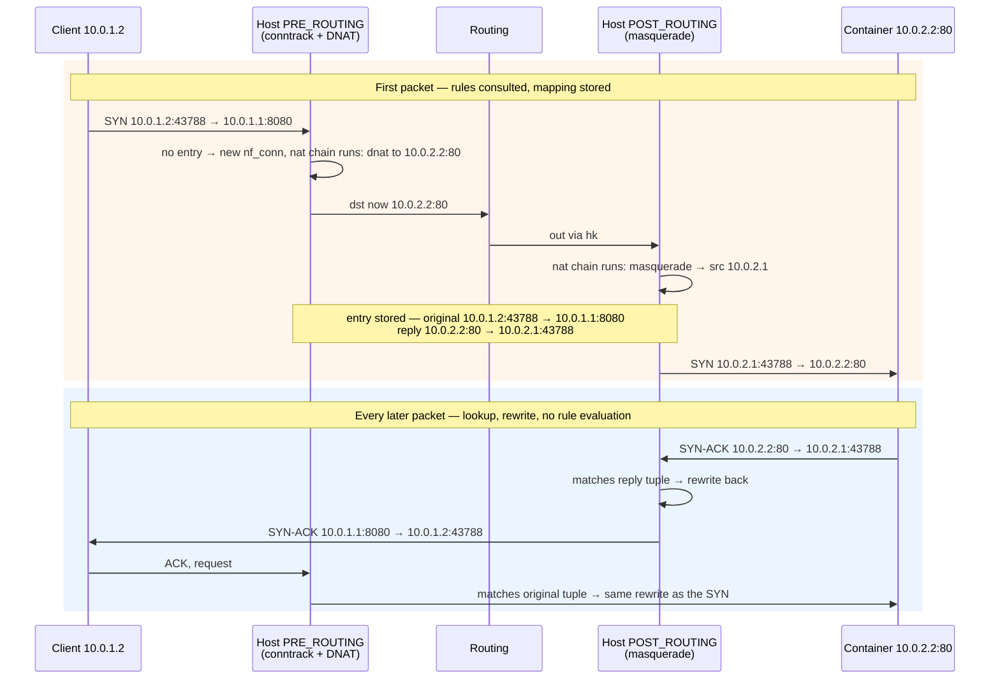

# Connection Tracking and NAT

A stateful firewall rule like "allow established connections" and a NAT rule like "masquerade outgoing
traffic" both need the kernel to remember every flow it has seen. On Linux that memory is **conntrack**:
a hash table of `nf_conn` entries, each holding the flow's addresses and ports in both directions, a
protocol state, a timeout, and — if NAT applies — the rewritten addresses. NAT on Linux isn't a separate
packet-rewriting engine. It's a decision made once, on a connection's first packet, stored in that
connection's conntrack entry, and applied to every later packet by lookup. Why NAT needs that state at
all is on the [NAT and connection tracking page](../../computer-science/computer-networks/nat-and-connection-tracking.md);
this page is how the kernel keeps it.

## The conntrack entry

Each tracked flow is a <Src file="include/net/netfilter/nf_conntrack.h" symbol="nf_conn" />. Its core is
two <Src file="include/net/netfilter/nf_conntrack_tuple.h" symbol="nf_conntrack_tuple_hash" />es:

- the **original** tuple — source and destination address and port, and protocol, as the first packet
  looked;
- the **reply** tuple — what a packet coming back would look like. Without NAT it's the original
  reversed. With NAT it's the reversed *rewritten* tuple.

Both are inserted into the hash table, so a packet in either direction finds the same entry with one
lookup. The entry also has `status` bits (`IPS_SEEN_REPLY`, `IPS_ASSURED`, `IPS_SRC_NAT`, …), a timeout,
and optional *extensions* — NAT data, a helper, byte/packet accounting, labels.

Conntrack registers at PRE_ROUTING and LOCAL_OUT with priority -200. For each packet,
`nf_conntrack_in` → `resolve_normal_ct` looks up the tuple. On a miss it creates a new entry, but leaves
it **unconfirmed** — not in the table yet. Only at the very end of the packet's path, at priority
`INT_MAX` in POST_ROUTING or LOCAL_IN, does `nf_conntrack_confirm` insert it. A first packet that a
firewall rule drops never creates a visible entry, which stops a flood of rejected packets from filling
the table.

## States as rules see them

Rules match on `ct state` (nftables) or `--ctstate` (iptables). The value comes from `enum
ip_conntrack_info`, which describes *this packet's* relationship to its entry:

| State | Meaning |
|---|---|
| `new` | the first packet of a flow — no entry existed |
| `established` | the entry has seen packets in both directions; this packet belongs to it |
| `related` | a new flow that an existing one *expects* — an ICMP error about a tracked flow, or an FTP data connection |
| `invalid` | doesn't fit — a TCP segment out of window, a reply with no matching flow |
| `untracked` | exempted with `notrack` in the raw priority |

That's separate from the **protocol tracker's** state, which conntrack keeps per entry for TCP: `SYN_SENT`,
`SYN_RECV`, `ESTABLISHED`, `FIN_WAIT`, `CLOSE_WAIT`, `LAST_ACK`, `TIME_WAIT`, `CLOSE`. Those mirror the
endpoints' TCP states, as seen by a middlebox that watches both directions, and each has its own timeout.
A packet of a connection in TCP state `SYN_RECV` is already `ct state established` to a rule, because the
entry has seen a reply.

## NAT is decided once

NAT rules live in chains of type `nat`, and the kernel only consults them for a connection's **first
packet**:

1. **First packet.** The nat chain's rules run. A `dnat` or `masquerade` match calls `nf_nat_setup_info`,
   which picks the new address and port — making sure the result's reply tuple doesn't collide with
   another entry — and stores the mapping in the entry by rewriting its reply tuple. Then the packet
   itself is rewritten.
2. **Every later packet**, in either direction. `nf_nat_inet_fn` finds the mapping already set up and
   calls `nf_nat_packet`, which rewrites the headers from the stored tuple. The nat chain isn't run again.

Where each kind happens:

- **DNAT** at PRE_ROUTING (and LOCAL_OUT, for locally generated packets): it must change the destination
  *before* the routing decision, so the packet is routed to the new address.
- **SNAT** and **masquerade** at POST_ROUTING, after routing has chosen the output interface. Masquerade
  is SNAT that takes the output interface's current address as the new source, and flushes its entries
  when that address goes away — the right choice for a dynamic address.



*NAT decided once on the first packet and replayed by lookup for every packet after it.*

## Helpers

Some protocols put addresses and ports in their *payload*: FTP's `PORT` command, SIP's call setup. A NAT
that only rewrites headers breaks them, and a firewall can't know the data connection they announce.
**Helpers** parse those payloads, rewrite them, and create *expectations* — entries for flows that are
about to arrive — so the data connection shows up as `ct state related`.

Helpers used to attach automatically to every connection on their port. That let an attacker trigger
helper parsing (and the expectations it creates) on any host with the module loaded, so automatic
assignment was disabled by default in Linux 4.7 and the code was removed entirely in 6.0. A helper now
has to be assigned explicitly — in nftables with a `ct helper` object and a rule such as `tcp dport 21 ct
helper set "ftp-standard"`.

## Table size and the failure everyone meets once

Two sysctls size the table:

- `net.netfilter.nf_conntrack_buckets` — hash buckets. The default is total RAM ÷ 16384, between 1024
  and 262144, and any 64-bit machine with more than 4 GB gets the maximum. This 12 GB machine has 262144.
- `net.netfilter.nf_conntrack_max` — maximum entries. The default equals the bucket count (262144 here).
  Each entry is hashed twice, once per direction, so that averages two entries per bucket.

Entries stay until their timeout. The defaults are generous: `nf_conntrack_tcp_timeout_established` is
432000 seconds — **five days** — because a firewall that forgets an idle but open connection breaks it.
UDP entries last 30 seconds, or 120 once traffic has been seen both ways.

When the table is full, conntrack can't create an entry for a new flow, so the packet is dropped and the
kernel logs:

```text
nf_conntrack: table full, dropping packet
```

The usual cause isn't many real connections. It's many *short* ones: a busy DNS server or resolver,
where every query is a new UDP flow that stays for 30 seconds; a scan; or thousands of TCP connections
lingering in `TIME_WAIT` (120 s in conntrack). The three responses:

1. **Raise the limit** — and the bucket count with it, or each bucket's chain gets longer and every
   lookup slower.
2. **Shorten timeouts** for the protocol causing the churn, e.g. `nf_conntrack_udp_timeout`.
3. **Don't track traffic that doesn't need state.** A DNS server's queries don't need conntrack; a
   `notrack` rule at the `raw` priority (-300, before conntrack) exempts them.

## Inspecting it

The `conntrack` tool reads the table over netlink:

| Command | Shows |
|---|---|
| `conntrack -L` | every entry |
| `conntrack -E` | live events: `NEW`, `UPDATE`, `DESTROY` |
| `conntrack -S` | per-CPU counters; the ones to watch are `insert_failed`, `drop`, and `early_drop` |
| `conntrack -D -p tcp --dport 8080` | deletes matching entries |
| `cat /proc/sys/net/netfilter/nf_conntrack_count` | current number of entries, without the tool |

## What actually happens

**Run for real on this machine (WSL2, kernel 6.18), checked 2026-10-26** — the `docker run -p 8080:80`
port-forward, rebuilt by hand without Docker. Three private network namespaces stand in for the pieces:
a *client* (`10.0.1.2`), a *host* (`10.0.1.1` towards the client, `10.0.2.1` towards the container), and a
*container* running a web server on `10.0.2.2:80`. They're joined by veth pairs; the namespace and veth
setup is the subject of [network namespaces and virtual devices](./network-namespaces-and-virtual-devices.md).
`nft` 1.1.6 and `conntrack` 1.4.9 were extracted from their Debian packages and run as root inside a user
namespace — no host root, and nothing on the host's own network changed.

In the host namespace, forwarding on (`echo 1 > /proc/sys/net/ipv4/ip_forward`) and two rules in a
dedicated table — the same two Docker's port publishing creates:

```text
table ip lab {
	chain prerouting {
		type nat hook prerouting priority dstnat; policy accept;
		tcp dport 8080 dnat to 10.0.2.2:80
	}

	chain postrouting {
		type nat hook postrouting priority srcnat; policy accept;
		oif "hk" masquerade
	}
}
```

Then `conntrack -E` in the host namespace, and a `curl http://10.0.1.1:8080/` from the client:

```text
$ curl http://10.0.1.1:8080/        # run in the client namespace
HTTP 200

$ conntrack -E -o timestamp
[1793022013.301383]	    [NEW] tcp      6 120 SYN_SENT src=10.0.1.2 dst=10.0.1.1 sport=43788 dport=8080 [UNREPLIED] src=10.0.2.2 dst=10.0.2.1 sport=80 dport=43788
[1793022013.301406]	 [UPDATE] tcp      6 60 SYN_RECV src=10.0.1.2 dst=10.0.1.1 sport=43788 dport=8080 src=10.0.2.2 dst=10.0.2.1 sport=80 dport=43788
[1793022013.301408]	 [UPDATE] tcp      6 432000 ESTABLISHED src=10.0.1.2 dst=10.0.1.1 sport=43788 dport=8080 src=10.0.2.2 dst=10.0.2.1 sport=80 dport=43788 [ASSURED]
[1793022013.302280]	 [UPDATE] tcp      6 120 FIN_WAIT src=10.0.1.2 dst=10.0.1.1 sport=43788 dport=8080 src=10.0.2.2 dst=10.0.2.1 sport=80 dport=43788 [ASSURED]
[1793022013.302320]	 [UPDATE] tcp      6 30 LAST_ACK src=10.0.1.2 dst=10.0.1.1 sport=43788 dport=8080 src=10.0.2.2 dst=10.0.2.1 sport=80 dport=43788 [ASSURED]
[1793022013.302339]	 [UPDATE] tcp      6 120 TIME_WAIT src=10.0.1.2 dst=10.0.1.1 sport=43788 dport=8080 src=10.0.2.2 dst=10.0.2.1 sport=80 dport=43788 [ASSURED]

--- the container's web server log
10.0.2.1 - - [26/Oct/2026 14:40:13] "GET / HTTP/1.1" 200 -
```

The `[NEW]` line is the whole NAT decision, already made. Its fields:

| Field | Value | Meaning |
|---|---|---|
| `tcp 6` | | protocol name and number |
| `120` | | seconds until this entry expires, reset by each packet; it changes with the TCP state |
| `SYN_SENT` | | the TCP tracker's state |
| `src=10.0.1.2 dst=10.0.1.1 sport=43788 dport=8080` | original tuple | the packet as the client sent it |
| `[UNREPLIED]` | | nothing has come back yet |
| `src=10.0.2.2 dst=10.0.2.1 sport=80 dport=43788` | reply tuple | what a reply will look like: from the container's port 80 to the host's `hk` address — both rewrites encoded |
| `[ASSURED]` (later lines) | | seen both ways and established; early-drop won't evict it under pressure |

The reply tuple *is* the mapping: the destination was changed to `10.0.2.2:80` (DNAT) and the source to
`10.0.2.1` (masquerade). The source port, `43788`, survived because it didn't collide with anything.

The other five lines are the handshake, request and close, about one millisecond in total. None of them
caused a rule to run; each packet matched the entry and was rewritten from it. The timeout follows the
TCP state: 60 s in `SYN_RECV`, **432000 s** — five days — once `ESTABLISHED`, 120 s in `TIME_WAIT`.

The container's log shows the client as `10.0.2.1`, not `10.0.1.2`: masquerade hid the real client. That
is why Docker's published ports can lose the client address unless the masquerade rule is scoped more
narrowly — a recurring problem [Container Networking](../15-containers-and-virtualization/container-networking.md) returns to.

## Misconceptions

1. **"Conntrack is only used when you configure NAT."** Any stateful rule loads and uses it, including the
   `ct state established,related accept` line in nearly every default firewall. In the
   [netfilter page's trace](./netfilter-and-nftables.md#reading-a-live-ruleset), a filter-only ruleset
   still shows `conntrack: ct direction original ct state new`.
2. **"NAT rules are evaluated for every packet."** Only for the first packet of a flow. The capture above
   is six packets' worth of events from one rule evaluation.
3. **"Raising `nf_conntrack_max` is always safe."** Each entry costs a few hundred bytes of kernel memory,
   and raising the maximum without raising `nf_conntrack_buckets` makes hash chains longer, so every
   packet's lookup gets slower.

<KernelFacts
  structure={[["struct nf_conn", "include/net/netfilter/nf_conntrack.h"], ["struct nf_conntrack_tuple", "include/net/netfilter/nf_conntrack_tuple.h"]]}
  path="PRE_ROUTING → nf_conntrack_in() → resolve_normal_ct() → nf_nat_inet_fn() → nf_nat_setup_info() (first packet) | nf_nat_packet() (later) → … → nf_conntrack_confirm()"
  observe="sudo conntrack -L | head; cat /proc/sys/net/netfilter/nf_conntrack_count /proc/sys/net/netfilter/nf_conntrack_max"
  trap="Changing a NAT rule does not affect connections that already exist — their mapping lives in the conntrack entry. A port-forward that 'still points at the old container' after a rule change is usually a stale entry; `conntrack -D` with a matching filter removes it." />

## References

- [Netfilter Conntrack Sysfs variables](https://docs.kernel.org/networking/nf_conntrack-sysctl.html) —
  every conntrack sysctl with its default, including the bucket and maximum formulas and all the
  per-protocol timeouts quoted above.
- [conntrack(8)](https://manpages.debian.org/testing/conntrack/conntrack.8.en.html) — the inspection
  tool used throughout this page, with its filter syntax.
- Neira Ayuso, *Netfilter's connection tracking system*, ;login: 31(3), 2006 — the design paper by the
  netfilter maintainer. The details have moved since, but the two-tuple model and the confirm step are the
  same.
- [Performing Network Address Translation (NAT)](https://wiki.nftables.org/wiki-nftables/index.php/Performing_Network_Address_Translation_(NAT))
  on the nftables wiki — NAT, masquerade and `ct helper` rules in nftables syntax, checked via context7 on
  2026-10-26.
