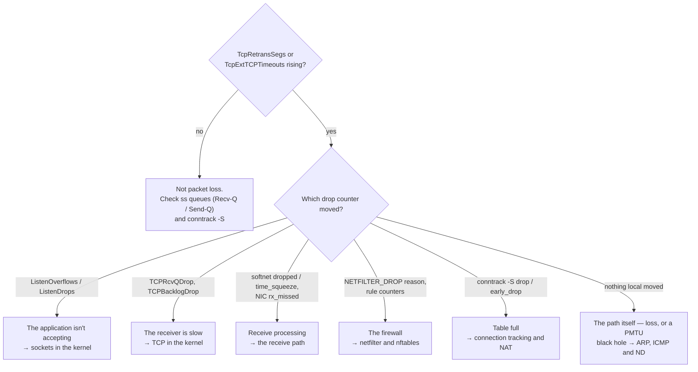

# Diagnosing Network Problems

"The network is slow" and "connections hang" are symptoms, and they can come from:

- the NIC dropping packets it had no buffer for;
- the kernel dropping them in a backlog or the firewall;
- an application that stopped calling `accept`;
- a full conntrack table;
- a path-MTU black hole;
- the actual network.

Each one moves a different counter. This page is the method — find out which counter moved — and a
worked case, using tools whose data sources were all introduced earlier in this folder. It's the
networking twin of [diagnosing I/O problems](../12-block-layer-and-storage/diagnosing-io-problems.md).

## Counters first, captures second

The kernel already counts almost every drop and retransmission, cheaply, all the time. A packet capture
is expensive, needs root, and shows only what passed the tap — and on both
[the receive path](./the-receive-path.md#up-through-the-device-layer) and
[the transmit path](./the-transmit-path.md#the-device-layer-and-the-qdisc), several drop points are on the
far side of the tap. So start with `ss` and the counter files, decide which layer is involved, and capture
only once you know which flow to look at.

## `ss`, in place of `netstat`

`ss` gets socket state from the kernel over netlink (`sock_diag`), with filtering done in the kernel.
`netstat` parses `/proc/net/tcp` as text, which is slow on a host with a hundred thousand sockets. The
flags that matter:

| Flag | Adds |
|---|---|
| `-t` / `-u` / `-l` / `-a` | TCP / UDP / listening only / all states |
| `-n` | numbers instead of names — no DNS lookups while you're debugging DNS |
| `-p` | owning process and descriptor |
| `-i` | `TCP_INFO`: RTT, cwnd, retransmits — read field by field on [TCP in the kernel](./tcp-in-the-kernel.md#reading-ss--ti) |
| `-m` | socket memory: receive and send buffer use against their limits |
| `-e` | inode, UID, cookie |

Filters go after the flags: `ss -tn state established '( dport = :443 or sport = :443 )'`. For a
listening socket, remember that `Recv-Q` is the accept-queue length and `Send-Q` its limit
([sockets in the kernel](./sockets-in-the-kernel.md#what-actually-happens)).

## The counter files

`/proc/net/snmp` and `/proc/net/netstat` hold the protocol counters. `nstat -az` prints them all with
absolute values; plain `nstat` prints what changed since its last run, which is usually what you want.
`/proc/net/softnet_stat` has the per-CPU receive counters ([the receive path](./the-receive-path.md#where-packets-are-dropped)),
`ip -s link` the per-interface ones, and `ethtool -S` the driver's own, whose names vary by driver.

Every name below was checked against `nstat -az` on this machine's 6.18 kernel:

| Counter | Question it answers |
|---|---|
| `TcpRetransSegs` | Am I losing packets? |
| `TcpExtTCPTimeouts` | Am I losing whole windows, so that only a timeout recovers? |
| `TcpExtListenOverflows` / `TcpExtListenDrops` | Is my application accepting connections fast enough? |
| `TcpExtTCPBacklogDrop` | Is a socket lock held too long while packets arrive? |
| `TcpExtTCPRcvQDrop` | Is my receiver reading too slowly? |
| `UdpRcvbufErrors` | Is a UDP receive buffer too small? |
| `IpInDiscards` / `IpOutNoRoutes` | Are IP packets being discarded, or is a route missing? |
| `TcpExtIPReversePathFilter` | Is `rp_filter` dropping asymmetric traffic? ([routing](./routing-and-neighbours.md#reverse-path-filtering)) |
| softnet `dropped`, `time_squeeze` | Is the receive softirq falling behind? |
| NIC `rx_missed`-style counters | Is the NIC out of receive buffers? |
| `conntrack -S`: `drop`, `early_drop` | Is the conntrack table full? ([conntrack](./connection-tracking-and-nat.md#table-size-and-the-failure-everyone-meets-once)) |

## What `tcpdump` can and cannot see

- **Received packets** are tapped in `__netif_receive_skb_core`, *before* netfilter and before the
  socket. `tcpdump` shows packets that the firewall, a full accept queue, or a full receive buffer then
  dropped.
- **Sent packets** are tapped in `dev_hard_start_xmit`, *after* the qdisc. A packet the qdisc dropped
  never appears.
- **Offloaded packets** appear as the stack sees them: GRO-merged on receive, pre-TSO on send — tens of
  kilobytes per "packet".
- **XDP** programs run in the driver, before any tap, so packets they drop are invisible to `tcpdump`.

## Attributing drops

Counters say *how many*; drop reasons say *why*. Every place in the stack that drops a packet frees it
with `kfree_skb_reason` and a value from `enum skb_drop_reason` — at v6.18, among about a hundred others,
`SKB_DROP_REASON_TCP_LISTEN_OVERFLOW`, `SKB_DROP_REASON_NETFILTER_DROP`, `SKB_DROP_REASON_SOCKET_RCVBUFF`,
`SKB_DROP_REASON_NO_SOCKET`. The `skb:kfree_skb` tracepoint reports the reason and the code location:

- `perf trace -e skb:kfree_skb` prints each drop with its reason;
- `dropwatch` reads the kernel's drop monitor;
- `pwru` ("packet, where are you?") is an eBPF tool that follows one packet through every kernel function
  it passes, so you see the last function before the drop. The eBPF folder covers how it works.

All three need root and access to the tracing interfaces.



*Narrowing a network complaint to one layer by asking which kernel counter moved, before reaching for a
capture.*

The last branch points at the [ARP, ICMP and Neighbour Discovery page](../../computer-science/computer-networks/arp-icmp-and-neighbour-discovery.md):
a path that silently drops large packets *and* the ICMP "fragmentation needed" messages that would report
it causes connections that open fine and then hang on the first full-size segment.

## What actually happens

**Measured on this machine, 2026-10-26** — as a non-root user, so inside a private network namespace
(`unshare -rn`), where namespace-root can run `tcpdump` (4.99.6, extracted from its Debian package and run
with `-Z root`) and `nft` on the namespace's own `lo`. Tracefs is root-only on the host, so the
`skb:kfree_skb` step couldn't be run here; it's described, not shown.

**Symptom:** clients say connections to a service "hang" for seconds, then fail or work.

**Setup:** a server that listens with a backlog of 1 and never calls `accept`, standing in for an
application whose accept loop is stuck:

```bash
python3 -c "import socket,time; s=socket.socket(); s.bind(('127.0.0.1',9000)); s.listen(1); time.sleep(60)" &
for i in $(seq 8); do timeout 5 nc -z 127.0.0.1 9000 & done
```

**Evidence 1 — the listening socket's queue is full.**

```text
$ ss -ltn 'sport = :9000'
State  Recv-Q Send-Q Local Address:Port Peer Address:Port
LISTEN 2      1          127.0.0.1:9000      0.0.0.0:*

$ ss -tan 'dport = :9000'
State      Recv-Q Send-Q Local Address:Port  Peer Address:Port
FIN-WAIT-2 0      0          127.0.0.1:42800    127.0.0.1:9000
FIN-WAIT-2 0      0          127.0.0.1:42806    127.0.0.1:9000
FIN-WAIT-1 0      1          127.0.0.1:42820    127.0.0.1:9000
SYN-SENT   0      1          127.0.0.1:42822    127.0.0.1:9000
SYN-SENT   0      1          127.0.0.1:42830    127.0.0.1:9000
SYN-SENT   0      1          127.0.0.1:42832    127.0.0.1:9000
SYN-SENT   0      1          127.0.0.1:42840    127.0.0.1:9000
SYN-SENT   0      1          127.0.0.1:42856    127.0.0.1:9000
```

`Recv-Q 2` against a limit of 1: the accept queue admits one more than the backlog, because the kernel's
"full" check (`sk_acceptq_is_full`) is *greater than*. Three `nc -z` runs reported success: two whose
connections are in the queue, and a third (`42820`) that completed its side of the handshake although the
server never queued the connection (below). The other five are stuck in `SYN-SENT`: their SYNs aren't
being answered.

**Evidence 2 — the counters name it.**

```text
$ nstat -az TcpExtListenOverflows TcpExtListenDrops TcpExtTCPReqQFullDrop TcpExtTCPReqQFullDoCookies
TcpExtListenOverflows           34                 0.0
TcpExtListenDrops               34                 0.0
TcpExtTCPReqQFullDoCookies      0                  0.0
TcpExtTCPReqQFullDrop           0                  0.0
```

34 listen overflows in five seconds, on a host with no other traffic in this namespace. `TCPReqQFullDrop`
is zero, so the SYN (request) side is fine; it's the *accept* queue that's full.

**Evidence 3 — the capture shows the SYNs arriving.** `tcpdump -ni lo` filtered to SYN and SYN-ACK
packets, summarised per client port, seconds from the first packet:

```text
42800  SYN@0.00 SYN-ACK@0.00
42806  SYN@0.00 SYN-ACK@0.00
42820  SYN@0.00 SYN-ACK@0.00 SYN-ACK@1.03 SYN-ACK@3.05
42822  SYN@0.00 SYN@1.03 SYN@2.06 SYN@3.08 SYN@4.10
42830  SYN@0.00 SYN@1.03 SYN@2.06 SYN@3.08 SYN@4.10
42832  SYN@0.00 SYN@1.03 SYN@2.06 SYN@3.08 SYN@4.10
42840  SYN@0.00 SYN@1.03 SYN@2.06 SYN@3.08 SYN@4.10
42856  SYN@0.00 SYN@1.03 SYN@2.06 SYN@3.08 SYN@4.10
```

Read against the counters:

- **Five clients' SYNs arrived and were dropped after the tap.** With the accept queue full, the listener
  drops new SYNs without answering, counting each in `ListenOverflows` and `ListenDrops`. The clients
  retransmit every second — this kernel's `net.ipv4.tcp_syn_linear_timeouts` is 4, so the first four SYN
  retries are linear, 1 s apart, before exponential backoff starts. That is the user's "hang".
- **Client `42820` got a SYN-ACK, but its final ACK was dropped.** The handshake completed on the client;
  on the server, the child socket couldn't be queued, so the server kept only the request and re-sent its
  SYN-ACK at 1 s and 3 s (SYN-ACK retries use exponential backoff). The client believes it's connected;
  the server has no connection to accept.
- On a kernel with tracing access, `perf trace -e skb:kfree_skb` during this run would attribute these
  drops to `TCP_LISTEN_OVERFLOW`.

**Cause and fix.** The accept queue is full because nothing accepts. Raising `somaxconn` or the backlog
would make the queue longer and delay the symptom; the fix is the accept loop.

**A second case: the firewall.** Same namespace, a server on port 9001, and one rule:

```text
$ nft list table inet lab
table inet lab {
	chain input {
		type filter hook input priority filter; policy accept;
		tcp dport 9001 counter packets 2 bytes 120 drop
	}
}

$ nc -z -w2 127.0.0.1 9001; echo "nc exit: $?"
nc exit: 1

$ tcpdump -ni lo -tttt 'tcp port 9001'
2026-10-26 14:45:55.880756 IP 127.0.0.1.53716 > 127.0.0.1.9001: Flags [S], seq 1515214691, ...
2026-10-26 14:45:56.881112 IP 127.0.0.1.53716 > 127.0.0.1.9001: Flags [S], seq 1515214691, ...
```

The capture looks the same as the first case: SYNs arrive, nothing answers. What differs is the counter
that accounts for them: the rule's own counter shows exactly the two SYNs the capture saw, and the drop
reason would be `NETFILTER_DROP`. (`ListenDrops` read 36 at the end of this case, two more than before —
those were the first case's clients, still retrying port 9000 in the background, not port 9001.)

<Lab host="root-required" title="Find the drop the capture cannot explain" time="30 min">

On a real Linux host as root, with `tcpdump`, `nft` and `perf` installed. The output above is from a user-
namespace run of the same steps; step 6 additionally needs the host's tracing interfaces.

1. Start a server that never accepts:
   `python3 -c "import socket,time; s=socket.socket(); s.bind(('127.0.0.1',9000)); s.listen(1); time.sleep(900)" &`
2. `for i in $(seq 8); do timeout 5 nc -z 127.0.0.1 9000 & done`
3. Watch `ss -ltn 'sport = :9000'`: `Recv-Q` reaches `Send-Q` + 1 and stays there.
4. `nstat -az TcpExtListenOverflows TcpExtListenDrops` — both climb while the clients retry.
5. `tcpdump -ni lo port 9000 -c 20` — SYNs arrive and are retransmitted every second, unanswered.
6. `perf trace -e skb:kfree_skb` — each drop with its reason, `TCP_LISTEN_OVERFLOW` for these.
7. Add a firewall drop and repeat:

   ```bash
   nft add table inet lab
   nft add chain inet lab input '{ type filter hook input priority filter; }'
   nft add rule inet lab input tcp dport 9001 counter drop
   nc -z -w2 127.0.0.1 9001
   ```

   Compare the capture, `nft list table inet lab`'s counter, and the reason, `NETFILTER_DROP`.
8. Clean up: `nft delete table inet lab`, and stop the server.

**If it fails:** an older `perf` may not decode the `reason` field into a name — the raw number still
indexes `enum skb_drop_reason`. On loopback both directions appear on one interface, so filter on flags as
above to keep the capture readable.

</Lab>

## Misconceptions

1. **"If `tcpdump` shows the packet arrived, the kernel accepted it."** The receive tap is before netfilter,
   the accept queue and the socket buffer. In both cases above the capture showed SYNs arriving that were
   then dropped.
2. **"Connection timeouts mean the network is dropping packets."** A full accept queue produces exactly
   the same client symptom on a perfect network — the first case above ran entirely on loopback.
3. **"Raising `somaxconn` fixes listen overflows."** It makes the queue longer, so a stalled accept loop
   takes slightly longer to overflow it. The fix is whatever stopped the application accepting.

<KernelFacts
  structure={[["enum skb_drop_reason", "include/net/dropreason-core.h"], ["struct tcp_info", "include/uapi/linux/tcp.h"]]}
  path="SYN arrives → tcp_v4_rcv() → tcp_conn_request() → accept queue full → drop with reason → kfree_skb_reason() → skb:kfree_skb tracepoint"
  observe="nstat -az | grep -Ei 'retrans|overflow|drop'; ss -ltn"
  trap="A capture showing a SYN arriving and no SYN-ACK leaving does not mean the firewall dropped it. A full accept queue drops the SYN after the tap too — `nstat`'s `ListenOverflows` and the drop reason tell the two apart; the capture cannot." />

## References

- [ss(8)](https://man7.org/linux/man-pages/man8/ss.8.html) — every `ss` flag and the filter language.
- [SNMP counter](https://docs.kernel.org/networking/snmp_counter.html) — the kernel's own explanation of
  many of the SNMP and netstat counters in this page's table, with when each increments.
- [pwru](https://github.com/cilium/pwru) — the per-packet function tracer, with examples of attributing a
  drop to the function that made it.
- Gregg, *Systems Performance*, 2nd ed. (Addison-Wesley, 2020), chapter 10, "Network" — the network-analysis
  methodology this page follows, including counters before captures.
- [tcpdump(1)](https://www.tcpdump.org/manpages/tcpdump.1.html) — capture options, including `-Z` and the
  notes on where a capture is taken.
