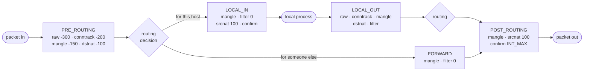

# netfilter and nftables

netfilter is not a firewall. It is a set of **hooks** at fixed points in the network stack — five for IP,
plus ingress and egress on each device — where registered functions may inspect a packet, change it,
accept it, or drop it. iptables, nftables, connection tracking and NAT are all *users* of those hooks.
Once you know where the hooks sit relative to the routing decision, every "why didn't my rule match?"
question can be answered by drawing the packet's path.

## The hooks

The five IPv4 hooks sit on [the receive path](./the-receive-path.md#ip-and-the-first-routing-decision)
and [the transmit path](./the-transmit-path.md#ip-routing-and-the-neighbour) around the routing decision:

| Hook | Where | Sees |
|---|---|---|
| `NF_INET_PRE_ROUTING` | in `ip_rcv`, before routing | every received IP packet |
| `NF_INET_LOCAL_IN` | in `ip_local_deliver`, after routing chose "this host" | packets for local sockets |
| `NF_INET_FORWARD` | in `ip_forward` | packets routed through this host |
| `NF_INET_LOCAL_OUT` | in `__ip_local_out` | packets generated by local sockets |
| `NF_INET_POST_ROUTING` | in `ip_output`, after routing | every packet leaving, local or forwarded |

Two more hooks are attached to devices rather than to IP: **netdev ingress**, right after the driver, and
**netdev egress** (added in Linux 5.16), just before the qdisc. Both see every protocol, not just IP.

In the code, each hook point is a call to `NF_HOOK` (in <Src file="include/linux/netfilter.h"
symbol="NF_HOOK" />). If nothing is registered at that hook, it costs almost nothing — a static key skips
it. Otherwise <Src file="net/netfilter/core.c" symbol="nf_hook_slow" /> runs each registered function
(each one described by a <Src file="include/linux/netfilter.h" symbol="nf_hook_ops" />) in priority order,
and each returns a **verdict**:

| Verdict | Effect |
|---|---|
| `NF_ACCEPT` | continue to the next function at this hook, then on through the stack |
| `NF_DROP` | free the packet; stop |
| `NF_STOLEN` | the function took ownership of the packet; the stack forgets it |
| `NF_QUEUE` | send the packet to a user-space program (`nfqueue`) for a decision |
| `NF_REPEAT` | call this function again |

## Priorities decide order

Several subsystems register at the same hook, and their priorities decide who runs first. Lower runs
earlier. At v6.18, `include/uapi/linux/netfilter_ipv4.h` defines:

| Priority | Value | Who runs there |
|---|---|---|
| `NF_IP_PRI_RAW` | -300 | the `raw` table — before conntrack, so it can exempt packets (`notrack`) |
| `NF_IP_PRI_CONNTRACK` | -200 | connection tracking: find or create the packet's entry |
| `NF_IP_PRI_MANGLE` | -150 | packet marking and header changes |
| `NF_IP_PRI_NAT_DST` | -100 | destination NAT (at PRE_ROUTING and LOCAL_OUT) |
| `NF_IP_PRI_FILTER` | 0 | filtering — the "firewall" proper |
| `NF_IP_PRI_SECURITY` | 50 | SELinux packet labelling |
| `NF_IP_PRI_NAT_SRC` | 100 | source NAT and masquerade (at POST_ROUTING and LOCAL_IN) |
| `NF_IP_PRI_CONNTRACK_CONFIRM` | `INT_MAX` | commit the new conntrack entry — last of all |

The order has consequences. Conntrack runs before everything that asks about connection state. DNAT runs
before filtering, so a filter rule at FORWARD sees the *rewritten* destination — the container's address,
not the host port the client used. SNAT runs after filtering, so filter rules see the *original* source.
nftables names these values (`priority filter`, `priority dstnat`, `priority srcnat`, `priority raw`), and
a chain may use any number in between.



*The five IPv4 netfilter hooks around the routing decision, with the order in which conntrack, NAT, and
filtering run at each.*

{/* Task 22: the Wikimedia Commons "Netfilter-packet-flow" figure goes here, beside the Mermaid
    simplification above, credited with <Figure source= href= /> and a static/img/linux/SOURCES.md row.
    The page is written to stand alone without it. */}

## nftables: a VM in the kernel

iptables has a fixed set of tables (`filter`, `nat`, `mangle`, `raw`), each with predefined chains, and
every match type (`-m conntrack`, `-m multiport`) is a separate kernel module. nftables turns that around:

- **The kernel has a small virtual machine** with registers and generic instructions — load a header
  field, compare, look up in a set, set a verdict. `nft` compiles your rules into that bytecode in user
  space, and the kernel runs it: <Src file="net/netfilter/nft_chain_filter.c" symbol="nft_do_chain_ipv4" />
  → `nft_do_chain` evaluates a chain's rules, expression by expression. New matches mostly need changes to
  `nft`, not new kernel modules.
- **Tables and chains are yours to name.** Nothing exists until you create it. A *base chain* is attached
  to a hook by declaration — `type filter hook input priority filter; policy drop;` — and a *regular
  chain* is only reachable by `jump`. A table also has a family: `ip`, `ip6`, `inet` (both),
  `arp`, `bridge`, or `netdev`.
- **Sets and maps** make matching against many values one hash or tree lookup instead of thousands of
  linear rules: `ip saddr @blocklist drop`, or `dnat to tcp dport map { 8080 : 10.0.2.2, 8081 : 10.0.2.3 }`.
- **Changes are atomic.** `nft -f file` sends the whole ruleset as one netlink transaction, so there's
  no moment where half the new rules are loaded.

## iptables over nftables

On current distributions the `iptables` command is usually **`iptables-nft`**: it accepts iptables syntax
and creates nftables objects in tables named like the old ones. The older **`iptables-legacy`** programs
the original `x_tables` kernel code instead. `iptables -V` tells you which you have:

```text
$ iptables -V
iptables v1.8.11 (nf_tables)
```

Loading an iptables ruleset with `iptables-nft-restore` and then asking nftables what it holds shows the
translation (abridged):

```text
$ nft list ruleset
# Warning: table ip filter is managed by iptables-nft, do not touch!
table ip filter {
	chain INPUT {
		type filter hook input priority filter; policy drop;
		ct state related,established counter packets 0 bytes 0 accept
		...
```

The two back ends don't share rules. `iptables-legacy -L` doesn't show rules made with `nft` or
`iptables-nft`, and the reverse is also true, but *both* sets of hooks run on every packet. A host where
one tool installed legacy rules and an administrator added nft rules has two firewalls, each looking
incomplete from the other's command.

## The same policy both ways

One policy: drop incoming traffic by default; allow replies to connections this host made; allow SSH from
one subnet; allow HTTP and HTTPS; log and drop the rest. Both versions below were loaded into a private
network namespace, checked with `nft list ruleset` and `iptables -S`, and tested from a client in a
second namespace (`10.0.1.2`) against listeners on ports 22, 80 and 8081: 22 and 80 connected, 8081 timed
out.

<Tabs>
<TabItem value="nftables" label="nftables">

Rule source, loaded with `nft -f firewall.nft`:

```text
flush ruleset

table inet filter {
    chain input {
        type filter hook input priority filter; policy drop;

        ct state established,related accept
        ct state invalid drop
        iif lo accept
        ip saddr 10.0.1.0/24 tcp dport 22 accept
        tcp dport { 80, 443 } accept
        log prefix "input-drop: " counter drop
    }
}
```

`inet` covers IPv4 and IPv6 in one table, and the `{ 80, 443 }` set is one lookup.

</TabItem>
<TabItem value="iptables" label="iptables">

Rule source, loaded with `iptables-restore < firewall.rules`:

```text
*filter
:INPUT DROP [0:0]
:FORWARD ACCEPT [0:0]
:OUTPUT ACCEPT [0:0]
-A INPUT -m conntrack --ctstate ESTABLISHED,RELATED -j ACCEPT
-A INPUT -m conntrack --ctstate INVALID -j DROP
-A INPUT -i lo -j ACCEPT
-A INPUT -s 10.0.1.0/24 -p tcp --dport 22 -j ACCEPT
-A INPUT -p tcp -m multiport --dports 80,443 -j ACCEPT
-A INPUT -j LOG --log-prefix "input-drop: "
-A INPUT -j DROP
COMMIT
```

IPv4 only; IPv6 needs the same rules again through `ip6tables-restore`. `LOG` doesn't stop traversal, so
logging and dropping are two rules.

</TabItem>
</Tabs>

## Reading a live ruleset

`nft list ruleset` prints rules with their counters. After the test above:

```text
		log prefix "input-drop: " counter packets 2 bytes 120 drop
```

Two packets were dropped: the SYN to port 8081 and its retransmission.

To see *why* a packet went where it did, mark it for tracing and watch. Tracing has to be switched on
before the chains you want to see, so the rule goes in a chain at a very early priority:

```bash
nft add chain inet filter trace_pre '{ type filter hook prerouting priority -350; }'
nft add rule inet filter trace_pre ip saddr 10.0.1.2 tcp dport 8081 meta nftrace set 1
nft monitor trace
```

Then a connection attempt from the client to port 8081:

```text
trace id 36229be8 inet filter trace_pre packet: iif "hc" ... ip saddr 10.0.1.2 ip daddr 10.0.1.1 ... tcp sport 52860 tcp dport 8081 tcp flags == syn ...
trace id 36229be8 inet filter trace_pre rule ip saddr 10.0.1.2 tcp dport 8081 meta nftrace set 1 (verdict continue)
trace id 36229be8 inet filter trace_pre policy accept
trace id 36229be8 inet filter input conntrack: ct direction original ct state new ct id 2730460715
trace id 36229be8 inet filter input packet: iif "hc" ... tcp dport 8081 tcp flags == syn ...
trace id 36229be8 inet filter input rule log prefix "input-drop: " counter packets 2 bytes 120 drop (verdict drop)
```

Read top to bottom, that's the packet's whole journey: it passed `trace_pre` at PRE_ROUTING, conntrack
classified it as `new`, routing sent it to LOCAL_IN, it matched none of the accept rules, and the last
rule dropped it. On a host still using `iptables-legacy`, the nearest equivalent is the per-rule counters
of `iptables -L -v -n --line-numbers`.

## Misconceptions

1. **"iptables is the Linux firewall."** It's one front end to netfilter. On most current distributions
   it's `iptables-nft`, which translates its rules into nftables objects, as shown above.
2. **"A rule in the INPUT chain filters forwarded traffic."** Forwarded packets never reach LOCAL_IN. A
   router's or container host's forwarded traffic goes through FORWARD, and needs rules there.
3. **"Rule order within a table is all that matters."** At one hook, chain *priority* decides first:
   every chain at priority -100 runs before any chain at priority 0, whichever table they're in. And an
   `accept` only ends the current chain — a later chain at the same hook can still drop the packet.

<KernelFacts
  structure={[["struct nf_hook_ops", "include/linux/netfilter.h"], ["struct nft_chain", "include/net/netfilter/nf_tables.h"]]}
  path="ip_rcv() → NF_HOOK(NF_INET_PRE_ROUTING) → nf_hook_slow() → nft_do_chain_ipv4() → nft_do_chain() → verdict"
  observe="sudo nft list ruleset | head -40; iptables -V"
  trap="`iptables-legacy` and `iptables-nft` rules live in different kernel subsystems and do not see each other — a host where Docker installed legacy rules and the administrator added nft rules can have two firewalls, each silently incomplete." />

## References

- [nftables wiki](https://wiki.nftables.org/wiki-nftables/index.php/Main_Page), especially
  [Netfilter hooks](https://wiki.nftables.org/wiki-nftables/index.php/Netfilter_hooks) — the project's own
  documentation of chains, hooks and priorities. The rule syntax on this page was checked against it via
  context7 on 2026-10-26, and loaded with nftables 1.1.6.
- [nft(8)](https://manpages.debian.org/testing/nftables/nft.8.en.html) — the complete nftables command and
  rule language reference.
- [netfilter.org documentation](https://www.netfilter.org/documentation/) — the netfilter project's
  documentation index, including the hook architecture and the iptables tutorials.
- <Src file="net/netfilter/core.c" symbol="nf_hook_slow" /> — how a hook runs its registered functions in
  order and acts on each verdict.
