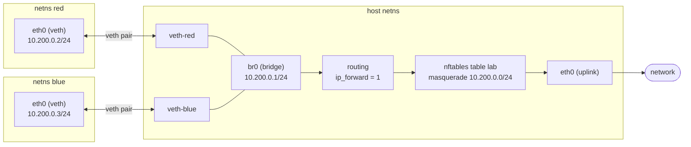

# Network Namespaces and Virtual Devices

A network namespace is a complete, independent copy of the network stack: its own interfaces, addresses,
routing tables and rules, neighbour cache, netfilter rules and conntrack table, sockets, and
`/proc/sys/net`. A new one contains nothing but a loopback device, and that device is down. To connect it
to anything, you need virtual devices — veth pairs, bridges, macvlans, tunnels. That combination is the
whole mechanism container runtimes automate. This page builds it by hand.

## A whole stack per namespace

Each namespace is a <Src file="include/net/net_namespace.h" symbol="net" />. `clone` or `unshare` with
`CLONE_NEWNET` calls `copy_net_ns`, which allocates a new `struct net` and runs `setup_net`. Every part
of the networking code that keeps per-namespace state registers a <Src file="include/net/net_namespace.h"
symbol="pernet_operations" /> — an `init` and an `exit` function — and `setup_net` calls each registered
`init` in turn. IPv4 creates its routing tables, TCP its hash tables, netfilter its hook lists,
conntrack its table. That's why a new namespace has its own conntrack table, and why everything on this
section's earlier pages applies inside one.

What's per-namespace and what isn't:

| Per-namespace | Shared, or moves with something else |
|---|---|
| interfaces, addresses, routes, rules, neighbours | a **physical NIC** belongs to exactly one namespace at a time, and can be moved |
| netfilter rules, conntrack table | the **kernel code and modules** — one kernel for all namespaces |
| sockets and port numbers — two namespaces can both listen on port 80 | **UNIX sockets in the filesystem** — their namespace is the mount namespace's |
| most `net.*` sysctls, under each namespace's own `/proc/sys/net` — including `somaxconn` and `rmem_max` at v6.18 | some `net.core.*` sysctls that are still global, such as `netdev_budget` and `netdev_max_backlog` |
| its own loopback device | |

The [`clone` flags](../06-processes-and-threads/threads-are-tasks.md) decide which namespaces a new task
shares. `CLONE_NEWNET` is the one that gives it a separate network stack.

## Handles: `/proc`, bind mounts, and `ip netns`

A namespace exists while something refers to it: a process inside it, an open file descriptor of
`/proc/<pid>/ns/net`, or a bind mount of that file. When the last reference goes, the namespace and every
device in it are destroyed.

`ip netns add red` creates a namespace and bind-mounts its `ns/net` file at `/run/netns/red`, so it
outlives the `ip` command that created it. `ip netns exec red <cmd>` opens that file and calls `setns` to
join it before running the command. `ip netns delete` only removes the bind mount, which is the trap in
this page's `KernelFacts`. `nsenter --net=/proc/<pid>/ns/net` joins any process's namespace, whether or
not `ip netns` knows its name, and `lsns -t net` lists every network namespace the system has.

## veth pairs

A **veth** pair is two network devices joined back to back: a frame sent on one is received on the other.
In code, `veth_xmit` takes the `sk_buff` being transmitted and, through `veth_forward_skb`, hands it
straight to the peer device's receive path — no wire, no ring, just a function call that crosses from one
namespace's stack into another's. Put one end in a namespace and leave the other on the host, and you
have the basic container link. Each end has its own MAC address and can have its own IP address.

## Bridges

A **bridge** is a software Ethernet switch. Each attached device is a *port*. The bridge learns which MAC
address is behind which port from each frame's source address (`br_fdb_update` fills the forwarding
database, the FDB), and forwards frames only to the right port (`br_handle_frame` on receive,
`br_forward` out), flooding only frames for unknown or broadcast addresses. The bridge is also an
interface itself. Give it an IP address and the host can talk to everything plugged into it, and act as
their router. `bridge fdb show` prints what it has learned.

## The other virtual devices

| Device | What it is | Use it for |
|---|---|---|
| **macvlan** | sub-interfaces on a parent NIC, each with its *own MAC*, which appear as separate hosts on the physical network. Modes: `bridge` (sub-interfaces can talk), `private`, `vepa` | containers that need real addresses on the LAN. The host itself can't reach its macvlans through the parent by default |
| **ipvlan** | like macvlan, but every sub-interface shares the parent's MAC. `l2` and `l3` modes | networks that limit MACs per port (some cloud and Wi-Fi setups) |
| **VLAN** | an 802.1Q tagged sub-interface: `ip link add link eth0 name eth0.100 type vlan id 100` | joining a tagged VLAN on a trunk port |
| **VXLAN**, **Geneve** | Layer 2 frames carried inside UDP between hosts | overlay networks spanning many hosts (Kubernetes CNIs, cloud VPCs) |
| **WireGuard** | an encrypted Layer 3 tunnel device | VPNs; site-to-site and host-to-host encryption |
| **netkit** | a veth-like pair whose transmit is a BPF program, so packets can be redirected without passing the host's stack. In mainline since Linux 6.7 (`drivers/net/netkit.c` at v6.18) | high-performance container networking, driven by eBPF |

The eBPF folder covers how netkit and the traffic-control hooks are programmed.



*The network the lab builds: two namespaces on a bridge, routed and masqueraded out through the host —
the same shape a container runtime creates for you.*

<Lab host="root-required" title="Build a two-namespace network, then give it the internet" time="30 min">

:::warning[This lab changes host networking settings]
Steps 5–6 enable IP forwarding and add a NAT rule on the host. Record the original `net.ipv4.ip_forward`
value first and restore it in the cleanup step. Run it on a machine where a brief firewall change is
acceptable.
:::

On a real Linux host as root (not WSL2). Record the original value first: `sysctl net.ipv4.ip_forward`.

1. `ip netns add red; ip netns add blue`
2. `ip link add br0 type bridge && ip link set br0 up`
3. For each namespace, a veth pair with one end inside and the other on the bridge:

   ```bash
   ip link add veth-red type veth peer name eth0 netns red
   ip link set veth-red master br0 && ip link set veth-red up
   ip -n red addr add 10.200.0.2/24 dev eth0
   ip -n red link set eth0 up && ip -n red link set lo up
   # the same for blue, with 10.200.0.3/24
   ```

4. `ip netns exec red ping -c2 10.200.0.3`, then `bridge fdb show br br0`.
5. Make the host their router and NAT them out:

   ```bash
   ip addr add 10.200.0.1/24 dev br0
   ip -n red route add default via 10.200.0.1
   ip -n blue route add default via 10.200.0.1
   sysctl -w net.ipv4.ip_forward=1
   nft add table ip lab
   nft add chain ip lab postrouting '{ type nat hook postrouting priority srcnat; }'
   nft add rule ip lab postrouting ip saddr 10.200.0.0/24 oif eth0 masquerade   # your uplink's name
   ```

6. `ip netns exec red ping -c2 1.1.1.1`, and `conntrack -L | grep 10.200.0.2`.
7. Clean up: `ip netns delete red; ip netns delete blue; ip link delete br0; nft delete table ip lab`, and
   `sysctl -w net.ipv4.ip_forward=<original value>`.

**What it printed.** This machine has no root, so the run below is the same lab inside a user namespace
(`unshare -rn`), where root-in-the-namespace can do all of it to namespaces it owns. `red` and `blue` were
held open by `unshare -n` processes instead of `ip netns add`, and the "internet" was a fourth namespace
owning `1.1.1.1`, joined to the host namespace's `eth0` by another veth pair. Every command's output is
from that run, 2026-10-26, kernel 6.18:

```text
$ bridge link show                                   # after step 3
6: veth-red@if5: <BROADCAST,MULTICAST,UP,LOWER_UP> mtu 1500 master br0 state forwarding priority 32 cost 2
8: veth-blue@if7: <BROADCAST,MULTICAST,UP,LOWER_UP> mtu 1500 master br0 state forwarding priority 32 cost 2

$ ip netns exec red ping -c2 10.200.0.3              # step 4
2 packets transmitted, 2 received, 0% packet loss, time 1008ms
rtt min/avg/max/mdev = 0.036/0.036/0.037/0.000 ms

$ bridge fdb show br br0 | grep -v permanent
22:f8:42:1b:85:1d dev veth-red master br0
e2:26:bc:cc:6b:01 dev veth-blue master br0

$ ip netns exec red ip neigh
10.200.0.3 dev eth0 lladdr e2:26:bc:cc:6b:01 REACHABLE
```

The bridge learned one MAC behind each port from the ping's frames, and `red`'s neighbour entry for
`10.200.0.3` holds the same MAC the bridge learned on `veth-blue` — `blue`'s `eth0`. (`permanent` lines,
the bridge's own addresses, are filtered out.)

```text
$ ip netns exec red ping -c2 1.1.1.1                 # step 6
2 packets transmitted, 2 received, 0% packet loss, time 1011ms

$ conntrack -L | grep 10.200.0.2
icmp     1 30 src=10.200.0.2 dst=1.1.1.1 type=8 code=0 id=10458 src=1.1.1.1 dst=192.0.2.10 type=0 code=0 id=10458 mark=0 use=1

$ ip -d link show veth-red
6: veth-red@if5: <BROADCAST,MULTICAST,UP,LOWER_UP> mtu 1500 qdisc noqueue master br0 state UP mode DEFAULT group default qlen 1000
    link/ether 72:e9:17:b4:cd:f7 brd ff:ff:ff:ff:ff:ff link-netnsid 1 promiscuity 1 allmulti 1 minmtu 68 maxmtu 65535
    veth
```

The conntrack entry's reply tuple says it all: the reply from `1.1.1.1` is addressed to `192.0.2.10`, the
host's uplink address, so masquerade rewrote `red`'s `10.200.0.2`
([connection tracking and NAT](./connection-tracking-and-nat.md#nat-is-decided-once) explains the two
tuples). `link-netnsid 1` shows the veth's peer lives in another namespace, and `qdisc noqueue` is the
virtual-device default from [traffic control](./traffic-control.md#where-the-qdisc-sits). Cleanup put
`ip_forward` back to `0`.

**If it fails:** if `red` can reach `10.200.0.1` but not `1.1.1.1`, look for a host firewall with a
default-drop `FORWARD` policy — Docker installs one. `nft list ruleset | grep -B3 'hook forward'` shows any
forward chain and its policy; allow `10.200.0.0/24` there, or test on a machine without Docker.
`conntrack` comes from the `conntrack` (or `conntrack-tools`) package.

</Lab>

<KernelFacts
  structure={[["struct net", "include/net/net_namespace.h"], ["struct pernet_operations", "include/net/net_namespace.h"]]}
  path="unshare(CLONE_NEWNET) → copy_net_ns() → setup_net() → pernet ops init · veth: veth_xmit() → veth_forward_skb() → peer receive"
  observe="ip netns list; lsns -t net; ip -d link show type veth"
  trap="Deleting a network namespace with `ip netns delete` only removes the bind-mount handle. If any process is still inside it, the namespace — interfaces, sockets, and all — keeps existing, invisibly to `ip netns list`. `lsns -t net` still shows it." />

## References

- [network_namespaces(7)](https://man7.org/linux/man-pages/man7/network_namespaces.7.html) — what a network
  namespace contains, and how devices move between namespaces.
- [ip-netns(8)](https://man7.org/linux/man-pages/man8/ip-netns.8.html) and
  [veth(4)](https://man7.org/linux/man-pages/man4/veth.4.html) — the tool and the device this page's lab
  uses. The iproute2 command surface was checked via context7 on 2026-10-26.
- Kerrisk, [*Namespaces in operation, part 7: Network namespaces*](https://lwn.net/Articles/580893/) (LWN,
  2014) — a step-by-step walkthrough. The semantics haven't changed; the list of virtual devices has grown.
- [Ethernet Bridging](https://docs.kernel.org/networking/bridge.html) and
  [bridge(8)](https://man7.org/linux/man-pages/man8/bridge.8.html) — the in-tree bridge documentation and
  the command that inspects bridge ports and the FDB.
