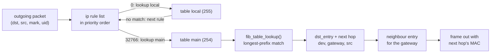
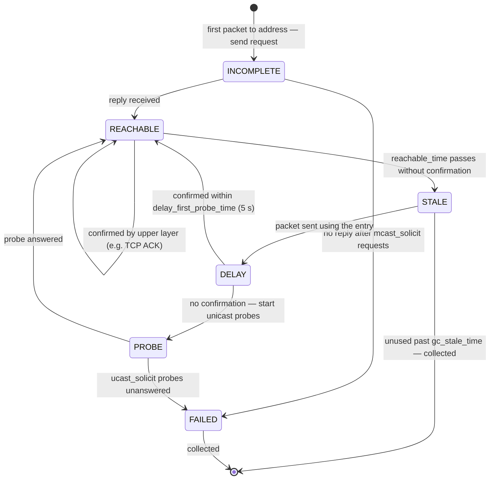

# Routing and Neighbours

Every packet this host sends, and every packet it forwards as a router, needs two answers before it can
leave: which interface and next hop to use (**routing**), and that next hop's link-layer address
(**neighbour resolution**). Linux answers the first with a longest-prefix-match lookup over several
routing tables, chosen by policy rules. It answers the second with a per-interface neighbour cache that has
more states than most people expect. `ip route get` asks the kernel exactly the question a packet asks,
which makes it the best routing debugger there is.

## The FIB and longest-prefix match

A routing table is a FIB (forwarding information base), a <Src file="include/net/ip_fib.h"
symbol="fib_table" />. IPv4 stores each one as an LC-trie, a compressed binary trie over address bits
(`net/ipv4/fib_trie.c`). <Src file="net/ipv4/fib_trie.c" symbol="fib_table_lookup" /> walks it and returns
the *most specific* matching prefix: a `/32` host route beats a `/24`, which beats the `/0` default route.
The result is a route with one or more next hops: an output device, a gateway address (or none, for a
directly connected network), and a preferred source address.

Linux used to put a **routing cache** in front of the trie, a hash of recent destination results. It was
removed in Linux 3.6 (2012): its speed depended on the traffic pattern, and an attacker sending to random
addresses could thrash it. Older documentation, and older `ip` output, still mention it. What survived is
small and per-destination: a `fib_nh_exception` on a next hop records what the host has *learned* about one
destination — a smaller path MTU from an ICMP "fragmentation needed", or an ICMP redirect.

## Tables and policy rules

There isn't one routing table. There are up to 2³² of them, with three built in:

| Table | ID | Contents |
|---|---|---|
| `local` | 255 | every address this host owns, and the broadcast addresses — maintained by the kernel |
| `main` | 254 | what `ip route add` and DHCP write to by default |
| `default` | 253 | empty unless you use it |

**Policy rules** (`ip rule`) pick which table to consult. Each rule has a priority, a selector — source
prefix, input interface, firewall mark, UID, IP protocol, port range — and an action, usually `lookup
<table>`. The kernel walks the rules in priority order (`fib_rules_lookup`), and the first rule whose
table produces a match wins. A rule whose table has no matching route lets the walk continue.

The default rule set is priority 0 → `local`, 32766 → `main`, 32767 → `default`. `local` is consulted
first because "is this packet for *me*?" must be answered before any route to elsewhere can apply — a
packet to one of your own addresses must be delivered locally, whatever `main` says.

## Route lookup in the datapath

There are two kinds of lookup:

- **Input routing**, on [the receive path](./the-receive-path.md#ip-and-the-first-routing-decision):
  `ip_rcv_finish` calls <Src file="include/net/route.h" symbol="ip_route_input_noref" />, which decides
  between local delivery, forwarding, and dropping, and takes the incoming interface into account
  (reverse-path filtering, below).
- **Output routing**, for packets this host generates: <Src file="include/net/route.h"
  symbol="ip_route_output_flow" /> → `ip_route_output_key_hash` → `fib_lookup`, keyed by a `flowi4`
  holding the destination, source, mark, UID and TOS.

Either way, the result is a <Src file="include/net/dst.h" symbol="dst_entry" /> (embedded in an IPv4
`rtable`) attached to the `sk_buff`. Its `input` or `output` function pointer is literally what happens
next: `ip_local_deliver`, `ip_forward`, or `ip_output`. A connected TCP socket caches its `dst` in
`sk_dst_cache` ([the transmit path](./the-transmit-path.md#ip-routing-and-the-neighbour)), so a
long-lived connection does one lookup, not one per segment. Routing-table changes bump a generation
number that invalidates those cached entries.



*An output lookup: the rules choose a table, the table's trie finds the longest matching prefix, and the
next hop's neighbour entry supplies the link-layer address.*

## Nexthop objects and multipath

A route can have several next hops (ECMP — equal-cost multipath). The kernel picks one per flow by
hashing the packet's addresses (and ports, if `net.ipv4.fib_multipath_hash_policy` says so), so a flow
sticks to one path and its packets don't get reordered.

Since Linux 5.3, next hops can be separate objects (`ip nexthop add id 1 via 192.0.2.1 dev eth0`) that
routes refer to by ID. Groups combine them (`ip nexthop add id 3 group 1/2`), and `resilient` groups keep
existing flows on their path when a member is added or removed. With hundreds of thousands of routes
sharing a few next hops, as on a BGP router, changing a next hop once updates every route that uses it.

## The neighbour table

Each (interface, next-hop address) pair has a <Src file="include/net/neighbour.h" symbol="neighbour" />
entry: the link-layer address, a state, timers, and a small queue. ARP (IPv4) and Neighbour Discovery
(IPv6) fill it. The protocols themselves are on the
[ARP, ICMP and Neighbour Discovery page](../../computer-science/computer-networks/arp-icmp-and-neighbour-discovery.md);
this section is the cache's lifecycle.

The states are called NUD (neighbour unreachability detection) states:

| State | Meaning |
|---|---|
| `INCOMPLETE` | resolution in progress; a request has been sent, no answer yet |
| `REACHABLE` | the address is confirmed and recently proven to work |
| `STALE` | the address is known, but not confirmed recently. Still used — a check is scheduled for the next use |
| `DELAY` | a packet was sent to a `STALE` entry; waiting briefly for traffic to confirm it before probing |
| `PROBE` | sending unicast requests to confirm the entry |
| `FAILED` | probes went unanswered; packets to it are dropped with "host unreachable" |
| `NOARP` / `PERMANENT` | no resolution needed / configured by hand; never expire |

Packets for an `INCOMPLETE` entry wait in its queue (`unres_qlen_bytes`, 212992 here) rather than being
dropped, and leave when the reply arrives — that's <Src file="net/core/neighbour.c"
symbol="neigh_resolve_output" />. Upper layers can confirm reachability without ARP: when TCP receives an
ACK for data it sent through a neighbour, that proves the neighbour works, and the entry is refreshed.
That's why a busy gateway entry sits in `REACHABLE` indefinitely.

The table is garbage-collected against three thresholds:

- below `gc_thresh1` (128), entries are never collected;
- above `gc_thresh2` (512), collection becomes aggressive;
- `gc_thresh3` (1024) is a hard maximum.

A host on a flat network with thousands of neighbours — a container host, a large Kubernetes node — hits
`gc_thresh3` and logs `neighbour table overflow`. Raising the thresholds is the fix.



*The states a neighbour entry moves through, and why a healthy entry spends most of its life in `STALE`
without anything being wrong.*

## Reverse-path filtering

With `rp_filter` on, a received packet is checked by asking: "if I sent a reply to this packet's
*source*, would it go out the interface the packet came in on?" If not, the packet is dropped as probably
spoofed. Mode `1` is strict (must be the same interface); mode `2` is loose (the source just has to be
routable through some interface). The value used is the maximum of `conf.all.rp_filter` and the
interface's own setting.

Strict mode breaks **asymmetric routing**: a host with two uplinks, where replies legitimately leave by a
different interface than requests arrive on, sees traffic silently disappear. Such drops show up in the
`IPReversePathFilter` counter (`nstat -az TcpExtIPReversePathFilter`). This machine has
`conf.all.rp_filter = 0` and `conf.eth1.rp_filter = 2`, so `eth1` runs in loose mode.

<Lab host="any-linux" title="Ask the kernel what a packet would do" time="15 min">

No root needed. Output below is from this machine: WSL2 with Ubuntu 26.04 in *mirrored* networking mode,
iproute2 6.19, checked 2026-10-26. The rules involving tables `127`/`128`, `loopback0`, and `eth0` are
WSL's own plumbing for mirroring the Windows host's network; an ordinary Linux machine shows only the
last three rules.

1. **The rules.** `ip rule show`:

   ```text
   0:	from all iif eth0 ipproto tcp lookup local
   0:	from all iif eth0 ipproto udp lookup local
   0:	from all iif loopback0 ipproto tcp lookup local
   ...                                          # same pair for loopback0 and eth1
   1:	from all ipproto tcp lookup 127
   1:	from all ipproto udp lookup 127
   1:	from all ipproto tcp lookup 128
   1:	from all ipproto udp lookup 128
   2:	from all lookup local
   32766:	from all lookup main
   32767:	from all lookup default
   ```

   WSL moved the `local` lookup from priority 0 to 2 and put its own rules in front, selecting on input
   interface and IP protocol.

2. **The tables.** `ip route show table main` and `ip route show table local | head`:

   ```text
   default via 192.168.100.1 dev eth1 proto kernel metric 30
   192.168.100.0/24 dev eth1 proto kernel scope link metric 286
   192.168.100.1 dev eth1 proto kernel scope link metric 30

   local 10.255.255.254 dev lo proto kernel scope host src 10.255.255.254
   broadcast 10.255.255.254 dev lo proto kernel scope link src 10.255.255.254
   local 127.0.0.0/8 dev lo proto kernel scope host src 127.0.0.1
   local 127.0.0.1 dev lo proto kernel scope host src 127.0.0.1
   broadcast 127.255.255.255 dev lo proto kernel scope link src 127.0.0.1
   local 192.168.100.7 dev eth1 proto kernel scope host src 192.168.100.7
   broadcast 192.168.100.255 dev eth1 proto kernel scope link src 192.168.100.7
   ```

   `main` has the default route and the connected subnet. `local` has an entry for every address this
   host owns (`local`) and for every broadcast address it must accept (`broadcast`) — written by the
   kernel when the addresses were configured, not by anyone running `ip route`.

3. **Ask about two destinations.** `ip route get 1.1.1.1` and `ip route get 127.0.0.1`:

   ```text
   1.1.1.1 via 192.168.100.1 dev eth1 src 192.168.100.7 uid 1000
       cache
   127.0.0.1 via 169.254.73.152 dev loopback0 table 127 src 127.0.0.1 uid 1000
       cache
   ```

   For `1.1.1.1`: no table is printed, so it's `main`; the default route matched; the packet would go to
   gateway `192.168.100.1` out of `eth1` with source `192.168.100.7`. `uid 1000` is the UID the lookup was
   done for — rules can select on it. `cache` means the answer is a computed `dst_entry`, not a table line;
   it's a leftover of the pre-3.6 output format.

   `127.0.0.1` is the surprise. On ordinary Linux the answer is `local 127.0.0.1 dev lo table local`.
   Here it came from table 127, which holds one route:

   ```text
   $ ip route show table 127
   127.0.0.1 via 169.254.73.152 dev loopback0 proto kernel src 127.0.0.1 onlink
   ```

   Ask again, naming the protocol, and the answer splits:

   ```text
   $ ip route get 127.0.0.1 ipproto tcp
   127.0.0.1 via 169.254.73.152 dev loopback0 table 127 src 127.0.0.1 uid 1000
       cache
   $ ip route get 127.0.0.1 ipproto icmp
   local 127.0.0.1 dev lo table local src 127.0.0.1 uid 1000
       cache <local>
   ```

   That's policy routing by protocol. WSL's priority-1 rules send TCP and UDP for `127.0.0.1` through
   `loopback0` to the Windows host — that's how `localhost:3000` reaches a server running on Windows —
   while ICMP falls through to priority 2, the `local` table, and stays on Linux's own `lo`. A `ping
   localhost` and a `curl localhost` on this machine take different paths. On a non-WSL machine, both get
   the `local` answer.

4. **Change the question.** Rules can select on source, mark, protocol. `ip route get 1.1.1.1 from
   192.168.100.7 mark 0x1`:

   ```text
   1.1.1.1 from 192.168.100.7 via 192.168.100.1 dev eth1 mark 1 uid 1000
       cache
   ```

   Same answer, because no rule here selects on mark `1`. Add `ip rule add fwmark 1 lookup 100` (root) and
   a route in table 100, and the same command shows the new path — this is how VPN clients and
   policy-based routing send some traffic one way and the rest another.

5. **The neighbour table.** `ip -s neigh show`:

   ```text
   192.168.100.1 dev eth1 lladdr 08:2f:e9:e4:b2:28  ref 1 used 425/7/425probes 1 REACHABLE
   169.254.73.152 dev loopback0 lladdr 00:11:22:33:44:55  used 2347/0/2390probes 0 PERMANENT
   ```

   `used A/B/C` is seconds since the entry was last *used* / *confirmed* / *updated*. The gateway was
   confirmed 7 seconds ago and is `REACHABLE`. The `loopback0` entry is WSL's static one, `PERMANENT`.

6. **Watch an entry go stale.** The gateway above never goes `STALE`, because the host's own traffic
   keeps confirming it. The cleanest way to see the lifecycle is an idle neighbour: two private network
   namespaces joined by a veth pair (`unshare -rn`, then `unshare -n` for the peer), with `10.9.0.2` on
   the far end:

   ```text
   [t=  0s] $ ping -c1 -q 10.9.0.2 | tail -1
   rtt min/avg/max/mdev = 0.028/0.028/0.028/0.000 ms
   [t=  0s] $ ip -s neigh show dev v0
   10.9.0.2 lladdr 52:c7:b9:2b:aa:95  ref 1 used 0/0/0probes 4 REACHABLE
   [t= 59s] $ ip -s neigh show dev v0
   10.9.0.2 lladdr 52:c7:b9:2b:aa:95  used 59/59/35probes 4 STALE
   [t= 59s] $ ping -c1 -q 10.9.0.2 | tail -1
   rtt min/avg/max/mdev = 0.027/0.027/0.027/0.000 ms
   [t= 59s] $ ip -s neigh show dev v0       # straight after the packet
   10.9.0.2 lladdr 52:c7:b9:2b:aa:95  ref 1 used 0/59/0probes 4 DELAY
   [t= 62s] $ ip -s neigh show dev v0
   10.9.0.2 lladdr 52:c7:b9:2b:aa:95  ref 1 used 3/62/3probes 4 DELAY
   [t= 68s] $ ip -s neigh show dev v0
   10.9.0.2 lladdr 52:c7:b9:2b:aa:95  ref 1 used 3/3/3probes 1 REACHABLE
   [t= 68s] $ ping -c1 -W1 -q 10.9.0.99; sleep 4; ip neigh show dev v0
   10.9.0.2 lladdr 52:c7:b9:2b:aa:95 REACHABLE
   10.9.0.99 FAILED
   ```

   Every transition from the diagram is here. The entry went `STALE` after about 35 seconds without
   confirmation (`updated 35`; `reachable_time` is a random value around `base_reachable_time_ms`, 30 s).
   The ping still got through instantly — `STALE` entries are used, not re-resolved. That use moved it to
   `DELAY`. A one-shot ping produces no further traffic to confirm it, so after the 5 s delay the kernel
   sent a unicast probe: `probes 1`, answered, and the entry is `REACHABLE` again, confirmed 3 seconds
   ago. An address nobody answers for ends in `FAILED`.

**If it fails:** inside a container, `ip rule` usually shows only the three default rules and the gateway
may be a virtual bridge; on WSL2 in NAT mode (the default) there is one `eth0` and the gateway is the
Hyper-V virtual switch; and if `unshare -rn` reports `Operation not permitted`, unprivileged user
namespaces are disabled (`kernel.unprivileged_userns_clone` or an AppArmor policy), so run step 6 in a VM.

</Lab>

<KernelFacts
  structure={[["struct fib_table", "include/net/ip_fib.h"], ["struct neighbour", "include/net/neighbour.h"]]}
  path="ip_route_output_flow() → fib_lookup() → fib_rules_lookup() → fib_table_lookup() → dst → ip_finish_output2() → neigh_output() → neigh_resolve_output()"
  observe="ip route get 1.1.1.1 && ip -s neigh show"
  trap="`STALE` in `ip neigh` does not mean broken — it means the entry has not been confirmed recently and will be re-verified the next time it is used. Deleting `STALE` entries to 'fix' networking changes nothing except adding an ARP round trip." />

## References

- [ip-route(8)](https://man7.org/linux/man-pages/man8/ip-route.8.html),
  [ip-rule(8)](https://man7.org/linux/man-pages/man8/ip-rule.8.html) and
  [ip-neighbour(8)](https://man7.org/linux/man-pages/man8/ip-neighbour.8.html) — the command surface used on
  this page; checked against current iproute2 via context7 on 2026-10-26, and run with iproute2 6.19.
- [IP Sysctl](https://docs.kernel.org/networking/ip-sysctl.html) — `rp_filter` modes, the neighbour
  `gc_thresh*` thresholds and timers, and their defaults.
- LWN, [weekly kernel page, July 25, 2012](https://lwn.net/Articles/507651/) — the 3.6 merge-window report,
  quoting David Miller on why the IPv4 routing cache was removed. Useful when older documentation describes
  a cache that no longer exists.
- <Src file="net/core/neighbour.c" symbol="neigh_resolve_output" /> — how packets wait in a neighbour's
  queue while resolution is pending.
