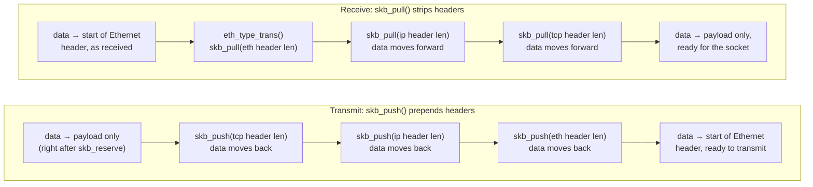

# `sk_buff`: The Packet Container

Every packet in the kernel lives in a <Src file="include/linux/skbuff.h" symbol="sk_buff" />, and the
structure is designed around one observation: a packet gains headers on the way down the stack and loses
them on the way up. So the data area is allocated with spare room at the front, and "adding a header" is
moving a pointer backwards through memory that's already there, not copying the payload into a bigger
buffer. Once you can see the four pointers that bound that memory and the shared-info tail sitting past
the last of them, you can read almost any networking code in the tree — it is, overwhelmingly, code that
moves those pointers around.

## Metadata and data are separate

`sk_buff` itself is metadata: which device a packet arrived on or will leave through, its protocol,
timestamps, the socket that owns it, the offsets of each header, and the lengths of everything. None of
that metadata *is* the packet's bytes — the struct instead points at a separately allocated data buffer,
and the split matters because several `sk_buff`s can point at the very same buffer at once (see
[Clone versus copy](#clone-versus-copy) below). Growing or shrinking what a `sk_buff` claims to hold is
therefore often just arithmetic on its own fields, not an operation on the buffer at all.

## `head`, `data`, `tail`, `end`

Four positions inside the data buffer, in order, bound the regions that matter:

- **`head`** — the start of the allocation.
- **`data`** — the start of what's currently considered "the packet" — everything between `head` and
  `data` is **headroom**, reserved space nothing has written into yet.
- **`tail`** — the end of what's currently considered "the packet" — everything between `data` and `tail`
  is the packet itself.
- **`end`** — the end of the linear buffer — everything between `tail` and `end` is **tailroom**, and
  `struct skb_shared_info` (below) lives immediately past `end`, not inside it.

Four helpers move these positions instead of touching the buffer's contents. `<Src
file="include/linux/skbuff.h" symbol="skb_reserve" />` moves both `data` and `tail` forward together,
carving out headroom before anything has been written — this is normally the very first call after
allocation. `<Src file="include/linux/skbuff.h" symbol="skb_put" />` moves `tail` forward, extending the
packet at the end (appending payload). `<Src file="include/linux/skbuff.h" symbol="skb_push" />` moves
`data` *backward* into existing headroom, prepending a header. `<Src file="include/linux/skbuff.h"
symbol="skb_pull" />` moves `data` forward, stripping a header off the front. None of the four ever
`memcpy`s the payload — they only ever move one of these two pointers, which is the entire reason
pushing and pulling headers is cheap regardless of how large the payload behind them is.

Verified at v6.18: `<Src file="include/linux/skbuff.h" symbol="sk_buff_data_t" />` is conditionally
`unsigned int` — an **offset** from `head` — on any build where `BITS_PER_LONG > 32` (every 64-bit
build), and a raw `unsigned char *` pointer otherwise. `tail` and `end` are declared with this type, so
on the 64-bit builds this documentation otherwise assumes, they are offsets you add to `head` to get an
address, not addresses themselves — code that treats them as pointers without going through the
accessors is reading the wrong type.

## Header offsets

`mac_header`, `network_header`, and `transport_header` are stored the same way — as offsets, this time
always from `head` regardless of build width — rather than as pointers or computed on demand from
`protocol` fields. Each is set once, as the corresponding layer parses the packet: the device layer sets
`mac_header` in `eth_type_trans()`, IP sets `network_header` in `ip_rcv()`, and the transport protocol
sets `transport_header` once it identifies itself. Accessors like `skb_network_header()`, `ip_hdr()`, and
`tcp_hdr()` just add the stored offset back to `head`. Storing the offset at parse time, instead of
re-deriving it wherever it's needed, means every later layer can find an earlier layer's header in
constant time without re-walking anything — the cost of remembering "IP started here" is one field write,
paid once.

## Linear and non-linear data

`len` is the *total* size of the packet's data across every location it might live in; `data_len` is how
much of that total is *not* in the linear buffer between `data` and `tail`. `<Src
file="include/linux/skbuff.h" symbol="skb_headlen" />` (`len - data_len`) is the size of the linear part
alone. The reason `data_len` can be nonzero at all: payload can additionally live in page fragments
(`skb_shinfo(skb)->frags[]`, an array of `skb_frag_t`) or in a chain of further `sk_buff`s
(`skb_shinfo(skb)->frag_list`), so a single GRO-merged packet tens of kilobytes long need not be one
contiguous allocation — it's the linear part plus whatever's hanging off `frags`/`frag_list`.

This is exactly why code must call `<Src file="include/linux/skbuff.h" symbol="pskb_may_pull" />` before
reading a header directly from `skb->data`: `pskb_may_pull(skb, len)` checks whether at least `len` bytes
are actually present in the *linear* region and, if not, pulls enough of the non-linear data into it
first. Code that reads a header by raw pointer without this check works on every test packet that
happened to be fully linear and reads past the linear buffer's end on the GRO-merged or fragmented one
that wasn't — the trap this page's `KernelFacts` closes with.

## Clone versus copy

Four operations, in increasing order of what they actually duplicate. `<Src file="net/core/skbuff.c"
symbol="skb_clone" />` allocates a new `sk_buff` and copies only its *metadata* — the new struct points
at the *same* underlying data buffer as the original. Verified at v6.18: cloning increments
`skb_shinfo(skb)->dataref` (an `atomic_t` on `struct skb_shared_info`, tracked via `<Src
file="include/linux/skbuff.h" symbol="skb_shared_info" />`) rather than copying any bytes, which is what
makes `tcpdump`'s packet tap and TCP's retransmit queue cheap: both need their own `sk_buff` (their own
view of headers, timestamps, and reference lifetime) over data they don't need their own copy of.
`skb_copy()` and `<Src file="include/linux/skbuff.h" symbol="pskb_copy" />` go further and actually
duplicate the data buffer — `skb_copy()` the whole thing, `pskb_copy()` just the linear part, both used
when a caller genuinely needs to modify data it can't risk sharing. `<Src
file="include/linux/skbuff.h" symbol="skb_cow" />` and `<Src file="include/linux/skbuff.h"
symbol="skb_unshare" />` sit between: both check `dataref` first and only copy if the buffer is actually
shared (`dataref` above 1), so code that needs to write to a possibly-cloned buffer doesn't pay a copy on
the common unshared case. This is the whole mechanism behind "one packet, many readers" costing one
allocation instead of `N` copies — the buffer is shared by default, and a copy happens only at the one
point some reader needs to mutate it.

## Allocation

`<Src file="net/core/skbuff.c" symbol="__alloc_skb" />` is the primitive nearly everything else calls:
it takes the requested size from a dedicated slab cache (see
[Slab, SLUB, and `kmalloc`](../08-memory-management/slab-slub-and-kmalloc.md) for how that cache itself
works) rather than generic `kmalloc()`, and `<Src file="include/linux/skbuff.h" symbol="alloc_skb" />` is
a thin convenience wrapper over it. `<Src file="net/core/skbuff.c" symbol="napi_alloc_skb" />` is the
receive-path specialization — it pulls from a per-CPU cache NAPI keeps warm specifically so the common
case (one allocation per poll iteration, same CPU every time) never contends a lock or touches a
different CPU's memory. `<Src file="net/core/skbuff.c" symbol="build_skb" />` and its NAPI counterpart
`<Src file="net/core/skbuff.c" symbol="napi_build_skb" />` are different in kind from all of the above:
instead of allocating a fresh buffer for the driver to fill, they wrap an `sk_buff` structure *around*
memory the driver already has — typically a page the DMA engine already filled — avoiding the copy a
plain `alloc_skb()` + memcpy would cost. Page pools (`struct page_pool`) take this further again, letting
a driver recycle DMA-mapped pages across many receive cycles instead of mapping and unmapping fresh ones
each time; the mechanism is a driver-level optimization on top of `build_skb()`, not a different data
structure, so it's mentioned here in one sentence rather than given its own section.

## The fields that matter

`struct sk_buff`, verified at v6.18, is large — the warning in the brief for this page turned out to be
accurate: several of the fields that matter most live inside a union, or inside the
`struct_group(headers, ...)` block that the kernel copies with one `memcpy()` in `__copy_skb_header()`,
not as plain top-level members. Grouped by concern, with exactly where each one actually lives:

| Field | Concern | Type | Where it actually lives |
|---|---|---|---|
| `head` | position | `unsigned char *` | top-level |
| `data` | position | `unsigned char *` | top-level |
| `tail` | position | `sk_buff_data_t` | top-level (an offset from `head` on 64-bit builds) |
| `end` | position | `sk_buff_data_t` | top-level (an offset from `head` on 64-bit builds) |
| `len` | position | `unsigned int` | top-level |
| `data_len` | position | `unsigned int` | top-level |
| `mac_header` | layering | `__u16` | inside `struct_group(headers, ...)` |
| `network_header` | layering | `__u16` | inside `struct_group(headers, ...)` |
| `transport_header` | layering | `__u16` | inside `struct_group(headers, ...)` |
| `protocol` | layering | `__be16` | inside `struct_group(headers, ...)` |
| `sk` | ownership | `struct sock *` | top-level |
| `dev` | ownership | `struct net_device *` | inside a union with `dev_scratch` |
| `destructor` | ownership | `void (*)(struct sk_buff *)` | inside a union with `_skb_refdst` and `tcp_tsorted_anchor` |
| `_skb_refdst` | routing | `unsigned long` | the same union as `destructor` |
| `ip_summed` | offload | `__u8:2` bitfield | inside `struct_group(headers, ...)` |
| `csum` | offload | `__wsum` | inside a union (with `csum_start`/`csum_offset`), itself inside `struct_group(headers, ...)` |
| `gso_size` | offload | `unsigned short` | **not on `sk_buff` at all** — on `skb_shared_info`, reached via `skb_shinfo(skb)->gso_size` |
| `users` | lifecycle | `refcount_t` | top-level, one of the last fields in the struct |

Three fields deserve a second look precisely because they aren't where a first guess would put them.
`dev` shares a union with `dev_scratch` — some protocols reuse that same space to stash a scratch value
when a device pointer isn't meaningful for that `sk_buff` (the comment in the source names the UDP
receive path as one user), so code touching `dev` outside the paths that guarantee it's actually a
device pointer is reading whatever the last writer put there. `destructor` and `_skb_refdst` share a
union with `tcp_tsorted_anchor`, which is how the same 16 bytes serve TCP's retransmit-queue bookkeeping
on one code path and a destructor callback plus routing-cache pointer on another, without the struct
carrying both at once. And `gso_size` isn't part of `sk_buff` in the first place — GSO/offload metadata
lives on `skb_shared_info`, past `end`, reached only through `skb_shinfo()`.

```wavedrom title="One sk_buff data buffer: headroom, the parsed headers, payload, tailroom, and the shared-info tail" alt="Bit-field-style strip drawn as byte regions of one sk_buff data buffer, left to right: headroom (starting at head), Ethernet header (starting at data), IP header, TCP header, payload, tailroom (starting at tail), and skb_shared_info (starting at end). Region widths are illustrative, not to scale."
{ reg: [
    { bits: 6,  name: "headroom  [head]", type: 1 },
    { bits: 4,  name: "Ethernet hdr  [data]", type: 2 },
    { bits: 4,  name: "IP hdr", type: 3 },
    { bits: 4,  name: "TCP hdr", type: 4 },
    { bits: 10, name: "payload", type: 5 },
    { bits: 4,  name: "tailroom  [tail]", type: 1 },
    { bits: 4,  name: "skb_shared_info  [end]", type: 6 }
  ],
  config: { hspace: 1200, bits: 36, lanes: 1 }
}
```

*One received TCP segment inside its `sk_buff` buffer: the headroom that makes `skb_push` cheap, the
four boundary pointers, and the shared info at the end.*

Pushing and pulling headers is the same pointer move read in opposite directions — transmit prepends by
walking `data` backward through headroom that was reserved in advance; receive strips by walking it
forward through headers already parsed. Neither direction ever touches the payload bytes in between.



*Adding and stripping headers by moving one pointer: the payload never moves.*

<KernelFacts
  structure={[["struct sk_buff", "include/linux/skbuff.h"], ["struct skb_shared_info", "include/linux/skbuff.h"]]}
  path="RX: napi_alloc_skb() → skb_put() → eth_type_trans() (skb_pull) · TX: skb_reserve() → skb_push() per header → dev_queue_xmit()"
  observe="grep -E '^skbuff' /proc/slabinfo"
  trap="`skb->len` is not the size of the linear buffer. Reading a header by pointer from `skb->data` without `pskb_may_pull()` works on every test packet that happened to be linear, and reads past the buffer on the GRO-merged or fragmented one that was not." />

:::note
`/proc/slabinfo` is `0400`, root-only, in this sandbox — `grep -E '^skbuff' /proc/slabinfo` as an
unprivileged user returns `Permission denied`, verified directly rather than assumed. The `observe`
command above is still the right one to reach for on a machine where it's readable (or under `sudo`);
this page just can't show captured output from it. `ip -s link show` and `/proc/net/softnet_stat`, used
on [the map page](./the-network-stack-map.md), *are* world-readable here and were captured live.
:::

## References

- [Kernel documentation — `struct sk_buff`](https://docs.kernel.org/networking/skbuff.html) — the
  kernel-doc rendering of the structure's own comment block, including the ownership and cloning rules;
  confirmed present at the pinned version.
- <Src file="include/linux/skbuff.h" symbol="sk_buff" /> — the structure itself, whose opening comment
  block is the best single explanation of the shared-buffer model, verified at v6.18.
- <Src file="net/core/skbuff.c" symbol="skb_clone" /> — cloning and the `dataref` accounting that makes
  it cheap, verified at v6.18.
- [Kernel documentation — Page Pool API](https://docs.kernel.org/networking/page_pool.html) — the
  DMA-page-recycling mechanism named in one sentence above, in the kernel's own words.
