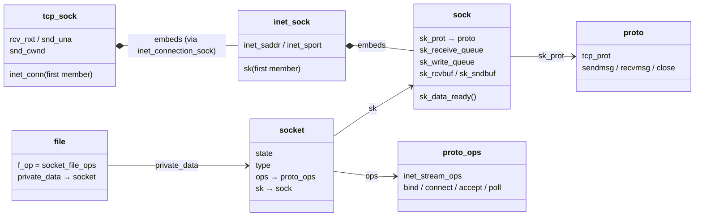
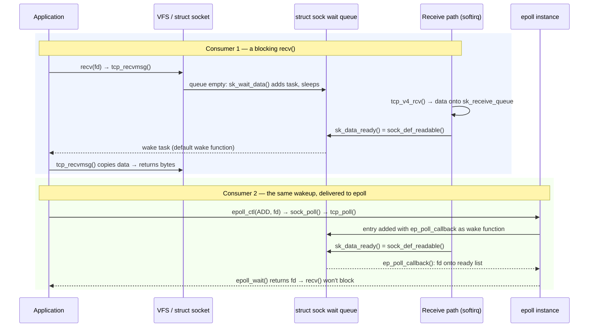

# Sockets in the Kernel

A socket descriptor is an ordinary file descriptor: it indexes the process's file table and lands on a
`struct file`, exactly like a descriptor for `/etc/hosts` does. Behind that file the kernel keeps two
objects with deliberately different jobs. **`struct socket`** faces the VFS and the syscall layer — it is
what `read`, `poll` and `close` see. **`struct sock`** faces the protocol — it holds the queues, the buffer
accounting, the connection state, and the wait queue that incoming data wakes. The split is how one socket
API fronts TCP, UDP, UNIX sockets and netlink without any of those protocols knowing what a file is. What
the calls *mean* from the caller's side is the
[sockets page in Computer Networks](../../computer-science/computer-networks/sockets-and-the-application-boundary.md);
this page is the kernel's side of the same objects.

## From descriptor to protocol

The chain from a number to a protocol has four links:

1. **fd → `struct file`.** `socket()` ends by calling <Src file="net/socket.c" symbol="sock_alloc_file" />,
   which creates a file on the internal `sockfs` pseudo-filesystem. That is why `ls -l /proc/<pid>/fd`
   shows a socket as `socket:[27054]` — the number is the `sockfs` inode, and `ss -e` prints the same
   number as `ino:`. The file's `f_op` is `socket_file_ops`, so every generic file operation lands in
   `net/socket.c` first ([the four VFS objects](../11-vfs-and-filesystems/the-four-objects.md) covers the
   `file` side).
2. **`struct file` → `struct socket`.** `file->private_data` points at the <Src file="include/linux/net.h"
   symbol="socket" />. It carries little: `state` (`SS_CONNECTED` and friends, the API's view), `type`
   (`SOCK_STREAM`), `ops` (the dispatch table below), `file` (the back-pointer), and `sk`.
3. **`struct socket` → `struct sock`.** `sk` points at the <Src file="include/net/sock.h" symbol="sock" />,
   where the protocol's state actually lives.
4. **`struct sock` → the protocol's own struct.** A TCP socket is not a `struct sock` with a pointer to TCP
   data; it is a `struct tcp_sock` whose first member is a `struct inet_connection_sock`, whose first
   member is a <Src file="include/net/inet_sock.h" symbol="inet_sock" />, whose first member is the
   `struct sock`. One allocation, nested. <Src file="include/linux/tcp.h" symbol="tcp_sk" /> converts a
   `struct sock *` to the `struct tcp_sock *` that contains it — the
   [embedded-struct idiom](../04-kernel-architecture-and-idioms/container-of-and-embedded-structs.md) with
   the offset fixed at zero.



*The objects behind one TCP socket descriptor: the VFS-facing `file` and `socket`, the protocol-facing
`sock` nested inside `tcp_sock`, and the two dispatch tables hanging off them.*

## Two dispatch tables

There are two tables of function pointers, one per layer of the split:

| Table | Hangs off | Selected by | TCP's instance | What it implements |
|---|---|---|---|---|
| <Src file="include/linux/net.h" symbol="proto_ops" /> | `socket->ops` | address family + type | <Src file="net/ipv4/af_inet.c" symbol="inet_stream_ops" /> | the socket API: `bind`, `connect`, `accept`, `listen`, `poll`, `sendmsg`, `recvmsg` |
| <Src file="include/net/sock.h" symbol="proto" /> | `sock->sk_prot` | the protocol | <Src file="net/ipv4/tcp_ipv4.c" symbol="tcp_prot" /> | the protocol: `connect`, `sendmsg`, `recvmsg`, `close`, plus memory accounting and hashing |

`proto_ops` is shared by everything with the same API shape — every IPv4 stream socket uses
`inet_stream_ops`, and most of its entries are thin `inet_*` functions that take the socket lock and call
through to `sk->sk_prot`. `proto` is where TCP, UDP and SCTP actually differ.

`socket(AF_INET, SOCK_STREAM, IPPROTO_TCP)` picks both. <Src file="net/socket.c" symbol="__sys_socket" />
calls `sock_create` → <Src file="net/socket.c" symbol="__sock_create" />, which allocates the `struct
socket` and calls the address family's `create` hook. For `AF_INET` that is <Src file="net/ipv4/af_inet.c"
symbol="inet_create" />: it walks the protocol switch for the requested type (`inetsw[SOCK_STREAM]`),
finds the entry that pairs `inet_stream_ops` with `tcp_prot`, sets `sock->ops`, and calls <Src
file="net/core/sock.c" symbol="sk_alloc" /> with `tcp_prot`. `tcp_prot` names its own object size, so
that one allocation is a whole `tcp_sock`. Back in `__sys_socket`, `sock_alloc_file` wraps the result in a
file and installs a descriptor.

## Buffers and accounting

Six `struct sock` fields carry the data and its cost:

| Field | Holds |
|---|---|
| `sk_receive_queue` | `sk_buff`s that arrived and that the application hasn't read yet |
| `sk_write_queue` | `sk_buff`s the application wrote that the protocol hasn't finished with (for TCP: not yet acknowledged) |
| `sk_rcvbuf` | the receive limit, in bytes of *memory*, not payload |
| `sk_sndbuf` | the send limit, likewise |
| `sk_rmem_alloc` | memory currently charged against `sk_rcvbuf` |
| `sk_wmem_queued` | memory currently charged against `sk_sndbuf` |

Memory is charged when an [`sk_buff`](./sk-buff.md) is queued, and the charge is the buffer's *truesize*
— the whole allocation, including the `sk_buff` struct and unused tailroom — not the payload length.
A stream of small packets therefore fills a receive buffer long before the payload bytes add up to
`sk_rcvbuf`. When the receive side is full, UDP drops the datagram (`UdpRcvbufErrors`), and TCP first
shrinks its advertised window towards zero and then drops (`TcpExtTCPRcvQDrop`) — see
[TCP in the kernel](./tcp-in-the-kernel.md).

Two families of limits set those fields, and they are easy to confuse:

- `net.core.rmem_max` / `wmem_max` cap what an application may request with `setsockopt(SO_RCVBUF)`.
- `net.ipv4.tcp_rmem` / `tcp_wmem` are TCP's `min default max` triple. TCP starts at the default and
  *autotunes* upward to the max as the connection proves it needs more — unless the application set
  `SO_RCVBUF` itself, which switches autotuning off for that socket.

On this machine the cap for explicit requests is far below what TCP grows to on its own:

```text
net.core.rmem_max = 4194304
net.ipv4.tcp_rmem = 4096	131072	33554432
```

So an application that "tunes" with `SO_RCVBUF` can end up with a smaller buffer than one that doesn't.

Above every per-socket limit sits a per-protocol one: `net.ipv4.tcp_mem` is three numbers in *pages*
(`low pressure high`, here `142587 190119 285174`) bounding all TCP socket memory on the host. Past
`pressure`, TCP stops growing buffers and starts trimming them; past `high`, new allocations fail. A
single host-wide counter is why one misbehaving service with thousands of stalled connections can degrade
TCP for every other process on the machine.

## Blocking and waking

A `recv` on an empty receive queue reaches `tcp_recvmsg`, which finds nothing to copy and calls <Src
file="net/core/sock.c" symbol="sk_wait_data" />. That puts the task on the socket's wait queue in
`TASK_INTERRUPTIBLE` and schedules away — the general mechanism is in
[process states and wait queues](../06-processes-and-threads/process-states-and-wait-queues.md); the queue
itself hangs off `sk->sk_wq`.

The other half runs in softirq context on whatever CPU [the receive path](./the-receive-path.md)
processed the segment on. TCP appends the data to `sk_receive_queue` and calls `sk->sk_data_ready(sk)`.
For an ordinary socket that pointer is <Src file="net/core/sock.c" symbol="sock_def_readable" />, set when
the `sock` was initialized, and it wakes everything on the wait queue that cares about readability. The
woken task goes back through `tcp_recvmsg`, finds data, copies it to user memory, and returns.



*One wakeup, two consumers: how arriving data wakes a blocked `recv` or marks a descriptor ready in
`epoll`.*

## How epoll hooks in

`epoll_ctl(EPOLL_CTL_ADD, fd)` asks the file whether it's ready by calling its `poll` method, and passes a
`poll_table` that isn't a real table. For a socket the call goes <Src file="net/socket.c"
symbol="sock_poll" /> → `sock->ops->poll`, which `inet_stream_ops` sets to <Src file="net/ipv4/tcp.c"
symbol="tcp_poll" />. `tcp_poll` registers on the socket's wait queue through that `poll_table`, and
epoll's callback for the registration adds a wait-queue entry whose wake function is <Src
file="fs/eventpoll.c" symbol="ep_poll_callback" /> instead of "wake this task".

So when `sock_def_readable` walks the wait queue it calls whatever wake function each entry carries. A
blocked `recv`'s entry wakes a task; epoll's entry runs `ep_poll_callback`, which puts the descriptor on
the epoll instance's ready list and wakes whoever is in `epoll_wait`. The socket doesn't know which
consumer it has. There is one notification mechanism, and epoll is a second subscriber to it. That's why
epoll scales to many descriptors: the cost is paid per *event* on the wait queue, not per descriptor on
every `epoll_wait` call.

## Listening sockets

`listen(fd, backlog)` turns a socket into a listener. <Src file="net/socket.c"
symbol="__sys_listen_socket" /> first clamps the requested backlog to `net.core.somaxconn`, without any
error. Then `inet_listen` moves the socket to `TCP_LISTEN`, sets up its accept queue, and hashes it so
incoming SYNs can find it.

A SYN for a listener does not create a socket. TCP creates a <Src file="include/net/request_sock.h"
symbol="request_sock" />: a small object holding just what the handshake needs — the peer's address and
port, its initial sequence number, the options it offered. A full `struct sock` (a whole `tcp_sock`) is
created only when the final ACK of the handshake arrives. That child is then linked onto the listener's
accept queue, and it's what `accept` dequeues. This is the kernel side of the
[two-queue model](../../computer-science/computer-networks/sockets-and-the-application-boundary.md):

- **Pending handshakes** cost a `request_sock` each.
- **Completed but unaccepted connections** cost a full socket each, and are bounded by the clamped
  backlog. When that queue is full, the kernel ignores the completing ACK by default and counts it in
  `TcpExtListenOverflows`, so the client retransmits.

When the SYN side itself overflows, `net.ipv4.tcp_syncookies` (`1` here, meaning "only when needed")
switches to SYN cookies: the handshake state is encoded into the SYN-ACK's sequence number, so the kernel
stores nothing until the ACK proves the client is real.

## What actually happens

**Run for real on this machine (WSL2, kernel `6.18.33.2-microsoft-standard-WSL2`), checked 2026-10-26.**
`strace` was obtained without root the same way as on
[`open`, `read`, `write` in the Kernel](../11-vfs-and-filesystems/open-read-write-in-the-kernel.md#what-actually-happens)
(`apt-get download strace libunwind8` plus `dpkg -x`). The server is OpenBSD `nc -l 127.0.0.1 8080` under
`strace -f`. The client is a small Python script that connects, sends one line, and closes, so that the
`ss` snapshots could be taken at exact moments.

The server's syscalls, with the dynamic-linker noise removed:

```text
socket(AF_INET, SOCK_STREAM, IPPROTO_TCP) = 3                       # file + socket + tcp_sock created; fd 3
setsockopt(3, SOL_SOCKET, SO_REUSEADDR, [1], 4) = 0
setsockopt(3, SOL_SOCKET, SO_REUSEPORT, [1], 4) = 0
bind(3, {sa_family=AF_INET, sin_port=htons(8080), sin_addr=inet_addr("127.0.0.1")}, 16) = 0
listen(3, 1)                      = 0                               # nc asks for a backlog of 1
accept4(3, {sa_family=AF_INET, sin_port=htons(38519), sin_addr=inet_addr("127.0.0.1")}, [128 => 16], SOCK_NONBLOCK) = 4
read(4, "hello kernel\n", 16384)  = 13                              # reads come from fd 4, not 3
read(4, "", 16384)                = 0                               # peer's FIN: end of stream
close(4)                          = 0
close(3)                          = 0
```

After `listen`, there is one socket, in `LISTEN`:

```text
$ ss -tlnpe 'sport = :8080'
State  Recv-Q Send-Q Local Address:Port Peer Address:PortProcess
LISTEN 0      1          127.0.0.1:8080      0.0.0.0:*    users:(("nc",pid=4989,fd=3)) uid:1000 ino:27054 sk:2c cgroup:/init.scope <->
```

For a listener the two queue columns mean something else. `Recv-Q` is the number of completed
connections waiting in the accept queue (0), and `Send-Q` is the accept queue's limit — the backlog `nc`
asked for, after clamping (1).

The handshake finished in the kernel before `nc`'s `accept4` ran. On loopback that takes microseconds, so
the `request_sock` stage was too short to catch in a snapshot. After `accept4` returned, a second
`file`/`socket`/`sock` triple exists with its own inode and its own descriptor (one unrelated `TIME-WAIT`
line, left by an earlier run, removed):

```text
$ ss -tanpe '( sport = :8080 or dport = :8080 )'
State     Recv-Q Send-Q Local Address:Port  Peer Address:Port Process
LISTEN    0      1          127.0.0.1:8080       0.0.0.0:*     users:(("nc",pid=4989,fd=3))      uid:1000 ino:27054 sk:2c cgroup:/init.scope <->
ESTAB     0      0          127.0.0.1:8080     127.0.0.1:38519 users:(("nc",pid=4989,fd=4))      uid:1000 ino:21837 sk:2d cgroup:/init.scope <->
ESTAB     0      0          127.0.0.1:38519    127.0.0.1:8080  users:(("python3",pid=4985,fd=4)) uid:1000 ino:21140 sk:2e cgroup:/init.scope <->

$ ls -l /proc/4989/fd
lr-x------ 1 dev dev 64 Oct 26 14:17 0 -> /dev/null
l-wx------ 1 dev dev 64 Oct 26 14:17 1 -> pipe:[21136]
l-wx------ 1 dev dev 64 Oct 26 14:17 2 -> pipe:[21136]
lrwx------+1 dev dev 64 Oct 26 14:17 3 -> socket:[27054]
lrwx------+1 dev dev 64 Oct 26 14:17 4 -> socket:[21837]
```

Three things are worth reading off this:

- **The listener is still there, unchanged.** `ino:27054` is still fd 3 and still `LISTEN`. Accepting
  did not turn it into the connection.
- **The connection is a new object.** `ino:21837` (the `sockfs` inode `/proc` shows as `socket:[21837]`)
  is fd 4, with its own `sk:` address. Every `read` in the trace targets fd 4.
- **The other end is a third socket.** Loopback has both endpoints on one host, so the client's socket
  (`ino:21140`, owned by `python3`) appears in the same table.

To see the accept queue fill, a second listener asked for `listen(fd, 100000)`, three clients connected,
and nothing called `accept` at first:

```text
$ ss -ltn 'sport = :8081'   # listen(fd, 100000); 3 clients connected, none accepted
State  Recv-Q Send-Q Local Address:Port Peer Address:Port
LISTEN 3      4096       127.0.0.1:8081      0.0.0.0:*

$ ss -ltn 'sport = :8081'   # after one accept()
State  Recv-Q Send-Q Local Address:Port Peer Address:Port
LISTEN 2      4096       127.0.0.1:8081      0.0.0.0:*
```

`Send-Q` is 4096, not 100000: `net.core.somaxconn` on this machine is `4096`, and the kernel truncated
the request without an error. `Recv-Q` counts the three fully established connections waiting for
`accept`, and it drops by one when the application takes one.

## Misconceptions

1. **"The `listen` backlog is the maximum number of connections."** It bounds connections that have
   finished the handshake and are waiting to be *accepted*. Accepted connections don't count against it,
   and the value is capped by `net.core.somaxconn` without an error, as the 100000 → 4096 capture above
   shows.
2. **"A socket and a connection are the same object."** A listening socket never becomes a connection.
   Each accepted connection is a new `file`/`socket`/`sock` with its own descriptor (fd 4 next to fd 3
   above), and the listener keeps listening.
3. **"`Recv-Q` in `ss` is always unread bytes."** For an established socket it is. For a listening socket
   it is the number of connections waiting in the accept queue, and `Send-Q` is that queue's limit.

<KernelFacts
  structure={[["struct socket", "include/linux/net.h"], ["struct sock", "include/net/sock.h"]]}
  path="socket() → __sys_socket() → sock_create() → inet_create() → sk_alloc() → sock_alloc_file() → fd"
  observe="ss -tlnpe && ss -tnpim | head -20"
  trap="Raising the `listen()` backlog in your application does nothing past `net.core.somaxconn`, and the kernel silently truncates it — the value in `ss -ltn`'s `Send-Q` column shows what you actually got." />

## References

- <Src file="net/socket.c" symbol="__sys_socket" /> — socket creation and the `sockfs` file glue. The
  `somaxconn` clamp is a few functions further down, in `__sys_listen_socket`, verified at v6.18.
- <Src file="include/net/sock.h" symbol="sock" /> — `struct sock`, whose per-field comments are the
  fastest way to find what any `sk_*` field means.
- [socket(7)](https://man7.org/linux/man-pages/man7/socket.7.html) and
  [listen(2)](https://man7.org/linux/man-pages/man2/listen.2.html) — the socket options and the
  backlog/`somaxconn` note, from the caller's side.
- [epoll(7)](https://man7.org/linux/man-pages/man7/epoll.7.html) — the readiness contract that this page's
  second wait-queue consumer implements, including edge- versus level-triggered delivery.
