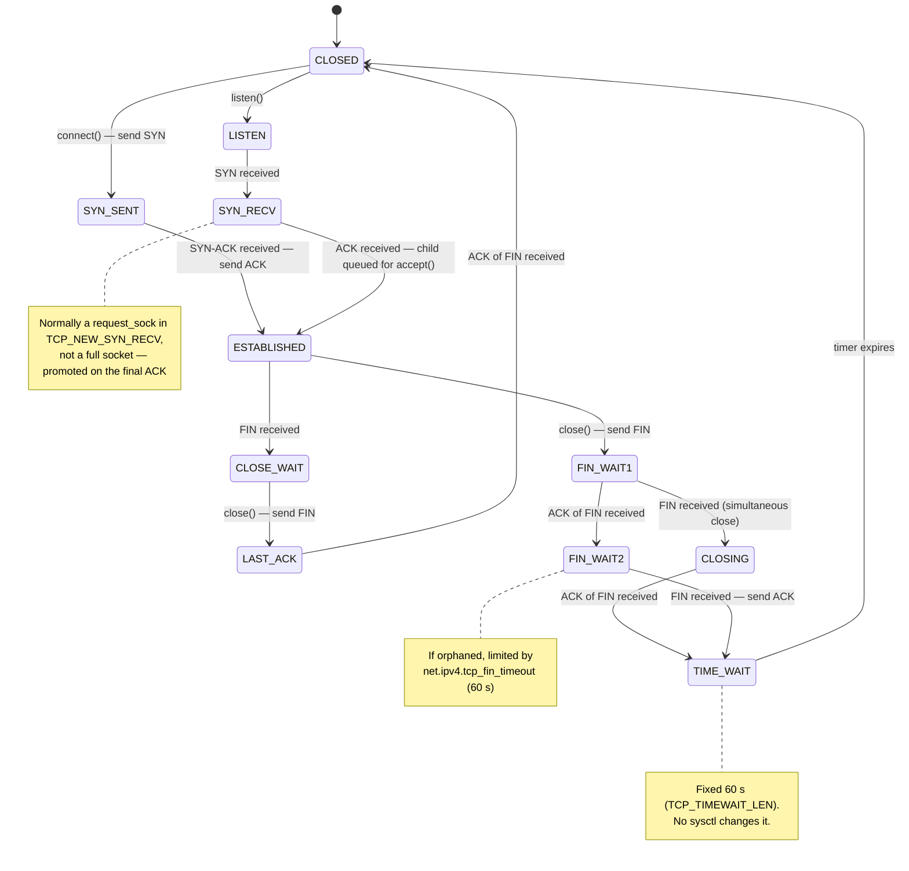

# TCP in the Kernel

The [transport-layer page](../../computer-science/computer-networks/transport-layer-tcp-udp.md) describes
TCP as a protocol: sequence numbers, windows, a handshake, a state machine. This page describes it as
tens of thousands of lines of kernel C under `net/ipv4/tcp*.c`, which have to make that protocol fast on
everything from a lossy phone link to a 400 Gbit/s datacentre network. Most of what an application
experiences as "TCP behaviour" — a 40 ms stall on small requests, a connection that lingers after
`close`, throughput that climbs for the first few seconds — is a specific kernel mechanism with a
specific tunable. This page names them.

## The state machine as implemented

The kernel tracks the protocol's eleven states in `sk->sk_state`, with names from
<Src file="include/net/tcp_states.h" symbol="TCP_ESTABLISHED" /> and its neighbours. It adds a few details
the RFC doesn't have:

- **Half-open connections aren't sockets.** A SYN arriving at a listener creates a small `request_sock`
  in state `TCP_NEW_SYN_RECV`, not a full socket in `SYN_RECV` (see
  [listening sockets](./sockets-in-the-kernel.md#listening-sockets)). `TCP_SYN_RECV` proper only appears on
  a full socket in rarer cases such as TCP Fast Open.
- **`TIME_WAIT` isn't a full socket either.** When a connection enters `TIME_WAIT`, the kernel swaps the
  large `tcp_sock` for a small `inet_timewait_sock` that holds just the four-tuple, the sequence numbers
  and the timer. That is why thousands of `TIME_WAIT` entries cost little memory.
- **Orphans.** After `close()` the application no longer has a descriptor, but the connection can still be
  in `FIN_WAIT1`, `FIN_WAIT2`, `CLOSING` or `LAST_ACK`, finishing the shutdown. Such a socket is an
  *orphan*; `net.ipv4.tcp_max_orphans` bounds how many may exist.

Two functions process incoming segments. <Src file="net/ipv4/tcp_input.c" symbol="tcp_rcv_established" />
is the fast path for the common case, in-order data on an established connection, described on
[the receive path](./the-receive-path.md#tcp-and-the-socket). Everything else — handshakes, closing,
unusual flags — goes through `tcp_rcv_state_process`, which is the state machine in code.



*TCP's states as the kernel tracks them, with the two timers people confuse marked where they apply.*

## Buffers and autotuning

The `net.ipv4.tcp_rmem` and `tcp_wmem` sysctls are three numbers each: minimum, initial, maximum
(`4096 131072 33554432` for receive on this machine). A new connection starts at the initial size. The
receive side then **autotunes**: `tcp_rcv_space_adjust`, called as the application reads, measures how
much data the application consumed in one round-trip time and grows `sk_rcvbuf` so the advertised window
can cover about twice that. A connection on a fast, long path ends up with a large buffer; an idle one
stays small. The send buffer grows in the same way with the congestion window.

Setting `SO_RCVBUF` or `SO_SNDBUF` yourself turns this off for that socket: the kernel locks the buffer
at your value (doubled, for bookkeeping overhead, and capped by `net.core.rmem_max`). The accounting
behind these numbers — what is charged, and what happens when it's full — is on
[sockets in the kernel](./sockets-in-the-kernel.md#buffers-and-accounting).

## Retransmission and loss detection

TCP has two ways to notice a lost segment:

- **The retransmission timeout (RTO).** For every connection, the kernel keeps a smoothed RTT and its
  variance, and computes the RTO from them. The RTO has a floor, `TCP_RTO_MIN`, which is `HZ / 5` —
  200 ms — at v6.18. So even on a 0.1 ms datacentre path, a segment whose loss is only detected by timeout
  stalls the connection for at least 200 ms. Each further timeout doubles the RTO.
- **ACK-based detection,** much faster. The receiver's SACK blocks say exactly which ranges arrived.
  Linux's default loss detection is **RACK-TLP** (RFC 8985, `net/ipv4/tcp_recovery.c`): a segment is lost
  if a segment sent *later* has already been acknowledged and enough time — a fraction of the RTT,
  allowing for reordering — has passed. That replaced the older "three duplicate ACKs" rule.

The **tail loss probe** (the TLP half) handles the last segments of a burst, where no later segment
exists to trigger RACK: after about two RTTs with no ACK, TCP retransmits the last segment so the
receiver's SACK reveals what's missing, instead of waiting for the full RTO.

## Pluggable congestion control

How fast TCP sends is decided by a congestion-control module: a <Src file="include/net/tcp.h"
symbol="tcp_congestion_ops" /> table with hooks such as `cong_avoid` (grow the window on an ACK),
`ssthresh` (what to do on loss) and `cong_control` (take over entirely, as BBR does). Modules register
with `tcp_register_congestion_control`. After `tcp_ack` processes an acknowledgement, `tcp_cong_control`
calls into the module to adjust the window.

```text
$ sysctl net.ipv4.tcp_congestion_control net.ipv4.tcp_available_congestion_control
net.ipv4.tcp_congestion_control = cubic
net.ipv4.tcp_available_congestion_control = reno cubic
```

The default is **CUBIC** (RFC 9438), a loss-based algorithm: it grows the window along a cubic curve and
backs off when packets are lost. "Available" lists only modules that are loaded. Others, such as `bbr`, are
loaded by `modprobe tcp_bbr` and then selectable per socket with `setsockopt(TCP_CONGESTION)` or
host-wide with the sysctl.

**BBR** is model-based: instead of treating loss as the signal, it continually estimates the path's
bottleneck bandwidth and minimum RTT, and paces sending at that rate. The module in mainline at v6.18,
`net/ipv4/tcp_bbr.c`, is **BBR version 1**, the algorithm described in the 2016 ACM Queue paper. Its
state has no `inflight_lo`/`inflight_hi` bounds, which BBRv2 and BBRv3 added. BBRv3 exists in Google's
out-of-tree branch and in some vendor kernels, not in mainline at this version (checked in the source
and via context7, 2026-10-26). Because BBR's rate model depends on pacing, its own header comment asks
for the `fq` qdisc ([traffic control](./traffic-control.md#classless-qdiscs)); without it, TCP falls back
to internal pacing with a high-resolution timer per socket.

## Nagle, delayed ACK, and corking

Two reasonable mechanisms make a bad combination:

- **Nagle's algorithm** holds a small segment back while earlier data is still unacknowledged, so that a
  stream of tiny writes becomes fewer, fuller segments.
- **Delayed ACK** holds an ACK back — at least 40 ms (`TCP_DELACK_MIN` is `HZ / 25`), up to 200 ms —
  hoping to piggyback it on response data.

A client that sends a request as two writes — a header, then a small body — sends the header at once.
Nagle holds the body until the header is ACKed. The server, waiting for the full request, has nothing to
reply with, so it delays the ACK. Both sides wait for a timer, and every request picks up 40 ms or more.

The socket options that control this:

- `TCP_NODELAY` disables Nagle, for request/response protocols that already write whole messages.
- `TCP_CORK` does the opposite: hold *everything* until uncorked (or 200 ms pass), so headers and a
  `sendfile` body leave in full segments.
- `TCP_QUICKACK` asks for immediate ACKs for a while.
- `TCP_NOTSENT_LOWAT` limits how much *unsent* data may sit in the socket buffer, so an application
  writing in priority order keeps control of what goes next instead of queueing megabytes ahead.

## TIME_WAIT, keepalive, and closing

The side that closes first spends **60 seconds in `TIME_WAIT`** — `TCP_TIMEWAIT_LEN`, a compile-time
constant, roughly two maximum segment lifetimes. It exists so that a delayed segment from the old
connection can't be accepted by a new connection with the same four-tuple, and so that a lost final ACK
can be retransmitted. That's correct behaviour, and it's cheap (see the state-machine section above).

What people try to tune instead:

- **`net.ipv4.tcp_fin_timeout`** (60) limits how long an *orphaned* socket waits in `FIN_WAIT2` for the
  peer's FIN. It doesn't touch `TIME_WAIT`. The kernel's own documentation says so, and the coincidence
  that both are 60 seconds is where the myth comes from.
- **`net.ipv4.tcp_tw_reuse`** lets a *new outgoing* connection reuse a four-tuple still in `TIME_WAIT`
  when TCP timestamps prove it's safe. `2`, the default here, enables it for loopback only.
- **`net.ipv4.tcp_tw_recycle`** was removed in Linux 4.12. It broke clients behind NAT, and any guide
  that tells you to set it is older than 2017.

**Keepalive** is off unless the application enables `SO_KEEPALIVE`. When it is on, the first probe goes
after `net.ipv4.tcp_keepalive_time` — 7200 seconds, two hours — of idleness. That's far too long for
noticing dead peers, which is why applications set `TCP_KEEPIDLE`, `TCP_KEEPINTVL` and `TCP_KEEPCNT` per
socket. `TCP_USER_TIMEOUT` is the stronger tool: it caps how long sent data may stay unacknowledged before
the connection is killed, which covers a peer that vanished mid-transfer, not just an idle one.

## TCP Fast Open and the options table

**TCP Fast Open** (RFC 7413) lets a client that has talked to a server before send data in the SYN,
saving a round trip. The server gives the client a cookie on the first connection, and the client
presents it with data next time. `net.ipv4.tcp_fastopen` is a bitmask: `1` (this machine's value, and the
default) enables the client side only; servers need `0x2` and a listener that opts in with
`TCP_FASTOPEN`. Middleboxes that drop SYNs carrying data have kept its deployment limited.

| Option | What it changes | When to use it |
|---|---|---|
| `TCP_NODELAY` | disables Nagle | request/response protocols that write whole messages |
| `TCP_CORK` | holds partial segments until uncorked | header + `sendfile` body; assembling a response |
| `TCP_USER_TIMEOUT` | kills the connection when data stays unacknowledged this long | anything that must notice a dead peer in seconds |
| `TCP_KEEPIDLE` (+ `KEEPINTVL`, `KEEPCNT`) | per-socket keepalive timing | long-lived idle connections through NAT or firewalls |
| `SO_REUSEPORT` | lets several sockets bind one port; the kernel spreads connections across them | one listener per worker thread or process |
| `SO_LINGER` | makes `close()` wait for unsent data, or with a zero timeout sends RST and skips `TIME_WAIT` | rarely; the zero-timeout form loses data |
| `TCP_NOTSENT_LOWAT` | limits unsent data in the socket buffer | HTTP/2 and other multiplexed, prioritised streams |
| `TCP_CONGESTION` | picks the congestion-control module for this socket | trying BBR for one service without changing the host |
| `TCP_INFO` | *reads* the connection's internals: RTT, cwnd, retransmits | monitoring; it's what `ss -ti` prints |

## Reading `ss -ti`

`ss -ti` prints `TCP_INFO` for each connection. This is a real `curl` download, rate-limited to 20 MB/s
and sampled five seconds in, on this machine (WSL2):

```text
$ ss -tinp state established
0 0 192.168.100.7:39465 141.95.207.211:443 users:(("curl",pid=8476,fd=5))
 cubic wscale:11,10 rto:240 rtt:37.916/1.614 ato:40 mss:1400 pmtu:1492 rcvmss:1440 advmss:1440 cwnd:10
 bytes_sent:2183 bytes_acked:2184 bytes_received:105156011 segs_out:2162 segs_in:40506 data_segs_out:15
 data_segs_in:40503 send 2953898bps lastsnd:372 lastrcv:204 lastack:204 pacing_rate 5907752bps
 delivery_rate 864192bps delivered:16 app_limited busy:464ms rcv_rtt:38 rcv_space:10385945
 rcv_ssthresh:21668672 minrtt:36.617 rcv_ooopack:17276 snd_wnd:530432 rcv_wnd:21668864
```

| Field | Value here | Meaning |
|---|---|---|
| `cubic` | | congestion-control module for this socket |
| `rto` | 240 ms | current retransmission timeout: smoothed RTT plus variance, never under 200 ms |
| `rtt` | 37.9/1.6 ms | smoothed RTT / its mean deviation |
| `minrtt` | 36.6 ms | lowest RTT seen — close to the path's propagation delay |
| `mss` / `pmtu` | 1400 / 1492 | segment size, and the path MTU (1492 suggests PPPoE somewhere on the path) |
| `cwnd` | 10 | congestion window in segments. 10 is the *initial* window: this socket mostly receives, so its own sending never grew it |
| `ssthresh` | absent | no loss has ever happened in this socket's sending direction |
| `bytes_acked` / `bytes_received` | 2 KB / 105 MB | what this side sent and had acknowledged / what it received |
| `retrans` | absent | nothing retransmitted. On a sender this reads `retrans:<current>/<total>` |
| `pacing_rate` | 5.9 Mbit/s | the rate TCP would pace *sending* at — about twice cwnd/RTT |
| `delivery_rate` | 0.86 Mbit/s | measured rate of acknowledged sending, marked `app_limited` because the application had little to send |
| `rcv_space` | 10.4 MB | autotuning's estimate of what the application reads per RTT — grown from the 128 KB initial size |
| `rcv_wnd` | 21.7 MB | the window this side currently advertises, after autotuning |
| `rcv_ooopack` | 17276 | segments received out of order — reordering on the path, which RACK tolerates without calling them lost |

For a *sending* connection the interesting fields are the opposite set: a `cwnd` well above 10, an
`ssthresh` that records the last loss response, and nonzero `retrans` and `bytes_retrans`.

## Misconceptions

1. **"`tcp_fin_timeout` shortens `TIME_WAIT`."** It limits how long an orphaned socket waits in
   `FIN_WAIT_2`. `TIME_WAIT` is `TCP_TIMEWAIT_LEN`, a fixed 60 seconds with no sysctl.
2. **"Many sockets in `TIME_WAIT` is a problem to tune away."** Each one is a small
   `inet_timewait_sock`, not a full socket, and they exist to protect new connections from old segments.
   They're only a problem for a client making very many outgoing connections to *one* destination, where
   they can exhaust local ports. `tcp_tw_reuse` and connection reuse address that case.
3. **"Setting a large `SO_RCVBUF` improves throughput."** Setting it switches off autotuning for that
   socket. The download above grew its receive space to 10 MB on its own; an application that set 4 MB
   by hand would have capped it there, and one that set 64 KB would have throttled it.

<KernelFacts
  structure={[["struct tcp_sock", "include/linux/tcp.h"], ["struct tcp_congestion_ops", "include/net/tcp.h"]]}
  path="tcp_v4_rcv() → tcp_rcv_established() (fast path) | tcp_rcv_state_process() → tcp_ack() → tcp_cong_control() → ca_ops->cong_avoid()"
  observe="ss -tin state established | head -20; sysctl net.ipv4.tcp_congestion_control net.ipv4.tcp_available_congestion_control"
  trap="Setting `SO_RCVBUF` or `SO_SNDBUF` turns off the kernel's buffer autotuning for that socket. Applications that 'optimise' by setting a fixed large buffer usually end up with worse throughput on fast paths and more memory on slow ones than the default would have given them." />

## References

- [tcp(7)](https://man7.org/linux/man-pages/man7/tcp.7.html) — every TCP socket option and most sysctls on
  this page, described from the kernel's side.
- [IP Sysctl](https://docs.kernel.org/networking/ip-sysctl.html) — the kernel's authoritative list of
  `net.ipv4.tcp_*` sysctls with their defaults, including the `tcp_fin_timeout` and `tcp_tw_reuse`
  definitions quoted above.
- [RFC 8985](https://www.rfc-editor.org/rfc/rfc8985) (RACK-TLP) and
  [RFC 9438](https://www.rfc-editor.org/rfc/rfc9438) (CUBIC) — the loss detection and default congestion
  control Linux implements.
- Cardwell et al., [*BBR: Congestion-Based Congestion Control*](https://doi.org/10.1145/3012426.3022184),
  ACM Queue 14(5), 2016 — the model behind BBR. It describes BBRv1, the version `net/ipv4/tcp_bbr.c` ships
  at v6.18 (checked 2026-10-26).
- <Src file="net/ipv4/tcp_input.c" symbol="tcp_rcv_established" /> — the receive fast path, whose comments
  explain the header-prediction conditions for taking it.
