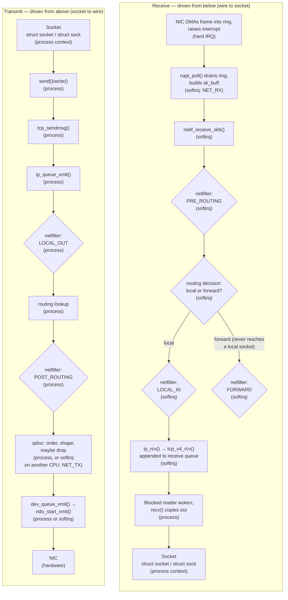

# The Network Stack, Mapped

A packet crosses about twice as many layers as the seven-box OSI picture suggests, and it crosses them
in both directions by different code — a receive-side function is not the transmit-side function run
backwards. This page is the reference map for the whole folder: the socket layer, the transport
protocol, IP, netfilter's hooks, routing, the neighbour table, the device layer, the queueing
discipline, and the driver, laid out for receive and for transmit, with the page in this folder that
owns each box named next to it. [The Life of a Packet](../02-guided-traces/the-life-of-a-packet.md)
already walked one packet through this shape as a narrative; every later page in this folder refers back
to *this* page the way that guided trace pointed forward to it.

## Two directions, two code paths

Receive is driven from the bottom. A NIC DMAs a frame into a ring buffer, raises an interrupt, and the
hard-IRQ handler does almost nothing but schedule polling — see
[How an Interrupt Reaches the Kernel](../10-interrupts-time-and-deferred-work/how-an-interrupt-reaches-the-kernel.md)
for that handoff in general and [The Receive Path](./the-receive-path.md) for the network-specific
version of it. Nearly everything after that — draining the ring, running netfilter, making the routing
decision, handing the packet to TCP — happens later, in `NET_RX_SOFTIRQ` softirq context (see
[Softirqs](../10-interrupts-time-and-deferred-work/softirqs.md)), on whatever CPU took the interrupt.
Only the very last step, waking a blocked reader, runs in the process that's waiting.

Transmit is driven from the top. A process calls `send()` or `write()`, and most of the work — building
headers, the netfilter hooks, the routing lookup, handing the packet to the queueing discipline — runs
synchronously in that process's own context, charged to it. It does *not* stay that way all the way
down, though: a busy qdisc can defer the actual dequeue-and-transmit step to `NET_TX_SOFTIRQ`, and that
softirq can run later, on a different CPU, than the one the sending process was on.

Which context a given stage runs in — hard IRQ, softirq, or process — is the single most useful fact for
reading networking code, because it tells you what that code is and isn't allowed to do (sleep, allocate
with `GFP_KERNEL`, take a mutex) and whose CPU time it's charged against. The map below annotates every
stage with it.

## The layers

| Layer | Receive behavior | Transmit behavior | Key function or struct | Owning page |
|---|---|---|---|---|
| socket | A data-ready callback wakes a process blocked in `recv()`/`read()`, which then copies bytes out of the socket's receive queue. | `send()`/`write()` copies bytes into the kernel and hands them to the transport protocol. | `struct socket` / `struct sock` | [Sockets in the Kernel](./sockets-in-the-kernel.md) |
| transport | Sequencing, reassembly of out-of-order segments, and (for TCP) acknowledgment bookkeeping before data is appended to the receive queue. | Segmentation into MSS-sized units, sequence numbers attached, and (for TCP) the retransmit queue populated. | `tcp_v4_rcv()` / `tcp_sendmsg()` | [TCP in the Kernel](./tcp-in-the-kernel.md) |
| IP | Header validation, defragmentation if needed, then the routing decision: deliver locally or forward. | Header construction, fragmentation if the path MTU requires it, using the route already looked up. | `ip_rcv()` / `ip_output()` | [The Receive Path](./the-receive-path.md) / [The Transmit Path](./the-transmit-path.md) |
| netfilter hooks | `PRE_ROUTING` fires first; after the routing decision, `LOCAL_IN` (destined here) or `FORWARD` (destined elsewhere) fires. | `LOCAL_OUT` fires right after the packet is built; `POST_ROUTING` fires last, just before the device layer. | `NF_HOOK()` call sites in `net/ipv4/ip_input.c` and `net/ipv4/ip_output.c` | [netfilter and nftables](./netfilter-and-nftables.md) |
| routing | A FIB lookup on the destination address decides local delivery versus forwarding. | A FIB lookup on the destination address picks the outgoing device and next hop before the IP header is even built. | FIB (`fib_lookup()`) | [Routing and Neighbours](./routing-and-neighbours.md) |
| neighbour | Mostly passive — an incoming ARP reply or NDP advertisement updates a cached entry. | Resolves the next hop's IP address to a link-layer address (ARP/NDP) before a frame can be built, caching the result. | the neighbour table (`struct neighbour`) | [Routing and Neighbours](./routing-and-neighbours.md) |
| device layer | `netif_receive_skb()` dispatches the `sk_buff` to the right protocol handler by `skb->protocol`. | `dev_queue_xmit()` hands the `sk_buff` to the device's queueing discipline. | `netif_receive_skb()` / `dev_queue_xmit()` | [The Receive Path](./the-receive-path.md) / [The Transmit Path](./the-transmit-path.md) |
| qdisc | Not normally in the receive path (an ingress qdisc exists but is the exception, not the rule). | Orders, and can shape, police, or drop, queued packets before they reach the driver. | `Qdisc` (`struct Qdisc`) | [Traffic Control and qdiscs](./traffic-control.md) |
| driver and NAPI | `napi_poll()` drains the DMA ring, builds `sk_buff`s, and hands each one up to `netif_receive_skb()`. | `ndo_start_xmit()` hands descriptors to the NIC and writes the doorbell register that tells it work is waiting. | `napi_poll()` / `ndo_start_xmit` | [The Receive Path](./the-receive-path.md) / [The Transmit Path](./the-transmit-path.md) |
| NIC | DMAs the arriving frame into the ring buffer and raises an interrupt. | Reads descriptors off the ring via DMA and puts the bits on the wire. | — | not owned here — driver internals are a later, not-yet-scaffolded folder |

## The control plane

Everything in the table above is the *datapath*: what happens to one packet. None of it decides what the
routing table, the neighbour table, the firewall rules, or an interface's addresses and flags actually
*are* — that state arrives separately, over netlink, from userspace tools like `ip` and `nft`, and the
datapath only ever consults it. `rtnetlink` (`AF_NETLINK`, `NETLINK_ROUTE`) is the specific netlink
family that carries routing, neighbour, and link/address changes; connection-tracking and firewall state
arrive over their own netlink families instead. The datapath's job is to read this state fast on every
packet; building and maintaining it is comparatively rare and comparatively slow, which is exactly the
asymmetry a FIB lookup or a neighbour-table lookup is optimized for.

## Where the hooks are

Five netfilter hook points appear on the map, always in this order along whichever path a packet takes:
`PRE_ROUTING` (every incoming packet, before the routing decision), `LOCAL_IN` (incoming, destined for
this host), `FORWARD` (incoming, destined elsewhere), `LOCAL_OUT` (locally generated, right after the
packet is built), and `POST_ROUTING` (every outgoing packet, whether locally generated or forwarded,
right before the device layer). Later pages refer to "the hook at `LOCAL_OUT`" and so on by these names.

Two more attach points exist below and beside these, both eBPF territory owned by a later folder in this
section, not yet written: **XDP**, which runs even earlier than `PRE_ROUTING` — at the driver, before an
`sk_buff` is even allocated — and **tc** (traffic-control) **BPF**, which attaches at the qdisc layer on
both ingress and egress. Both are named here only so the boundary is clear; neither is covered by this
folder.

## Namespaces cut across all of it

Every layer in the table above except the NIC itself exists once *per network namespace*: a namespace
gets its own routing tables, its own neighbour tables, its own netfilter rules, and its own set of
(usually virtual) devices. A process's namespace membership is what determines which complete copy of
this whole map its packets actually traverse. See
[Network Namespaces and Virtual Devices](./network-namespaces-and-virtual-devices.md) for how that
isolation is built and how packets cross from one namespace's stack into another's.

## What this folder does not cover

What TCP, IP, and Ethernet headers actually mean, and the protocols' own state machines and wire
formats, are owned by [`computer-science/computer-networks/`](../../computer-science/computer-networks/intro.md) —
this folder never re-teaches protocol semantics, only what the kernel's code does with them. NIC driver
internals — how a specific device driver programs its hardware, descriptor rings, and interrupt
moderation — belong to a later, not-yet-scaffolded folder in this section. XDP and BPF programs
attached at the hooks named above are likewise a later folder's territory; this folder names where they
attach and stops there.

Receive and transmit are drawn as two columns below, each read top-to-bottom: receive on the left runs
from the NIC down to the socket, transmit on the right runs from the socket down to the NIC — mirror
images of each other, meeting conceptually at the same socket and the same NIC even though a diagram
that must be read in one consistent direction can't literally merge those into single shared boxes.

*The kernel network stack in both directions, with netfilter's hooks and the execution context of every
stage.*

<KernelFacts
  structure={[["struct sk_buff", "include/linux/skbuff.h"], ["struct net_device", "include/linux/netdevice.h"]]}
  path="RX: NIC → napi_poll() → netif_receive_skb() → ip_rcv() → tcp_v4_rcv() → socket queue · TX: tcp_sendmsg() → ip_queue_xmit() → dev_queue_xmit() → ndo_start_xmit()"
  observe="ip -s link show && cat /proc/net/softnet_stat | head -4"
  trap="Receive processing for a packet addressed to your process usually runs on whatever CPU took the NIC's interrupt, in softirq context, charged to no process at all — which is why a busy network server can show high `si` in `top` while its own threads look idle." />

## References

- [Kernel documentation — the networking index](https://docs.kernel.org/networking/index.html) — the
  networking documentation index at the pinned version.
- [Kernel documentation — scaling in the network
  stack](https://docs.kernel.org/networking/scaling.html) — RSS, RPS, RFS, and XPS; the clearest in-tree
  description of how packets get spread across CPUs, which is what turns the single softirq path drawn
  above into something that scales with core count.
- Benvenuti, *Understanding Linux Network Internals* (O'Reilly, 2005) — still the deepest book written on
  the stack's overall structure; very old by now, so treat it as an architecture reference, never as a
  source of current function names.
- Damato, ["Monitoring and Tuning the Linux Networking Stack: Receiving
  Data"](https://blog.packagecloud.io/monitoring-tuning-linux-networking-stack-receiving-data/)
  (packagecloud blog, 2016) — an exhaustive, code-level walk of the receive path; predates v6.18, so
  verify every function name it gives against the source before trusting it.
