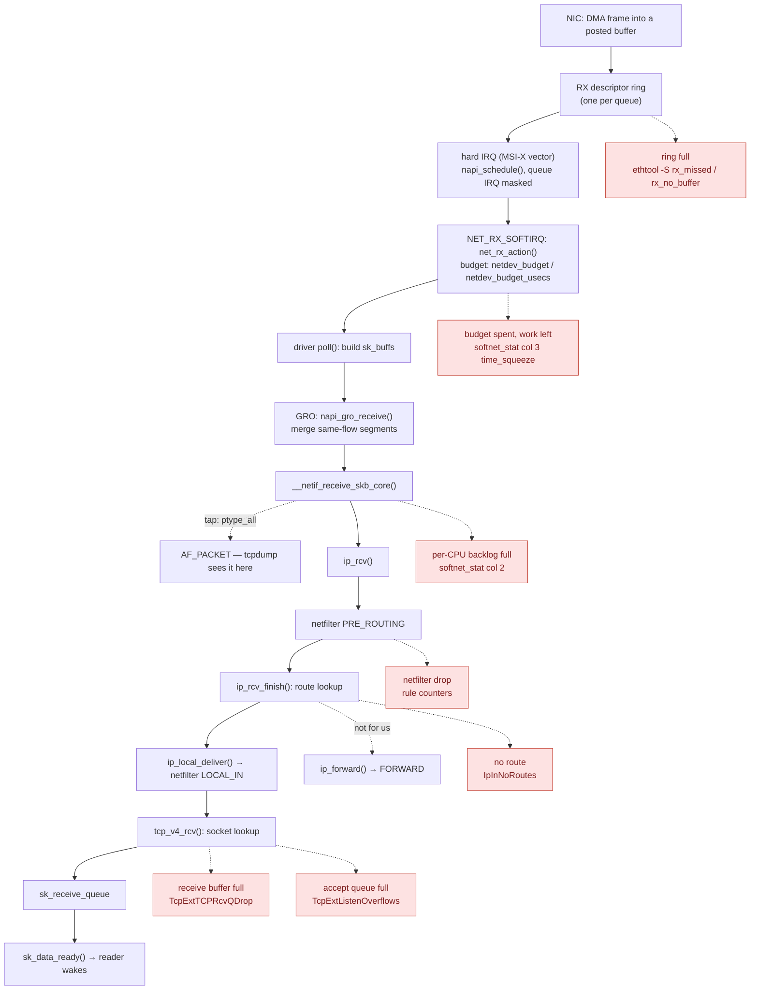

# The Receive Path

A busy NIC can deliver a million packets a second, and handling each one with its own interrupt would
spend the whole machine on interrupt entry and exit. So Linux takes one interrupt, turns that queue's
interrupt off, and *polls* the device from a softirq until the ring is empty or a budget runs out. That's
NAPI. While polling, it merges segments of the same flow into larger packets (GRO), passes them up through
the device layer, IP and TCP in batches, and finally wakes the reader. This page follows one TCP segment
along that path and marks every place it can be dropped, with the counter that records each drop.



*Every stage of receiving a TCP segment, the context each runs in (hard IRQ, then softirq, then the woken
task), and the counter that records a drop at each. `time_squeeze` is drawn with the drops because it is
read alongside them, but it counts deferred work, not lost packets — see the trap below.*

## From wire to ring

Before any packet arrives, the driver *pre-posts* empty buffers into a receive descriptor ring: a circular
array in memory the NIC can read, where each descriptor holds the DMA address of one empty buffer. When a
frame arrives, the NIC writes it directly into the next posted buffer, marks that descriptor done, and
moves on, without involving the CPU. The DMA API that makes those addresses safe belongs to the
device-drivers material in a later folder. What matters here is that a ring has a fixed number of slots.
If the CPU doesn't take frames out and post fresh buffers fast enough, the NIC has nowhere to put the next
frame and drops it in hardware. That drop is visible only in the driver's own counters (`ethtool -S`), and
their names vary by driver.

Modern NICs have several receive queues, each with its own ring and its own MSI-X interrupt vector. The NIC
hashes each packet's flow (addresses and ports) to pick a queue — receive-side scaling, or **RSS** — so one
flow always lands on one queue, and different flows spread across them. Which CPU each queue's interrupt
is delivered to is the
[interrupt affinity layer](../10-interrupts-time-and-deferred-work/interrupt-affinity-and-balancing.md);
this page picks up once the interrupt fires.

## NAPI: interrupt once, then poll

The driver's interrupt handler does almost nothing. It calls <Src file="include/linux/netdevice.h"
symbol="napi_schedule" /> on the queue's <Src file="include/linux/netdevice.h" symbol="napi_struct" />, which
puts it on this CPU's poll list in its <Src file="include/linux/netdevice.h" symbol="softnet_data" /> and
raises `NET_RX_SOFTIRQ`. It also masks the queue's interrupt. From here the device doesn't interrupt again;
the kernel comes to it.

The [softirq](../10-interrupts-time-and-deferred-work/softirqs.md) runs <Src file="net/core/dev.c"
symbol="net_rx_action" />, which calls each scheduled queue's `poll` function with a weight (usually 64
packets). The driver's `poll` takes completed descriptors off the ring, wraps each buffer in an
[`sk_buff`](./sk-buff.md), passes it up, and refills the ring. Two limits stop a softirq from monopolising
the CPU:

- `net.core.netdev_budget` — packets per `net_rx_action` run across all queues (300 here);
- `net.core.netdev_budget_usecs` — time per run (8000 µs here).

If a `poll` call uses less than its weight, the ring is empty: the driver calls `napi_complete_done` and
unmasks the interrupt. If it uses its whole weight, the queue stays on the poll list and is polled again.
If the run's budget is exhausted with work still waiting, `net_rx_action` increments `time_squeeze` and
re-raises the softirq for later. Under sustained load, that later run may happen in `ksoftirqd`.

**Threaded NAPI** (`echo 1 > /sys/class/net/<dev>/threaded`; `0` on this machine's `eth0`) moves each
queue's polling out of softirq context into its own kernel thread, `napi/<dev>-<id>`. Those threads are
ordinary schedulable tasks with a priority and CPU affinity, the same trade the
[threaded IRQs](../10-interrupts-time-and-deferred-work/threaded-irqs.md) page describes for interrupt
handlers.

## GRO

Before the stack sees a packet, `poll` hands it to <Src file="include/linux/netdevice.h"
symbol="napi_gro_receive" />. At v6.18 that is a static inline wrapper that calls <Src
file="net/core/gro.c" symbol="gro_receive_skb" /> on the NAPI instance's GRO state. Generic receive
offload holds packets for the duration of one poll and merges consecutive segments of the same flow into
one large `sk_buff`, chaining the extra payload as fragments. TCP then processes one 64 KB "segment"
instead of 44 MSS-sized ones, so the per-packet costs — the socket lookup, netfilter, the ACK decision —
are paid once.

GRO merges only what it can merge without changing the packet's meaning. A segment that arrives out of
order, carries different TCP options or flags (a `PSH`, a changed timestamp), or belongs to a different
flow ends the current merge. Lossy or reordered traffic therefore gets little benefit. On a router, GRO
must undo itself on the way out: the merged packet has to be split back into wire-sized segments before
transmission (GSO, on [the transmit path](./the-transmit-path.md)), which is work a pure forwarder
wouldn't otherwise do.

## Up through the device layer

GRO's output goes to `netif_receive_skb` → <Src file="net/core/dev.c" symbol="__netif_receive_skb_core" />,
which delivers the packet in a fixed order:

1. **Taps first.** Every handler registered on `ptype_all` gets the packet — that's where an `AF_PACKET`
   socket, and therefore `tcpdump`, sees it. This is *before* netfilter and before any socket. `tcpdump`
   shows you what reached the host, not what reached the application.
2. **VLAN untagging**, then the device's **rx handler**, if it has one. A port enslaved to a bridge, bond
   or macvlan has one, and that handler can consume the packet into the virtual device.
3. **The protocol handler** for the packet's ethertype — `ip_rcv` for IPv4.

Loopback traffic enters here by a different door. It has no ring and no device interrupt:
`loopback_xmit` calls `__netif_rx`, which puts the `sk_buff` on the *sending* CPU's per-CPU backlog
(`enqueue_to_backlog`). NAPI's built-in `process_backlog` then polls it from there. The backlog has a
length limit (`net.core.netdev_max_backlog`), and overflowing it is the drop counted in `softnet_stat`'s
second column. The same backlog is where RPS (below) sends packets it moves between CPUs.

## IP and the first routing decision

<Src file="net/ipv4/ip_input.c" symbol="ip_rcv" /> checks the header (version, length, checksum) and runs
the packet through the `NF_INET_PRE_ROUTING` netfilter hook. Connection tracking and destination NAT
happen there, which is why NAT must be decided before routing. <Src file="net/ipv4/ip_input.c"
symbol="ip_rcv_finish" /> then makes the routing decision:

- **For this host:** <Src file="net/ipv4/ip_input.c" symbol="ip_local_deliver" /> reassembles fragments,
  runs `NF_INET_LOCAL_IN`, and hands the packet to the transport protocol — `tcp_v4_rcv`.
- **For someone else:** <Src file="net/ipv4/ip_forward.c" symbol="ip_forward" />, through the `FORWARD`
  hook, and out [the transmit path](./the-transmit-path.md).
- **For nowhere:** dropped and counted as `IpInNoRoutes`.

The hooks are the subject of [netfilter and nftables](./netfilter-and-nftables.md); the routing decision
is [routing and neighbours](./routing-and-neighbours.md).

## TCP and the socket

<Src file="net/ipv4/tcp_ipv4.c" symbol="tcp_v4_rcv" /> validates the segment and looks up the socket by its
four-tuple — a listener if it's a SYN for a listening port, an established socket otherwise. Then it checks
who holds the socket:

- **A user task holds the socket lock** (it's inside `recvmsg` or `sendmsg` at that moment). The softirq
  can't touch the socket's state, so `tcp_add_backlog` parks the segment on the socket's backlog. The task
  processes the backlog itself when it releases the lock. The backlog has a byte limit; exceeding it is a
  drop (`TcpExtTCPBacklogDrop`).
- **Nobody holds it.** `tcp_v4_do_rcv` → <Src file="net/ipv4/tcp_input.c" symbol="tcp_rcv_established" />
  runs. Its fast path handles the common case (in-order data on an established connection) in a few
  dozen instructions: it queues the data on `sk_receive_queue`, schedules an ACK, and calls
  `sk_data_ready`.

What `sk_data_ready` wakes, and how `epoll` hears about it, is the subject of
[sockets in the kernel](./sockets-in-the-kernel.md#blocking-and-waking). When and how the ACK goes out is
[TCP in the kernel](./tcp-in-the-kernel.md).

## Steering: RSS, RPS, RFS

Three mechanisms decide which CPU does this work. They stack:

| Mechanism | Done by | Spreads by | Configured with |
|---|---|---|---|
| **RSS** — receive-side scaling | the NIC, in hardware | flow hash → RX queue → that queue's IRQ CPU | `ethtool -X` (indirection table), IRQ affinity |
| **RPS** — receive packet steering | the kernel, in software, early in the receive softirq | flow hash → CPU, by putting the `sk_buff` on that CPU's backlog | `/sys/class/net/<dev>/queues/rx-<N>/rps_cpus` (a CPU bitmask) |
| **RFS** — receive flow steering | the kernel, on top of RPS | the CPU where the *reading thread* last ran | `net.core.rps_sock_flow_entries` plus per-queue `rps_flow_cnt` |

RSS needs a multi-queue NIC. RPS gives a single-queue NIC (or a virtual device) the same spreading in
software, at the cost of an inter-processor interrupt to start the other CPU's backlog. Neither knows
where the application is. RFS fixes that: `recvmsg` records which CPU the reading thread runs on in a
global flow table, and RPS steers that flow's packets there, so the softirq and the reader share a cache.
`net.core.rps_sock_flow_entries` is `0` here, so RFS is off — the default. Where interrupts themselves
land is the [interrupt affinity layer](../10-interrupts-time-and-deferred-work/interrupt-affinity-and-balancing.md);
this table is the network-specific steering above it.

## Where packets are dropped

| Drop point | Context | Counter |
|---|---|---|
| RX ring full — no posted buffer | NIC hardware | `ethtool -S <dev>`: driver-specific, e.g. `rx_missed_errors`, `rx_no_buffer_count`, `rx_fifo_errors` |
| Per-CPU backlog full (RPS, loopback, non-NAPI drivers) | softirq | `/proc/net/softnet_stat` column 2 |
| Budget exhausted with work left — *deferred, not dropped* | softirq | `/proc/net/softnet_stat` column 3, `time_squeeze` |
| Netfilter `drop` verdict | softirq | the rule's own counter (`nft list ruleset` with `counter`) |
| No route | softirq | `IpInNoRoutes` |
| Socket receive buffer full | softirq | `TcpExtTCPRcvQDrop`, `UdpRcvbufErrors` |
| Socket backlog full (lock held by user) | softirq | `TcpExtTCPBacklogDrop` |
| Accept queue full | softirq | `TcpExtListenOverflows` (and `TcpExtListenDrops`) |

The `/proc/net/softnet_stat` format at v6.18 is one row per CPU of hexadecimal columns. Column 1 is
packets processed, 2 dropped, 3 `time_squeeze`, 10 packets received by RPS, 11 flow-limit drops, 12
current backlog length, and 13 the CPU number. Columns 4–9 are retired fields kept as zeros so old
parsers keep working.

Counters tell you *how many*. Since the drop-reason work, every drop also says *why*. The kernel frees a
dropped packet through <Src file="include/linux/skbuff.h" symbol="kfree_skb_reason" /> (at v6.18 an inline
wrapper over `sk_skb_reason_drop`), passing a value from <Src file="include/net/dropreason-core.h"
symbol="skb_drop_reason" /> — `SKB_DROP_REASON_SOCKET_RCVBUFF`, `SKB_DROP_REASON_NETFILTER_DROP`, and
about a hundred more. The `skb:kfree_skb` tracepoint fires with that reason and the code location, so a
tracer can say "these 12 packets were dropped because the socket buffer was full, in `tcp_v4_rcv`"
instead of inferring it from counters. The observability folder covers the tools that read the
tracepoint.

## What actually happens

**Run for real on this machine (WSL2, kernel `6.18.33.2-microsoft-standard-WSL2`, 8 CPUs), checked
2026-10-26.** This machine has no root, `perf` or `bpftrace`, so a `kprobe:tcp_v4_rcv` per-CPU count isn't
possible here. What any user can read is `/proc/softirqs`, `/proc/net/softnet_stat`, `ps -o psr` (the CPU
a thread last ran on), and `nstat`. The workload: `python3 -m http.server 8090` on loopback and 500
sequential `curl` requests to it, sampling the server's CPU every 50 requests.

```text
server psr samples:   5   5   5   5   0   0   1   1   3   3

                    CPU0       CPU1       CPU2       CPU3       CPU4       CPU5       CPU6       CPU7
      NET_RX:       5683       2879       8093       6027       7487       1840       4021       3870   # before
      NET_RX:       6544       3784       9035       7010       8378       2714       5028       4765   # after
NET_RX delta per CPU: [861, 905, 942, 983, 891, 874, 1007, 895]

softnet cpu0: processed+652 dropped+0 time_squeeze+0
softnet cpu1: processed+597 dropped+0 time_squeeze+0
softnet cpu2: processed+737 dropped+0 time_squeeze+0
softnet cpu3: processed+793 dropped+0 time_squeeze+0
softnet cpu4: processed+736 dropped+0 time_squeeze+0
softnet cpu5: processed+707 dropped+0 time_squeeze+0
softnet cpu6: processed+817 dropped+0 time_squeeze+0
softnet cpu7: processed+754 dropped+0 time_squeeze+0

$ nstat     # host-wide deltas over the same interval, receive-side lines
IpInReceives                    5799               0.0
TcpInSegs                       5799               0.0
TcpExtTCPRcvCoalesce            499                0.0
```

Reading it against the path above:

1. **Receive ran on every CPU, and the server didn't stay put.** The server thread was seen on CPUs 5, 0,
   1 and 3. `NET_RX` softirqs ran on all eight, almost evenly (861–1007 each). On loopback the receive
   softirq runs on the CPU that *sent* the packet: `loopback_xmit` puts it on the sender's own backlog.
   So each request was received on whichever CPU `curl` happened to run on, and each response on the
   server's CPU at that moment.
2. **`NET_RX` climbs, `softnet_stat` agrees, nothing was dropped.** The eight `softnet_stat` rows processed
   5,793 packets between them, within six of the host's 5,799 `IpInReceives` — the counters were read
   a moment apart, so a few packets landed between the two snapshots. `NET_RX` softirqs number more than packets, because a softirq can be
   raised and find no work left. Columns 2 and 3 stayed at zero: a `curl` loop is nowhere near enough to
   fill a backlog or exhaust a 300-packet budget.
3. **The wakeup crossed CPUs.** A wakeup happens on the CPU that ran the softirq. The server was always on
   one CPU while receive work was spread across all eight, so most of its wakeups came from a different
   CPU. That's the cache-unfriendly pattern RFS exists to fix, and RFS is off here
   (`rps_sock_flow_entries = 0`).

`TcpExtTCPRcvCoalesce` (499, one per request) counts a different merge: TCP appending a new segment's
data onto the last `sk_buff` already in the receive queue. Unlike GRO, it happens after the socket lookup.

## Misconceptions

1. **"One packet, one interrupt."** Under load it is one interrupt per poll cycle. After `napi_schedule`
   the queue's interrupt stays masked while `net_rx_action` drains up to `netdev_budget` packets, and on
   loopback there is no device interrupt at all.
2. **"`tcpdump` shows what my application received."** `tcpdump` taps in `__netif_receive_skb_core`, before
   netfilter and before any socket. It shows packets the firewall then dropped, and packets a full
   receive buffer then discarded.
3. **"Receive processing runs on my application's CPU."** It runs where the interrupt (RSS), RPS, or — on
   loopback — the sender put it. The capture above shows receive work on all eight CPUs while the server
   used four. Only RFS steers it towards the reader.

<KernelFacts
  structure={[["struct napi_struct", "include/linux/netdevice.h"], ["struct softnet_data", "include/linux/netdevice.h"]]}
  path="irq → napi_schedule() → net_rx_action() → driver poll → napi_gro_receive() → __netif_receive_skb_core() → ip_rcv() → tcp_v4_rcv() → sk_data_ready()"
  observe="cat /proc/net/softnet_stat; grep NET_RX /proc/softirqs; nstat -az TcpExtTCPRcvQDrop TcpExtListenOverflows"
  trap="A rising `time_squeeze` column in `/proc/net/softnet_stat` means `net_rx_action` ran out of budget with packets still waiting — not that packets were dropped. The drops, if any, show up later in the ring or backlog counters, so raising `netdev_budget` fixes one and not the other." />

## References

- [NAPI](https://docs.kernel.org/networking/napi.html) — the kernel's own description of the NAPI contract,
  budgets and weights, and threaded mode.
- [Scaling in the Linux Networking Stack](https://docs.kernel.org/networking/scaling.html) — RSS, RPS, RFS
  and XPS in detail, with every sysfs and sysctl knob this page names.
- Damato, [*Monitoring and Tuning the Linux Networking Stack: Receiving Data*](https://blog.packagecloud.io/monitoring-tuning-linux-networking-stack-receiving-data/)
  (packagecloud, 2016) — the exhaustive driver-to-socket walk with every counter explained. It's from
  2016, so function names have moved: `napi_gro_receive` is now a wrapper, `softnet_stat` gained columns.
  Check names against v6.18.
- LWN, [*Better visibility into packet-dropping decisions*](https://lwn.net/Articles/885729/) (2022) — why
  `kfree_skb_reason` was added and how the tracepoint reports a reason. The current list of reasons is
  <Src file="include/net/dropreason-core.h" />.
