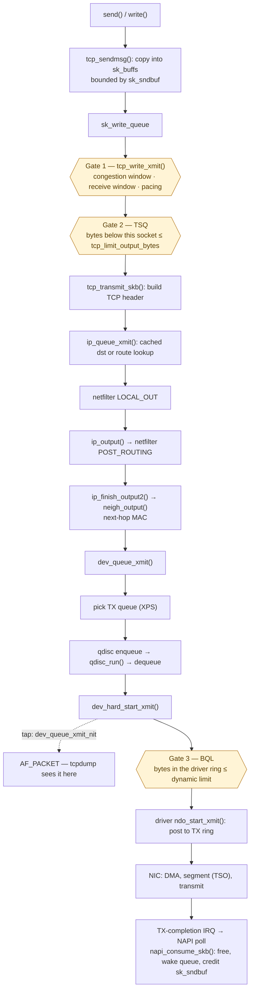

# The Transmit Path

When `send()` returns, your bytes have been accepted into a socket buffer — nothing more. From there the
kernel:

1. cuts them into segments;
2. picks a route and a next-hop address;
3. queues them in a queueing discipline;
4. hands them to a driver, which DMAs them to the NIC;
5. frees them only when the NIC confirms they were transmitted.

The receive path is mostly about keeping up. The transmit path is mostly about *holding back*. Several of
its stages exist only to limit how much data sits queued below the socket, because on the transmit side
excess buffering is a latency bug, not a throughput feature.



*Transmitting a TCP segment, with the three gates — congestion control, TSQ, and BQL — that decide how
much is allowed to queue at each level.*

## From `send()` into TCP

`send` on a TCP socket reaches `tcp_sendmsg` (declared in `include/net/tcp.h`). It copies the user's bytes
into [`sk_buff`](./sk-buff.md)s appended to `sk_write_queue`, filling the tail `sk_buff` up to a size-goal
before starting a new one. Every byte copied is charged to the socket's send buffer. When
`sk_wmem_queued` reaches `sk_sndbuf`, a blocking sender sleeps on the socket's wait queue until
completions free memory — the same mechanism as the receive side, described in
[sockets in the kernel](./sockets-in-the-kernel.md#buffers-and-accounting). `MSG_ZEROCOPY` and `sendfile`
avoid the copy: the `sk_buff`s reference the user's or the page cache's pages as fragments instead.

Data in the write queue isn't on the wire yet. At the end of `tcp_sendmsg`, `tcp_push` calls <Src
file="net/ipv4/tcp_output.c" symbol="tcp_write_xmit" />, which decides how much may leave *now*:

- the **congestion window**, TCP's estimate of what the network can carry;
- the **receive window**, what the peer said it can accept;
- **pacing**, which spreads a window's worth of segments over a round-trip time instead of sending them
  in one burst.

Each segment that passes goes to <Src file="net/ipv4/tcp_output.c" symbol="tcp_transmit_skb" />, which
clones it — the original stays on the write queue until it's acknowledged, for retransmission — builds the
TCP header, and passes it to IP. Where the windows come from is [TCP in the kernel](./tcp-in-the-kernel.md).

## Segmentation offload

TCP doesn't cut its data into MTU-sized segments. It builds "super-packets" of up to 64 KB, with the
segment size recorded in the shared info (`skb_shinfo(skb)->gso_size`), and passes them down as one
`sk_buff`. The packet is cut as late as possible:

- **TSO** (TCP segmentation offload): the NIC does it in hardware, copying the TCP/IP header onto each
  piece and fixing up sequence numbers, lengths and checksums.
- **GSO** (generic segmentation offload): the NIC can't, so the kernel does it in software with <Src
  file="include/net/gso.h" symbol="skb_gso_segment" />, just before the driver. That's later than TCP
  would, so the whole stack still handles one large packet instead of 44 small ones.

**Checksum offload** is the same idea for checksums: `skb->ip_summed = CHECKSUM_PARTIAL` tells the driver
"the TCP checksum still needs computing, starting at `csum_start`," and the NIC fills it in.

This machine's NIC is a Hyper-V synthetic adapter (`hv_netvsc` driver, WSL2), and it offers both:

```text
$ ethtool -k eth0 | grep -E 'segmentation|checksum'
rx-checksumming: on
tx-checksumming: on
	tx-checksum-ipv4: on
	tx-checksum-ipv6: on
tcp-segmentation-offload: on
	tx-tcp-segmentation: on
	tx-tcp6-segmentation: on
generic-segmentation-offload: on
```

The trap in this page's `KernelFacts` follows from that. `tcpdump` on the *sender* taps the packet in the
device layer, before the NIC segments it. A capture there shows 64 KB "packets" that never existed on the
wire, and checksums that look wrong because the NIC hadn't written them yet.

## IP, routing, and the neighbour

<Src file="include/net/ip.h" symbol="ip_queue_xmit" /> needs a route. A connected TCP socket keeps the
result of its last lookup in `sk_dst_cache` and reuses it until the routing table changes, so most
segments skip the lookup. With the route in hand, it fills in the IP header and passes the packet through
the `NF_INET_LOCAL_OUT` hook. <Src file="include/net/ip.h" symbol="ip_output" /> then runs
`NF_INET_POST_ROUTING`, where source NAT happens.

<Src file="net/ipv4/ip_output.c" symbol="ip_finish_output2" /> turns the route's next-hop *IP* address
into a *MAC* address through the neighbour table: <Src file="include/net/neighbour.h"
symbol="neigh_output" /> either writes the cached hardware header straight in front of the packet, or —
if the neighbour isn't resolved yet — queues the packet and sends an ARP request first. The routing
decision and the neighbour state machine are [routing and neighbours](./routing-and-neighbours.md); the
hooks are [netfilter and nftables](./netfilter-and-nftables.md).

## The device layer and the qdisc

`dev_queue_xmit` → <Src file="net/core/dev.c" symbol="__dev_queue_xmit" /> is the device-layer entry. It
does four things in order:

1. **Picks a transmit queue.** A multi-queue NIC has one TX ring per queue. **XPS** (transmit packet
   steering) maps CPUs to queues, so a CPU sends on a queue it owns and doesn't contend a lock with other
   CPUs.
2. **Enqueues on that queue's qdisc.** `__dev_xmit_skb` calls the queueing discipline's `enqueue`. The
   qdisc decides ordering and what to drop — the subject of [traffic control](./traffic-control.md).
3. **Runs the qdisc.** `qdisc_run` dequeues packets and calls `sch_direct_xmit`, which calls <Src
   file="net/core/dev.c" symbol="dev_hard_start_xmit" />. That function first copies the packet to any
   `AF_PACKET` taps (`dev_queue_xmit_nit`). So `tcpdump` sees outgoing packets *after* the qdisc and
   *before* the driver.
4. **Calls the driver.** `ndo_start_xmit` posts the packet's buffers to the TX descriptor ring and rings
   the NIC's doorbell.

When the driver's ring is full, the driver *stops* the queue (`netif_tx_stop_queue`), and packets wait in
the qdisc until completions free ring slots. Virtual devices such as `veth` and `lo` have no ring and use
`noqueue`: `dev_queue_xmit` calls the driver directly.

## Keeping queues short: TSQ and BQL

A fast sender can fill every queue below it — a 1,000-packet qdisc, a driver ring with thousands of
slots — and each queued packet adds delay to everything behind it. That's **bufferbloat**: a large buffer
doesn't add throughput once the link is saturated; it adds latency, for every flow sharing the queue. Two
mechanisms push back:

- **TCP Small Queues (TSQ)** limits how many bytes one socket may have queued *below* TCP — in the
  qdisc and the driver ring — before `tcp_write_xmit` stops and waits for completions. The limit is
  `net.ipv4.tcp_limit_output_bytes` (4194304 here), and since pacing arrived it's scaled down further to
  about a millisecond's worth at the current rate (`tcp_small_queue_check` in
  `net/ipv4/tcp_output.c`).
- **Byte Queue Limits (BQL)** sizes the *driver ring's* usable depth in bytes, dynamically: just enough
  to keep the NIC busy between completion interrupts, and no more. The driver reports bytes sent and
  completed (`netdev_tx_sent_queue`, `netdev_tx_completed_queue`), and the kernel adjusts the limit. Its
  state is under `/sys/class/net/<dev>/queues/tx-<N>/byte_queue_limits/`.

Together they move queueing *up*, out of the driver ring (where it can only be FIFO) into the qdisc
(where `fq_codel` can keep it short and fair). BQL only works if the driver implements it, and this
machine's doesn't:

```text
$ grep -H . /sys/class/net/eth0/queues/tx-0/byte_queue_limits/*
/sys/class/net/eth0/queues/tx-0/byte_queue_limits/hold_time:1000
/sys/class/net/eth0/queues/tx-0/byte_queue_limits/inflight:0
/sys/class/net/eth0/queues/tx-0/byte_queue_limits/limit:0
/sys/class/net/eth0/queues/tx-0/byte_queue_limits/limit_max:1879048192
/sys/class/net/eth0/queues/tx-0/byte_queue_limits/limit_min:0
/sys/class/net/eth0/queues/tx-0/byte_queue_limits/stall_cnt:0
/sys/class/net/eth0/queues/tx-0/byte_queue_limits/stall_max:0
/sys/class/net/eth0/queues/tx-0/byte_queue_limits/stall_thrs:0
```

`limit` and `inflight` stay at 0 under traffic because `hv_netvsc` never calls the BQL accounting
functions — neither `netvsc.c` nor `netvsc_drv.c` mentions them at v6.18. On a physical NIC with BQL
(`e1000e`, `ixgbe`, `mlx5` and most others), `limit` moves while traffic flows.

## Completion

The NIC signals that it has sent a batch of descriptors, usually through the same interrupt and NAPI
instance that handles receive. In its poll function, the driver walks the completed TX descriptors,
unmaps their DMA buffers, and frees each `sk_buff` with <Src file="include/linux/skbuff.h"
symbol="napi_consume_skb" />, which returns it to a per-CPU cache in batches instead of freeing them one
by one. Three things follow:

- the driver reports the completed bytes to BQL;
- if the queue was stopped and now has room, it is woken, and the qdisc runs again;
- the `sk_buff`'s destructor uncharges it from its socket's write memory — the event that wakes a sender
  blocked on `sk_sndbuf`, and that lets TSQ release the next batch.

Only the *clone* is freed here. TCP's original `sk_buff` stays on the write queue until the peer's ACK
arrives, because TCP might have to send it again.

## Misconceptions

1. **"`send()` returning means the data was sent."** It means the data was copied into the socket's send
   buffer. On [traffic control](./traffic-control.md#classful-qdiscs-and-filters) a sender rate-limited to
   10 Mbit/s counted 15.7 Mbit/s of successful `send()` calls, because the first megabytes went into its
   buffer, not onto the link.
2. **"Bigger transmit queues (`txqueuelen`) improve throughput."** Once the link is busy, a longer queue
   only adds delay for every flow sharing it. BQL, TSQ and `fq_codel` exist because shorter queues behave
   better.
3. **"TSO means the NIC implements TCP."** The NIC only cuts already-built segments and fills in their
   headers. All TCP state — sequence numbers, windows, retransmission, congestion control — stays in the
   kernel.

<KernelFacts
  structure={[["struct Qdisc", "include/net/sch_generic.h"], ["struct netdev_queue", "include/linux/netdevice.h"]]}
  path="tcp_sendmsg() → tcp_write_xmit() → tcp_transmit_skb() → ip_queue_xmit() → ip_finish_output2() → neigh_output() → dev_queue_xmit() → dev_hard_start_xmit() → ndo_start_xmit()"
  observe="ethtool -k eth0 | grep -E 'segmentation|checksum'; grep -H . /sys/class/net/eth0/queues/tx-0/byte_queue_limits/*"
  trap="`tcpdump` on a sending host shows the giant pre-segmentation packets that TSO/GSO hand to the driver, not what went on the wire. A 64 KB 'packet' in a capture is not an MTU problem — capture on the receiver or a mirror port to see the real frames." />

## References

- [Segmentation Offloads](https://docs.kernel.org/networking/segmentation-offloads.html) — TSO, GSO,
  checksum offload and their variants, defined by the kernel's own documentation.
- [Scaling in the Linux Networking Stack](https://docs.kernel.org/networking/scaling.html) — XPS, the
  transmit half of CPU steering, with its sysfs knobs.
- LWN, [*TCP small queues*](https://lwn.net/Articles/507065/) (2012) and
  [*Network transmit queue limits*](https://lwn.net/Articles/454390/) (2011) — the design reasoning
  behind TSQ and BQL, written when each was merged.
- <Src file="net/core/dev.c" symbol="__dev_queue_xmit" /> — the device-layer transmit entry: queue
  selection, qdisc handoff, and the `noqueue` shortcut for virtual devices.
