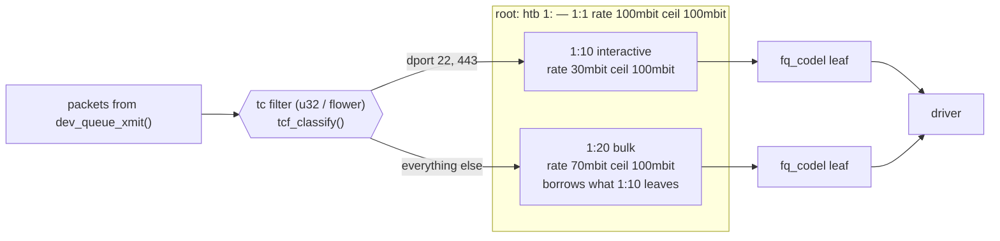

# Traffic Control and qdiscs

Every transmit queue has a queueing discipline — a *qdisc* — in front of it, and the qdisc decides three
things: which packet goes next, how long packets may wait, and which ones are dropped when there are too
many. That choice decides whether one busy upload makes every other connection on the machine lag.
Traffic control (`tc`) is the subsystem that lets you choose the discipline, build hierarchies of them,
and sort traffic between them.

## Where the qdisc sits

On [the transmit path](./the-transmit-path.md#the-device-layer-and-the-qdisc), `dev_queue_xmit` picks a
TX queue and calls that queue's qdisc's `enqueue`. `qdisc_run` later calls its `dequeue` and passes the
packet to the driver. A qdisc is a <Src file="include/net/sch_generic.h" symbol="Qdisc" /> instance whose
behaviour comes from a table of operations, <Src file="include/net/sch_generic.h" symbol="Qdisc_ops" />:
`enqueue`, `dequeue`, `peek`, plus `init`/`change`/`dump` for configuration. Everything on this page is
some implementation of that table.

When a device comes up, `dev_activate` attaches default qdiscs (`attach_default_qdiscs` in
`net/sched/sch_generic.c`):

- a device with no queue of its own (`IFF_NO_QUEUE` — `veth`, `dummy`, `lo` in a fresh namespace) gets
  `noqueue`: packets go straight to the driver;
- a single-queue device gets the default qdisc;
- a multi-queue device gets `mq` at the root, which does no scheduling, with one default qdisc per TX
  queue under it.

"The default" has two layers. The kernel's compiled-in default is `pfifo_fast` (`default_qdisc_ops` in
`net/sched/sch_generic.c` at v6.18). systemd ships a `sysctl.d` file that sets `net.core.default_qdisc =
fq_codel`, and most distributions keep it. But the sysctl is only read when a qdisc is *attached*. This
machine (Ubuntu 26.04 under WSL2, systemd 259) shows the gap:

```text
$ grep -rn default_qdisc /usr/lib/sysctl.d/
/usr/lib/sysctl.d/50-default.conf:48:-net.core.default_qdisc = fq_codel
/usr/lib/sysctl.d/55-bufferbloat.conf:8:-net.core.default_qdisc = fq_codel

$ sysctl -n net.core.default_qdisc
fq_codel

$ tc qdisc show dev eth0
qdisc mq 0: root
qdisc pfifo_fast 0: parent :8 bands 3 priomap 1 2 2 2 1 2 0 0 1 1 1 1 1 1 1 1
qdisc pfifo_fast 0: parent :7 bands 3 priomap 1 2 2 2 1 2 0 0 1 1 1 1 1 1 1 1
...                                                      # six more, one per TX queue
```

The sysctl says `fq_codel`, but `eth0` runs `pfifo_fast` on all eight queues. WSL2 brings the virtual NIC
up before `systemd-sysctl` runs, so the device was activated while the compiled-in default still applied.
The fix is to re-attach after boot (`tc qdisc replace dev eth0 root fq_codel`, or bring the device down
and up). Check what a device *actually* runs with `tc qdisc show`, not what the sysctl says.

## Classless qdiscs

A classless qdisc is one queue with one policy:

| qdisc | How it orders and drops | What it optimises | Typical use |
|---|---|---|---|
| `pfifo_fast` | three FIFO bands by the packet's priority; strict priority between bands; tail-drop at `txqueuelen` | nothing — it's the simplest thing that works | compiled-in default |
| `fq` | a queue per flow, round-robin between them, **with pacing** — each flow released at its socket's pacing rate | fairness and smooth sending for a host's own TCP flows | hosts sending with BBR, which expects pacing |
| `fq_codel` | a queue per flow (1024 hashed buckets), round-robin, with CoDel dropping in each queue (target 5 ms, interval 100 ms — the RFC 8290 defaults) | low latency under load; one bulk flow can't starve the others | systemd's default, and a good general default |
| `cake` | `fq_codel`-style queues plus a built-in shaper, per-host fairness, and awareness of link overheads (DSL, DOCSIS) | a home router's uplink in one qdisc | edge routers |
| `noqueue` | no queue at all — `enqueue` passes the packet straight to the driver | nothing to manage | virtual devices with no TX ring |

The `fq_codel` defaults on this kernel, read from a fresh instance:

```text
$ tc qdisc add dev lo root fq_codel && tc qdisc show dev lo
qdisc fq_codel 8001: root refcnt 2 limit 10240p flows 1024 quantum 65550 target 5ms interval 100ms memory_limit 32Mb ecn drop_batch 64
```

## Why CoDel works

Older active queue management dropped packets based on how *many* were queued. But queue length is the
wrong signal. A queue of 1,000 packets that drains in a millisecond is harmless; a queue of 50 that never
drains is a permanent 50-packet delay. CoDel ("controlled delay") measures what the user actually feels:
each packet's **sojourn time**, how long it waited in the queue.

If the minimum sojourn time over an `interval` (100 ms) stays above `target` (5 ms), the queue isn't
draining — there's a **standing queue** — and CoDel starts dropping, or ECN-marking, packets, faster and
faster until the delay falls back under target. A burst that arrives and drains quickly never triggers
it, because some packet in the interval saw a short wait. TCP senders see the drops, shrink their
congestion windows, and the standing queue goes away.

That's why CoDel, and not smaller buffers, is the fix for bufferbloat. A small buffer drops the bursts
that legitimately need absorbing; CoDel absorbs bursts and removes only the queue that persists.
`fq_codel` adds per-flow queues on top, so a bulk download's standing queue doesn't sit in front of your
interactive SSH packets.

## Classful qdiscs and filters

A **classful** qdisc has *classes*: children it can sort packets into, each with its own rules and its own
leaf qdisc. The usual one is `htb` (hierarchical token bucket):

- each class has a `rate` (guaranteed) and a `ceil` (the most it may borrow up to);
- a class under its rate sends freely; a class over its rate may *borrow* unused rate from its parent, up
  to its `ceil`;
- leaves end in their own qdisc — by default a `pfifo`, better an `fq_codel`.

**Filters** decide which class a packet goes to. A filter is a <Src file="include/net/sch_generic.h"
symbol="tcf_proto" /> attached to a qdisc or class, and the qdisc runs its chain with <Src
file="net/sched/cls_api.c" symbol="tcf_classify" />. The common classifiers are `u32` (match header fields
at offsets), `flower` (match named fields: addresses, ports, VLAN), `fw` (match the firewall mark that an
nftables rule set), and `bpf` (run an eBPF program).



*An htb hierarchy that guarantees interactive traffic a rate, lets bulk traffic borrow what is left, and
manages each queue's latency with fq_codel.*

A real cap, tried in a private network namespace (`unshare -rn`, so only that namespace's `lo` is
affected): limit everything sent to TCP port 9000 to 10 Mbit/s and leave the rest effectively unlimited.

```bash
tc qdisc add dev lo root handle 1: htb default 20 r2q 1000
tc class add dev lo parent 1: classid 1:10 htb rate 10mbit
tc class add dev lo parent 1: classid 1:20 htb rate 10gbit
tc filter add dev lo parent 1: protocol ip prio 1 u32 match ip dport 9000 0xffff flowid 1:10
```

Two senders ran for four seconds at the same time, one to each port:

```text
port 9000: receiver measured     10.2 Mbit/s   sender's own estimate     15.7 Mbit/s
port 9001: receiver measured   9101.6 Mbit/s   sender's own estimate   8096.5 Mbit/s

$ tc -s class show dev lo classid 1:10
class htb 1:10 root prio 0 rate 10Mbit ceil 10Mbit burst 1600b cburst 1600b
 Sent 5488552 bytes 89 pkt (dropped 0, overlimits 47 requeues 0)
 backlog 66b 1p requeues 0
 lended: 49 borrowed: 0 giants: 0
 tokens: -1637803 ctokens: -1637803
```

The receiver on port 9000 got 10.2 Mbit/s, the configured rate. The sender to port 9000 thought it had
done 15.7 Mbit/s, because its first few megabytes went into its socket buffer, not through the shaper.
`overlimits 47` counts the times the class had to hold a packet back, and `tokens` is negative because the
class is in debt to its bucket. (`r2q 1000` only silences a warning about the default quantum at a
10 Gbit/s rate.)

## Shaping versus policing

There are two ways to enforce a rate:

- **Shaping** *delays* excess traffic: packets wait in a queue until the rate allows them. The output is
  smooth and nothing is lost, but queueing adds latency. That's what `htb` does.
- **Policing** *drops* excess traffic as it arrives. It's instant and needs no queue, but it's lossy, and
  TCP reacts to the loss by backing off.

You can shape only what you *send*, because shaping needs a queue you control before the bottleneck. By
the time a packet arrives at your NIC it has already crossed the link, so there's nothing to delay —
ingress can only be policed. The workaround is IFB (intermediate functional block): an ingress filter
redirects arriving packets to a virtual `ifb0` device, and an `htb` on `ifb0`'s egress shapes them. TCP
senders then see the delay and slow down, which is the effect you wanted.

## Ingress and clsact

Received packets also pass a `tc` hook: after the driver and GRO, before the protocol handler, in
`__netif_receive_skb_core` on [the receive path](./the-receive-path.md#up-through-the-device-layer). A
device gets that hook by adding the `ingress` qdisc, or `clsact`, which provides both an ingress and an
egress attach point. It isn't a real queue — nothing waits there. It's a place to attach filters and
actions: police, drop, mark, redirect to another device.

`clsact` is also where eBPF programs attach to the traffic-control layer (`tc filter add dev eth0 ingress
bpf ...`). That attach point is how container networking and load balancers rewrite and redirect packets
without netfilter, and it is covered in the eBPF folder.

## netem, for testing

`netem` is a qdisc that makes a network *worse* on purpose: delay, jitter, loss, duplication, reordering,
rate limits. It's how you reproduce a 200 ms mobile link on a laptop. Again in a private namespace:

```text
$ ping -c3 -q 127.0.0.1
rtt min/avg/max/mdev = 0.019/0.020/0.022/0.001 ms

$ tc qdisc add dev lo root netem delay 100ms
$ ping -c3 -q 127.0.0.1
rtt min/avg/max/mdev = 200.038/200.065/200.104/0.027 ms
```

The round trip went up by 200 ms, not 100. On `lo` the echo request *and* the reply both leave through
`lo`'s egress, so both are delayed. On a real interface only your outgoing direction would be. Remove it
with `tc qdisc del dev lo root`. Common variants are `delay 100ms 20ms` (jitter), `loss 1%`, and
`reorder 25% 50%`.

:::warning
Never try `netem`, `htb`, or a policer for the first time on the interface you're logged in through. A
`loss 100%` or a mistyped rate on a remote machine's only interface cuts off your own SSH session, and
the only way back is console access. Use `lo` in a private namespace (`unshare -rn`), a `veth` pair, or a
VM — the examples above all ran that way.
:::

<KernelFacts
  structure={[["struct Qdisc_ops", "include/net/sch_generic.h"], ["struct tcf_proto", "include/net/sch_generic.h"]]}
  path="dev_queue_xmit() → __dev_xmit_skb() → q->enqueue() → qdisc_run() → dequeue_skb() → sch_direct_xmit()"
  observe="tc -s qdisc show dev eth0 && sysctl net.core.default_qdisc"
  trap="A rate limit set with `tc` on a server's egress does nothing about how fast it *receives*; ingress can only be policed (dropped), not shaped. Limiting download speed needs a policer on ingress, or shaping on the far side of the link." />

## References

- [tc(8)](https://man7.org/linux/man-pages/man8/tc.8.html), with
  [tc-fq_codel(8)](https://man7.org/linux/man-pages/man8/tc-fq_codel.8.html),
  [tc-htb(8)](https://man7.org/linux/man-pages/man8/tc-htb.8.html),
  [tc-cake(8)](https://man7.org/linux/man-pages/man8/tc-cake.8.html) and
  [tc-netem(8)](https://man7.org/linux/man-pages/man8/tc-netem.8.html) — the command reference for every
  qdisc on this page, with each parameter's default.
- [RFC 8290](https://www.rfc-editor.org/rfc/rfc8290), *The Flow Queue CoDel Packet Scheduler and Active
  Queue Management Algorithm* — fq_codel's specification, and the source of the 5 ms / 100 ms defaults.
- Gettys & Nichols, [*Bufferbloat: Dark Buffers in the Internet*](https://doi.org/10.1145/2063166.2071893),
  ACM Queue 9(11), 2011 — the paper that named the problem this subsystem's modern defaults fix.
- [Bufferbloat.net CoDel wiki](https://www.bufferbloat.net/projects/codel/wiki/) — CoDel and cake project
  documentation with measurements. Some pages are years old; check the date before relying on a number.
