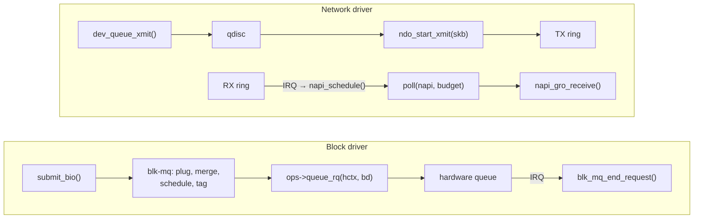

# Block and Network Driver Shapes

A character driver handles one call at a time, on behalf of one open file. Block and network
drivers handle **queues**:

- the block layer hands a block driver `struct request`s through blk-mq;
- the network stack hands a network driver `sk_buff`s through `ndo_start_xmit`, and expects the
  driver to deliver received packets by NAPI polling.

Neither kind of driver has a `read` or `write` function. Neither sees a file descriptor. This page
describes both shapes in enough detail to read either kind of driver. The block-layer and network
folders own the machinery the drivers plug into.

## The block shape

A blk-mq driver describes its hardware queues and hands the block layer a table of callbacks
(<Src file="include/linux/blk-mq.h" symbol="blk_mq_ops" />). The skeleton, in the order a driver's
`probe` builds it:

1. **A tag set.** `struct blk_mq_tag_set` says how many hardware queues the device has
   (`nr_hw_queues`), how deep each is (`queue_depth`), how many bytes of driver-private data to
   allocate alongside each request (`cmd_size`), and which `blk_mq_ops` to use.
   `blk_mq_alloc_tag_set()` preallocates every request and tag.
2. **Queue limits.** A `struct queue_limits` gives the device's logical block size, maximum transfer
   size, segment limits and so on.
3. **A disk.** `blk_mq_alloc_disk(set, &lim, queuedata)` creates the request queue and the
   `gendisk` together. **In v6.18 it takes the `queue_limits` argument**; tutorials written before
   that change call it with two arguments, and set limits afterwards with functions that are gone.
4. **Registration.** `add_disk()` makes `/dev/<name>` appear. As with `cdev_add()`, the device is
   live from that moment.

The data path is then one callback. The block layer calls **`queue_rq(hctx, bd)`** with a request
(`bd->rq`) already merged, scheduled and tagged. The driver:

1. calls `blk_mq_start_request(rq)`;
2. turns the request's segments into the hardware's command format, usually by DMA-mapping its
   scatterlist;
3. submits the command to the hardware queue matching `hctx`, and returns `BLK_STS_OK`, or
   `BLK_STS_RESOURCE` to ask the block layer to retry later.

Completion is asynchronous. When the hardware finishes, typically signalled by a per-queue
interrupt, the driver calls `blk_mq_end_request(rq, status)`, or `blk_mq_complete_request()` to
defer the work to the submitting CPU. The waiting task is woken from there.

The smallest real example is **null_blk** (<Src file="drivers/block/null_blk/main.c"
symbol="null_queue_rq" />): a block device with no hardware, whose `queue_rq` completes requests
immediately or after a timer. It exists to benchmark the block layer, and is the best one to read
first. [blk-mq](../12-block-layer-and-storage/blk-mq.md) owns the queueing model, and
[NVMe in the Kernel](../12-block-layer-and-storage/nvme-in-the-kernel.md) shows a real device's
`queue_rq`.

## The network shape

A network driver allocates a `struct net_device` (`alloc_etherdev()` for Ethernet), fills in
<Src file="include/linux/netdevice.h" symbol="net_device_ops" />, and calls `register_netdev()`,
after which the interface appears in `ip link`. The callbacks that define its shape:

- **`ndo_open` / `ndo_stop`** run on `ip link set up/down`. `ndo_open` allocates and fills the
  receive ring, requests interrupts, enables NAPI, and starts the transmit queue with
  `netif_start_queue()`.
- **`ndo_start_xmit(skb, dev)`** is the transmit path. The stack calls it, in softirq or process
  context with the queue's lock held, for every packet. The driver DMA-maps the `sk_buff`'s data and
  fragments, writes descriptors, rings the doorbell, and returns `NETDEV_TX_OK`. It **must not
  sleep**. It must also **stop the queue** (`netif_stop_queue()`) *before* the ring is full, so the
  stack stops sending, and wake it from the transmit-completion path once space frees up.
- **NAPI `poll(napi, budget)`** is the receive path. The receive interrupt does almost nothing: it
  masks the queue's interrupt and calls `napi_schedule()`. The kernel later calls the driver's
  `poll` function in softirq context. It harvests up to `budget` received packets from the ring,
  builds `sk_buff`s, passes them up with `napi_gro_receive()`, refills the ring, and, if it ran out
  of work before the budget, calls `napi_complete_done()` and unmasks the interrupt. The NAPI
  context is set up with `netif_napi_add()`.

[The Receive Path](../13-networking-stack/the-receive-path.md) and
[The Transmit Path](../13-networking-stack/the-transmit-path.md) own what happens on either side of
these callbacks. A small real example is the **veth** driver (`drivers/net/veth.c`), whose
`veth_xmit()` hands each packet straight to its peer. `virtio_net` is a full one: real rings, NAPI,
and multiple queues.



*The two queue-driven shapes. A block driver receives finished requests and completes them later; a
network driver receives packets to send, and polls for packets to receive.*

## Side by side

| | Character driver | Block driver | Network driver |
|---|---|---|---|
| Unit of work | A `read`/`write`/`ioctl` call on a file | A `struct request` (one or more `bio`s, merged) | An `sk_buff` (one packet, possibly with fragments) |
| Entry point | `file_operations` | `blk_mq_ops.queue_rq` | `net_device_ops.ndo_start_xmit`, NAPI `poll` |
| Context | Process context of the caller; may sleep | Usually process context, but must not block on the hardware | Softirq or process context; must not sleep |
| Completion | Return from the call | Asynchronous: `blk_mq_end_request()` | TX: free the `sk_buff` after the hardware is done. RX: hand packets up from `poll` |
| Flow control | The caller simply blocks | Tags and `BLK_STS_RESOURCE` | `netif_stop_queue()` / `netif_wake_queue()`, BQL |
| User-visible object | `/dev/<node>` | `/dev/<disk>`, `/sys/block/<disk>` | An interface: `ip link`, `/sys/class/net/<if>` |
| Small real example to read | `drivers/char/mem.c` (`/dev/null`, `/dev/zero`) | `drivers/block/null_blk/` | `drivers/net/veth.c` |

The queue structure is visible from user space. On the folder-01 Debian VM, the virtio disk has four
blk-mq hardware queues, one per vCPU. The virtio network device has one queue pair:

```text
$ uname -r
6.12.113+deb13-cloud-amd64
$ ls /sys/block/vda/mq/
0  1  2  3
$ cat /sys/block/vda/mq/*/cpu_list
0
1
2
3
$ sudo ethtool -l ens3 | sed -n '/Current/,$p'
Current hardware settings:
RX:		n/a
TX:		n/a
Other:		n/a
Combined:	1
```

<KernelFacts
  structure={[["struct blk_mq_ops", "include/linux/blk-mq.h"], ["struct net_device_ops", "include/linux/netdevice.h"]]}
  path="block: blk_mq_dispatch_rq_list() / __blk_mq_issue_directly() → q->mq_ops->queue_rq() · net: dev_hard_start_xmit() → xmit_one() → netdev_start_xmit() → ops->ndo_start_xmit()"
  observe="ls /sys/block/*/mq; cat /sys/block/*/mq/*/cpu_list; ethtool -l <if>"
  trap="`ndo_start_xmit` must not sleep, and it must stop the queue (`netif_stop_queue()`) before the ring is full. A driver that routinely returns `NETDEV_TX_BUSY` instead has a bug, not flow control: the stack requeues the packet and spins." />

## References

- [Multi-Queue Block IO Queueing Mechanism (blk-mq)](https://docs.kernel.org/block/blk-mq.html) —
  the tag set, hardware and software queues, and the dispatch path a block driver plugs into.
- [Network Devices, the Kernel, and You!](https://docs.kernel.org/networking/netdevices.html) — the
  `net_device_ops` contract, including locking and context rules for `ndo_start_xmit`.
- [Softnet Driver Issues](https://docs.kernel.org/networking/driver.html) — the transmit-side
  rules: stop the queue before the ring fills, and why `NETDEV_TX_BUSY` is a bug.
- [NAPI](https://docs.kernel.org/networking/napi.html) — the polling model, budgets, and the
  interrupt masking protocol from the driver's side.
- <Src file="drivers/block/null_blk/main.c" symbol="null_queue_rq" /> — the simplest complete
  `queue_rq`, with no hardware in the way.
