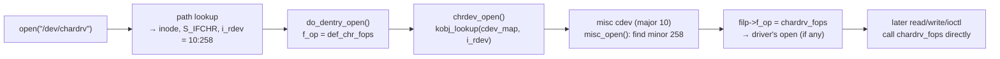

# Character Devices

A character device is the simplest complete driver shape: a device number that leads to a
`file_operations` table. `open`, `read`, `write` and `ioctl` on a `/dev` node land directly in
driver functions. Everything [Superblock, Inode, Dentry, File](../11-vfs-and-filesystems/the-four-objects.md)
says about `struct file` applies unchanged. The only new piece is how the kernel gets from a device
number to the right table. This page covers that piece, the misc-device shortcut most small drivers
should use, and where the `/dev` node itself comes from.

## Device numbers

A device is identified by a `dev_t`: a **major** number and a **minor** number packed into 32 bits
(12 bits of major, 20 of minor; `MAJOR()`, `MINOR()` and `MKDEV()` split and join them).
Historically the major chose the driver and the minor chose one device among that driver's
devices. That is still the model, though majors are now usually allocated dynamically:

- **`alloc_chrdev_region(&dev, first_minor, count, name)`** asks for an unused major and a range of
  minors. Use it for new drivers.
- **`register_chrdev_region(dev, count, name)`** claims a specific, known range. Use it only for
  numbers fixed in `Documentation/admin-guide/devices.txt`.

`/proc/devices` lists registered majors. On the folder-01 Debian VM:

```text
$ head -12 /proc/devices
Character devices:
  1 mem
  4 /dev/vc/0
  4 tty
  4 ttyS
  5 /dev/tty
  5 /dev/console
  5 /dev/ptmx
  7 vcs
 10 misc
 13 input
 21 sg
```

## `struct cdev` and `cdev_add`

The number alone does nothing. A <Src file="include/linux/cdev.h" symbol="cdev" /> connects a
range of device numbers to a `file_operations` table:

```c
cdev_init(&priv->cdev, &demo_fops);
priv->cdev.owner = THIS_MODULE;
ret = cdev_add(&priv->cdev, priv->devt, 1);
```

`cdev_add()` inserts the range into the kernel's `cdev_map`. **From that moment the device is
live**: any process that opens a node with that number reaches `demo_fops` immediately, even if the
rest of `probe` has not finished. `cdev_add()` should therefore come last, after everything the
file operations depend on is ready.

When a process opens a device node, the VFS sees an inode with a device type and an `i_rdev`, and
installs the generic `def_chr_fops`, whose `open` is
<Src file="fs/char_dev.c" symbol="chrdev_open" />. That function looks `i_rdev` up in `cdev_map`
(`kobj_lookup()`), finds the driver's `cdev`, **replaces `filp->f_op` with the driver's own
table**, and calls the driver's `open`. Every later `read`, `write` and `ioctl` on that file goes
straight to the driver, with no device-number lookup.



*How opening a device node finds the driver. The lookup happens once, at `open`, after which the
file's operations table simply is the driver's.*

## `file_operations` for a device

A device driver fills only the members it needs. The ones that matter most:

| Member | Called for | Notes |
|---|---|---|
| `owner` | — | Set to `THIS_MODULE`, so the module can't unload while a file is open |
| `open` / `release` | `open()`, last `close()` | Per-open state goes in `filp->private_data` |
| `read` / `write` | `read()`, `write()` | Copy with `copy_to_user`/`copy_from_user`; update `*ppos` |
| `unlocked_ioctl` | `ioctl()` | Device-specific commands; see the lab for numbering |
| `compat_ioctl` | `ioctl()` from 32-bit processes | `compat_ptr_ioctl` if the arguments need no translation |
| `llseek` | `lseek()` | `noop_llseek` for stream devices, `fixed_size_llseek` for buffers |
| `poll` | `poll`/`select`/`epoll` | Report readiness, and register on a wait queue |
| `mmap` | `mmap()` | Map device memory or a kernel buffer into the process |

Each `open()` gets its own `struct file`, so per-open state (a read position, a selected channel)
belongs in `filp->private_data`, not in a global. Device-wide state lives in the driver's
per-device structure, reachable from the `cdev` with `container_of`.

## The misc-device shortcut

Most small drivers need exactly one device node. For them, the **misc** subsystem replaces the
whole number-allocation and `cdev` dance with one structure:

```c
static struct miscdevice demo_misc = {
	.minor	= MISC_DYNAMIC_MINOR,
	.name	= "demo",		/* becomes /dev/demo */
	.fops	= &demo_fops,
};

ret = misc_register(&demo_misc);
```

Every misc device shares **major 10**, owned by `drivers/char/misc.c`. `MISC_DYNAMIC_MINOR` asks for
a free minor; v6.18 allocates dynamic minors above 255. `misc_register()` also creates the class
device (`/sys/class/misc/demo`), so the `/dev` node appears automatically. A driver with nothing
else to do in init and exit can reduce the whole registration to `module_misc_device(demo_misc);`,
as the [lab](./lab-a-character-driver.md) does.

| | `cdev` + `alloc_chrdev_region` | `miscdevice` |
|---|---|---|
| Major number | Its own, allocated dynamically | Shared major 10 |
| Number of nodes | Any range of minors | One per `miscdevice` |
| Boilerplate | Region, `cdev_init`/`cdev_add`, class, `device_create` | One struct and one call |
| `/dev` node | Only if the driver creates a class device | Automatic |
| Use when | Many devices or nodes per driver (tty, input, sound) | A single control or data node |

## Where `/dev` nodes come from

The kernel does not need `/dev` to exist. It needs an inode with the right device number. Nodes are
created in two layers:

- **devtmpfs.** When a driver registers a class device with a device number (`device_create()`, or
  `misc_register()` doing it internally), the kernel itself creates the node in **devtmpfs**, a
  kernel-maintained `tmpfs` mounted on `/dev`. The node gets a default name and mode, and exists
  before any user-space daemon runs. That is why the folder-01 initramfs, with no udev at all, gets
  `/dev/chardrv` as soon as the module loads.
- **udev.** On a full system, `systemd-udevd` receives the uevent for the same device and applies
  rules: permissions and group, persistent symlinks (`/dev/disk/by-id/…`), and renames. See
  [Firmware, udev, and Hotplug](./firmware-udev-and-hotplug.md).

`mknod` by hand still works for any number, but a node made that way is not removed when the driver
goes away.

## Classes

A driver with its own major makes its nodes appear by creating a **class** and a class device per
node:

```c
demo_class = class_create("demo");
device_create(demo_class, parent, priv->devt, priv, "demo%d", idx);
```

In v6.18, `class_create()` takes only the name. Older kernels and most tutorials pass
`THIS_MODULE` as the first argument; that form no longer compiles. Drivers that can define the
class statically use `class_register()` on a `const struct class` instead.

<KernelFacts
  structure={[["struct cdev", "include/linux/cdev.h"], ["struct miscdevice", "include/linux/miscdevice.h"]]}
  path="open(/dev/x) → do_dentry_open() → def_chr_fops.open = chrdev_open() → kobj_lookup(cdev_map, i_rdev) → filp->f_op = driver fops → driver open()"
  observe="cat /proc/devices; ls -l /dev/null /dev/kmsg; ls /sys/class/misc"
  trap="Calling `cdev_add()` (or `misc_register()`) before the device is ready makes it live immediately. User space can `open()` it on the very next instruction, before the rest of `probe` has run." />

## References

- [Char device registration](https://docs.kernel.org/core-api/kernel-api.html#char-devices) — the
  kernel-doc for `alloc_chrdev_region()`, `cdev_add()` and friends.
- <Src file="fs/char_dev.c" symbol="chrdev_open" /> — the lookup that turns a device number into a
  driver's `file_operations`, in about forty lines.
- <Src file="drivers/char/misc.c" symbol="misc_register" /> — the misc subsystem: one major, a
  minor allocator, and automatic class devices.
- [Linux allocated devices](https://docs.kernel.org/admin-guide/devices.html) — the registry of
  fixed major and minor numbers.
- Corbet, Rubini & Kroah-Hartman, *Linux Device Drivers*, 3rd ed. (2005), ch. 3 "Char Drivers" — the
  classic walk-through; the registration API is the same, while the class and ioctl details are
  dated.
