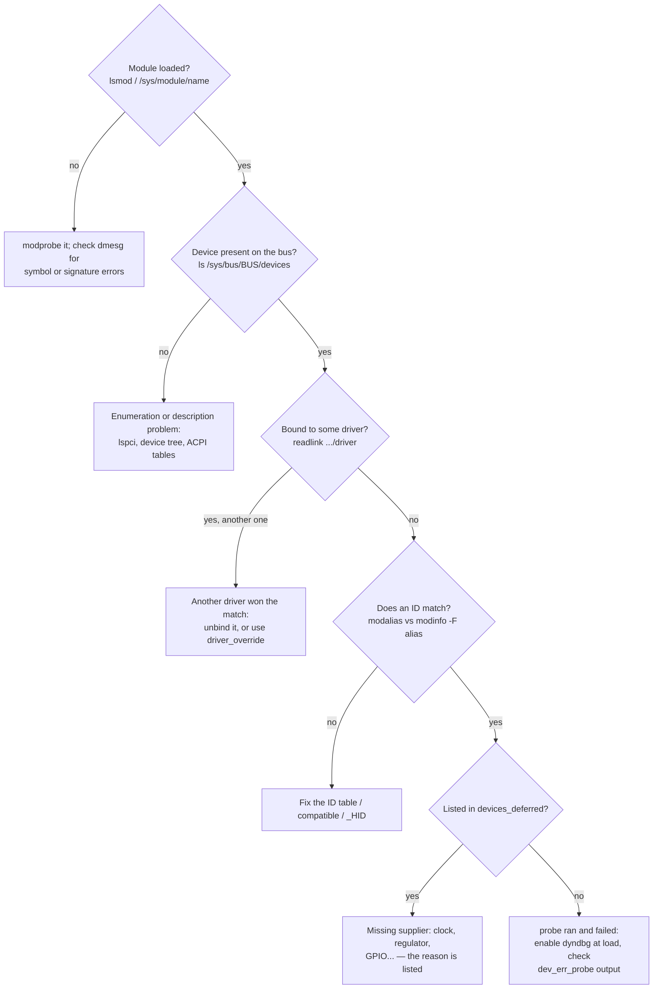

# Debugging Drivers

Driver bugs are hard to see because a driver runs where debuggers are least comfortable: in
interrupt context, inside `probe` during boot, and on paths that run only when the hardware
misbehaves. The toolkit is a short sequence:

1. make the driver talk, without rebuilding it (dynamic debug);
2. watch its functions without editing it (ftrace);
3. check it bound at all (the device model's own state);
4. read a crash or warning back to a source line (`faddr2line`, `decode_stacktrace.sh`).

This page applies each tool to the `chardrv` module from the
[character-driver lab](./lab-a-character-driver.md), on the folder-01 v6.18 lab kernel.

## Dynamic debug

`pr_debug()` and `dev_dbg()` are free to leave in production code. On a kernel built with
`CONFIG_DYNAMIC_DEBUG` (most distribution kernels), each call becomes an entry in a table of **call
sites**, disabled by default, costing one patched-out branch each. They can be switched on at run
time, per module, file, function or line, through `/proc/dynamic_debug/control`:

```bash
echo 'module chardrv +p' > /proc/dynamic_debug/control     # every call site in the module
echo 'func chardrv_write +p' > /proc/dynamic_debug/control  # one function
echo 'file chardrv.c line 61 +p' > /proc/dynamic_debug/control
```

They can also be enabled at load time, which catches messages from `probe` that run before anyone
could write to the control file:

- `insmod chardrv.ko dyndbg=+p`, or the same in `/etc/modprobe.d/`;
- `chardrv.dyndbg=+p` on the kernel command line, for a built-in driver.

Prefer `dev_dbg(dev, …)` over `pr_debug()` in drivers. It prefixes the message with the driver and
device name, so the output says *which* device. A `pr_debug()` message carries the module name only
if the file defines `pr_fmt`, as `chardrv.c` does. Without that define, its messages appear in the
log with no prefix at all, and grepping for the driver's name finds nothing.

## ftrace scoped to a module

The function tracer can be limited to one module's functions with the `:mod:` filter. The
`function_graph` tracer then shows each call, nested, with its duration:

```bash
cd /sys/kernel/tracing
echo ':mod:chardrv' > set_ftrace_filter
echo function_graph > current_tracer
echo 1 > tracing_on
```

The lab's [ftrace section](./lab-a-character-driver.md#watching-it-with-ftrace) shows the output.
Two variations that matter in driver work:

- `echo 1 > options/func_stack_trace` with the plain `function` tracer records *who called* each
  function. That is how the lab identified the unexpected `ioctl` as the shell's own.
- A **kprobe event** records a function's arguments without rebuilding anything:
  `echo 'p:chio chardrv_ioctl cmd=%si:x32' > kprobe_events` captured the ioctl command number in
  the same lab.

Folder 17 of this section will own ftrace and kprobes in depth. Folder 01's
[Debugging the Kernel with GDB](../01-lab-and-toolchain/debugging-the-kernel-with-gdb.md) is the
interactive alternative.

## A probe that never fires

The most common driver "bug" is a driver whose `probe` never runs. Nothing crashes and, often,
nothing is logged.



*The order to check when a device stays unbound. Each question rules out one layer of
[the device model](./the-linux-device-model.md).*

The deferred list was empty in the lab VM:

```text
$ cat /sys/kernel/debug/devices_deferred
$
```

On an embedded board it is usually the first file to read.

## debugfs for your driver

A driver can expose its internal state for developers under `/sys/kernel/debug/<driver>/`:

```c
priv->dbg = debugfs_create_dir(dev_name(dev), NULL);
debugfs_create_u32("irq_count", 0444, priv->dbg, &priv->irq_count);
debugfs_create_file("regs", 0444, priv->dbg, priv, &demo_regs_fops);
…
debugfs_remove_recursive(priv->dbg);	/* in remove */
```

debugfs functions are designed so that callers don't check their return values: if debugfs is
absent, they return error pointers that the other debugfs calls accept and ignore. A register dump
in debugfs is often the single most useful thing a hardware driver can offer its own developers. It
is never an interface for tools (see [Talking to User Space](./talking-to-user-space.md)).

## From an oops or a warning to a source line

Kernel warnings and oopses identify code as `function+offset/length [module]`. Two scripts in the
kernel tree turn that into a file and line, given the module built with debug information:

- **`scripts/faddr2line <module.ko or vmlinux> func+0xoff/0xlen`** decodes one address;
- **`scripts/decode_stacktrace.sh vmlinux [module-dir]`** reads a whole pasted trace on stdin and
  annotates every frame.

Reading an oops in depth — registers, the `Code:` line, taint flags — belongs to folder 17 of this
section; the lab below shows the decoding step.

## Five driver bugs

The [memory-safety catalogue in folder 04](../04-kernel-architecture-and-idioms/memory-safety-in-kernel-c.md)
lists the bug classes of kernel C in general. These five are the driver-specific shapes they
usually take:

| Bug | Symptom | Tool that finds it |
|---|---|---|
| **Use-after-free after `remove`**: a timer, workqueue item or open file still uses the freed per-device structure | Crash minutes after unbind or unplug, in an unrelated-looking place | KASAN; unbind/rebind loops in testing |
| **Sleeping in atomic context**: `mutex_lock()`, `kmalloc(GFP_KERNEL)` or `msleep()` in an interrupt handler, or under a spinlock | `BUG: sleeping function called from invalid context`, or a rare deadlock | `CONFIG_DEBUG_ATOMIC_SLEEP`, lockdep |
| **DMA ownership violation**: CPU touches a buffer the device owns, or a missing unmap | Stale data on non-coherent hardware; leaks and warnings at unload | `CONFIG_DMA_API_DEBUG` ([The DMA API](./the-dma-api.md)) |
| **Unbalanced runtime-PM counts**: a `get` with no `put` on an error path | Device never suspends; battery drain; or the opposite, a device powered off while in use | `power/runtime_status`, and `power/runtime_usage` in sysfs (with `CONFIG_PM_ADVANCED_DEBUG`) |
| **Managed resource released too late**: a `devm_request_irq()` interrupt still live after `remove` freed what its handler uses | Use-after-free in the handler, only when an interrupt arrives during unbind | KASAN; free the IRQ explicitly in `remove` |

The last row is the price of `devm_`'s convenience: managed resources are released *after* `remove`
returns.

## Lab: dynamic debug, then a lock bug found by lockdep

<Lab host="qemu" title="Turn on chardrv's debug messages, then let lockdep find a deliberate bug" time="20 min">

Uses the `chardrv` module and the folder-01 initramfs VM, booted with the lab kernel. That kernel
was built with `CONFIG_DYNAMIC_DEBUG` and `CONFIG_PROVE_LOCKING` (lockdep) enabled on top of the
folder-01 debug options; check with `grep -E 'DYNAMIC_DEBUG|PROVE_LOCKING' .config` in the kernel
tree.

**Part 1 — dynamic debug.** Load the module with its debug messages enabled, exercise it, and turn
them off again:

```bash
mount -t debugfs none /sys/kernel/debug
insmod /chardrv.ko dyndbg=+p
grep chardrv /proc/dynamic_debug/control
printf hello > /dev/chardrv
cat /dev/chardrv
dmesg | grep chardrv
echo 'module chardrv -p' > /proc/dynamic_debug/control
grep chardrv /proc/dynamic_debug/control
rmmod chardrv
```

Measured (`uname -r`: `6.18.0`):

```text
[    3.616914] chardrv: loading out-of-tree module taints kernel.
+ grep chardrv /proc/dynamic_debug/control
chardrv.c:37 [chardrv]chardrv_read =p "read %zu bytes, pos now %lld\n"
chardrv.c:61 [chardrv]chardrv_write =p "wrote %zu bytes, length now %zu\n"
+ printf hello
+ cat /dev/chardrv
hello
+ dmesg | grep chardrv
[    3.616914] chardrv: loading out-of-tree module taints kernel.
[    3.709250] chardrv: wrote 5 bytes, length now 5
[    3.723400] chardrv: read 5 bytes, pos now 5
+ echo 'module chardrv -p' > /proc/dynamic_debug/control
+ grep chardrv /proc/dynamic_debug/control
chardrv.c:37 [chardrv]chardrv_read =_ "read %zu bytes, pos now %lld\n"
chardrv.c:61 [chardrv]chardrv_write =_ "wrote %zu bytes, length now %zu\n"
```

Each control line names the file, line, module and function of one call site, its flags, and its
format string. `=p` means printing is on; `=_` means no flags, so the call site is silent again.

**Part 2 — a lock leak.** Copy `chardrv.c` and introduce a classic error-path bug in
`chardrv_write()`: return early without releasing the mutex.

```text
-	if (*ppos >= CHARDRV_BUF_SIZE) {
-		ret = -ENOSPC;			/* buffer full */
-		goto out;
-	}
+	if (*ppos >= CHARDRV_BUF_SIZE)
+		return -ENOSPC;			/* BUG: returns with buf_lock held */
```

Build it as `chardrv-broken.ko`, load it, and write one byte at offset 4096, the end of the buffer,
which takes the buggy path:

```bash
insmod /chardrv-broken.ko
dd if=/dev/zero of=/dev/chardrv bs=1 count=1 seek=4096
```

Measured:

```text
[    3.952659] ================================================
[    3.952741] WARNING: lock held when returning to user space!
[    3.953132] 6.18.0 #1 Tainted: G           O
[    3.953234] ------------------------------------------------
[    3.953296] dd/77 is leaving the kernel with locks still held!
[    3.953450] 1 lock held by dd/77:
[    3.953515]  #0: ffffffffc03da108 (buf_lock){+.+.}-{4:4}, at: chardrv_write+0x26/0xe0 [chardrv]
dd: error writing '/dev/chardrv': No space left on device
```

Lockdep checks, on every return to user space, that the task holds no locks
(`lockdep_sys_exit()`), and reports the lock by name and by where it was taken. Without lockdep,
this bug shows nothing at all at the moment it happens. The *next* `write()` or `read()` would
simply hang forever in `mutex_lock()`.

Decode the location on the host, against the broken module's build directory:

```bash
~/kernel-lab/linux/scripts/faddr2line chardrv.ko chardrv_write+0x26/0xe0
```

```text
chardrv_write+0x26/0xe0:
chardrv_write at …/chardrv-broken/chardrv.c:49
```

Line 49 is the `if` immediately after `mutex_lock(&buf_lock)` on line 48. The address lockdep
records is the return address of the lock call, so it lands on the next statement. "Where the lock
was taken" is one line earlier than the decoded line.

**Clean up:** power off the VM (`poweroff -f`); the broken module never existed outside it.

If it fails: no `chardrv:` lines in Part 1 means `CONFIG_DYNAMIC_DEBUG` is off in the lab kernel's
`.config`; enable it and rebuild as in
[Building a Kernel](../01-lab-and-toolchain/building-a-kernel.md). No lockdep warning in Part 2
means `CONFIG_PROVE_LOCKING` is off. `faddr2line` printing `??` means the module was built without
debug information; the folder-01 configuration includes it.

</Lab>

## Misconceptions

1. **"`printk` debugging is primitive."** With dynamic debug, the messages are already in the code,
   cost almost nothing when off, can be turned on per function without a rebuild, and work in
   interrupt context and during boot, where a debugger struggles. Many kernel developers reach for
   them first.
2. **"If `probe` failed, there would be an error in `dmesg`."** A probe that returns
   `-EPROBE_DEFER`, `-ENODEV`, or most other errors is under no obligation to log, and the driver
   core logs failures only at debug level. A device can stay unbound silently.

<KernelFacts
  structure={[["struct _ddebug", "include/linux/dynamic_debug.h"], ["scripts/decode_stacktrace.sh", "scripts/decode_stacktrace.sh"]]}
  path="pr_debug() → dynamic_pr_debug() → DYNAMIC_DEBUG_BRANCH(descriptor) (patched-out jump) → __dynamic_pr_debug() → printk at KERN_DEBUG"
  observe="grep <module> /proc/dynamic_debug/control; sudo cat /sys/kernel/debug/devices_deferred"
  trap="`devm_request_irq()` frees the IRQ *after* `remove` returns. If `remove` freed the memory the handler uses, an interrupt that arrives during unbind is a use-after-free." />

## References

- [Dynamic debug](https://docs.kernel.org/admin-guide/dynamic-debug-howto.html) — the query
  language for `/proc/dynamic_debug/control` and the `dyndbg=` boot and module parameters.
- [Function tracer](https://docs.kernel.org/trace/ftrace.html) — `set_ftrace_filter` with `:mod:`,
  `function_graph`, and stack traces.
- [Bug hunting](https://docs.kernel.org/admin-guide/bug-hunting.html) — going from an oops to a
  source line with `faddr2line` and `decode_stacktrace.sh`.
- [Runtime locking correctness validator](https://docs.kernel.org/locking/lockdep-design.html) —
  what lockdep checks, including held locks on return to user space.
