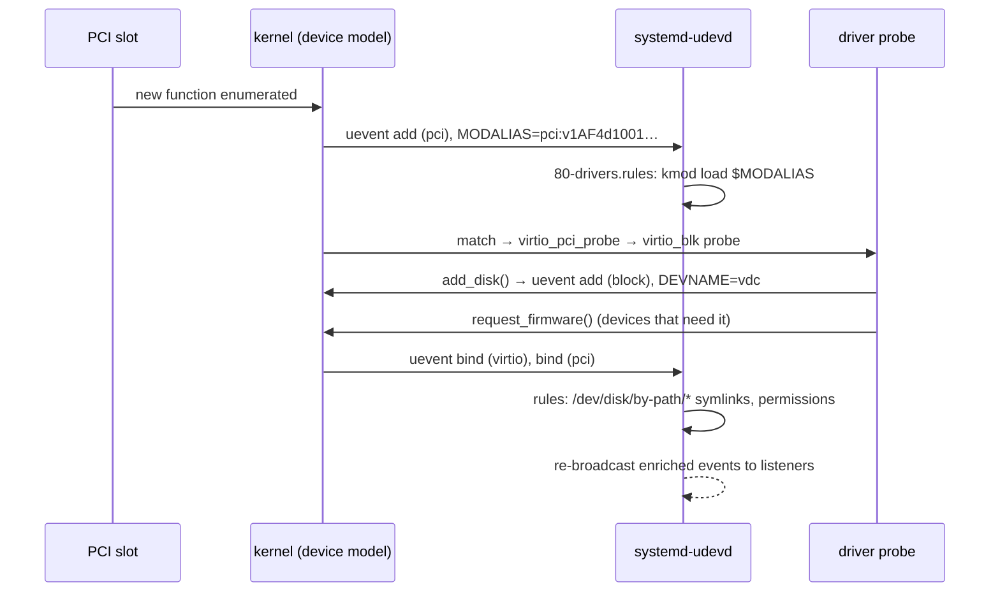

# Firmware, udev, and Hotplug

Every time a device appears, two things happen outside the kernel proper:

- **Firmware.** Many devices (Wi-Fi chips, GPUs, some NICs and storage controllers) are inert until
  a firmware blob is loaded into them. The driver asks for that blob by file name, and the kernel
  reads it from the filesystem.
- **Naming and permissions.** User space has to turn a bare kernel device into something usable: a
  `/dev` node with the right owner and mode, stable symlinks, a predictable network interface
  name, and the right driver module loaded.

The second part runs through **uevents**: notifications from the device model to user space, which
**udev** turns into actions. This page follows one device's arrival through both, using a disk
hot-added to a running VM.

## `request_firmware`

A driver loads firmware from `probe` (or later, when the device is opened):

```c
const struct firmware *fw;

ret = request_firmware(&fw, "vendor/chip-v3.bin", &pdev->dev);
if (ret)
	return dev_err_probe(&pdev->dev, ret, "firmware missing\n");
/* fw->data, fw->size: copy it to the device, e.g. through DMA */
release_firmware(fw);
```

<Src file="drivers/base/firmware_loader/main.c" symbol="request_firmware" /> reads the file
directly from the filesystem, searching in order:

1. the path given by the `firmware_class.path=` boot parameter, if set;
2. `/lib/firmware/updates/$(uname -r)`;
3. `/lib/firmware/updates`;
4. `/lib/firmware/$(uname -r)`;
5. `/lib/firmware`.

With `CONFIG_FW_LOADER_COMPRESS`, it also tries `.zst` and `.xz` versions of each name. Distributions
ship most firmware compressed. The files come from the `linux-firmware` collection, packaged by
distributions (on Debian, the `firmware-*` packages). The folder-01 Debian cloud VM has no firmware
at all: its virtual devices need none.

```text
$ ls /lib/firmware
ls: cannot access '/lib/firmware': No such file or directory
```

Variants exist for other needs:

- `request_firmware_nowait()` loads asynchronously, so `probe` need not block;
- `firmware_request_nowarn()` doesn't log when optional firmware is absent;
- `firmware_request_platform()` also looks in platform firmware tables.

There used to be a fallback where the kernel asked user space to supply the file through sysfs
(`CONFIG_FW_LOADER_USER_HELPER`). It is now rarely enabled, and modern udev refuses those requests
outright. Debian's `50-firmware.rules` contains one line, which cancels any such request the
instant it appears:

```text
SUBSYSTEM=="firmware", ACTION=="add", ATTR{loading}="-1"
```

**The timing trap.** A driver built *into* the kernel probes during boot, possibly before the real
root filesystem is mounted. Its `request_firmware()` then searches the initramfs. If the firmware
isn't in the initramfs, the load fails, and the device stays dead until the driver is reloaded. The
same driver built as a module usually loads later, from the real root, and works. Initramfs
generators copy firmware for modules they include; [Initramfs and Early User Space](../03-boot-and-init/initramfs-and-early-userspace.md)
covers what goes in.

## Uevents

Whenever the device model adds, removes, binds, unbinds or changes a device, it calls
`kobject_uevent()` (<Src file="lib/kobject_uevent.c" symbol="kobject_uevent_env" />). That builds an
**environment block** of `KEY=value` lines: `ACTION`, `DEVPATH`, `SUBSYSTEM`, plus subsystem
additions such as `MODALIAS`, `DEVNAME`, `MAJOR`/`MINOR` and `DRIVER`. The block is broadcast on a
`NETLINK_KOBJECT_UEVENT` socket. Every uevent carries an increasing `SEQNUM`.

Two groups of listeners receive uevents:

- **`systemd-udevd`**, which processes each event through its rules, then re-broadcasts the enriched
  event for other programs;
- any program listening on the kernel's netlink group directly, though almost nothing does. Programs
  subscribe to udev's re-broadcast (through libudev or sd-device) instead, so they see the
  device only after udev has finished preparing it.

## udev rules and naming

udev rules live in `/usr/lib/udev/rules.d/` (distribution) and `/etc/udev/rules.d/` (local, which
wins for the same file name). Files are processed in lexical order. Each rule is a list of **match
keys** (`==`, `!=`) and **assignment keys** (`=`, `+=`). For example:

```text
# /etc/udev/rules.d/70-lab-sensor.rules
SUBSYSTEM=="tty", ATTRS{idVendor}=="0403", ATTRS{serial}=="A9XK2L1Z", \
    SYMLINK+="lab-sensor", MODE="0660", GROUP="dialout"
```

`ATTRS` (plural) searches the device *and its parents* for attributes, which is how a rule for a tty
can match a USB serial number two levels up. `udevadm info -a` prints exactly those keys
([Talking to User Space](./talking-to-user-space.md) shows its output), and `udevadm test
/sys/…` dry-runs the rules for one device.

**Module loading is a rule too.** Debian's `80-drivers.rules` is what turns a device's `MODALIAS`
into a loaded driver:

```text
ACTION!="add", GOTO="drivers_end"

ENV{MODALIAS}=="?*", RUN{builtin}+="kmod load"
…
LABEL="drivers_end"
```

`kmod load` matches the alias against `modules.alias`, which is generated from every module's
`MODULE_DEVICE_TABLE`. That is the end of the chain [PCI and PCIe Drivers](./pci-and-pcie-drivers.md)
started.

**Predictable network interface names.** The kernel names interfaces `eth0`, `eth1`, … in probe
order, which can change between boots. udev's `net_id` builtin computes stable names from the
hardware's position, and a policy picks one of them:

```text
$ udevadm test-builtin net_id /sys/class/net/ens3 2>/dev/null | grep ID_NET_NAME
ID_NET_NAME_MAC=enx525400123456
ID_NET_NAME_PATH=enp0s3
ID_NET_NAME_SLOT=ens3
$ cat /sys/class/net/ens3/name_assign_type
4
```

`en` is Ethernet. `s3` is hotplug slot 3, which firmware reported for PCI device `00:03.0`.
`p0s3` is PCI bus 0, slot 3. `x525400123456` is the MAC address. The default policy prefers the slot
name, so the interface became `ens3`. `name_assign_type` 4 is `NET_NAME_RENAMED`: the kernel created
`eth0`, and user space renamed it.

## Coldplug versus hotplug

A device that appears while the system runs (**hotplug**) generates its uevents in real time. But
most devices appear during early boot, before `systemd-udevd` is running, and their uevents were
broadcast to nobody. **Coldplug** replays them. At startup, `udevadm trigger` (run by
`systemd-udev-trigger.service`) writes `add` into every device's `uevent` file in sysfs, which makes
the kernel re-emit an `add` uevent for each. udev then processes boot-time devices exactly as if
they had just been plugged in. Any device's event can be replayed the same way:
`echo add | sudo tee /sys/class/net/ens3/uevent`.

## What actually happens

Hot-adding a disk to the running folder-01 Debian VM, through the QEMU monitor, shows the whole
sequence. In the VM:

```bash
udevadm monitor --kernel --udev --property --subsystem-match=block \
    --subsystem-match=pci --subsystem-match=virtio
```

On the host, at the QEMU monitor (`-monitor unix:monitor.sock,server,nowait` added to folder 01's
invocation), with a scratch image created by `qemu-img create -f raw hot.img 64M`:

```text
(qemu) drive_add 0 if=none,id=hot0,file=hot.img,format=raw
(qemu) device_add virtio-blk-pci,drive=hot0,id=hotdisk
…
(qemu) device_del hotdisk
```

The monitor output, event headers only (`uname -r`: `6.12.113+deb13-cloud-amd64`, udev 257):

```text
KERNEL[1628.501688] add      /devices/pci0000:00/0000:00:07.0 (pci)
KERNEL[1628.541745] add      /devices/pci0000:00/0000:00:07.0/virtio4 (virtio)
KERNEL[1628.574256] add      /devices/pci0000:00/0000:00:07.0/virtio4/block/vdc (block)
KERNEL[1628.574667] bind     /devices/pci0000:00/0000:00:07.0/virtio4 (virtio)
KERNEL[1628.575599] bind     /devices/pci0000:00/0000:00:07.0 (pci)
UDEV  [1628.613506] add      /devices/pci0000:00/0000:00:07.0 (pci)
UDEV  [1628.621874] add      /devices/pci0000:00/0000:00:07.0/virtio4 (virtio)
UDEV  [1628.666777] add      /devices/pci0000:00/0000:00:07.0/virtio4/block/vdc (block)
UDEV  [1628.671606] bind     /devices/pci0000:00/0000:00:07.0/virtio4 (virtio)
UDEV  [1628.680764] bind     /devices/pci0000:00/0000:00:07.0 (pci)
KERNEL[1636.158624] remove   /devices/pci0000:00/0000:00:07.0/virtio4/block/vdc (block)
UDEV  [1636.187958] remove   /devices/pci0000:00/0000:00:07.0/virtio4/block/vdc (block)
KERNEL[1636.199399] unbind   /devices/pci0000:00/0000:00:07.0/virtio4 (virtio)
KERNEL[1636.199768] remove   /devices/pci0000:00/0000:00:07.0/virtio4 (virtio)
KERNEL[1636.231325] unbind   /devices/pci0000:00/0000:00:07.0 (pci)
UDEV  [1636.231699] unbind   /devices/pci0000:00/0000:00:07.0/virtio4 (virtio)
KERNEL[1636.233588] remove   /devices/pci0000:00/0000:00:07.0 (pci)
UDEV  [1636.233952] remove   /devices/pci0000:00/0000:00:07.0/virtio4 (virtio)
UDEV  [1636.310107] unbind   /devices/pci0000:00/0000:00:07.0 (pci)
UDEV  [1636.312575] remove   /devices/pci0000:00/0000:00:07.0 (pci)
```

And the properties of the disk event, before and after udev's rules ran:

```text
KERNEL[1628.574256] add      /devices/pci0000:00/0000:00:07.0/virtio4/block/vdc (block)
ACTION=add
DEVPATH=/devices/pci0000:00/0000:00:07.0/virtio4/block/vdc
SUBSYSTEM=block
DEVNAME=/dev/vdc
DEVTYPE=disk
DISKSEQ=5
SEQNUM=1777
MAJOR=254
MINOR=32

UDEV  [1628.666777] add      /devices/pci0000:00/0000:00:07.0/virtio4/block/vdc (block)
ACTION=add
…
ID_PATH=pci-0000:00:07.0
ID_PATH_TAG=pci-0000_00_07_0
…
DEVLINKS=/dev/disk/by-diskseq/5 /dev/disk/by-path/pci-0000:00:07.0 /dev/disk/by-path/virtio-pci-0000:00:07.0
TAGS=:systemd:
```

What the sequence shows:

- **Three devices, stacked, for one disk.** The PCI core enumerated a new function in slot 7
  (`pci`). The `virtio-pci` driver registered a virtio device on top of it (`virtio4`).
  `virtio_blk` created the disk (`vdc`). This is the stacking from
  [The Linux Device Model](./the-linux-device-model.md), now visible as events.
- **The disk exists before its driver's `bind` event.** The `block` add comes from inside
  `virtio_blk`'s `probe` (`add_disk()`); the `bind` for `virtio4` is emitted when `probe` returns.
  The PCI `bind` comes last, after `virtio_pci_probe()` finished.
- **The kernel's event is raw; udev's is enriched.** The kernel supplied the device number and a
  name. udev added `ID_PATH` and three `DEVLINKS`, the stable symlinks under `/dev/disk/` that
  `/etc/fstab` should refer to instead of `/dev/vdc`.
- **udev lags by tens of milliseconds** (1628.574 → 1628.666 for the disk): the rules run, the
  symlinks are created, and only then is the event re-broadcast. Programs that listen to udev, not
  the kernel, never see a half-prepared device.
- **Removal runs in reverse**: disk, then the virtio device's unbind and remove, then the PCI
  function. After `device_del`, `lsblk` no longer lists `vdc`, so the VM is back where it started.



*One device's arrival: the kernel announces each layer as it appears, and udev loads drivers,
creates names, then tells everyone else.*

<KernelFacts
  structure={[["struct firmware", "include/linux/firmware.h"], ["kobject_uevent_env", "lib/kobject_uevent.c"]]}
  path="device_add() → kobject_uevent(KOBJ_ADD) → netlink broadcast → systemd-udevd rules → kmod load $MODALIAS → driver probe → request_firmware() → /lib/firmware"
  observe="udevadm monitor --kernel --udev --property; udevadm info -a /sys/class/net/<if>"
  trap="A built-in driver that calls `request_firmware()` before the root filesystem is mounted finds only what is in the initramfs. The symptom is a device that works when its driver is a module and fails when it is built in." />

## References

- [Linux Firmware API](https://docs.kernel.org/driver-api/firmware/index.html) — `request_firmware()`
  and its variants, the search path, and the fallback mechanisms.
- [udev(7)](https://man7.org/linux/man-pages/man7/udev.7.html) — the rules language: every match
  and assignment key, and processing order. The context7 systemd entry returned no udev-rules
  material when checked on 2026-10-26, so the rule syntax here was checked against this man page
  and the rules files shipped on Debian 13.
- [Predictable Network Interface Names](https://systemd.io/PREDICTABLE_INTERFACE_NAMES/) — why
  `eth0` was replaced, and the naming schemes behind `ens3` and `enp0s3`.
- <Src file="drivers/base/firmware_loader/main.c" symbol="fw_get_filesystem_firmware" /> — the
  search over `fw_path[]`, including the compressed-file suffixes.
