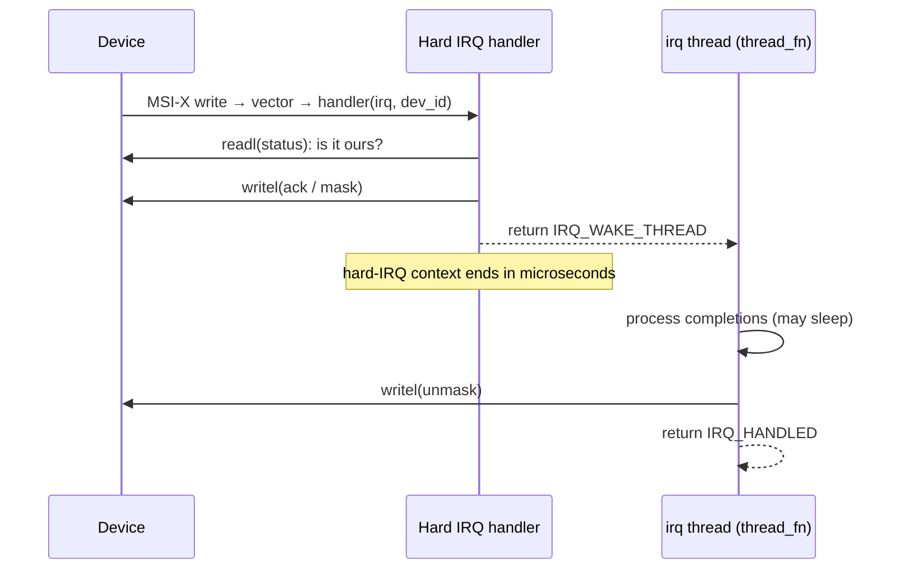

# Interrupts in a Driver

[Folder 10](../10-interrupts-time-and-deferred-work/how-an-interrupt-reaches-the-kernel.md) followed
an interrupt from the device to the kernel's generic handling. A driver sees the other end of that
path. It has three jobs:

- ask for interrupt vectors;
- install a handler that must decide quickly whether the interrupt was its own;
- push everything slow out of that handler, usually into a thread.

Multi-queue devices make this concrete: one vector per queue, each steered to the CPU that will
consume that queue's data. This page applies folder 10's mechanisms to real drivers.

## `request_irq` and its managed, threaded form

The core call is <Src file="kernel/irq/manage.c" symbol="request_threaded_irq" />:

```c
int request_threaded_irq(unsigned int irq, irq_handler_t handler,
			 irq_handler_t thread_fn, unsigned long flags,
			 const char *name, void *dev_id);
```

- **`handler`** runs in hard-interrupt context. It may not sleep and should take microseconds.
- **`thread_fn`**, if given, runs in a dedicated kernel thread (`irq/<n>-<name>`) when the handler
  returns `IRQ_WAKE_THREAD`. It may sleep.
- **`dev_id`** is passed back to both, normally the driver's per-device structure. On a shared line
  it is also how `free_irq()` identifies which handler to remove.

`request_irq()` is the same call with no thread function. In `probe`, the managed forms
`devm_request_irq()` and `devm_request_threaded_irq()` free the interrupt automatically on unbind.
The vector is then freed *after* `remove` returns, a point [Debugging Drivers](./debugging-drivers.md)
returns to.

## The shared-line contract

Legacy INTx lines can be shared by several devices: `IRQF_SHARED` asks for that. When a shared line
fires, the kernel calls **every** handler registered on it, and each one must answer honestly:

- **`IRQ_HANDLED`** — "my device was asserting the line, and I serviced it." The handler finds this
  out by reading its device's interrupt-status register.
- **`IRQ_NONE`** — "not mine."

The kernel counts the answers. If the line keeps firing and nobody handles it, almost 100,000
interrupts with more than 99,900 of them unhandled, then <Src file="kernel/irq/spurious.c"
symbol="note_interrupt" /> logs `irq N: nobody cared` and **disables the line**. A stuck device
cannot then lock up a CPU with an interrupt storm. Each IRQ's running count is visible:

```text
$ cat /proc/irq/35/spurious
count 4700
unhandled 1
last_unhandled 4294730604 ms
```

A handler that always returns `IRQ_HANDLED` defeats that protection, and hides a stuck device behind
a busy CPU.

## MSI and MSI-X vectors

PCIe devices should use message-signalled interrupts. They are never shared, they arrive ordered
after the device's DMA writes, and a device can have many of them (see
[PCIe in Depth](../../computer-science/buses-and-io/pcie-in-depth.md)). The v6.18 API allocates
vectors of whatever type is available and hands back Linux IRQ numbers:

```c
nvec = pci_alloc_irq_vectors(pdev, 1, nr_queues + 1,
			     PCI_IRQ_MSIX | PCI_IRQ_MSI | PCI_IRQ_INTX);
if (nvec < 0)
	return nvec;

for (i = 0; i < nvec; i++) {
	ret = devm_request_irq(&pdev->dev, pci_irq_vector(pdev, i),
			       demo_queue_irq, 0, "demo", &priv->queue[i]);
	if (ret)
		return ret;
}
```

- The **flags** say which types are acceptable. The API tries MSI-X first, then MSI, then the
  legacy line. `PCI_IRQ_INTX` was called `PCI_IRQ_LEGACY` until recently; the old name no longer
  exists in v6.18. `PCI_IRQ_ALL_TYPES` is all three.
- **`min_vecs` and `max_vecs`** let the driver accept fewer vectors than it wanted. It gets back the
  number actually allocated, and must size its queues to match.
- **`pci_irq_vector(pdev, i)`** converts vector index `i` into the Linux IRQ number to pass to
  `request_irq()`. Never assume the numbers are consecutive.
- **`pci_free_irq_vectors()`** releases them, after every IRQ has been freed. With a device enabled
  by `pcim_enable_device()`, that happens automatically.

## Top half and thread

A typical handler does the minimum in hard-interrupt context:

1. read the device's interrupt status; if the device didn't raise it, return `IRQ_NONE`;
2. acknowledge or mask the interrupt in the device, so it stops asserting;
3. return `IRQ_WAKE_THREAD` to run `thread_fn`, or `IRQ_HANDLED` if that was all the work.

The thread then does anything that can sleep: talking to an I²C device, taking a mutex, allocating
memory. For level-triggered lines, **`IRQF_ONESHOT`** keeps the line masked until the thread
finishes; otherwise the still-asserted line would fire again as soon as the hard handler returns.
Requesting a thread-only handler (`handler == NULL`) without `IRQF_ONESHOT` fails with `-EINVAL`,
unless the interrupt chip is marked one-shot-safe. PCI MSI chips are (`IRQCHIP_ONESHOT_SAFE`),
because an edge-triggered message cannot keep re-firing.
[Threaded IRQs](../10-interrupts-time-and-deferred-work/threaded-irqs.md) owns the mechanism,
including how the thread is scheduled.

Network drivers usually use NAPI instead of a thread: the handler disables the queue's interrupt and
schedules polling in softirq context (see [The Receive Path](../13-networking-stack/the-receive-path.md)).



*The split most drivers use: a hard handler that only identifies and silences the interrupt, and a
thread that does the work.*

## Per-queue vectors and affinity

A multi-queue device (an NVMe drive, a multi-queue NIC, virtio-blk with several request queues) gets
one vector per queue. Adding **`PCI_IRQ_AFFINITY`** (through `pci_alloc_irq_vectors_affinity()`)
asks the kernel to spread those vectors across CPUs and to **manage** that spread itself: one queue
per CPU (or group of CPUs), with the vector's affinity fixed so that a queue's completions arrive on
the CPU that submitted to it.

The folder-01 Debian VM (4 vCPUs) shows both kinds side by side:

```text
$ uname -r
6.12.113+deb13-cloud-amd64
$ grep -E 'CPU|virtio' /proc/interrupts
           CPU0       CPU1       CPU2       CPU3
 24:          0          0          0          0  PCI-MSIX-0000:00:05.0   0-edge      virtio2-config
 25:       6895          0          0          0  PCI-MSIX-0000:00:05.0   1-edge      virtio2-req.0
 26:          0       7811          0          0  PCI-MSIX-0000:00:05.0   2-edge      virtio2-req.1
 27:          0          0       8813          0  PCI-MSIX-0000:00:05.0   3-edge      virtio2-req.2
 28:          0          0          0      10288  PCI-MSIX-0000:00:05.0   4-edge      virtio2-req.3
 …
 34:          0          0          0          0  PCI-MSIX-0000:00:03.0   0-edge      virtio0-config
 35:          0       4665          0          0  PCI-MSIX-0000:00:03.0   1-edge      virtio0-input.0
 36:          0          0       5960          0  PCI-MSIX-0000:00:03.0   2-edge      virtio0-output.0
$ for i in 25 26 27 28 35 36; do echo "$i: $(cat /proc/irq/$i/smp_affinity_list)"; done
25: 0
26: 1
27: 2
28: 3
35: 0-3
36: 0-3
$ echo 0 | sudo tee /proc/irq/25/smp_affinity_list
tee: /proc/irq/25/smp_affinity_list: Operation not permitted
```

| Column or file | What it shows here |
|---|---|
| IRQ number (24, 25, …) | Linux IRQ numbers, as returned by `pci_irq_vector()` |
| Per-CPU counts | `virtio2-req.N` fires only on CPU N, one request queue per CPU |
| `PCI-MSIX-0000:00:05.0` | The interrupt domain (MSI-X) and the device's BDF |
| `1-edge` | Vector index 1 of that device; MSIs are edge-triggered |
| `virtio2-req.0` | The `name` passed to `request_irq()` |
| `smp_affinity_list` 0, 1, 2, 3 and `EPERM` on write | virtio-blk asked for **managed** affinity. The kernel pinned each queue's vector and refuses to let user space (or `irqbalance`) move it |
| `smp_affinity_list` `0-3` for virtio-net | virtio-net's vectors are not managed; any CPU is allowed, and `irqbalance` may move them |

[Interrupt Affinity and Balancing](../10-interrupts-time-and-deferred-work/interrupt-affinity-and-balancing.md)
owns the affinity mechanism. What this page adds is that a driver chooses managed or unmanaged
affinity when it allocates vectors.

## Masking, `disable_irq`, and teardown order

- **`disable_irq(irq)`** masks the line and then **waits** for any running handler to finish (it
  calls `synchronize_irq()`). Calling it from that IRQ's own handler waits for itself: a deadlock.
  **`disable_irq_nosync()`** masks without waiting, and is the form to use inside a handler.
- **`synchronize_irq(irq)`** waits for running handlers without masking. It is useful after telling
  the device to stop generating interrupts, before freeing what the handler uses.

Teardown order is the mirror of probe:

1. tell the device to stop raising interrupts;
2. `free_irq()` (which also synchronises);
3. free the memory the handler touched;
4. `pci_free_irq_vectors()`.

Freeing memory before the IRQ is the bug: a late interrupt runs the handler on freed memory.

## Misconceptions

1. **"Returning `IRQ_HANDLED` always is harmless."** On a shared line it hides another device's
   storm, and it defeats the spurious-interrupt detector that would otherwise disable a stuck line.
   Return `IRQ_NONE` when the status register says the interrupt wasn't yours.
2. **"`disable_irq()` from inside the handler is fine."** It waits for the handler to complete, and
   the handler is the caller. Use `disable_irq_nosync()` there.

<KernelFacts
  structure={[["irqreturn_t", "include/linux/irqreturn.h"], ["pci_alloc_irq_vectors", "include/linux/pci.h"]]}
  path="pci_alloc_irq_vectors() → pci_alloc_irq_vectors_affinity() → __pci_enable_msix_range() → MSI-X table programmed → request_threaded_irq(pci_irq_vector(pdev, i), …)"
  observe="grep -E 'CPU|virtio|nvme' /proc/interrupts; cat /proc/irq/*/smp_affinity_list"
  trap="On a shared line, a handler that claims every interrupt hides a stuck device. One that claims none gets the line disabled with 'nobody cared', taking every other device on that line down with it." />

## References

- [The MSI Driver Guide HOWTO](https://docs.kernel.org/PCI/msi-howto.html) — `pci_alloc_irq_vectors()`,
  its flags, and how to use `pci_irq_vector()`. Checked against the v6.18 documentation via
  context7 on 2026-10-26.
- [Linux generic IRQ handling](https://docs.kernel.org/core-api/genericirq.html) — the IRQ core
  that `request_threaded_irq()` registers with: flow handlers, chips and descriptors.
- <Src file="kernel/irq/manage.c" symbol="request_threaded_irq" /> — the flag checks (for example,
  the `IRQF_ONESHOT` rule for thread-only handlers, in `__setup_irq`) and handler installation.
- <Src file="kernel/irq/spurious.c" symbol="note_interrupt" /> — the unhandled-interrupt counting
  behind "nobody cared".
