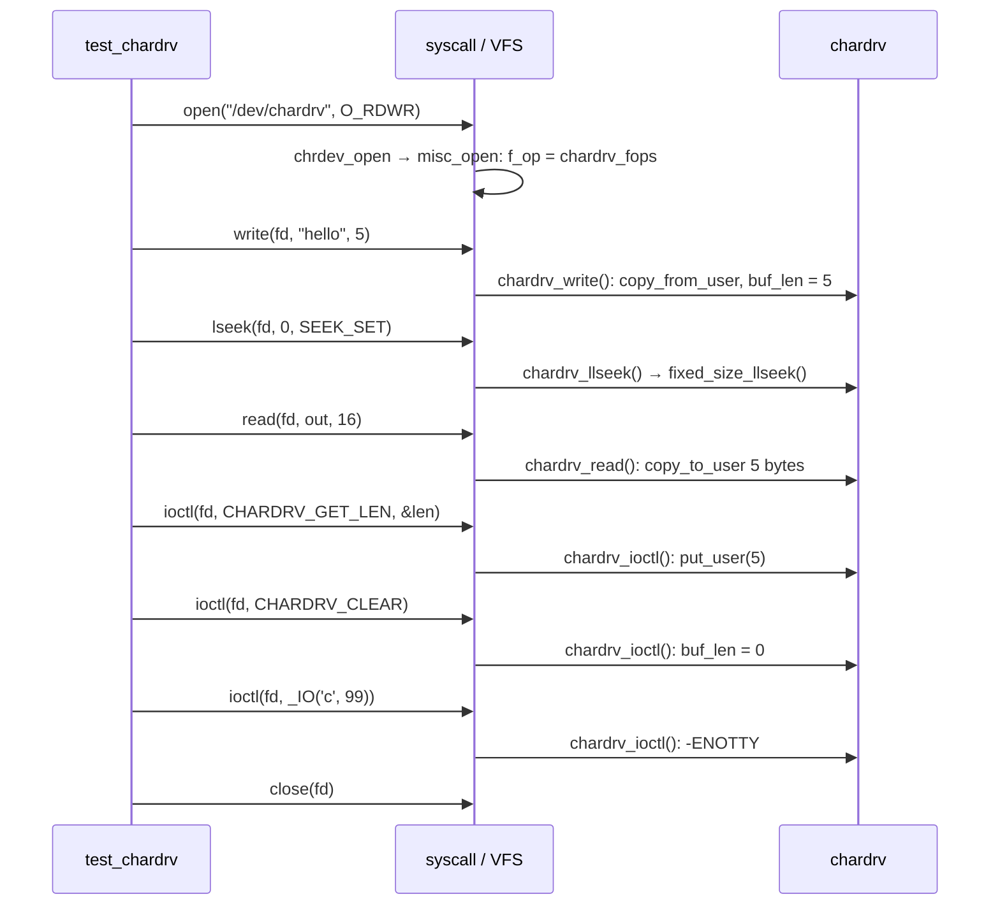

# Lab: Write a Character Driver

This lab builds a complete and correct driver that does nothing useful: a 4 KiB scratch buffer
behind `/dev/chardrv`, with `read`, `write`, `lseek`, and two `ioctl`s. It is small enough to read
in one sitting, and complete enough to touch every boundary the earlier folders described:

- `copy_to_user`/`copy_from_user` across the user/kernel line;
- a mutex around shared state;
- `file_operations` reached through a device node;
- the misc-device registration from [Character Devices](./character-devices.md);
- module load and unload.

Everything below was built against the folder-01 v6.18 kernel tree and run in the folder-01 QEMU
initramfs. The transcripts are that run's real output.

## What you will build

| File | Role |
|---|---|
| [`chardrv.h`](pathname:///code/linux/chardrv/chardrv.h) | The ioctl numbers, shared by the module and the test program |
| [`chardrv.c`](pathname:///code/linux/chardrv/chardrv.c) | The module: about a hundred lines |
| [`test_chardrv.c`](pathname:///code/linux/chardrv/test_chardrv.c) | A user-space program that exercises every operation and prints `PASS` or the first failure |
| [`Makefile`](pathname:///code/linux/chardrv/Makefile) | Builds the module against the lab kernel tree, and the test program statically |

The module's behaviour:

- `write()` copies into the buffer at the file position, up to the 4 KiB limit; a write starting at
  the end returns `-ENOSPC`;
- `read()` copies out from the file position up to the amount written so far, and returns 0 at the
  end;
- `lseek()` moves within the 4 KiB buffer;
- `ioctl(CHARDRV_CLEAR)` empties the buffer, and `ioctl(CHARDRV_GET_LEN)` returns how much it holds;
- any other `ioctl` returns `-ENOTTY`.

## The code

The shared header defines the two ioctl commands:

```c
/* SPDX-License-Identifier: GPL-2.0 */
/* ioctl interface shared by chardrv.ko and its user-space test program. */
#ifndef CHARDRV_H
#define CHARDRV_H

#include <linux/ioctl.h>
#include <linux/types.h>

#define CHARDRV_BUF_SIZE 4096

#define CHARDRV_CLEAR   _IO('c', 1)
#define CHARDRV_GET_LEN _IOR('c', 2, __u32)

#endif
```

The module itself:

```c
// SPDX-License-Identifier: GPL-2.0
/*
 * chardrv: a 4 KiB scratch buffer behind /dev/chardrv.
 * read/write/llseek on the buffer, plus two ioctls: clear it, and get its length.
 */
#include <linux/fs.h>
#include <linux/miscdevice.h>
#include <linux/module.h>
#include <linux/mutex.h>
#include <linux/uaccess.h>

#include "chardrv.h"

static char buf[CHARDRV_BUF_SIZE];
static size_t buf_len;		/* bytes of buf currently holding data */
static DEFINE_MUTEX(buf_lock);	/* protects buf and buf_len */

static ssize_t chardrv_read(struct file *file, char __user *ubuf,
			    size_t count, loff_t *ppos)
{
	ssize_t ret;

	mutex_lock(&buf_lock);
	if (*ppos >= buf_len) {
		ret = 0;			/* end of data */
		goto out;
	}
	count = min_t(size_t, count, buf_len - *ppos);
	if (copy_to_user(ubuf, buf + *ppos, count)) {
		ret = -EFAULT;
		goto out;
	}
	*ppos += count;
	ret = count;
	pr_debug("read %zu bytes, pos now %lld\n", count, *ppos);
out:
	mutex_unlock(&buf_lock);
	return ret;
}

static ssize_t chardrv_write(struct file *file, const char __user *ubuf,
			     size_t count, loff_t *ppos)
{
	ssize_t ret;

	mutex_lock(&buf_lock);
	if (*ppos >= CHARDRV_BUF_SIZE) {
		ret = -ENOSPC;			/* buffer full */
		goto out;
	}
	count = min_t(size_t, count, CHARDRV_BUF_SIZE - *ppos);
	if (copy_from_user(buf + *ppos, ubuf, count)) {
		ret = -EFAULT;
		goto out;
	}
	*ppos += count;
	buf_len = max_t(size_t, buf_len, *ppos);
	ret = count;
	pr_debug("wrote %zu bytes, length now %zu\n", count, buf_len);
out:
	mutex_unlock(&buf_lock);
	return ret;
}

static long chardrv_ioctl(struct file *file, unsigned int cmd, unsigned long arg)
{
	u32 len;

	switch (cmd) {
	case CHARDRV_CLEAR:
		mutex_lock(&buf_lock);
		buf_len = 0;
		mutex_unlock(&buf_lock);
		return 0;
	case CHARDRV_GET_LEN:
		mutex_lock(&buf_lock);
		len = buf_len;
		mutex_unlock(&buf_lock);
		return put_user(len, (u32 __user *)arg);
	default:
		return -ENOTTY;			/* "not supported", by convention */
	}
}

static loff_t chardrv_llseek(struct file *file, loff_t offset, int whence)
{
	return fixed_size_llseek(file, offset, whence, CHARDRV_BUF_SIZE);
}

static const struct file_operations chardrv_fops = {
	.owner		= THIS_MODULE,
	.read		= chardrv_read,
	.write		= chardrv_write,
	.unlocked_ioctl	= chardrv_ioctl,
	.llseek		= chardrv_llseek,
};

static struct miscdevice chardrv_dev = {
	.minor	= MISC_DYNAMIC_MINOR,
	.name	= "chardrv",
	.fops	= &chardrv_fops,
	.mode	= 0666,
};

/* Generates module init/exit that call misc_register()/misc_deregister(). */
module_misc_device(chardrv_dev);

MODULE_LICENSE("GPL");
MODULE_DESCRIPTION("A 4 KiB scratch buffer behind /dev/chardrv");
```

What each part does, in order:

1. **State.** One buffer, a length, and `DEFINE_MUTEX(buf_lock)` protecting both. The mutex, not a
   spinlock, because `copy_to_user()` can fault and sleep while the lock is held (see
   [Choosing a Lock](../09-concurrency-and-locking/choosing-a-lock.md)).
2. **`chardrv_read()`** clamps the request to the data available past `*ppos`, copies it out, and
   advances `*ppos`. It returns 0 (end of file) once the position reaches the length.
   `copy_to_user()` returns the number of bytes it *could not* copy, so any non-zero result becomes
   `-EFAULT` (see [Copying Data Across the Boundary](../05-syscalls-and-the-boundary/copying-data-across-the-boundary.md)).
3. **`chardrv_write()`** is the mirror image, clamping to the buffer size and extending `buf_len`.
4. **`chardrv_ioctl()`** switches on the command number. `put_user()` copies one scalar to user
   space with the same fault handling as `copy_to_user()`. Unknown commands get `-ENOTTY`, the
   documented "this device doesn't support that request" error.
5. **`chardrv_llseek()`** delegates to `fixed_size_llseek()`, which handles `SEEK_SET`/`SEEK_CUR`/
   `SEEK_END` against a fixed size and rejects positions outside it.
6. **`chardrv_fops`** wires the functions up; `.owner = THIS_MODULE` keeps the module loaded while
   any file is open.
7. **`chardrv_dev`** is the misc device: dynamic minor, name `chardrv`, mode `0666` so the test can
   run without root.
8. **`module_misc_device()`** generates the module's init and exit functions, which only call
   `misc_register()` and `misc_deregister()`.

The `pr_debug()` calls compile to nothing unless dynamic debug turns them on.
[Debugging Drivers](./debugging-drivers.md) uses them.

The ioctl numbers are not arbitrary. `_IOR('c', 2, __u32)` packs four fields into 32 bits, and
`CHARDRV_GET_LEN` comes out as `0x80046302`:

```wavedrom title="CHARDRV_GET_LEN = _IOR('c', 2, __u32) = 0x80046302: the four fields of an ioctl number" alt="Bit-field strip of a 32-bit ioctl number: nr (bits 0-7) = 2, type (bits 8-15) = 0x63 'c', size (bits 16-29) = 4, direction (bits 30-31) = read"
{ reg: [
    { bits: 8, name: "nr = 2", type: 2 },
    { bits: 8, name: "type = 0x63 ('c')", type: 3 },
    { bits: 14, name: "size = 4 (sizeof(__u32))", type: 4 },
    { bits: 2, name: "dir = 2 (read)", type: 5 }
  ],
  config: { hspace: 900, bits: 32, lanes: 1 }
}
```

Encoding the size and direction into the number means a tool like `strace` can decode the call,
and the kernel's compatibility layer can tell how much data a command moves. Driver authors pick
the **type** (one byte, conventionally a character) and the **nr**. `CHARDRV_CLEAR` is `_IO('c', 1)`
= `0x00006301`: no data, so size and direction are zero.

The user-space test:

```c
// SPDX-License-Identifier: GPL-2.0
/* Exercise /dev/chardrv: write, seek, read back, and both ioctls. */
#include <errno.h>
#include <fcntl.h>
#include <stdio.h>
#include <string.h>
#include <sys/ioctl.h>
#include <unistd.h>

#include "chardrv.h"

#define CHECK(cond, what) \
	do { if (!(cond)) { printf("FAIL: %s (errno %d: %s)\n", what, errno, strerror(errno)); return 1; } } while (0)

int main(void)
{
	char out[16] = { 0 };
	__u32 len;
	int fd = open("/dev/chardrv", O_RDWR);

	CHECK(fd >= 0, "open /dev/chardrv");
	CHECK(write(fd, "hello", 5) == 5, "write 5 bytes");
	CHECK(lseek(fd, 0, SEEK_SET) == 0, "seek to 0");
	CHECK(read(fd, out, sizeof(out)) == 5, "read back 5 bytes");
	CHECK(memcmp(out, "hello", 5) == 0, "data matches");
	CHECK(ioctl(fd, CHARDRV_GET_LEN, &len) == 0 && len == 5, "GET_LEN == 5");
	CHECK(ioctl(fd, CHARDRV_CLEAR) == 0, "CLEAR");
	CHECK(ioctl(fd, CHARDRV_GET_LEN, &len) == 0 && len == 0, "GET_LEN == 0 after CLEAR");
	CHECK(ioctl(fd, _IO('c', 99)) == -1 && errno == ENOTTY, "unknown ioctl -> ENOTTY");
	close(fd);
	printf("PASS\n");
	return 0;
}
```

## Building against your kernel

The `Makefile` uses the standard out-of-tree pattern from
[Kernel Modules](../04-kernel-architecture-and-idioms/modules-in-practice.md), pointed at the
folder-01 build tree:

```text
obj-m += chardrv.o

KDIR ?= $(HOME)/kernel-lab/linux

all:
	$(MAKE) -C $(KDIR) M=$(CURDIR) modules

test_chardrv: test_chardrv.c chardrv.h
	$(CC) -static -Wall -o $@ test_chardrv.c

clean:
	$(MAKE) -C $(KDIR) M=$(CURDIR) clean
	rm -f test_chardrv
```

```bash
cd chardrv
make                      # chardrv.ko, built against ~/kernel-lab/linux
make test_chardrv         # static binary, so it runs in the BusyBox initramfs
```

The build produced no warnings. Running the `sparse` static checker with `make C=2` also reported
nothing. Sparse 0.6.4, the last tagged release, is too old for v6.18 headers and floods the output
with spurious "unreplaced symbol" warnings, so this used a build from sparse's git tree, passed as
`make C=2 CHECK=/path/to/sparse`.

## Loading and exercising it

<Lab host="qemu" title="Load chardrv in the initramfs VM, exercise it, trace it, unload it" time="20 min">

Copy `chardrv.ko` and `test_chardrv` into the root of the folder-01 initramfs tree, repack it as
[A Minimal Root Filesystem](../01-lab-and-toolchain/a-minimal-rootfs.md) describes, and boot it
with the canonical invocation from
[Booting Your Kernel in QEMU](../01-lab-and-toolchain/booting-your-kernel-in-qemu.md). At the
shell:

```bash
insmod /chardrv.ko
ls -l /dev/chardrv
cat /sys/class/misc/chardrv/dev
/test_chardrv
```

Measured (the colour codes BusyBox's `ls` emits are stripped):

```text
+ uname -r
6.18.0
+ insmod /chardrv.ko
[    3.955630] chardrv: loading out-of-tree module taints kernel.
+ ls -l /dev/chardrv
crw-rw-rw-    1 0        0          10, 258 Oct 26 21:43 /dev/chardrv
+ cat /sys/class/misc/chardrv/dev
10:258
+ /test_chardrv
PASS
```

- **"loading out-of-tree module taints kernel"** is expected. The kernel records (taint flag `O`)
  that code not built with the kernel is loaded, so bug reports can say so.
- **`c` and `10, 258`**: a character device, major 10 (misc), and a dynamic minor allocated above
  255.
- **`crw-rw-rw-`** comes from `.mode = 0666`. devtmpfs created the node with no udev involved.
- **`PASS`** means all nine checks in `test_chardrv` succeeded, including `ENOTTY` for an unknown
  ioctl.

If it fails: `insmod: can't insert 'chardrv.ko': invalid module format` means the module was built
against a different kernel than the one booted. Rebuild with `KDIR` pointing at the tree that
produced the `bzImage` you booted. A missing `/dev/chardrv` means devtmpfs isn't mounted on `/dev`;
the folder-01 `/init` mounts it.

</Lab>

## Watching it with ftrace

The function tracer can be limited to one module with the `:mod:` filter, and `function_graph`
shows each call with its duration. In the same session:

```bash
mount -t tracefs none /sys/kernel/tracing
cd /sys/kernel/tracing
echo ':mod:chardrv' > set_ftrace_filter
echo function_graph > current_tracer
echo 1 > tracing_on
printf abc > /dev/chardrv
cat /dev/chardrv > /dev/null
echo 0 > tracing_on
cat trace
```

Measured:

```text
# tracer: function_graph
#
# CPU  DURATION                  FUNCTION CALLS
# |     |   |                     |   |   |   |
 0) # 1126.501 us |  chardrv_ioctl [chardrv]();
 0) + 34.187 us   |  chardrv_write [chardrv]();
 1) + 36.544 us   |  chardrv_read [chardrv]();
 1) + 10.980 us   |  chardrv_read [chardrv]();
```

- **The first line is an `ioctl` nobody in the script asked for.** A kprobe on `chardrv_ioctl`
  that records its `cmd` argument (`echo 'p:chio chardrv_ioctl cmd=%si:x32' > kprobe_events`)
  shows it comes from the shell itself, running the `printf` builtin, with
  `cmd=0x802c542a`. That is `TCGETS2`, `_IOR('T', 0x2A, struct termios2)`: the C library asking
  whether the new output descriptor is a terminal. The driver's `-ENOTTY` is exactly the answer
  that query expects, so output proceeds normally. The `#` marks a duration over 1 ms, inflated here
  because the VM runs without KVM acceleration.
- `cat` calls `read` twice: once to get the three bytes, once to get the 0 that means end of file.
- The two reads ran on CPU 1 and the write on CPU 0. The scheduler placed the two processes
  differently, and nothing in the driver cares.

Folder 01's [Debugging the Kernel with GDB](../01-lab-and-toolchain/debugging-the-kernel-with-gdb.md)
is the other route into the same functions: stop in `chardrv_write` with a breakpoint instead of
tracing it.

## Unloading cleanly

```bash
echo nop > /sys/kernel/tracing/current_tracer
cd /
rmmod chardrv
ls -l /dev/chardrv
```

Measured:

```text
+ rmmod chardrv
+ ls -l /dev/chardrv
ls: /dev/chardrv: No such file or directory
```

`rmmod` runs the exit function generated by `module_misc_device()`, which calls
`misc_deregister()`. That removes the class device, so devtmpfs removes the node. No warnings
appeared in `dmesg`. A module that leaked a lock, a timer or a still-registered device would show
it here.



*Every call `test_chardrv` makes, and the driver function each one reaches.*

## Things to try

- **Add `poll`.** Report `EPOLLIN` when `buf_len > 0`, and wake a wait queue in `write`, so a reader
  can block until data arrives.
- **Expose the length as a sysfs attribute** instead of an ioctl, and compare the two interfaces
  ([Talking to User Space](./talking-to-user-space.md) discusses the choice).
- **Break it on purpose.** [Debugging Drivers](./debugging-drivers.md) removes one `mutex_unlock()`
  from this module and lets lockdep find it.

<KernelFacts
  structure={[["struct file_operations", "include/linux/fs.h"], ["_IOR", "include/uapi/asm-generic/ioctl.h"]]}
  path="ioctl(fd, CHARDRV_GET_LEN, &n) → __x64_sys_ioctl() → do_vfs_ioctl() → vfs_ioctl() → filp->f_op->unlocked_ioctl() → chardrv_ioctl()"
  observe="ls -l /dev/chardrv && cat /sys/class/misc/chardrv/dev"
  trap="Returning `-EINVAL` for an unknown ioctl breaks callers that probe with ioctls and expect `ENOTTY`, the documented 'not supported by this device' answer. Shells do exactly that probe when they open a file." />

## References

- [Building External Modules](https://docs.kernel.org/kbuild/modules.html) — the `obj-m` and `M=`
  mechanics behind the `Makefile`.
- [ioctl based interfaces](https://docs.kernel.org/driver-api/ioctl.html) — how to number commands,
  why `-ENOTTY`, and the 32-bit compatibility rules.
- <Src file="include/uapi/asm-generic/ioctl.h" /> — the `_IO`/`_IOR`/`_IOW` encoding, with the field
  widths used in the diagram above.
- [Function tracer](https://docs.kernel.org/trace/ftrace.html) — `set_ftrace_filter`, the `:mod:`
  command, and `function_graph`.
