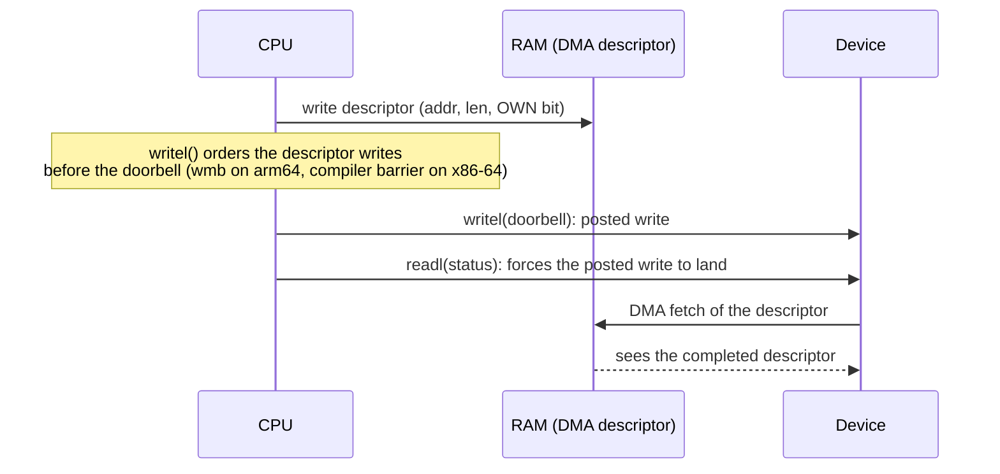

# MMIO, `ioremap`, and Accessors

Device registers sit at physical addresses, and the CPU reaches them with ordinary loads and
stores. That is exactly what makes the classic mistake easy: a plain pointer dereference compiles,
works on the author's machine, and is still wrong. Three things can break it:

- the compiler may merge, reorder or drop the access;
- the CPU may reorder it against the driver's writes to normal memory, such as a DMA descriptor
  the device is about to fetch;
- the mapping may be cacheable, so the write lands in a cache line and never reaches the device.

`ioremap` and the `readl`/`writel` family exist to make each of those guarantees explicit. This
page covers what each one promises, on x86-64 and on arm64, where the answers differ.

## `ioremap` and why the mapping is special

A BAR or a device-tree `reg` gives a **physical** address. Kernel code runs on virtual addresses,
so the range must first be mapped. `ioremap()` creates a kernel virtual mapping of the range with a
**device-appropriate memory type**:

- **On x86-64**, <Src file="arch/x86/mm/ioremap.c" symbol="ioremap" /> maps with the cache mode
  `_PAGE_CACHE_MODE_UC_MINUS`: uncached, but a weaker form that an MTRR setting can override to
  write-combining. Every access goes to the device, in program order.
- **On arm64**, it uses the *Device-nGnRE* memory type: non-gathering (no merging of accesses),
  non-reordering, with early write acknowledgement allowed.

Variants trade those guarantees for speed where the device allows it. The common one is
**`ioremap_wc()`**, which maps a range *write-combining*: writes may be buffered and merged into
larger bursts. That is right for a framebuffer, and wrong for a register whose writes have side
effects.

In a driver, the mapping is almost always obtained through a managed helper, which also checks
that the range was claimed first:

- `devm_platform_ioremap_resource(pdev, 0)` for platform devices;
- `pcim_iomap_region(pdev, bar, name)` or `pci_iomap(pdev, bar, 0)` for PCI.

## `__iomem` and sparse

`ioremap` returns `void __iomem *`. The `__iomem` annotation puts the pointer in a separate
**address space** as far as the static checker **sparse** is concerned. Normal C ignores it, but
running the build as `make C=1` (or `C=2` to check every file) makes sparse report:

- dereferencing an `__iomem` pointer directly (`*reg = 1`);
- passing an `__iomem` pointer where a normal pointer is expected, or the reverse;
- passing a normal pointer to `readl`/`writel`.

The rule it enforces is simple: an `__iomem` pointer may only be passed to accessor functions,
never dereferenced. Sparse is a separate package (`sparse` on Debian); without it, `make C=1` runs
the check step and silently checks nothing.

## `readl`/`writel` and their guarantees

The accessors are named by width: `readb`/`readw`/`readl`/`readq` for 8/16/32/64 bits, and the same
for `write`. Their guarantees, from the kernel's
[device I/O documentation](https://docs.kernel.org/driver-api/device-io.html):

- **Little-endian.** The value is converted between CPU byte order and little-endian, because PCI
  is little-endian. On a big-endian CPU this is a byte swap. Big-endian devices use
  `ioread32be()`/`iowrite32be()`.
- **Single, untorn access** of exactly the stated width: the compiler may not split, merge or omit
  it.
- **Ordered with each other.** Two `writel()`s to the same device arrive in program order.
- **Ordered after earlier normal-memory writes.** A `writel()` is not issued until the CPU's earlier
  writes to normal memory are visible to the device. This is the guarantee DMA depends on: fill a
  descriptor in RAM, then `writel()` the doorbell, and the device is guaranteed to see the filled
  descriptor when it fetches it.
- **`readl()` completes before later normal-memory reads.** A driver can read a status register
  that says "DMA done" and then read the buffer, without stale data.

## Relaxed accessors and explicit barriers

`readl_relaxed()`/`writel_relaxed()` keep the first three guarantees (byte order, untorn, ordered
with other accesses to the *same device*) and drop the last two (ordering against normal memory).
They are cheaper where that ordering costs something, and they are correct when no DMA buffer is
involved: for example, a sequence of configuration writes to registers that are not tied to a
descriptor ring.

When a driver uses relaxed accessors around DMA, it supplies the ordering itself:

- **`dma_wmb()`** orders writes to coherent DMA memory (descriptors) against each other, so the
  device sees a descriptor's contents before its "owned by device" bit.
- **`wmb()`** orders normal-memory writes against MMIO writes. It is the heavier barrier that a
  plain `writel()` effectively includes.

[Memory Ordering and Barriers](../09-concurrency-and-locking/memory-ordering-and-barriers.md) owns
the barrier semantics; the device-specific rules are in `Documentation/memory-barriers.txt` under
"Kernel I/O barrier effects".

## Posted writes and the read-back

A PCI memory write is **posted**: the CPU hands it to the interconnect and moves on without waiting
for the device to receive it. `writel()` returning means the write was *issued*, not that it
arrived. Usually that is fine. It matters when the driver needs the write to have *taken effect*
before something else happens: before a `udelay()` the hardware requires, before disabling the
device, or before releasing a lock that another CPU will take to talk to the same device.

The standard fix is to **read back** any register from the same device. PCI ordering rules forbid a
read from passing an earlier posted write on the same path, so when the read returns, the write has
landed:

```c
writel(CTRL_RESET, priv->regs + REG_CTRL);
readl(priv->regs + REG_CTRL);		/* flush the posted write */
udelay(10);				/* the reset pulse now really lasts 10 µs */
```

Port I/O (next section) is non-posted by definition, which is one reason legacy hardware used it
for timing-sensitive control.

## Port I/O, an x86 legacy

x86 has a second, separate address space for devices: 64 KiB of **I/O ports**, reached with the
`IN` and `OUT` instructions rather than loads and stores. The kernel's port accessors are
`inb`/`inw`/`inl` and `outb`/`outw`/`outl`, and PCI BARs can be I/O BARs (the virtio device in
[PCI and PCIe Drivers](./pci-and-pcie-drivers.md) has one, at `c100`).

New hardware rarely uses ports. A driver that must support a device whose registers may be in
either space uses the `ioread32()`/`iowrite32()` family on a cookie from `pci_iomap()` or
`ioport_map()`. Those accessors check at run time which kind of address they were given, so the
same code works with both.

:::note[arm64]
arm64 has no I/O-port instructions and no separate I/O address space. To support PCI devices with
I/O BARs, the kernel reserves a 16 MiB virtual window (`PCI_IOBASE`), and the PCI host controller
translates accesses in that window into I/O transactions on the bus. `inb()` becomes an ordinary
load from `PCI_IOBASE + port`. Described devices simply use MMIO, which is why QEMU's arm64 machine
places its `fw_cfg` device at an MMIO address, while the x86-64 machine uses ports (see
[Platform Devices, Device Tree, and ACPI](./platform-devices-and-description.md)).

The accessors differ in ordering cost too. On arm64, `writel()` expands to `__io_bw()`, which is
`dma_wmb()` (a `dmb oshst` barrier), then the store. `writel_relaxed()` is the store alone. On
arm64 the relaxed accessors therefore remove a real barrier instruction, and code that is correct
with `writel()` can break with `writel_relaxed()`.
:::

## What actually happens

On x86-64, the difference between `writel` and `writel_relaxed` is invisible in the instruction
stream. This module defines one wrapper around each, built against the folder-01 v6.18 lab kernel
tree:

```c
noinline void demo_writel(u32 v, void __iomem *reg)
{
	writel(v, reg);
}

noinline void demo_writel_relaxed(u32 v, void __iomem *reg)
{
	writel_relaxed(v, reg);
}
```

Disassembled with `objdump -dr -M intel` (relocations shown, raw bytes hidden):

```nasm
0000000000000010 <demo_writel>:
  10:	endbr64
  14:	call   19 <demo_writel+0x9>
			15: R_X86_64_PLT32	__fentry__-0x4
  19:	mov    DWORD PTR [rsi],edi
  1b:	jmp    20 <__pfx_demo_writel_relaxed>
			1c: R_X86_64_PLT32	__x86_return_thunk-0x4

0000000000000030 <demo_writel_relaxed>:
  30:	endbr64
  34:	call   39 <demo_writel_relaxed+0x9>
			35: R_X86_64_PLT32	__fentry__-0x4
  39:	mov    DWORD PTR [rsi],edi
  3b:	jmp    40 <demo_writel_relaxed+0x10>
			3c: R_X86_64_PLT32	__x86_return_thunk-0x4
```

Both functions are the same four instructions. `endbr64` is the CET landing pad, the `call` to
`__fentry__` is the ftrace hook, and the `jmp` to `__x86_return_thunk` is the Retbleed-mitigated
return. Each actual store is one `mov DWORD PTR [rsi],edi`. x86-64's memory model (TSO, see
[Memory Ordering and Consistency](../../computer-science/cpu-architecture/memory-ordering-and-consistency.md))
already keeps stores in order, and the uncached mapping makes the store go straight to the device.
The CPU needs no barrier instruction for either.

The difference on x86-64 is in the compiler, not the CPU. In
<Src file="arch/x86/include/asm/io.h" symbol="build_mmio_write" />, `writel` is generated with a
`"memory"` clobber and `__writel` (which `writel_relaxed` maps to) without one. The clobber is a
compiler barrier: it stops the compiler moving normal memory accesses across the `writel`. With the
relaxed form, the compiler may legally sink a descriptor store *below* the doorbell write, and
nothing in this tiny test shows that.

On arm64 the two compile to different code: `writel` gets the `dmb oshst` described in the note
above, from <Src file="arch/arm64/include/asm/io.h" symbol="__io_bw" />. Code that "works with
relaxed accessors" on an x86-64 test machine has only been tested against the compiler, not
against a weakly ordered CPU.



*Why `writel`'s ordering guarantee exists: the device must see the finished descriptor in RAM
before it acts on the doorbell, and a read-back is the only way to know the doorbell arrived.*

| Accessor | Ordered vs. same device | Ordered vs. normal memory | Byte order | Typical use |
|---|---|---|---|---|
| `readl` / `writel` | Yes | Yes | Little-endian | Default; any register touched around DMA |
| `readl_relaxed` / `writel_relaxed` | Yes | No | Little-endian | Hot paths with no DMA dependency, plus explicit barriers |
| `ioread32` / `iowrite32` | Yes | Yes | Little-endian | Code that must handle MMIO *or* port BARs |
| `ioread32be` / `iowrite32be` | Yes | Yes | Big-endian | Big-endian devices |
| `inl` / `outl` | Yes | Yes | Little-endian | x86 I/O ports (emulated through `PCI_IOBASE` on arm64) |
| `__raw_readl` / `__raw_writel` | No guarantee | No | CPU native | Almost never in drivers |

## Misconceptions

1. **"`volatile` is enough."** `volatile` stops the compiler eliding or reordering the volatile
   accesses themselves. It does nothing about CPU reordering against normal memory, byte order, or
   tearing on every architecture, and it does not satisfy sparse. The accessors are the interface.
2. **"`writel` returning means the device saw it."** PCI writes are posted. Only a read from the
   same device, or a non-posted access, guarantees the write has arrived.
3. **"Relaxed accessors are a micro-optimisation with no correctness impact."** They remove the
   ordering against normal memory that DMA depends on. On arm64 that is a missing barrier
   instruction; on x86-64 it is a missing compiler barrier. Either can produce a device that reads
   a half-written descriptor.

<KernelFacts
  structure={[["readl/writel (generic)", "include/asm-generic/io.h"], ["ioremap (x86-64)", "arch/x86/mm/ioremap.c"]]}
  path="devm_platform_ioremap_resource() / pci_iomap() → ioremap() → __ioremap_caller(…, _PAGE_CACHE_MODE_UC_MINUS) → __iomem pointer → writel(): barrier (arch-specific) → store"
  observe="sudo cat /proc/iomem | head -40; sudo cat /proc/ioports | head"
  trap="Code that dereferences an `__iomem` pointer directly can pass every test on x86-64 and fail on arm64. `make C=1` with sparse installed reports it before a user does." />

## References

- [Bus-Independent Device Accesses](https://docs.kernel.org/driver-api/device-io.html) — the
  authoritative statement of what each accessor guarantees, including posted writes, relaxed
  accessors and port I/O.
- [Linux kernel memory barriers](https://docs.kernel.org/core-api/wrappers/memory-barriers.html),
  section "Kernel I/O barrier effects" — how `wmb`, `dma_wmb` and the accessors interact.
- <Src file="arch/arm64/include/asm/io.h" symbol="__io_bw" /> and
  <Src file="arch/x86/include/asm/io.h" symbol="build_mmio_write" /> — the same accessor
  implemented with a barrier instruction on one architecture and a compiler barrier on the other.
- [Sparse](https://docs.kernel.org/dev-tools/sparse.html) — the static checker behind `__iomem`,
  and how to run it.
